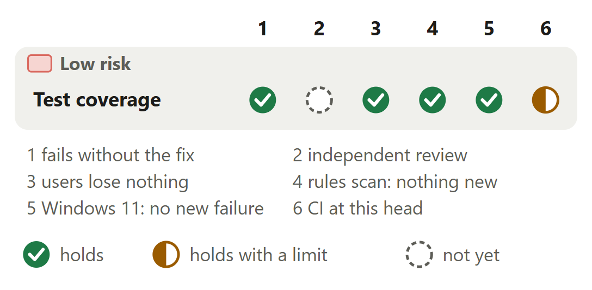

# Follow-up of #967: PowerShell scripts run for real, stand-in shown, wider matcher

For [pull request #1006](https://github.com/neralabs/rerail/pull/1006), head 1867dde06. [report.html](report.html) is the same report as one page: download it and open it.

## 1. The decision

**May these test cases run the ACL read and the Credential Manager script in real PowerShell, prove the stand-in, and read lowercase names and aliases?**

**We recommend:** approve it: each new case fails on Windows 11 when what it names breaks, and only test files change.

| Size | Risk and review | Waits on | Not verified |
|---|---|---|---|
| 143 lines in 5 files: 0 ship, 143 are the tests it changes, 0 are other tests and text | Fast. Test files only, no product code. | Nothing. No CI run on GitHub yet: not pushed. | 3 |

## 2. Intent, and the gap

| Change | Intended | Found | Now |
|---|---|---|---|
| Scripts checked as text | Each cmdlet names its module _(a test's name)_ | A wrong module passes every test _(the approval of #967)_ | Closes the gap. |
| Stand-in not shown | The setting refuses a name alone _(code comment)_ | Not shown by any case _(the approval of #967)_ | Closes the gap. |
| Capitals only | Every cmdlet named alone _(code comment)_ | Lowercase and aliases missed _(the approval of #967)_ | Closes the gap. |

Asked on 23 November 2026 in the approval of #967, as one follow-up of three items.

Sources at main, and causes

| Change | Where main states the intent | The cause, and what was measured |
|---|---|---|
| Scripts checked as text | `test/activation/device-keystore.test.ts` and `test/engine/storage/windows-acl.test.ts` at 559084b0c: each case stands in for PowerShell and checks the script with `cmdletsWithoutModule`. | No test ran the Credential Manager script; the text check reads whether a module is named, not whether it is the right one. |
| Stand-in not shown | `test/support/platform/powershell-commands.ts` at 559084b0c, `MODULE_QUALIFIED_ONLY`: "a cmdlet named alone, from a module not loaded yet, is not found". | Were `Microsoft.PowerShell.Management` loaded before the command, the two stand-in cases would pass with #967's fix undone. |
| Capitals only | `test/support/platform/powershell-commands.ts` at 559084b0c: "It misses aliases (`select`) and names written in lowercase, which PowerShell finds the same way." | The pattern took a capital at the start of the verb and of the noun, and no alias. |

## 3. Where to look

1. **Read first**, 5 min: `device-keystore.test.ts`: the read of an absent target. Is taking `CredRead`'s own refusal, never a cmdlet not found, right for runs over SSH?
2. 10 min: `windows-acl.test.ts`, `process-liveness.test.ts`, `powershell-commands.ts`, `powershell-commands.test.ts`: the ACL case, the stand-in case, the matcher and its alias cases.

**Then skim**, 2 min: No product code changes; #967's cases stay.

## 4. Risk against verification

Three test changes, low risk: start with the Credential Manager case, the one that takes two outcomes.

Each limit, and each check that does not hold yet

| Change | Check | Its limit, or why it does not hold yet |
|---|---|---|
| Test coverage | independent review | No review beside our own yet. |
| Test coverage | CI at this head | No CI run at this head on GitHub yet: the branch is not pushed. CI's Lint and type-check passes on Linux x64. |

## 5. The changes

**Three test follow-ups of #967**, low risk: A wrong module in the Credential Manager script: `main` passes every test; here one case fails.

<b>6. The decisions</b>

**Widen the text check, or make the real run the guard?**

**We chose** the wider text check: it reads every line of each script on every system. **Would change our mind:** A test that runs every branch of the Credential Manager script on Windows.

| Option | What a user gets | Cost | What it breaks |
|---|---|---|---|
| The matcher in any case, with the aliases **(chosen)** | Every line of every script read, each branch, on Linux, macOS and Windows. | A list of 148 aliases to keep. | A hashtable key spelt as an alias reads as one. |
| The real ModuleQualified run as the guard, the matcher a hint | One guard that is PowerShell itself. | Nothing to keep. | A read of an absent target never runs `ConvertTo-Json`; the write and remove branches never run; Linux and macOS run no PowerShell. |

**Evidence.** The Credential Manager case's read stops at `CredRead` over SSH and returns at its not-found branch elsewhere: `ConvertTo-Json`, the write and the remove are run by no test on any system.

**What may the Credential Manager case accept besides not found?**

**We chose** `CredRead`'s own refusal too, never a cmdlet not found: SSH sessions have no credential store. **Would change our mind:** A Windows test machine where a read that reaches Credential Manager fails for another reason.

| Option | What a user gets | Cost | What it breaks |
|---|---|---|---|
| Not found, or `FullyQualifiedErrorId : Win32Exception` **(chosen)** | The case passes on a desktop, in CI and over SSH, and fails on any cmdlet PowerShell did not find. | Two outcomes in one case. | A refusal of Credential Manager for another reason also passes. |
| Only not found | A stricter answer. | Nothing. | It fails on every machine whose logon session has no credential store, as over SSH. |

**Evidence.** On Windows 11, the script run as the product runs it in a test host's session: "A specified logon session does not exist" at `CredRead`, plain and under the setting; with a wrong module, CommandNotFoundException first.

<b>7. How it fits</b>

It stands alone on `main` 559084b0c: nothing merges first, and nothing waits on it.

**Shared files.** Of our own branches, one edits a fixture elsewhere in `windows-acl.test.ts`; a trial merge takes that file cleanly.

<b>8. What is not covered</b>: 3 not verified, 2 limits that stay

1. **`ConvertTo-Json`** It and the write and remove branches run in no test; the matcher reads their names, not their modules.
2. **GitHub's runner** Not run: the branch is not pushed. The Credential Manager case takes not found or the session's refusal.
3. **macOS** Not run; it starts no PowerShell.

**Limits that stay**

- The matcher misses an alias inside a string's `$(...)` and reads a hashtable key spelt as an alias as one.
- The alias list is Windows PowerShell 5.1's own; a module's or a profile's aliases are not in it.

## 9. What we ask of you

We ask no ruling.

<b>10. Evidence</b>

The description's "How you tested it" holds every run; "What is not covered" holds the limits.

| Where | What ran | Result |
|---|---|---|
| Windows 11 | The five test files that import the helper, here and at `main` | 393 passed, 4 skipped; `main` 239 passed, 4 skipped. |
| Windows 11 | The four changed test files, 30 runs | 30 of 30 passed, 213 passed and 2 skipped each. |
| Windows 11 | A copy with two wrong module names | The two new cases fail; #967's two text cases pass. |
| Windows 11 | #967's three product files undone | 7 failed, 386 passed: the three text cases, the two stand-in cases, the two new cases. |
| Linux x64 | The five test files that import the helper, here and at `main`; the four changed files, 30 runs | 386 passed, 11 skipped; `main` 235 passed, 8 skipped; 30 of 30. |
| Linux x64 | CI's Lint and type-check and Integration tests jobs; the reviewer's rules | Passed; integration 97 passed, 4 skipped; nothing new. |

**Sources.** Test runs: vitest's own reports. PowerShell's behaviour: the product's PowerShell started as the product starts it, on two Windows 11 machines.

