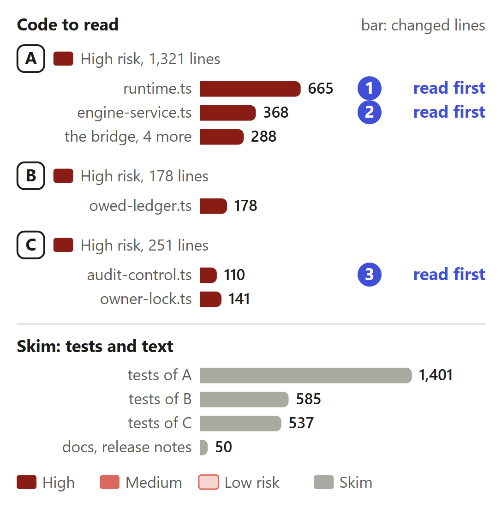
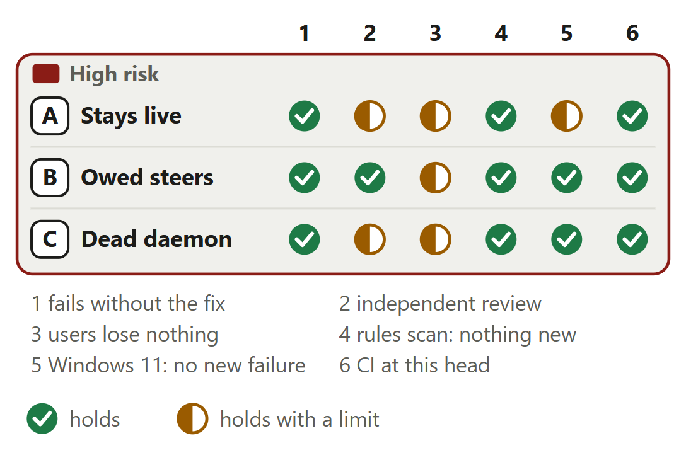

# Sessions: a quiet session's close frees its memory and takes nothing else

For [pull request #680](https://github.com/neralabs/rerail/pull/680), head d724d2090. [report.html](report.html) is the same report as one page: download it and open it.

## 1. The decision

**Does a session closed without its end lose anything but the memory #503 frees?**

1. A quiet session stays open and owned; one never ended reads as live. **Changes the intent.**
2. A steer owed at a stop, restart or day's close arrives at the next event. **Changes the intent.**
3. A daemon holds a lock in `locks/owners/`; a later one ends a dead daemon's sessions.

**We recommend:** answer #675 first, and if a quiet session is to stay open, approve this: beside `main` on Linux x64 and Windows 11 no case came out lower, except the cost #675's comment names.

| Size | Lane | Waits on | Not verified |
|---|---|---|---|
| 4,323 lines in 28 files: 1,750 ship, 2,573 are tests and text | Careful. A code owner approves; no high-risk path. | #675's answer. No maintainer has answered; CI passes. | 5 |

## 2. Intent, and the gap

| Change | Intended | Found | Now |
|---|---|---|---|
| A. The idle close | Closed as its end would _(docs, code comment)_ | Shows ended; scans refused _(tests over main)_ | **CHANGES THE INTENT: ANSWER 1.** The close frees only the memory. A maintainer must agree. |
| B. Owed steers | Lost at the day's close _(code comment)_ | Lost at a restart too _(tests over main)_ | **CHANGES THE INTENT: ANSWER 2.** Owed steers wait for the next event. A maintainer must agree. |
| C. A dead daemon's sessions | A gone owner is released _(our reading)_ | A reused process id hides it _(real daemon runs)_ | Closes the gap, changes answer 3. |

A, B: reported in #675, 13 November 2026. C: found 14 November in killed-daemon runs.

Sources at main, and causes

| Change | Where main states the intent | The cause, and what was measured |
|---|---|---|
| A. The idle close | `docs/in-session-surfaces.md` line 228: "The daemon closes a session that sends nothing for 30 minutes". `src/runtime/engine-service.ts` line 40, the comment on `IDLE_SESSION_MS`: "How long a session may send no event before the engine service closes it as its end would." `src/runtime/runtime.ts` line 1819 says the same of `closeIdleSession`. A test's name gives the reason: "so a killed agent's session does not stay forever" (`engine-service-runtimes.test.ts` line 183). | `closeIdleSession` stops the session through its host router, so `closeSession` gives the record an end time, interrupts its scans and releases its owner. `src/engine/audit/audit-control.ts` line 320 then refuses a scan: `Session is inactive`. Over `main`'s source (a9101752c, Linux x64), 18 cases fail on these losses: an end time (8), a scan not queued (4), no session opened for a scan (2), a checkout audit cut off (1), another writer's change unrecorded (1), the agent's text not read back (2). |
| B. Owed steers | `src/runtime/engine-service.ts` line 51, the comment on `OWING_SESSION_IDLE_MS`: a session that still owes its agent something is closed after a day "anyway, and what it owed is lost". `src/runtime/runtime.ts` line 1822 says the same. Nothing at `main` states the loss at a daemon stop or restart. | At `main`, `closeSession` empties the session's pending steers and held findings at every close, and the ledger holds neither, so version 0.1.4 loses them at a stop or restart too. A case over `main`'s source: a steer owed across a daemon restart is not delivered, where the case expects `Fix a.py.`. In OMP and Pi, the edit of a tool call left waiting across the day's close is never checked at `main`; 04f3678e9 checks it once the rules are open. |
| C. A dead daemon's sessions | Nothing at `main` says what becomes of a session whose daemon died. The nearest code is `#owner` in `src/engine/audit/audit-control.ts`, from line 132: an owner whose process is not live is made inactive and its scans interrupted with "Owning runtime exited before scan could complete". `processIsLive`, line 109, judges by the process id alone. No start and no sweep ends the session's record. | With the record kept open (A), a quiet session of a daemon that died stayed open for good: a run with real daemon processes found it, and a later one found that a process id live again hid the death. Runs with a real daemon process killed and its id live again, on Linux x64 and Windows 11: `rerail scan --session` stayed queued past the CLI's 10 s wait, and the next event got `already owned by a live runtime`. |

## 3. Where to look

1. **Read first**, 15 min: `runtime.ts`: `closeIdleSession`, `#owedAtClose`, `#takeOwed`. Can a steer go out twice, or a suspension lose its owner?
2. **Read first**, 12 min: `engine-service.ts`: `closeIdleSessions`, `resumeSuspended`, `endAbandonedSessions`. Can a session stay open with no daemon holding it?
3. **Read first**, 8 min: `audit-control.ts`: `writerEnded`, `endSessionsOfEndedOwners`. Can a live session be judged dead?
4. 12 min: C: `owner-lock.ts`. B: `owed-ledger.ts`.
5. 13 min: A: `code-rule-bridge.ts`, `operation.ts`, `operations.ts`, `stores.ts`, `daemon.ts`.

**Then skim**, 12 min: `engine-service-runtimes.test.ts`: four of `main`'s tests now expect an open record. Read the threat model's four added lines.

## 4. Risk against verification

Start at A, check 3: a session whose end never comes reads as live, on purpose.

Each half mark's limit

| Change | Check | It holds with this limit |
|---|---|---|
| A. Stays live | independent review | The tests and daemon processes ran against `main` at six heads. The first run found a suspended record ended days late (0b3fc1047) and lines with no failing case (bc4edf650, 928b889ac). The automated reviewer's one blocker is fixed in 771245b05, and it approved d724d2090 with no finding. The limit: that review sends #675's question to the maintainers, and none has answered. |
| A. Stays live | users lose nothing | At 94f8302a3 on Linux x64 and Windows 11, no case came out below `main` but one, on purpose: a session whose end never comes reads as live until its daemon stops, where `main` ends it about 31 minutes after its last event. A suspension also keeps about 45 KB. |
| A. Stays live | Windows 11: no new failure | The change's ten test files pass 273 of 273 on Windows 11 at 94f8302a3, and CI's two Windows unit jobs pass at d724d2090. The limit: of the 166 unit files that reach a changed module, 965 cases fail on that machine, all of them on `main` in every run of its baseline. |
| B. Owed steers | users lose nothing | A build without this change skips the ledger's `owed` line. One case holds the scrub: the ledger keeps an owed steer scrubbed of a secret, and a finding in `secrets.yaml` without its message. A steer whose file changed while the session was closed is dropped (f5a059f85). The limit: answer 2 is on purpose. |
| C. Dead daemon | independent review | Three runs with real daemon processes each found a defect here, each fixed: 6ade0c383, then 4aa3562af and eabadb18b, then 85cec2eab. The automated reviewer's second review added three: 5e8d1609d, be16c3ebe, 4799ea5a8. The check of 94f8302a3 found none. The limit: that second review asked for a maintainer's view on the lock, and none has given one. |
| C. Dead daemon | users lose nothing | With a daemon killed and its process id live again, on Linux x64 and Windows 11, every case measured at 94f8302a3 is at or above `main`. The limits: a row that names no lock goes by the process id, as on `main`; the check at a start and each minute costs time (part 8). |

<b>5. The changes</b>

**A. A quiet session stays live**, high risk. Quiet 30 minutes: ended on `main`, live and scannable here; 18 cases fail on `main`.

- **Problem:** Since #503 a session quiet for 30 minutes is closed as its end would, though its agent is often still open. The dashboard shows it ended, a scan for it fails, and another program's change to its files goes unrecorded.
- **Who meets it:** Anyone whose agent stays open through 30 quiet minutes. On one developer machine, 13 of 70 Claude Code sessions in 7 days went 30 minutes or more without a transcript line, then went on. No published version has the close.
- **What it does:** `closeIdleSession` frees the session's memory and answers with an `IdleClose`. `#markClosed` and `#endOwnership` leave the record open and the owner claimed. The engine service keeps a `SessionSuspension`, and `resumeSuspended` opens the session for a queued scan. `walkResume` and `#restoreHeldTexts` let the next walk go on where the last stopped. The daemon's stop ends each suspended record at its quiet time.
- **Risk:** High. A session's end time, its owner and its Log entries change. A suspension that leaks keeps the memory #503 frees, and one that loses track of its owner leaves a scan queued for good.
- **Check:** Can a session be out of memory and out of the service's `suspended` map with its record still open? `#suspend` keeps the suspension before any await. `resumeSuspended` asks again inside the lane, so an end that ran first stays an end. In `closeSession`, `endedAt` is null only while `suspending` is set. `#owesAgent` counts a queued scan and a running checkout audit. `#baselinePath` compares a source held before the suspension with its last observation, though the first walk is a baseline.
- **Picture:** On main a session's record is open and owned until it has been quiet for 30 minutes, then it is ended and a scan for it is refused. With this change the record stays open and owned past 30 quiet minutes, its memory is freed, and a scan for it runs.
- **Method:** the six test files the change first had, run over `main`'s source at a9101752c on Linux x64: 18 cases fail on these losses. All pass at 94f8302a3 on Linux x64 and Windows 11. The 30 minutes are `IDLE_SESSION_MS`, which this change leaves alone. The drawing is not to scale.

**B. Owed steers wait in the ledger**, high risk. A steer owed across a restart: lost on `main`, sent at the next event here.

- **Problem:** A steer or held finding a session has not delivered when it closes without its end is dropped. The agent never learns that its edit broke a rule, or that Rerail rolled an edit back.
- **Who meets it:** A session open at a daemon stop or restart, in 0.1.4 too, and one quiet for a day while it owes a steer. On `main`'s source 3 cases fail on it. How often in the field is not known.
- **What it does:** At a close without the end, `#owedAtClose` takes the steers and held findings no newer revision overtook, and `#keepOwed` writes them as one `owed` ledger entry with the digest of each file they name. `owedForDisk` scrubs it. At the next event `#takeOwed` gives the steers and writes the entry again, emptied. A Merge Assist note stays with Merge Assist (`ownSteers`).
- **Risk:** High. It decides what the agent is told, hours after the edit it speaks of, and it writes steer text to a file in the checkout.
- **Check:** Can a steer go out twice, or after its file changed? `#takeOwed` takes only once `#stillOwed` has compared each file with its digest, and gives none once the session closed meanwhile. `collectDeliveries` now runs in the session's lane. A rolled-back edit's steer goes out all the same. `owedFinding` withholds the message and fix of a finding in a secret-like file. A session that holds only a Merge Assist note is freed at 30 minutes, where `main` kept it a day.
- **Picture:** On main a steer a session still owes when it closes without its end is dropped at the close. With this change it waits in the session's ledger while the session is closed and goes out with the session's next event, unless the file it names changed meanwhile.
- **Method:** three cases over `main`'s source at a9101752c on Linux x64 fail: a steer owed across a daemon restart is not delivered, where the case expects `Fix a.py.`. They pass at 94f8302a3 on Linux x64 and Windows 11. The drawing is not to scale.

**C. A dead daemon's sessions end**, high risk. A killed daemon's session, its process id reused: owned for good on `main`, ended here.

- **Problem:** A daemon that ends without its stop ends none of its sessions. When another process gets its process id, each reads as owned: a scan for it stays queued and its next event is refused, so its edits go unchecked.
- **Who meets it:** Anyone whose daemon is killed, hits its heap limit or dies with the machine. Keeping a quiet session open (A) adds every suspended session to those a dead daemon leaves. Windows gives a process id out again soon.
- **What it does:** Each engine service holds a system lock on a file in `locks/owners/` for its life (`holdOwnerLock`), and its owner tokens begin with the lock's id. At a start and each minute, `endSessionsOfEndedOwners` ends each open session whose writer ended (`writerEnded`): record at its last event plus 30 minutes, owner released, scans interrupted. `forgetFreedOwnerLocks` removes the files no open session names.
- **Risk:** High. A wrong verdict ends a live session and interrupts its scans, or leaves a dead daemon's session owned, so its next event is refused and its edits go unchecked.
- **Check:** Can `writerEnded` call a running daemon's session ended? A lock that is held, has no file or cannot be tried reads as held. A row with no lock that names the judging process is its own only while its token is in `claimsHereWithoutLock`, with no clock read. `registerOwner` clears an end time a sweep wrote just before the claim. `forgetIfFree` removes a lock file only while holding its lock, once no open session's row names it.
- **Picture:** The check a daemon's start makes over 4,000 sessions with 200 open, on Linux x64: 0.12 to 0.23 ms on main, 2.6 to 3.3 ms with this change while the 200 owners run.
- **Method:** 4,000 sessions with 200 open, 15 rounds a variant, medians, on Linux x64, before the last thirteen commits. When the start ends the 200 it takes 44 to 58 ms. Windows 11, beside other runs: 15 to 36 ms against 0.27 to 0.36 ms, and 53 to 97 ms when it ends them.

<b>6. The decisions</b>

**What does a session closed without its end give up?** (ask 1)

**We chose** only its memory: one that comes back is the same live session. **Would change our mind:** another answer on #675.

| Option | What a user gets | Cost | What it breaks |
|---|---|---|---|
| Free the memory; keep the record open until its end or the daemon's stop **(chosen)** | A session that comes back is the same live session: scans run, another writer's change is recorded, owed steers arrive | About 45 KB per suspended session until the daemon stops | A session whose end never comes reads as live until the daemon stops, and `rerail reset` keeps its row |
| End it at 30 minutes, as `main` does | The memory freed; a killed agent's session ends about 31 minutes after its last event | Nothing | The losses #675 lists |
| Keep it open, and end one still quiet after a day (not built) | As chosen for a person away less than a day; a killed agent's session reads as live for a day at most | Not built or measured; the suspension already keeps the time it went quiet (`suspendedAt`) | A session waiting at a prompt for more than a day reads as ended |
| Show "idle since" for a session with no end event | A true display | Small | Scans stay refused, and `rerail reset` deletes the row as ended |

Before: On main a session that sends nothing for 30 minutes has its record ended, its owner released and its memory freed. Its next event opens it again from its ledger: its first walk is a baseline. After: Here the session's memory is freed while its record stays open and its owner is kept. Its next event or a scan opens it again and its walk goes on. If its daemon stops or dies, the record ends at its quiet time.

**Evidence.** With the change's tests on `main`'s source (a9101752c, Linux x64), 18 cases fail on these losses, and all pass here on Linux x64 and Windows 11. The cost is measured too: a killed agent's session stayed open and owned until the daemon's stop, and #675's comment states it. The comment asks which of the first three options the maintainers want; none has answered. Either other answer changes this branch before it leaves draft.

**Where do a closed session's owed steers wait?**

**We chose** an `owed` entry in the session's ledger, scrubbed: no schema change. **Would change our mind:** maintainers who want them in the database, or judge a steer hours late worse than none.

| Option | What a user gets | Cost | What it breaks |
|---|---|---|---|
| An `owed` ledger entry, written at a close without the end, scrubbed **(chosen)** | Steers and held findings survive the idle close, the day's close and a daemon stop or restart | One ledger line per close. A session that owes a steer still stays in memory for up to a day, as on `main` (`#owesAgent`); the entry is written at that day's close, a stop or a restart. | Nothing: a build without this change skips the line |
| Memory only, as `main` does: no ledger entry | They wait in memory through up to a day of quiet | Nothing beyond `main` | Lost at the day's close and at every stop or restart |
| A database table | Owed steers other readers can query | A schema change, on a path `REVIEW.md` lists as high-risk | Nothing |

Before: On main a close without the session's end empties its pending steers and held findings, and its next event finds nothing owed. After: With this change a close without the end writes an owed entry to the ledger, scrubbed. At the next event the steers go out with its answer, unless the file they name changed, and the entry is written again, emptied.

**Evidence.** Three cases fail on `main`'s source: a steer owed across a daemon restart never reaches the agent. One case holds the scrub: the ledger keeps an owed steer scrubbed of a secret, and a finding in `secrets.yaml` without its message. A steer whose file changed while the session was closed is dropped (f5a059f85). In OMP and Pi, a tool call left waiting across the day's close has its edit checked once the rules are open (04f3678e9).

**How does a later daemon know another has died?** (ask 3)

**We chose** a lock each engine service holds for life; any exit frees it. **Would change our mind:** a maintainer who wants no lock files in the home.

| Option | What a user gets | Cost | What it breaks |
|---|---|---|---|
| A lock each engine service holds for life, its id in its owner tokens **(chosen)** | A verdict on Linux and Windows 11 for every row that names a lock, whatever process now has the id, with no clock; macOS never ran | A lock try: under 0.01 ms on Linux x64, 0.17 to 0.25 ms on Windows 11. A stopped daemon's lock file stays until the next start or sweep | Nothing measured |
| The process id alone, as `main` judges an owner | A verdict only while the id is free | Nothing | A reused id: the session stays open and owned, a scan for it stays queued and its next event is refused |
| The owner row's last write against the process's start time | A verdict on Linux, at 0.02 ms a process, with no lock file in the home | Windows has no Node API for it: PowerShell took 380 to 1,000 ms for one process. There a quiet session would end at the idle close, as on `main` | Wrong after a clock step larger than the gap |

Before: On main, when a daemon dies with sessions open, no start and no sweep ends their records. An owner counts while its process id runs, so once another process has the id the session's next event is refused. After: Here the next start, or another daemon's sweep within a minute, reads each open session's owner row. If the row names a lock and the lock is free, the session is ended. If it names none, as for Pi and OMP sessions, the process id decides, as on main.

**Evidence.** Run with a real daemon process killed and its id live again, on Linux x64 and Windows 11. With the process id alone, `rerail scan --session` stayed queued past the CLI's 10 s wait and the next event got `already owned by a live runtime`. At this head the record ends at its last event plus the idle limit, the scan fails with `Session is inactive` as on `main`, and the next event opens the session again.

<b>7. How it fits</b>

It merges clean with `main` at c89f068ed, needs no other change, and stays a draft until #675 is answered. Trial merges conflict with #652, #679, #665, #532 and #667.

Pull request #680 is based on main at c89f068ed, which this head has merged, and merges clean with it. It waits on issue #675, not answered yet. No open pull request needs it. In trial merges it conflicts with #652 in the engine service's file, with the drafts #679, #665 and #532 in the bridge file, and with #667 in five files beyond those where #667 conflicts with main.

**The other open pull requests that share files.** Trial merges with `git merge-tree` at d724d2090, each head read on 14 November 2026. #652 (ffd9a7e3a) conflicts in `engine-service.ts`. #679 (aa8d7a049), #665 and the team's draft #532 conflict in `code-rule-bridge.ts`, #665 also in `runtime.ts` and one docs file. The team's #667 conflicts in five files beyond the twelve where it conflicts with `main`. The release #631 deletes #503's release note, which this branch edits. Ten other open pull requests share a file with no conflict. The description's "How it fits" has a row for each.

<b>8. What is not covered</b>: 5 not verified, 6 smaller gaps, 8 limits that stay

1. **A session whose end never comes** reads as live: #675's question.
2. **No maintainer** has reviewed it or answered #675.
3. **Rows that name no lock** (Pi, OMP, another database, an earlier version) go by process id, as on `main`.
4. **The cost measurements** were not run again at 94f8302a3.
5. **macOS** never ran.

**Smaller gaps**

- **#675's steps by hand** were not run: its numbers are from the tests.
- **Two lines have no case, by choice:** the guard of `failScans` in `resumeSuspended`, reached only if the open fails after the owner claim was taken back, and `server.close` inside the `try` of `close()`, which fails only for a server not listening.
- **Pi and OMP runtimes** were not driven through `NativeSessionServer` at 94f8302a3: the probe makes the lockless owner claim their runtime makes, in the service's own process. CI's `OMP and Pi real-session runtime paths` job passes.
- **How often in the field:** 13 of 70 sessions is one developer machine, and a gap in a transcript stands in for a gap between hooks. The rate across installs is not known.
- **The whole unit set on our machines** last ran at 961848254, before the last fourteen commits. One Windows case of `code-rule-runtime-lifecycle.test.ts` failed beside other runs and passed when its file ran alone. CI ran the whole set at d724d2090.
- **One test of `audit-cli.test.ts`** timed out once on a loaded Linux machine and passed 12 of 12 runs alone, here and at `main`. It is `main`'s own, in its Git verdicts (#692), and this pull request does not touch it.

**Limits that stay**

- A session whose end never comes (a killed agent, a `SessionEnd` hook that timed out) reads as live until its daemon stops. The dashboard and `rerail settings` show it live, and `rerail reset` keeps its row.
- A suspension keeps about 45 KB per session more than `main` until the daemon stops: Linux x64, a repository of 100 worktrees of 300 Python files, 3 sessions one after another.
- With 200 sessions open, the check at a start and each minute takes about 3 ms on Linux x64 and 15 to 36 ms on Windows 11, on the daemon's main thread; `main` takes under 0.4 ms.
- A daemon that could take no owner lock, and any daemon for a session it records in another database, ends a quiet session at the idle close, as `main` does. The owed steers still wait in the ledger.
- A stopped daemon's lock file stays in `locks/owners/` until the next start or sweep removes it.
- A scan for a suspended session starts once its rules have compiled again.
- A session's end still drops what it owed, and an owed steer whose file changed while the session was closed is dropped.
- Passing the lock to Pi and OMP runtimes means editing `NativeSessionServer#initialize`, at cyclomatic complexity 10 on `main`: a refactor first, in a pull request of its own.

## 9. What we ask of you

Asks 1 to 3 rule on answers 1 to 3.

1. **On [#675](https://github.com/neralabs/rerail/issues/675#issuecomment-6865878140): a session closed without its end: ended, kept open, or kept open a day?** We recommend kept open, as built.
2. **May an owed steer reach the agent at its next event, hours later?** We recommend yes: dropped if its file changed.
3. **May each daemon hold a lock file in `locks/owners/` for its sessions?** We recommend yes: process ids are reused.

<b>10. Evidence</b>

The description is the record: "How you tested it" holds the runs, what each found and the measurements; "The decisions" holds the options.

| Where | What ran | Result |
|---|---|---|
| CI on GitHub | The checks at d724d2090, read on 14 November 2026 | 28 pass, 17 are skipped, none fails. Both Linux unit jobs, both Windows unit jobs and `Integration tests` pass. |
| Linux x64 | The six test files the change first had, over `main`'s source at a9101752c | 41 of 216 cases fail: 21 on a loss a person meets, 19 on the interface the change adds, one only by its 20 s test timeout. |
| Linux x64, Windows 11 | The change's ten test files at 94f8302a3; d724d2090 changes two release notes and no code | 273 of 273 on each; none outside `main`'s Windows baseline. |
| Linux x64, Windows 11 | Every case the last thirteen commits add or edit, 20 rounds in a row, at 94f8302a3 | 320 of 320 on Linux x64; 220 of 220 on Windows 11. |
| Linux x64 | The 166 unit files that reach a changed module, at 94f8302a3 | 3,242 passed, 966 failed, 6 skipped: 965 need pack data that machine lacks, and one is #692's test, which passed 12 of 12 alone here and at `main`. |
| Windows 11 | The same 166 files at 94f8302a3 | 3,176 passed, 965 failed, 73 skipped; all 965 fail on `main` in every run of its baseline. |
| Linux x64 | 23 one-line removals of the last fixes, at 94f8302a3 | Each fails a case. |
| Linux x64, Windows 11 | Real daemon processes at 94f8302a3 against `main`: a daemon killed with its process id live again, a clock stepped back, a failed close, a session recorded in another database | No behaviour defect: every case measured is at or above `main`. Two release notes said too much, and d724d2090 corrects them. |

**What this report adds to the description**

- **Two asks beyond #675.** The description asks a maintainer nothing but #675's question. Part 9 adds two rulings that its "The decisions" names under what would change our mind: an owed steer delivered with the next event, and the lock files in `locks/owners/`. The automated reviewer asked for a maintainer's view on the second.
- **Four of `main`'s tests change what they expect.** A read of the test diff for this report: in `engine-service-runtimes.test.ts`, four tests of `main`, three of them renamed, now expect a quiet session's record to stay open, where they expected an end time. `runtime.test.ts` reads the idle close's answer as a kind, where it read a boolean. The description names the seam and not the four tests.
- **Corrected here: a session that owes a steer keeps its memory.** The description's decision 2 table sets the ledger entry against a day in memory, and its decision 1 drawing puts owed steers in the ledger at the 30-minute close. At this head a session that owes a steer is not suspended at 30 minutes (`#owesAgent`): it stays in memory up to a day, as on `main`, and the entry is written at that day's close or a stop.
- **Three changes here, four in the description.** The description's fourth change, a Merge Assist note that waits with Merge Assist across a close, is 29 changed lines of `runtime.ts` (6be6f665c). This report counts that file under A and describes the note in B's card.
- **The checks by name.** The description gives CI's counts at d724d2090. This report adds which jobs pass, the `OMP and Pi real-session runtime paths` job among them, and that the 17 skipped are the Rust engine and 16 steps that follow the automated approval.

**Sources.** Pull request #680, its diff, its checks and the automated reviewer's three reviews, and issue #675 with its one comment, read on GitHub on 14 November 2026. Rerail at `main` (c89f068ed) for each quoted intent. The diff of d724d2090 against `main` for the sizes and the read-first places. The run records of six heads, each with its commit. `git merge-tree` for every trial merge.

