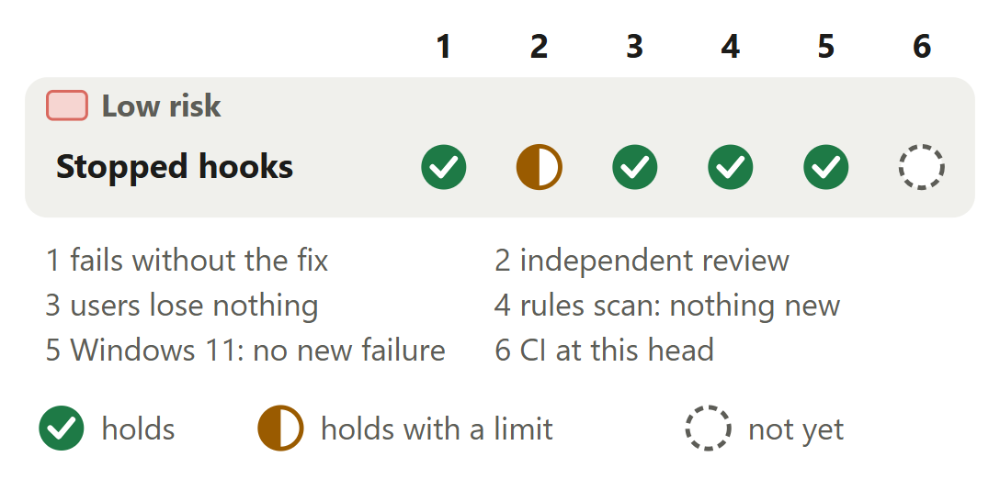

# The reference says what a stopped checkout's hooks send the daemon

For [pull request #814](https://github.com/neralabs/rerail/pull/814), head ded0a30e4. [report.html](report.html) is the same report as one page: download it and open it.

## 1. The decision

**Do the two corrected sentences say what a stopped checkout's hooks do on `main`?**

**We recommend:** approve it: each claim was run through the built hooks on Linux x64 and Windows 11.

| Size | Risk and review | Waits on | Not verified |
|---|---|---|---|
| 4 lines in 2 files: 0 ship, 4 are the tests it changes, 0 are other tests and text | Fast. Docs only: any maintainer can approve. | Nothing. No other pull request has to merge first. | 2 |

## 2. Intent, and the gap

| Change | Intended | Found | Now |
|---|---|---|---|
| Stopped checkout's hooks | Never contact the daemon _(docs)_ | One request, up to 3.1 s _(runs of built hooks)_ | Closes the gap. |

Found on 18 November 2026 by a maintainer, and run on Linux x64 and Windows 11.

Sources at main, and causes

| Change | Where main states the intent | The cause, and what was measured |
|---|---|---|
| Stopped checkout's hooks | `docs/reference.md` line 850 at `main`: "its hooks never autostart or contact the daemon"; `docs/rule-scoping.md` line 65: "hooks don't contact the daemon". | `hookRerailStarted` in `src/harness/hook-host.ts` asks `readRepositoryState` first, which reads the daemon (2 s; on Windows after the engine's proof, 2 s), and reads the database only when no daemon answers. |

## 3. Where to look

1. **Read first**, 3 min: `reference.md`: What stopping does. Does the sentence match `hookRerailStarted` and `readRepositoryState`?
2. 1 min: `rule-scoping.md`: the start table's stopped row.

**Then skim**, 1 min: The start table's stopped row in `rule-scoping.md` says the same in one line.

## 4. Risk against verification

Docs only; the claims rest on runs at `main`.

Each limit, and each check that does not hold yet

| Change | Check | Its limit, or why it does not hold yet |
|---|---|---|
| Stopped hooks | independent review | Our own read of the two sentences against the code; no second reader. |
| Stopped hooks | CI at this head | CI runs once the branch is pushed. |

## 5. The changes

**Stopped checkout's hooks, described**, low risk: A stopped checkout's hook beside an idle daemon: one request at `main`, which the reference denied.

**6. The decisions:** we made no choice here that a maintainer could have made differently.

<b>7. How it fits</b>

It stands on `main` alone. #738, #772 and #677 edit these files elsewhere; no trial merge adds a conflict.

<b>8. What is not covered</b>: 2 not verified

1. **OMP and Pi** were not run; they read the database in their own process, so the sentence names only the hooks that were run.
2. **macOS** never ran.

## 9. What we ask of you

We ask no ruling.

<b>10. Evidence</b>

The description holds the runs under "How you tested it".

| Where | What ran | Result |
|---|---|---|
| Linux x64 | 12 hooks, three times each, with no daemon, an idle one and a busy one, at `main` | Each asked a running daemon once; none started one; busy: 1.8 to 2.2 s. |
| Windows 11 | The same | Each sent the engine's proof, then the read; busy: 2.2 to 3.1 s; none started a daemon. |

**Sources.** Rerail at `main` f41b8fe6c, its built hooks, and the two docs, read on 18 November 2026.

