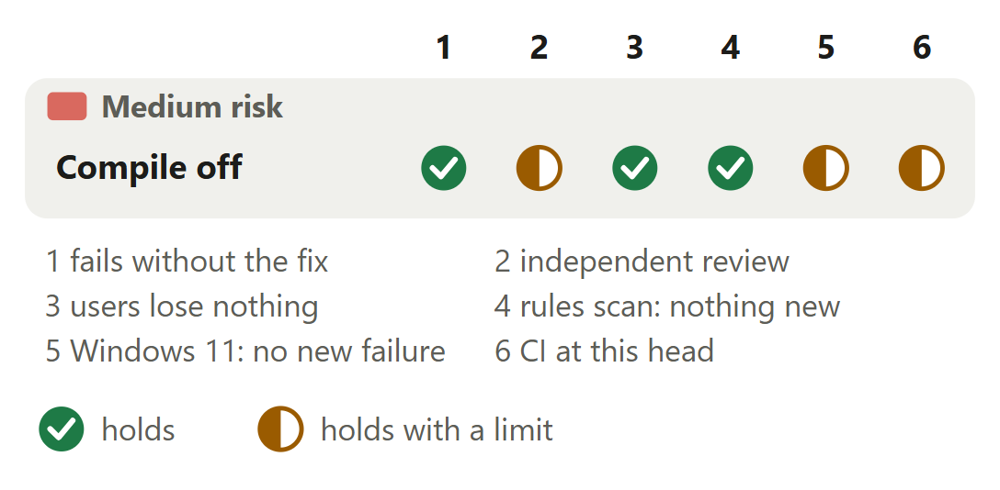

# Rules compile off the daemon's thread, and sessions build theirs ahead

For [pull request #973](https://github.com/neralabs/rerail/pull/973), head 06f1423b9. [report.html](report.html) is the same report as one page: download it and open it.

## 1. The decision

**May a repository's rules compile on a worker thread, and a session build ahead the rules of repositories it edited or keeps inside its folder?**

**We recommend:** approve it: every edit is still checked and steered at its own result, and no other session's hook waits 2.5 to 5 s behind a compile any more.

| Size | Risk and review | Waits on | Not verified |
|---|---|---|---|
| 1,273 lines in 10 files: 703 ship, 570 are tests and text | Standard. Daemon code and one engine export: a maintainer approves. | Nothing. No CI run on GitHub yet: not pushed. | 4 |

## 2. Intent, and the gap

| Change | Intended | Found | Now |
|---|---|---|---|
| Hooks never compile | A rule compiles once, hooks answered _(code comment)_ | Every hook waited for a compile _(CPU profile, runs)_ | Closes the gap. |

Found on 20 November 2026 on Windows 11 virtual machines, from a laptop's slow tool calls and a CPU profile of the daemon.

Sources at main, and causes

| Change | Where main states the intent | The cause, and what was measured |
|---|---|---|
| Hooks never compile | `src/engine/code-rule/code-rule-dsl-catalog.ts` at d1650acb4, the module's comment: "Executables are compiled once per process and shared by every catalog." `CheckoutCatalogs.catalog` builds a checkout's catalog on first ask, from `CheckoutCodeRuleRouter.#lane`, reached from an edit's capture (`#sourceLocation` -> `acceptsPath`). | The first ask builds the checkout's catalog synchronously, and `compileOutcome` calls the engine's compile on the JS thread for each rule no live catalog holds; a CPU profile put 97.9% of the busy samples of that hook there, 89.3% in the compile. The session's rule coverage, read after each event, built its own checkout's catalog the same way while the session opened. |

## 3. Where to look

1. **Read first**, 20 min: `code-rule-dsl-catalog.ts`: `CompiledRuleCache.compileOffThread`, `CompileLine`, `CheckoutCodeRuleCatalog.built`, `CheckoutCatalogs.prepare`, `checkoutsEditedBy`. Can one rule compile twice, or a call's rules wait behind rules built ahead?
2. 15 min: `checkout-code-rule-router.ts`, `code-rule-bridge.ts`, `runtime.ts`, `code-rule.ts`, `native.ts`, `mod.rs`: who asks for a build, and the engine's `compile_async`.

**Then skim**, 5 min: The test stands in for the engine's binding to count compiles on the thread and hold one off it.

## 4. Risk against verification

One change, medium risk: the daemon's compile path moves to a worker thread; what is checked and when a steer comes stay as on `main`.

Each half mark's limit

| Change | Check | It holds with this limit |
|---|---|---|
| Compile off | independent review | Our own review only: the rules review and the cases; no independent reviewer has read it yet. |
| Compile off | Windows 11: no new failure | Windows 11, 100 tool calls with a restart every 25: PreToolUse hooks at or over 2 s, `main` 7, here 1 (2,135 ms, a reopened session's first call waiting for its own rules). |
| Compile off | CI at this head | No CI run at this head on GitHub yet: the branch is not pushed. The commit hook's `npm run check` passed. |

## 5. The changes

**Rules compile off the daemon's thread**, medium risk: Another session's Read during that first edit, Windows 11: `main` 2.7 s, here 0.20 s.

<b>6. The decisions</b>

**Wait for the rules off the thread, or answer the edit at once?**

**We chose** wait off the thread and build ahead: that edit keeps its steer at its own result, and nothing else waits. **Would change our mind:** A maintainer who prefers every first edit answered at once, its steer a turn later.

| Option | What a user gets | Cost | What it breaks |
|---|---|---|---|
| Compile off the thread, build ahead what the session will need **(chosen)** | No other hook waits; that edit waits for its own rules, often already built. | An engine export, a second build path for a catalog, and rules held for repositories built ahead. | Nothing found. |
| Answer the edit at once and check it when its rules are ready | No hook waits at all. | Little code. | That edit's steer leaves its own result for a later hook. |
| Keep compiled rules on disk across restarts | A restart compiles nothing that did not change. | A stored form of a compiled rule, which the engine does not have, and its disk. | Nothing, if built. |

**Evidence.** One job a system, each way after the other, 10 runs, on `main` 95ad00618: another session's Read during that edit, Windows 11, `main` 3,846 ms median, compile off the thread 315 ms. That edit after a restart with rules built ahead: 793 to 843 ms against 4,066.

<b>7. How it fits</b>

Nothing has to merge first: `main` 06a1a1ce8 is merged into it; #883, #903, #741, #915 and #938 touch none of its files. #904 overlaps it in six files, #812 in three, #909 in four, #924 in three, #922 in two, #920 in one: both sides kept.

**The files it shares.** #904 marks whether a compiled rule reads other files (`crossFile`) and reads the session's catalog again as it opens: each entry keeps `crossFile`, and that read takes only a built catalog. #924 puts each rule's title on its compiled entry: every entry here is built in one place that sets it, and a case checks it for rules built ahead and at the edit. #812 shares open rule engines across worktrees; this change builds compiled rules from one shared cache. #909, #920 and #922 edit apart from it.

<b>8. What is not covered</b>: 4 not verified, 1 limit that stays

1. **macOS** never ran.
2. **Library rules** a library rule or a checkout's own rule is still compiled on the thread at each load to check that it compiles, as on `main`.
3. **Walks and refreshes** a walk that is first to ask about a checkout, or a rule configuration changed during a session, still compiles on the thread, as on `main`.
4. **A reopened session's first call** still waits for its own repository's rules after a restart, now off the thread: 2.1 s on Windows 11 here, 2.5 s at `main`.

**Limits that stay**

- Rules built ahead that nothing used are let go of when the session that asked for them ends; the daemon's memory a few seconds later does not show them freed yet (559 MB here, 605 MB kept, Linux x64).

## 9. What we ask of you

We ask no ruling.

<b>10. Evidence</b>

The description's "How you tested it" holds every run at `main` and here.

| Where | What ran | Result |
|---|---|---|
| Linux x64 | The runtime and router cases with `main`'s source and here; each with its line taken out | `main`: 4 of the first 5 failed (the steer at its own result passed); here 12 of 12 passed; each mutant failed its own case, the title case with the title left out where entries are built. |
| Linux x64 and Windows 11 | The 106 test files, at `main` and here | The 106 test files it edits, that import what it changes, or that #924 changed: none fails here on Linux x64. On Windows 11 the 54 failing only here on a busy machine, all past their time limit, pass on a quiet one or alone. |
| Linux x64 | `cargo test -p rerail-logic --lib` | 411 passed, 0 failed, 7 ignored at this head; `npm run check:native` passed at the head before the merge. |
| Linux x64 | Daemon memory after a session over 8 repositories built ahead ended | 559 MB here, 605 MB with the rules kept: a reading a few seconds after the end does not show them freed. |
| Linux x64 | The automated reviewer's rules at `main` b7c639830 | No new finding; no difference with Rerail built from `main`. |

**Sources.** The branch at b77fee806 and its diff against `main` 06a1a1ce8, read on 20 November 2026; runs on Windows 11 virtual machines and Linux x64 machines at `main` and at this branch's commits.

