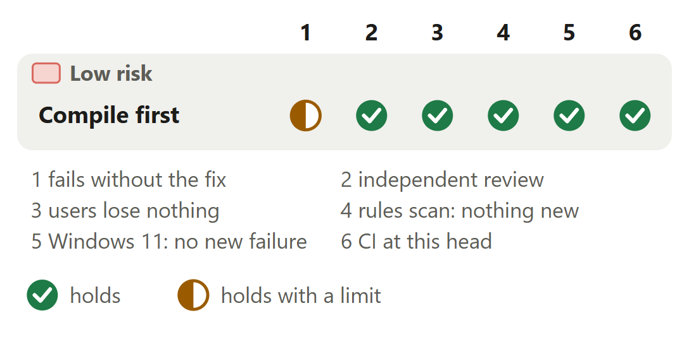

# Tests: rule-draft compiles the installed packs once, before its cases

For [pull request #636](https://github.com/neralabs/rerail/pull/636), head 01a2115b3. [report.html](report.html) is the same report as one page: download it and open it.

## 1. The decision

**Does the rule-draft case still check everything it checked, now that the packs' one-time compile runs before it?**

**We recommend:** approve it: one test file, no product code, and every case keeps its commands, assertions and time limit.

| Size | Lane | Waits on | Not verified |
|---|---|---|---|
| 6 lines in 1 file: 0 ship, 6 run in every test run, 0 are tests and text | Fast. The automated reviewer can approve. | Nothing. The dependency fix merged as #639. CI is green. | 2 |

## 2. Intent, and the gap

| Change | Intended | Found | Now |
|---|---|---|---|
| One rule-draft case | The case checks where rules count _(a test's name)_ | Timed out in 3 of 71 jobs _(CI job logs)_ | Closes the gap. |

Found on 12 November 2026 (UTC), in the "Unit tests (2/2)" jobs of the repository's CI on GitHub.

Sources at main, and causes

| Change | Where main states the intent | The cause, and what was measured |
|---|---|---|
| One rule-draft case | `test/cli/rule-draft.test.ts` line 266, the case's name: "counts only where rules add would have the rule run: the draft's folder, and the folders it is added at already". `src/engine/catalog/rule-catalog.ts` line 380, a code comment on `loadRuleCatalog`, says why one compile serves every case: "otherwise each call returns the same one." | The case is the file's first to run `rules add` (line 289), which calls `loadRuleCatalog` (`src/cli/rule-draft.ts` line 789). The first call in a process compiles every installed pack's rules. `rules test` reads the packs "without compiling" (line 425 there), so no earlier case paid it. Timed at main on a 32-core Linux machine, the case alone, 16 idle runs: the compile took 0.99 s of the case's 1.87 s (medians). |

## 3. Where to look

1. **Read first**, 2 min: `rule-draft.test.ts`: `beforeAll`, `loadRuleCatalog`. Is this the same compile the case's first `rules add` ran at main: same home, same installed packs?

**Then skim**, 1 min: The only other changed line is the `vitest` import. No case, assertion or time limit changed.

## 4. Risk against verification

One half mark. Under three busy loops the case still timed out in 5 of 201 runs. CI is green at 01a2115b3.

Each half mark's limit

| Change | Check | It holds with this limit |
|---|---|---|
| Compile first | fails without the fix | At main the case timed out in 50 of 67 runs, here in 0 of 201: the case alone, main and this change taking turns, eight runs at a time on four CPUs of a 32-core Linux machine. With three busy loops added it timed out in 67 of 67 runs at main and in 5 of 201 here. |

## 5. The changes

**Compile before the cases**, low risk: Under load, the case timed out in 50 of 67 runs at main and 0 of 201 here.

<b>6. The decisions</b>

**Compile before the cases, or give the one case a longer limit?**

**We chose** the compile before the cases: each case times its own commands, and no limit grows with the compile. **Would change our mind:** CI runners so slow that the case's own commands outlast its 5 s limit. Splitting the case would then win.

| Option | What a user gets | Cost | What it breaks |
|---|---|---|---|
| Compile once in `beforeAll` **(chosen)** | Each case times its own commands. The compile counts against vitest's 10 s hook limit. | Five added lines, one removed. | A compile slower than the hook limit fails the file, where at main it failed one case. |
| A longer limit for this case | Fewer timeouts. | One line. | The one-time compile stays inside one case. Its limit tracks the compile's cost, and the next case to run `rules add` first inherits it. |
| Split the case in two | Shorter cases. | Shared state between the two: the case reads as one sequence, before and after `rules add`. | The part that runs `rules add` first still pays the compile. |

**Evidence.** The interleaved runs under "How you tested it": main and this change took turns under the same load. Timed at main under twelve busy loops, 32 runs, the compile took 3.7 to 7.1 s, inside the hook limit. The description's "Decisions" has the same options and a drawing of the case before and after.

<b>7. How it fits</b>

Nothing has to merge before you review. The dependency fix is on main (it merged as #639), and this branch took main at 01a2115b3. #503 and #640 edit the same test file in other lines. A merge with each is clean.

**Related pull requests.** #635 fixes the other test that fails main's CI at random. It shares no file with this one, and either lands alone, in either order. The team's #640 edits the same test file as this one: at 5ca7f9194 it splits this case in two and gives each part a 15 s limit. A three-way merge of the file with that head is clean. No pull request of ours to follow edits this file. The description, under "How it fits", has one row per related pull request.

<b>8. What is not covered</b>: 2 not verified, 3 limits that stay

1. **On CI's own runners** the job that runs the case ran twice at this head, and the case passed both times. Two runs do not show that a rare timeout is gone.
2. **macOS** never ran.

**Limits that stay**

- Under three or more busy loops on four CPUs of a busy machine, about 2.5% of runs still take more than 5 s on the case's own commands: 5 of 201 with three loops, 5 of 200 with six.
- A compile slower than vitest's 10 s hook limit now fails the file, where at main it failed one case. The slowest compile measured took 7.1 s, at main, under twelve busy loops.
- Each `rerail rules add` process still compiles every installed pack's rules once: 0.99 s with two packs on an idle 32-core Linux machine, the median of 16 runs.

## 9. What we ask of you

1. **Should `rerail rules add` keep its compiled catalog between runs? This pull request leaves that cost as it is.** We recommend yes, as its own issue, measured first with more packs.

<b>10. Evidence</b>

The description on GitHub is the record. "How you tested it" holds the interleaved runs, the whole-file runs and the CI jobs that timed out. "Where it lands" holds the cause, with each step's time.

| Where | What ran | Result |
|---|---|---|
| CI on GitHub | The pull request's checks at 01a2115b3, read on 13 November 2026 | 12 of 20 checks passed, `Unit tests (1/2)`, `Unit tests (2/2)`, `Dependency audit` and `CI result` among them. 8 skipped. None failed. In the first attempt `Unit tests (2/2)` failed on one test of main that this pull request does not touch, in `code-rule-bridge.test.ts`. We reran the failed job once and it passed. This pull request's case passed in both attempts. |
| Linux, 32 cores | The case alone, main and this change taking turns, eight runs at a time on four CPUs, while other work kept the machine's load at 20 to 50 | Timed out, main against this change. No busy loop: 50 of 67 against 0 of 201. One loop: 64 of 67 against 0 of 201. Three loops: 67 of 67 against 5 of 201. |
| Linux, 32 cores | The whole file, idle, eight runs at a time | 64 of 64 runs passed at main and 64 of 64 here. The case took 1.9 to 2.7 s at main and 0.9 to 1.2 s here. |
| Linux, 32 cores | An independent rerun of the comparison | 1,192 runs. No `beforeAll` timed out. |
| Windows 11 | The whole file, Node 24.21.0 | 45 of 45 cases passed. |
| Linux | The rules scan as the automated reviewer runs it, rules from main, against the merge base | No finding. |

**What this report adds to the description**

- **CI ran the whole suite and the licence checks.** The description's own runs cover one test file. In CI's run at 01a2115b3 both unit test jobs passed, `Unit tests (2/2)` on a rerun, and so did the job named "Licences (REUSE and copyleft gate)". The description's checklist says so.
- **What a slow compile fails now, and the line count.** A read of the diff: `beforeAll` sits at the file's top level, so a compile past vitest's 10 s hook limit fails the file, where at main it failed one case. The description's options table says the same, and gives the cost: five lines added, one removed.
- **A product cache would not shorten the case.** The description's "What would change our mind" says a compiled-catalog cache in the product would not shorten the case. At b53486de3 the case's `rules add` reuses the catalog `beforeAll` compiled, and `rules test` never compiles. Only splitting the case shortens it.
- **Our answer to the read-first question.** A read of the file at b53486de3: no case installs or removes a pack. One case switches the Rerail home and runs only `rules test` there, which does not compile. So the file compiles once, in `beforeAll`, for the home and packs every `rules add` case uses.

**Sources.** The pull request, its diff and its CI on GitHub, read on 13 November 2026. The head, 01a2115b3, is b53486de3 plus one merge of main; the diff against main is unchanged. Rerail at main (feef6b5f0) for each quoted intent and for the cause. The description for the runs, all but CI's made before that merge. The open pull requests on GitHub and their diffs for the related pull requests.

