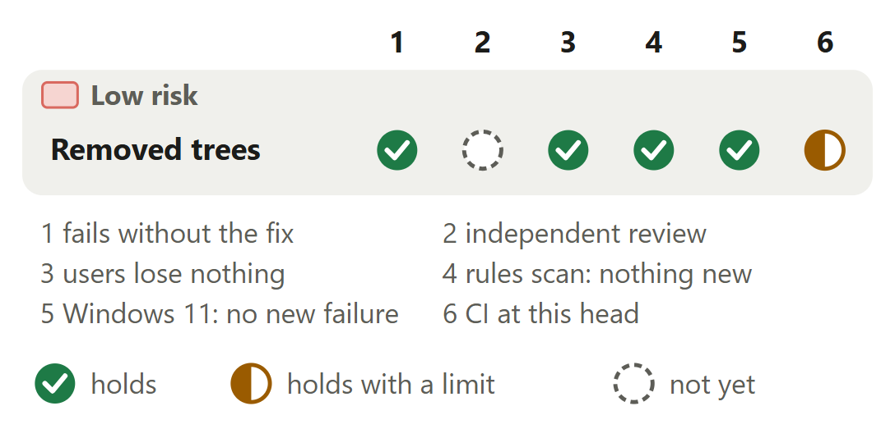

# A session's hooks stop waiting on worktrees removed since it saw them

For [pull request #985](https://github.com/neralabs/rerail/pull/985), head 6ceff37d92. [report.html](report.html) is the same report as one page: download it and open it.

## 1. The decision

**May a session stop asking Git about a kept checkout whose `.git` entry is gone, keeping what it last read of it?**

**We recommend:** approve it: removed worktrees stop costing each shell result and turn end a Git process, and every case of `main` still holds.

| Size | Risk and review | Waits on | Not verified |
|---|---|---|---|
| 428 lines in 3 files: 137 ship, 291 are tests and text | Careful. It decides which checkouts a session's walk asks Git about. | Nothing. No CI run here yet: the branch is not pushed. | 3 |

## 2. Intent, and the gap

| Change | Intended | Found | Now |
|---|---|---|---|
| Removed worktree, read again | A removed worktree is gone _(code comment)_ | Read again at every walk _(shape runs, both systems)_ | Closes the gap. |

Found on 21 November 2026 on a Windows 11 laptop whose hooks after shell commands took 10 to 17 s.

Sources at main, and causes

| Change | Where main states the intent | The cause, and what was measured |
|---|---|---|
| Removed worktree, read again | `src/engine/code-rule/code-rule-bridge.ts` at 1609ac3a30: `#syncWorktrees` (the comment quoted) calls `#forgetWorktrees`, which drops the worktree's files and view but not `SourceDiscovery.heads`; `#readCheckouts` reads every kept `HEAD` outside the listed worktrees through `readHeads`, before each walk of the session folder. | After `git worktree remove` the worktree leaves Git's list, so its kept `HEAD` falls among the checkouts `#readCheckouts` reads at every walk. Its `.git` is gone, so the HEAD reader asks Git, one process after another inside the walk the hook waits for: 3,447 Git processes in 5 minutes with 181 removed on Windows 11, about 25 ms per removed worktree at each walk. |

## 3. Where to look

1. **Read first**, 5 min: `code-rule-bridge.ts`: `#forgetWorktrees`, `#syncWorktrees`, `walkHeld`, `walkKeeps`, `#finishWorktreeWalk`, `#readCheckouts`, `standingCheckouts`. Can a checkout whose `.git` stands go unread, or a worktree listed for a whole walk lose that walk?

**Then skim**, 4 min: Nine cases in `code-rule-bridge.test.ts`: worktrees removed, unlisted with folders kept, unlisted mid-walk or as Git verdicts read, relisted mid-take or mid-walk, added again; a deleted checkout, a `.git` moved aside.

## 4. Risk against verification

One change, low risk: a checkout whose `.git` stands is read as before; only one whose `.git` is gone stops starting Git.

Each limit, and each check that does not hold yet

| Change | Check | Its limit, or why it does not hold yet |
|---|---|---|
| Removed trees | independent review | No independent review of this head yet. |
| Removed trees | CI at this head | No CI run at this head on GitHub yet: the branch is not pushed. CI's lint and type-check job passes on Linux x64. |

## 5. The changes

**Removed worktrees cost no Git**, low risk: Hook after `git status`, Windows 11, 181 worktrees removed: `main` 4,764 ms, 4073cf0bf5 209 ms.

<b>6. The decisions</b>

**Skip a kept checkout whose `.git` is gone, or let go of it?**

**We chose** skip it and keep its snapshot: the walk's result is `main`'s failed read, without the Git process. **Would change our mind:** A session seeing thousands of nested checkouts deleted for good keeps their snapshots; letting go of one whose folder went would then earn its case.

| Option | What a user gets | Cost | What it breaks |
|---|---|---|---|
| Skip it and keep its snapshot **(chosen)** | No Git process for it; a `.git` that comes back is judged against what the last walk read, as at `main`. | One `lstat` per kept checkout at each walk; a deleted checkout's snapshot stays in memory until the session ends. | Nothing `main` does. |
| Let go of it | The same speed, and no snapshot left. | The same `lstat`. | A `.git` back after a while is judged as a checkout first seen, so at the first walk after, Git's own writes there can read as the session's, or the reverse. |
| Keep asking Git | Nothing new. | A Git process per kept checkout and walk. | The wait stays and grows with every removed worktree. |

**Evidence.** With the entry gone, `main`'s read starts Git, which finds no checkout, so the walk keeps no `HEAD` and no entries and the snapshot stays: the same result. The case with the `.git` moved aside reads it as before once it is back, at both.

<b>7. How it fits</b>

It stands on `main` 1609ac3a30. It shares `code-rule-bridge.ts` and its test file with #974; Git merges #974's head 3b1685caf4 and it alone. Our change for #795, not open yet, touches none of its files and does not end this cost.

<b>8. What is not covered</b>: 3 not verified, 4 smaller gaps, 1 limit that stays

1. **Appearing worktrees** the first walks after many worktrees appear stay slow (#984): on Windows 11 one hook took 22 to 26 s as 130 appeared, at `main`, here and with our change for #795.
2. **macOS** never ran; its file calls answer as Linux's do.
3. **How many** worktrees people's sessions see and remove was not measured.

**Smaller gaps**

- **Router state.** The router keeps each worktree root's eligibility row, and the rule lane of a worktree in which an edit was audited, until the session ends; neither starts Git or reads a file per root at a boundary, and no slow hook here came from them.
- **Evaluator failure.** As at `main`, a failed evaluator call puts back what the session saw of a worktree Git stopped listing and listed again inside that call, so a write in the new worktree is judged against the removed one's file.
- **Shell command across both.** As at `main`, a shell command that ran across both updates keeps what the session saw of a path in such a worktree before it, and the next walk judges that file against the removed worktree's.
- **Suspended session.** A worktree removed while the session was suspended keeps its `HEAD` after the session opens again, at `main` and here; here no walk asks Git about it, and a write in a new worktree at that path was recorded as first seen at both.

**Limits that stay**

- The snapshot of a checkout deleted for good inside the session folder stays in memory until the session ends, at one `lstat` per walk.

## 9. What we ask of you

We ask no ruling.

<b>10. Evidence</b>

The description on GitHub is the record: "How you tested it" holds the runs on `main` and here.

| Where | What ran | Result |
|---|---|---|
| Windows 11, one machine alone | Two sessions through the registered Claude Code hooks and a daemon, 51 then 130 worktrees seen and removed, `main` and 4073cf0bf5 each built from its commit | `main`: hook after `git status` 4,764 ms median with 181 removed (19 hooks at or over 2 s), 1,459 with 51; 3,447 Git processes in 5 minutes. 4073cf0bf5: 209 and 209, turn ends 182; no hook at or over 2 s; 9 Git processes; the shell write that breaks a rule reported at its result. |
| Linux x64, one machine | The same at `main` and 86c385dc85 | `main`: shell results 772 ms median with 181 removed, 406 with 51. 86c385dc85: 174 and 169, turn ends 175; the shell write that breaks a rule reported at its result. |
| Linux x64 | Each new line taken out in turn, and the cases at `main`, at the first commit and at dce28fdd94 | Every one fails its own case (vitest exit 1); the head passes them all. |
| Windows 11 | The 14 test files importing the changed module at 4073cf0bf5, engine built for that commit | 559 passed, 2 skipped, none failing; `main` 549 passed, 1 skipped, 1 timing case failing at `main` only. |
| Linux x64 | The same 14 files at 4073cf0bf5 and at `main` on one machine; the changed test file at this head | 556 passed and 5 skipped, none failing; `main` 546 passed and 5 skipped; at this head 305 passed, 3 skipped. |
| Linux x64 | CI's lint and type-check job, and the reviewer's rules against `main` 1609ac3a30, at this head | Each step passes; no new finding. |

**Sources.** The branch at 6ceff37d92 and its diff against `main` 1609ac3a30, read on 22 November 2026; runs on Linux x64 machines and Windows 11 machines.

