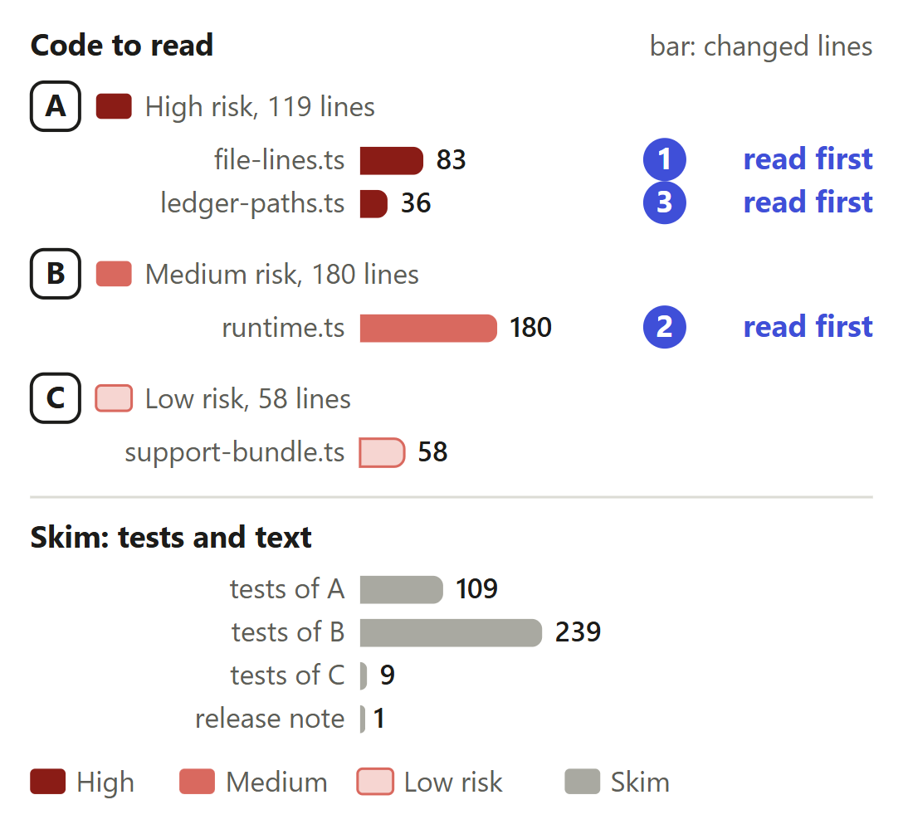
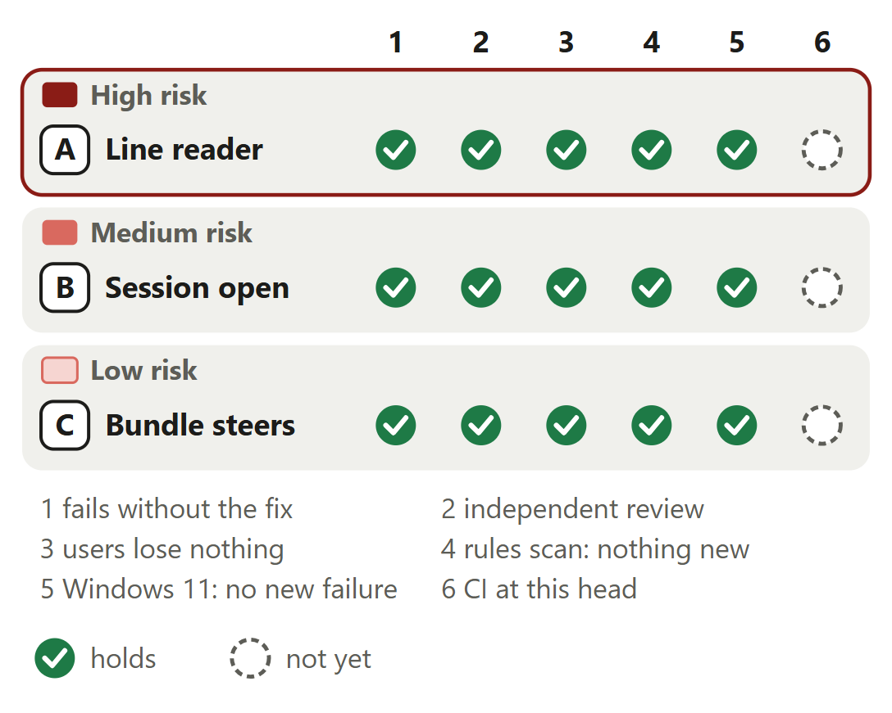

# A session's record past 512 MB opens after a restart

For [pull request #1103](https://github.com/neralabs/rerail/pull/1103), head 416732add6. [report.html](report.html) is the same report as one page: download it and open it.

## 1. The decision

**May a session's open read its record a line at a time, and keep of it only what the open reads?**

1. A session whose record passed 536,870,888 characters opens again after a restart.
2. An open holds no closed call's before-texts, and no hook host's sample texts.

**We recommend:** approve it: at `main` and in 0.2.1 every event of such a session fails after a restart; here it opens with the same entries, and its case costs 1.3 s.

| Size | Risk and review | Waits on | Not verified |
|---|---|---|---|
| 715 lines in 8 files: 357 ship, 358 are tests and text | High-risk path. It edits `src/engine/storage/`, which a maintainer approves. | Nothing. No CI run at this head yet: not pushed. | 3 |

## 2. Intent, and the gap

| Change | Intended | Found | Now |
|---|---|---|---|
| A. Session reopens | A session reopens from its ledger _(a test's name)_ | Past 512 MB every event fails _(the loop, 2 versions)_ | Closes the gap, changes answer 1. |
| B. What an open holds | Open calls restored, hook samples not kept _(code comment)_ | Every entry held, twice _(one run each)_ | Closes the gap, changes answer 2. |
| B. Torn line on Windows | Torn last line cut off _(code comment)_ | Windows: EPERM at every event _(the torn-line case)_ | Closes the gap. |
| C. Bundle steers | Bundle lists the ledger's steers _(code comment)_ | Past the limit: not found _(our reading)_ | Closes the gap. |

A session open 16 days, met on 25 November 2026; shown at `main` d54013c841 on Linux x64 and Windows 11, and in 0.2.1.

Sources at main, and causes

| Change | Where main states the intent | The cause, and what was measured |
|---|---|---|
| A. Session reopens | `test/runtime/session-samples.test.ts`: "stay in its ledger when the session opens again from it, as after an idle close or a daemon restart". `#openLedger` in `src/runtime/runtime.ts` reads the ledger through `readLines`. | `readLines` read the file through `readLedgerFile`, `handle.readFile("utf8")`, into one string; past 536,870,888 characters Node throws `RangeError: Invalid string length`, and every event of the session fails at its open. |
| B. What an open holds | `unresolvedCodeRuleCalls`: "Code-rule calls recorded without a matching result"; `MutableContentSource`: "One that does not keep them (a hook host's session, `keepsSamples`) holds none". | `validatedLedger` ran over all values once the whole file was read, and `compactValidated` copied each entry; `ledger.entries` kept a closed call's before-texts and a hook host's sample texts through the open. |
| B. Torn line on Windows | `readLines` sets `truncateTo`; `appendJsonLine` in `src/runtime/runtime.ts` truncated to it through the handle it opened with `O_APPEND`. | On Windows a handle opened to append holds append rights only, and a truncate needs write rights. |
| C. Bundle steers | `readSteers` in `src/cli/support-bundle.ts`: "The steers as delivered, from the session's ledger", read through `readFileSync(path, "utf8")`. | `readQuietly` returns undefined on any error, so a ledger past Node's string limit reads as missing. |

## 3. Where to look

1. **Read first**, 6 min: `file-lines.ts`: `LineSplitter.push`, `eachLine`. Does each line, and the last line's byte offset, come out as a decode of the whole file gives?
2. **Read first**, 8 min: `runtime.ts`: `readLines`, `readSessionLedger`, `KeptLedger`, `appendJsonLine`. Does any reader of an open's entries need a closed call's before-text or a hook host's sample text?
3. **Read first**, 2 min: `ledger-paths.ts`: `openLedgerToRead`, `readLedgerLines`. Do the folder checks and the no-follow open run before the first read, as for `readLedgerFile`?
4. 2 min: `support-bundle.ts`: `readSteers`, `ledgerSteers`, `deliveredSteer`.

**Then skim**, 4 min: One case writes 537,919,488 bytes in lines `rerail scrub` pads, then opens the session; the reader cases feed reads of 1 to 16 bytes.

## 4. Risk against verification

Start at the line reader: every session's open reads through it.

Each limit, and each check that does not hold yet

| Change | Check | Its limit, or why it does not hold yet |
|---|---|---|
| A to C | CI at this head | No CI run at this head on GitHub yet: the branch is not pushed. |

<b>5. The changes</b>

**A. Records read line by line**, high risk. Record of 600 MB after a restart: 4 of 4 events answered 400 at `main`, served here.

- **Problem:** After an update, `rerail daemon stop` or a reboot, a session whose record passed 536,870,888 characters gets every hook event answered 400, nothing recorded or checked, with no word in the coding agent.
- **Who meets it:** A session open for weeks: one open 16 days with about 54,000 tool calls wrote 655 MB, about 12 KB a call.
- **What it does:** `eachLine` reads the file in 1 MiB reads from the no-follow handle and hands each line on as it is read, holding one line's bytes at most; `readLedgerLines` runs the records folder's checks first, as `readLedgerFile` does.
- **Risk:** High: every session's open reads through it, and a wrong cut would lose or corrupt entries.
- **Check:** That `LineSplitter.push` copies what it keeps past a read, decodes a line only once its newline is read, and that `start` is the byte offset of the last line.
- **Picture:** A session with a record of about 600 MB, after the daemon restarts: at main 0 of its 4 hook events are served, each answered 400 Invalid string length; with this change 4 of 4 are served, on Windows 11.
- **Method:** The loop: a Claude Code session through the built hook and daemon, its record grown with copies of its own lines to 600 MB, the daemon stopped and started, then 4 of its events; at `main` on Linux x64 and Windows 11, here on Windows 11.

**B. Session open keeps less**, medium risk. One open of the loop's record: 47,905 closed calls' before-texts and 98,804 sample texts no longer held.

- **Problem:** The open read every value, then copied each into an entry, and held every closed call's before-texts and a hook host's sample texts, which nothing reads; on Windows a torn last line failed every later event.
- **Who meets it:** Every session's open after a restart, the more so the longer the session; the Windows defect, a session whose record a crash left mid-line.
- **What it does:** `readLines` hands each value to `take` as it is read; `readSessionLedger` takes each to its entry and `KeptLedger` lets a call's before-texts go once its result is read or its id is taken, and drops a hook host's sample text; `appendJsonLine` cuts a torn line through its own handle.
- **Risk:** Medium: an entry dropped that an open needed would restore a call without its before-texts or lose a sample an OMP session reads.
- **Check:** That `KeptLedger` closes a call at its result and at a later call of the same id, never at another, and that `#openLedger` keeps sample text for `keepsSamples` hosts.
- **Picture:** At the open of a Claude Code session's 600 MB record of closed calls, main kept the before-texts of all 47,905 calls and the text of all 98,804 samples; with this change it keeps none of either, and their entries stay.
- **Method:** Counted from the record the loop grew with 0.2.1 (600,009,384 bytes): its `policy-call` and `sample` lines, all of closed calls; what `KeptLedger` keeps of them follows from its cases.

**C. Support bundle reads lines**, low risk. Bundle of such a session: no steers and a ledger not found at `main`, its steers here.

- **Problem:** `rerail support-bundle` for a session past the limit says its ledger was not found, so its steers' text is missing, in the very bundle a person makes for it.
- **Who meets it:** A person who makes a bundle for a session whose record passed 536,870,888 characters.
- **What it does:** `ledgerSteers` reads the ledger with `eachLineSync`, the last line included, and `deliveredSteer` takes each `delivery` line as `readSteers` did.
- **Risk:** Low: what leaves in a bundle is unchanged; only how the file is read.
- **Check:** That a ledger that cannot be read still reads as not found, and the steers' cap is the same.
- **Picture:** For a session whose ledger is past Node's string limit, main's bundle reports the ledger not found and no steers; with this change it reads the ledger and its steers.
- **Method:** By the code at `main`: `readFileSync(path, "utf8")` throws past the limit and `readQuietly` returns undefined; the bundle at this size was not run.

<b>6. The decisions</b>

**Read a line at a time, read one Buffer, refuse past the limit, or rotate?**

**We chose** a line at a time from the same no-follow handle: a record's size alone no longer fails an open. **Would change our mind:** A maintainer who would bound the record itself; the reader stays right whatever bounds it later.

| Option | What a user gets | Cost | What it breaks |
|---|---|---|---|
| Read a line at a time **(chosen)** | A record past the limit opens; one line in memory at a time. | A reader of 83 lines, shared with the support bundle. | Nothing found. |
| Read the file as one Buffer and split it | Records up to 2 GiB open. | The whole file in memory at each open. | `readFile` refuses a file over 2 GiB (`ERR_FS_FILE_TOO_LARGE`): the same failure later. |
| Refuse past the limit with a clear message | The person learns which file to rename. | Little code. | The session still loses every check until a person acts. |
| Rotate the record past a size | A record that stays small. | A snapshot of all an open reads as a new file's first lines; the scrub, bundle and lost-events walk taught to read it. | A design change, beyond this fix. |

**Evidence.** At `main` and in 0.2.1 a 600 MB record failed every event after a restart; a Buffer read would carry it to 2 GiB and then fail the same way. Here a record of 537,919,488 bytes opens in 1.3 s on Linux x64, and the loop's record in 7.9 s on Windows 11.

**Keep every entry at an open, or only what the open reads?**

**We chose** drop a closed call's before-texts and a hook host's sample texts as each line is read. **Would change our mind:** A reader of an open's entries that needs either; none does at `main`.

| Option | What a user gets | Cost | What it breaks |
|---|---|---|---|
| Keep only what the open reads **(chosen)** | An open's peak memory about halved at 600 MB and 2 GB. | Two rules about which entries an open reads, each with its case. | Nothing found. |
| Keep every entry, as `main` did | The same entries in memory as before. | Memory that grows with the record: the before-texts and sample texts are about 96% of its bytes. | At 2 GB the open took the daemon to 4,686 MB, near its 4,288 MB heap limit: a larger record would pass it. |
| Drop only the closed calls' before-texts | Less to review. | Tool inputs and results, about three quarters of a hook host's record, still held. | Nothing, but memory still grows with the record. |

**Evidence.** On one Linux x64 machine: with the line reader alone an open of 2 GB peaked at 4,686 MB of daemon memory, here 2,079 MB; at 600 MB, 2,103 against 1,159 MB; the opens took the same time, 7.3 to 7.8 s and about 22 s.

<b>7. How it fits</b>

It stands alone on `main` 80cfc21dec, by Git's own merge: it needs no other change and none needs it.

This change stands on main 80cfc21dec, and needs no other change; it merges with the open pull requests #1076 and #1095, which share none of its files, with no conflict.

**The trial merges.** #1076 and #1095 are open and edit none of its files; Git merges this head with each and with `main`, exit 0.

<b>8. What is not covered</b>: 3 not verified, 3 limits that stay

1. **The record's growth** is not bounded, about 12 KB a tool call; an open reads every line: 1.7 s at 100 MB, 21.8 s at 2 GB.
2. **Linux x64, 30 rounds** of the 3 changed test files run on GitHub's runner, not on a machine of ours.
3. **macOS** never ran.

**Limits that stay**

- A single line over 536,870,888 characters still fails an open: a tool result or before-text that size.
- `rerail scrub` still reads a whole record as one Buffer; it has no string limit, and its memory grows with the file.
- An OMP or Pi session keeps its samples' text at an open, as its content source holds them while it runs.

## 9. What we ask of you

Asks 1 and 2 rule on answers 1 and 2.

1. **May a session open from a record past 536,870,888 characters, read a line at a time?** We recommend yes: today every event of such a session fails.
2. **May an open drop a closed call's before-texts and a hook host's sample texts as it reads them?** We recommend yes: no reader of an open's entries takes them.

<b>10. Evidence</b>

The description on GitHub is the record: "How you tested it" holds the runs at `main`, 0.2.1 and here.

| Where | What ran | Result |
|---|---|---|
| Linux x64 | The loop at `main` and with 0.2.1 from npm: a session's record of 600,068,546 and 600,009,384 bytes, the daemon restarted, 4 events | 4 of 4 answered `400 Invalid string length` on both; the second session served; daemon peak 1,544 and 2,291 MB. |
| Windows 11 | The loop at `main` and at this head | `main`: 4 of 4 answered 400. Here: 4 of 4 served, the first, which opened the record, in 7.9 s. |
| Linux x64, Windows 11 | The case file on `main` | The record case fails with `RangeError` on both; the torn-line case with `EPERM` on Windows 11. |
| Windows 11 | The 3 changed test files, 30 rounds | 30 of 30 passed. |
| Linux x64, Windows 11 | The 18 importing test files here, the 16 of them at `main` | All passed on both systems, at both. |
| Linux x64 | 14 single-line changes to the deciding lines | Each fails a case. |

**Sources.** The diff against `main` d54013c841 and the runs, read on 25 November 2026.

