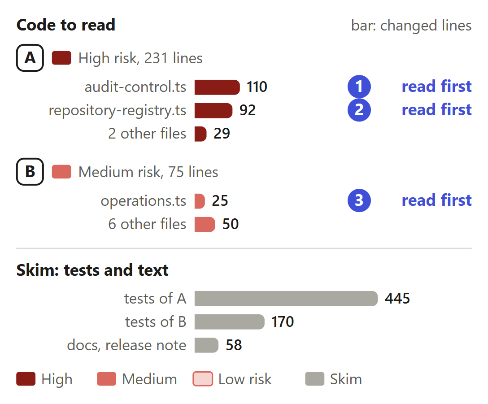
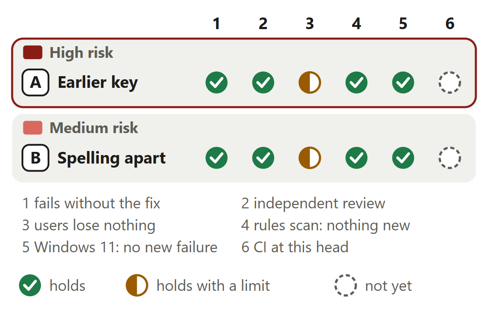

# Settings: an earlier version's Log mode and stop read again on Windows

For [pull request #753](https://github.com/neralabs/rerail/pull/753), head f9c9957e9. [report.html](report.html) is the same report as one page: download it and open it.

## 1. The decision

**Does reading the key an earlier version gave a Windows folder bring back Log mode and a stop without changing anything else?**

**We recommend:** approve it: beside 0.1.4, Log mode and a stop come back in every folder measured, at main's cost per hook event in each spelling the daemon resolves; one reading is a decision you can reverse.

| Size | Risk and review | Waits on | Not verified |
|---|---|---|---|
| 979 lines in 20 files: 306 ship, 673 are tests and text | Careful. It changes what the agent is told: a code owner. | Nothing. The approach was chosen on #666. | 3 |

## 2. Intent, and the gap

| Change | Intended | Found | Now |
|---|---|---|---|
| A. Settings kept on update | Saved settings apply after an update _(our reading)_ | Steer where Log was saved _(one reading)_ | Closes the gap. |
| B. Nothing more per event | Nothing more per hook event _(our reading)_ | 93 file calls where main makes 57 _(one reading)_ | Closes the gap. |

Found on 13 November 2026 on a Windows 11 machine, reading a database 0.1.4 wrote with main.

Sources at main, and causes

| Change | Where main states the intent | The cause, and what was measured |
|---|---|---|
| A. Settings kept on update | `docs/windows.md`, Checkout keys: main keys each record through `checkoutRealpath`, the native realpath on Windows; 0.1.4 keyed audit settings and a folder outside Git through Node's JS realpath (`audit-control.ts` line 82 and `checkout-control.ts` line 12 at the tag). | `canonicalWorkspace` and `physicalPath` changed from the JS realpath, which keeps the caller's letter case, drive letter and 8.3 name, to the native one, which gives the disk's spelling. Nothing moved the rows 0.1.4 saved, and every read asks only the new key. |
| B. Nothing more per event | The issue's chosen fix on #666: small, no storage change, nothing extra per event. | The hook sent the folder as spelt in place of its real path, so the daemon resolved that spelling on each event. |

## 3. Where to look

1. **Read first**, 12 min: `audit-control.ts`: `#settingsRow`, `#savedHere`, `#earlierKey`. Can a stored row lose to the earlier one, or another folder's earlier row count outside Git?
2. **Read first**, 8 min: `repository-registry.ts`: `ownStarted`, `earlierKeyOf`, `spelledCheckout`. Does another repository's stop, or another folder's spelling, ever decide?
3. **Read first**, 6 min: `operations.ts`: `readingSpelling` and the `spelling` value. Does the spelling reach only the start state of the folder asked about?
4. 5 min: `session-presentation.ts`, `repository-start.ts`, `operation.ts`, `stores.ts`, `daemon-control.ts`, `daemon.ts`, `checkout-control.ts`, `repository-model.ts`: the rest.

**Then skim**, 6 min: The earlier key's tests run on Windows only and build 0.1.4's key with Node's JS realpath; the hook's request is checked on every platform.

## 4. Risk against verification

Start at change A: it changes what the agent is told. CI has not run.

Each limit, and each check that does not hold yet

| Change | Check | Its limit, or why it does not hold yet |
|---|---|---|
| A. Earlier key | users lose nothing | 0.1.4 from npm saved four settings in 18 folders: Log mode and a stop come back, and two settings stay lost as at main, as decided. |
| B. Spelling apart | users lose nothing | Per hook event, the daemon's file calls and statements equal main's in every spelling it resolves, inside and outside Git; one it cannot resolve costs 4 to 7 more each event. |
| A and B | CI at this head | CI runs when the pull request opens. |

<b>5. The changes</b>

**A. Earlier key read at lookup**, high risk. Log mode after 0.1.4 under another spelling: Steer at main in 8 of 8, Log here.

- **Problem:** After an update from 0.1.4 on Windows, Log mode and a stop saved for a folder opened under another spelling are not found: main keys records by the disk's spelling, 0.1.4 by the folder as spelt.
- **Who meets it:** A person on Windows updating from 0.1.4 or earlier who set Log mode or stopped a folder opened under another spelling; VS Code spells every folder `c:\…`.
- **What it does:** Each audit settings read, and each start check of a folder outside Git, also reads the key 0.1.4 gave the spelling where the stored one has nothing; outside Git only for the folder's own repository.
- **Risk:** High. It changes what the agent is told and where Rerail runs; a wrong row would give a folder another's Log mode.
- **Check:** Through 0.1.4 from npm and each build's daemon, hooks and status line on Windows 11: Log in 8 of 8 and the stop in 3 of 3, where main reads Steer and runs.
- **Picture:** Of 8 folders where 0.1.4 saved Log mode under another spelling, main reads Log in none and this head in all 8.
- **Method:** 0.1.4 saved each setting in 18 folders; main and this head each read a copy with their own daemon.

**B. The spelling handed apart**, medium risk. Per hook event outside Git: 93 file calls in lower case before, 57 here, as at main.

- **Problem:** The head before this sent the daemon the folder as spelt, so the daemon resolved that spelling on every hook event: 93 file calls in lower case where main makes 57.
- **Who meets it:** Every hook event in a folder outside Git spelt otherwise than stored on Windows; VS Code spells every folder `c:\…`.
- **What it does:** The hook asks about the real path, as main does, and hands the spelling apart as `spelling`, only to a daemon whose state file says it reads it; the daemon forms 0.1.4's key from it once per spelling it can resolve.
- **Risk:** Medium. One optional request value and one state-file field, Windows only; an older daemon is not sent it.
- **Check:** Through the daemon's route with what each build's hook sends, on Windows 11: the same file calls and statements as main in every spelling the daemon resolves, inside and outside Git.
- **Picture:** Per hook event in a folder outside Git spelt in lower case, the daemon makes 93 file calls at the head before this and 57 here, as at main.
- **Method:** Counted public file calls and SQLite statements per hook event, after a spelling's first, at main, the head before and here.

<b>6. The decisions</b>

**Should the earlier rows be read where they are, or copied to the stored key?**

**We chose** reading them at lookup, as the maintainers chose on #666: small, no storage change, and deleted once 0.1.4 is gone. **Would change our mind:** Installs still on 0.1.4 after the next releases, so that the lookup could never be deleted.

| Option | What a user gets | Cost | What it breaks |
|---|---|---|---|
| Read the earlier key where the stored one has nothing **(chosen)** | Log mode and a stop come back, and a start and a stop 0.1.4 makes later are read too. | 266 source lines in 11 files, 150 of them code; no storage change; per hook event main's file calls and statements in each spelling the daemon resolves. | A status line hidden in a folder opened in another letter case, and a checkout's rule setting outside Git through a mapped or subst letter or an 8.3 name, stay lost, as at main. |
| Copy the rows to the stored key, with a table of spellings | Those two settings come back as well. | 802 source lines in 16 files, a migration step and a new table under the storage folder. | What 0.1.4 writes later is not read: after 0.1.4 changed the scope, the copy kept the old one. |
| Move the rows to the stored key, with no table | The same as the copy. | A migration step. | An earlier version sharing the database loses what it saved. |

**Evidence.** Measured on Windows 11 with 0.1.4 from npm saving each setting, then main and this head each reading a copy through their own daemon, hooks and status line; the copy's figures are from the measured options posted on #666.

**When does a row saved under the earlier spelling belong to this folder?**

**We chose** outside Git, only for the folder's own recorded repository; in a Git checkout always, as 0.1.4 read it. **Would change our mind:** A record that ties a Git checkout's row to it, or a report of a letter re-pointed between two Git checkouts.

| Option | What a user gets | Cost | What it breaks |
|---|---|---|---|
| Outside Git by the recorded repository; in a Git checkout always **(chosen)** | Log mode back in all 8 folders; through a re-pointed letter a folder outside Git steers, as at main. | Two primary-key lookups inside the read's one statement; outside Git or not read once per spelling. | Through a re-pointed letter a Git checkout takes the Log mode saved through it, as with 0.1.4. |
| Always | The same 8. | Nothing more. | Through a re-pointed letter any folder takes another's Log mode, and its agent is no longer told of broken rules. |
| Only outside Git | No other folder's Log mode anywhere. | The same as chosen. | Log mode lost in every Git checkout opened under another spelling, 4 of the 8. |

**Evidence.** Measured on Windows 11 with 0.1.4 from npm saving Log mode through a subst letter, then pointing the letter at another folder, inside and outside Git, read by main, the head before this guard and this head.

<b>7. How it fits</b>

It stands on `main` at e8a6b0b5a alone. #676 copied rows to fix the same issue; it was closed after the decision on #666. #674, #680 and #720 each meet it in a merge conflict; the others that share a file merge clean.

This pull request is based on main at e8a6b0b5a and needs no other change. In trial merges it meets the draft #674 in two files, and #680 and #720 in one each; #698, #708, #714, #742 and #677 merge clean.

**Shared files and trial merges.** #674 shares five source files and a test file: merge conflicts in `session-presentation.ts` and `repository-start.ts`, and whichever lands second keeps both sides. #680 has a merge conflict in `audit-control.ts`, #720 one in `docs/reference.md`. #698, #708, #714, #742 and #677 share files and merge with no conflict of this change's.

<b>8. What is not covered</b>: 3 not verified, 1 smaller gap, 2 limits that stay

1. **Two settings stay lost** a status line hidden in a folder opened in another letter case, and a rule turned off outside Git through a mapped or subst letter or 8.3 name.
2. **A Git checkout through a re-pointed letter** takes the Log mode 0.1.4 saved through that letter, as 0.1.4 did: no record says whose row it is. Outside Git the folder's own repository decides.
3. **macOS and Linux** read the same keys as main; Linux x64 ran the tests, macOS never ran.

**Smaller gaps**

- **A spelling the daemon cannot see** (a mapped or subst letter of another logon session, as for an elevated daemon) costs 4 to 7 file calls every event, with main's answer. Keeping a failed lookup per spelling ends that; a letter mapped later then waits for the daemon's restart.

**Limits that stay**

- Under another letter case, 0.1.4's next start or stop there decides, as at main: 0.1.4 compares Windows paths without letter case.
- A session already open when 0.1.4 stops a folder outside Git through a mapped letter keeps showing Rerail on in its status line.

## 9. What we ask of you

We ask no ruling.

<b>10. Evidence</b>

The description holds the table under "How you tested it", the fails-first runs, the mutants, and the statements and file calls per check.

| Where | What ran | Result |
|---|---|---|
| Windows 11, 0.1.4 | Saved Log mode, a stop, a hidden status line and a rule off in 18 folders, and Log through a subst letter later re-pointed; main and this head read a copy each, and hooks and daemons of different versions met | Log: Steer at main in 8 of 8, Log here. Stop outside Git through a letter or 8.3 name: main runs, this head stops (3 of 3). Re-pointed: outside Git Steer at both; in Git Log here, as decided. An older daemon answers this head's hooks as main's. |
| Windows 11 | File calls and statements per hook event, with what each build's hook sends | Outside Git main 57, the head before 93 in lower case and 65 through subst, here 57 in every spelling the daemon resolves, 61 to 64 in one it cannot; the same statements. |
| Windows 11 | 77 test files; the new and changed cases 20 times; 29 mutants | 2,163 passed; 2 timing tests failed beside other runs and passed alone at main (5 of 5) and here (4 of 4). The 20 runs: 0 failed. Every mutant fails a case. |
| Linux x64 | The same 77 files, CI's integration job, the changed cases 20 times | 2,138 passed; 1 race case failed, as in main's run there. Integration: 90 passed, 0 failed. The changed cases: 20 of 20 runs passed. |
| Linux x64 | The rules scan against main | No new finding against main at e8a6b0b5a, with the published 0.1.1 and with Rerail built from main; highest complexity 5. |

**Sources.** The branch at f9c9957e9 against main at e8a6b0b5a; the tags v0.1.3 and v0.1.4 and 0.1.5's release commit for what each version keys.

