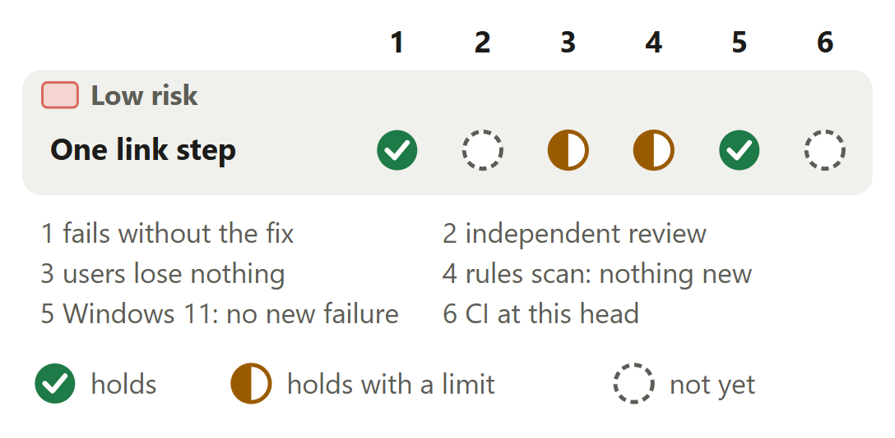

# `rerail start` and `rerail start --json` leave the daemon alike

For [pull request #1200](https://github.com/neralabs/rerail/pull/1200), head 04b0c8c6da. [report.html](report.html) is the same report as one page: download it and open it.

## 1. The decision

**May `rerail start` start the daemon where none runs, and `rerail start --json` keep another version's running daemon, so both forms leave it alike?**

1. `rerail start` with no daemon running starts one and shows its link.
2. `rerail start --json` keeps a running daemon of another version, and shows its link.

**We recommend:** approve it: both forms now end in one step, first-time set-up still ends on the active version's daemon, and a session's next event still replaces another version's daemon, in OMP and Pi on its port.

| Size | Risk and review | Waits on | Not verified |
|---|---|---|---|
| 378 lines in 16 files: 93 ship, 285 are tests and text | Reviewer approval. REVIEW.md lists no high-risk path among the files that ship. | Nothing. It stands alone on `main` f340b24d8d, merged in by Git. | 2 |

## 2. Intent, and the gap

| Change | Intended | Found | Now |
|---|---|---|---|
| No daemon running | Same step, as JSON _(docs)_ | Two different daemon answers _(the issue's runs)_ | Closes the gap, changes answer 1. |
| Another version's daemon | Hooks replace it _(code comment)_ | JSON form restarts it _(the issue's runs)_ | Closes the gap, changes answer 2. |

Reported on 26 November 2026 at `main` 8d62b17476 on Windows 11 and Linux x64; still shows over `main` f340b24d8d's source.

Sources at main, and causes

| Change | Where main states the intent | The cause, and what was measured |
|---|---|---|
| No daemon running | `docs/how-setup-works.md`, "How set-up asks": "`--json` on `rerail setup` and `rerail start` prints one `{ step, screen, question }` object per run." | `runStartCommand` in `cli.ts` asked `readRulesDashboard`, which never starts a daemon; `startRerailStep` asked the set-up environment's `dashboard`, whose `activeDaemon` starts one where none runs. |
| Another version's daemon | `setup-cli.ts` at `main`, `activeDaemon`: "The daemon of the active install; it serves every repository. A running daemon from another package (an older version) ... is replaced". | Set-up's dashboard step keeps only a daemon of the active package (`keptDaemon`), and the JSON form of `rerail start` ended on that step. |

## 3. Where to look

1. **Read first**, 5 min: `repository-setup.ts`: `startRerail`, `startRerailStep`, `summary`, `DashboardDaemon`. Should both forms end on the running daemon's link, starting one only where none runs?
2. 4 min: `setup-cli.ts`: `dashboardDaemon`, `KEPT_DAEMON`; `daemon-control.ts`: `keptOrReplaced`; `cli.ts`: `runStartCommand`; `cli/index.ts`, `harness/index.ts`: exports.

**Then skim**, 3 min: The integration cases run both forms, and OMP's and Pi's step then attach, through the built CLI and a real daemon; the doc paragraphs say what `rerail start` ends on.

## 4. Risk against verification

One change. Start at `startRerail` in `repository-setup.ts`.

Each limit, and each check that does not hold yet

| Change | Check | Its limit, or why it does not hold yet |
|---|---|---|
| One link step | independent review | No reader outside the author has read this head yet. |
| One link step | users lose nothing | `rerail start` with no daemon running now waits for one to start, as the JSON form did. Where none can be had, both show the link on the remembered or default port, as set-up does. |
| One link step | rules scan: nothing new | Rules scan at the last commit, 99a8867d9c, against `main` 6824b5aaf1 with Rerail built from `main`: no new finding, every function added or edited 5 or under. The published 0.1.1 cannot load `main`'s pack: no verdict there. |
| One link step | CI at this head | No CI run at this head on GitHub yet: the branch is not pushed. |

## 5. The changes

**One link step for both forms**, low risk: No daemon: `rerail start` showed no link at `main`; here both forms start one and show its link.

<b>6. The decisions</b>

**Which behaviour should both forms share?**

**We chose** start the daemon where none runs and keep any that answers, as our comment on #1140 said. **Would change our mind:** A maintainer preferring that `rerail start` move the home to the active version at once.

| Option | What a user gets | Cost | What it breaks |
|---|---|---|---|
| Keep any that answers; start one where none runs **(chosen)** | Both forms show a link; no checkout's start restarts the daemon other sessions use. | A daemon of another version runs until a coding agent's hook or a person replaces it. | Nothing found. |
| Both start or replace, as the JSON form did | The home moves to the active version at the first start. | Any checkout's start restarts the daemon every other session is using. | A daemon started with options a restart would drop, which `rerail update` leaves in place. |
| Both print a link only from a daemon that answers | No start ever starts or replaces a daemon. | No link where no daemon runs. | The link OMP's and Pi's picker shows today after `/rerail-start` with no daemon running. |

**Evidence.** The issue's runs, 5 of 5 on each system; a coding agent's hook replaces a daemon of another package on its session's next event (`runningDaemonEngineEndpoint`).

**How does OMP's and Pi's attach right after `/rerail-start` keep the link the picker showed?**

**We chose** replace another package's daemon on the port it had, as set-up's own replacements do. **Would change our mind:** A maintainer who wants OMP's and Pi's daemon always on a free port.

| Option | What a user gets | Cost | What it breaks |
|---|---|---|---|
| The attach replaces it on its port **(chosen)** | The link opens, also where the extension is older than the active version or autostart is off. | Bound to that port; a start fails if another program took it in between. | Nothing found. |
| The attach keeps any daemon that answers | Nothing is restarted. | The session talks to another version's daemon for its whole life. | The reason the attach replaces: an older daemon may not take the session's fields. |
| The picker's step replaces it, as `main` did | `main`'s behaviour in the picker. | A new flag to tell the picker from a person. | The link where the extension is older than the active version, as at `main`. |

**Evidence.** With the step keeping the daemon, the attach's free port left the link dead 5 of 5 on Linux x64; `main` 0 of 10.

<b>7. How it fits</b>

It stands alone on `main` f340b24d8d. #1175 and #1129 also edit `daemon-control.ts`; neither makes the start that takes any port, which this change moves. #1076, #1174, #1179, #1180 and #1181 merge cleanly with it; #1179 shares two docs and an export, in other lines.

<b>8. What is not covered</b>: 2 not verified, 2 limits that stay

1. **macOS** never ran.
2. **Windows in CI** the integration cases run in CI's Linux integration job only; on Windows they ran in our runs.

**Limits that stay**

- With no coding agent session running, a daemon of another version stays until a person restarts it, and nothing says so.
- A hook's replacement takes the remembered port, else 4737: a daemon that took a free port moves, as before.

## 9. What we ask of you

Asks 1 and 2 rule on answers 1 and 2.

1. **May `rerail start` start the active version's daemon where none runs, as `rerail start --json` did?** We recommend yes: both forms then show the link.
2. **May `rerail start --json` keep a running daemon of another version rather than restart it?** We recommend yes: other sessions use it, and hooks replace it.

<b>10. Evidence</b>

The description on GitHub is the record: "How you tested it" holds the runs at this head.

| Where | What ran | Result |
|---|---|---|
| Linux x64 | At this head: the six changed test files; with `daemon-control.ts` as `main` has it; over `main`'s `src/` | 410 passed; with `main`'s file only the two new cases fail; over `main` 9 cases, the OMP and Pi case passing there. |
| Linux x64 | At this head: 9 mutants; the issue's steps and OMP's and Pi's steps through the built CLI and a real daemon, 5 runs each; the 55 importers | Each mutant fails a case, two of them where this change meets #1175; 5 of 5 and 10 of 10 links answer; the importers fail only 11 pack-data cases, here and over `main`. |
| Linux x64 | At this head: 30 runs of each changed test file beside its CI shard neighbours | 30 of 30 runs of each, no failed round. |
| Windows 11 | At this head: the six changed test files; the two new-case files with `main`'s `daemon-control.ts` | 409 passed, 12 skipped; with `main`'s file only the two new cases fail, the link refusing the connection. |
| Windows 11 | At this head and at `main`: the 54 importers `main` has | 1,643 and 1,639 passed, the same 12 failures on each: 11 pack-data cases and a socket the machine refused. |
| Windows 11 | At this head: 30 runs of each changed test file beside its CI shard neighbours | 30 of 30 for each changed file; a neighbour's case timed out once, then passed 10 of 10 here and at `main`. |

**Sources.** The branch at 5461df4b47, Git's own merge of `main` f340b24d8d into the change, over an earlier one of `main` 06bedf6079 (its last commit 99a8867d9c), with the files both sides changed read at each merge, and its diff against `main` f340b24d8d, read on 27 November 2026; runs on Linux x64 and Windows 11 x64 machines.

