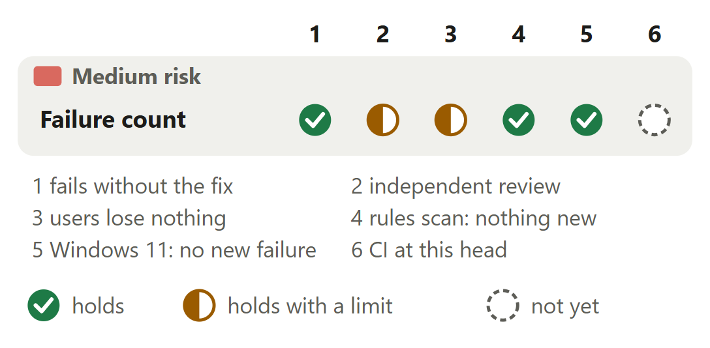

# Hook failures: `rerail status` counts every failure since the time it names

For [pull request #658](https://github.com/neralabs/rerail/pull/658), head e872cf241. [report.html](report.html) is the same report as one page: download it and open it.

## 1. The decision

**Does `rerail status` count every hook failure since the time it names, while the log moves and hooks record at once, as fast as `main`?**

1. The line leads with an outage on any failure after the last recorded event. **Changes the intent.**
2. With older failures gone, the line names when its count starts.

**We recommend:** rule on #577's three questions first, then read decision 1: a lock around the move would be shorter and is not built; the one state left open needs a lock every hook takes.

| Size | Risk and review | Waits on | Not verified |
|---|---|---|---|
| 2,503 lines in 5 files: 908 ship, 1,595 are tests and text | Standard. Medium risk; automated approval of 3046af36f only. | #577's three questions. No maintainer has answered. | 3 |

## 2. Intent, and the gap

| Change | Intended | Found | Now |
|---|---|---|---|
| The count | Full log moves; line counts 24 hours _(code comment, status line)_ | Count falls at each move; lines lost _(#577, measured runs)_ | Closes the gap, changes answer 2. |
| The outage lead | Leads when every failure is newer _(code comment, a test)_ | With `.1` counted, an outage hides _(a failing test)_ | **CHANGES THE INTENT: ANSWER 1.** Leads when any failure is newer. A maintainer must agree. |

Reported in #577, 12 November 2026.

Sources at main, and causes

| Change | Where main states the intent | The cause, and what was measured |
|---|---|---|
| The count | `src/harness/hook-failures.ts` at `main`. Line 14: "Past this size the file is moved to \`&lt;name>.1\`, replacing the one before; a failing hook writes on every event." Line 88, the line's text: "could not be recorded in the last 24 hours". Line 91, above `readHookFailures`: "The failures recorded since \`since\` (epoch ms), oldest first; none when the file is missing or unreadable." Line 46, above `recordHookFailure`: "Appends one failure." | Line 95 reads the live file alone, so the count falls to the failures since each move, every 1,100 to 1,300 failures. At a function seam, one process calling `recordHookFailure` 50 times a minute, it read 370 where 6,000 were owed at minute 120, on both systems. Line 61 renames the log to `.1`: of 30 hooks at once, a later one fails on a file gone and drops its line, or renames the new log over the full `.1`. |
| The outage lead | `src/harness/hook-failures.ts` at `main`, lines 76 to 77, above `hookFailureLines`: "When every failure is newer than the last recorded event, hooks run but nothing is recorded, and the line leads with that." `test/harness/hook-failures.test.ts` at `main`, line 46: "names the failures without that lead when events were recorded after some of them, and says nothing without any". | Line 85 at `main` leads only when `since.length === failures.length`. Without f8cf40dd6, the test "leads with an outage that began after the last recorded event once older failures moved aside" fails: the line reads `Hooks: 3 hook events could not be recorded in the last 24 hours`. With it: `Hooks run but nothing was recorded since <time>: 1 hook event failed, of 3 that could not be recorded in the last 24 hours`. The total that follows could go. |

## 3. Where to look

1. **Read first**, 30 min: `hook-failures.ts`: move (`moveAside`, `copyLines`), link (`placeFor`, `putBackLink`), line (`hookFailureLines`), read (`readLogParts`, `keptSinceOf`, `awaitingMovedAside`). Can a hook stopped or held up at any step lose a line, or status count one twice?
2. 2 min: `cli.ts`: `hookHealthLines`, one call site.

**Then skim**, 15 min: One `main` test changes its case (answer 1); two get 60 s, up from 5 (30 on Windows); none is removed.

## 4. Risk against verification

Start at check 3: one state writes where `main` does not.

Each limit, and each check that does not hold yet

| Change | Check | Its limit, or why it does not hold yet |
|---|---|---|
| Failure count | independent review | The automated reviewer approves 3046af36f with 0 blockers, 2 follow-ups and 1 nit; it has not reviewed the 16 commits and the merge since. Second runs from a separate checkout, and fixes, found 23 things at ten commits; the description lists each with its fix. The limit: no person on the team has reviewed or commented. |
| Failure count | users lose nothing | With both parts of the log full, `rerail status` takes 172.0 ms against `main`'s 171.5 on Linux x64 (median of 20, 6f563beed). `main` reads this version's logs after a downgrade. The limit: one state costs more than `main` (decision 2), in one a hook writes a line where `main` writes none, and eight cases are left (part 8). |
| Failure count | CI at this head | No CI result at e872cf241 when read on 17 November 2026. The last run, 43768974645 at 3046af36f: 24 checks, 19 pass, 5 are skipped, none fails. It passed on its third attempt; the first two each failed one test of `main` in a file this change does not edit, in `Unit tests (Windows, 2/2)` (#691, then #681). |

## 5. The changes

**The failure log and its count**, medium risk: Reads short under load. Windows 11: `main` 1,722 of 1,911, cd0d87fe2 none of 1,392. Linux x64: cd0d87fe2 7 of 648.

<b>6. The decisions</b>

**A take under each hook's name, or a lock around the move?** (ask 2)

**We chose** the take. `hook-failures.ts` grew from 112 to 938 lines. **Would change our mind:** a maintainer who wants the lock: since #503, an OS lock frees itself when its holder ends.

| Option | What a user gets | Cost | What it breaks |
|---|---|---|---|
| Take under the hook's own name, move on only when full, else give back **(chosen)** | Under load at cd0d87fe2, hooks lost no line and no status read missed a whole part. Built, with 81 tests in its file where `main` has 10. | 938 lines where `main` has 112. Two renames and a size check per move. The status read lists again and pauses while files move, and waits for a log a running hook holds (decision 2). | Eight cases stay (part 8), one of them a write `main` does not make. A hook stopped mid-move leaves a file until a later move removes it. |
| An OS lock around the whole move, with the size check under it | It would close three of the eight cases (the give-back by copy, the held-up write after it, a log still moving after the last pause), end decision 2's wait and shorten the module. | Not built, so not measured. Every hook that finds the log full takes the lock. The copy lock here takes 0.04 to 0.30 ms, and loading the engine in a fresh process 1.2 to 1.8 ms (d2e27d773, both systems). | It needs a rule for a hook whose engine does not load. The copy lock has one: the copy goes ahead without it. |
| `main`'s single rename | Nothing more. | Nothing. | Through real hooks: lines lost in 9 of 20 rounds on Linux x64; the count falls to 1 at each move. At a function seam: lines lost in 20 of 20 rounds, the count short in 20 of 24 readings. |

Before: At main, a hook that finds the log past 256 KB renames it straight to .1. A hook a moment later fails on a log already gone and loses its own line, or renames the new log another hook began over the full .1. After: With this change, a hook renames the log to a name of its own, then checks the size of what it took. Past 256 KB it moves the log to .1. If not, it gives the log back, by hard link or by copying its lines.

**Evidence.** The bursts and the counts under "How you tested it". The copy lock already uses `tryLockExclusive`, the engine's lock that #503 brought. #577's first text, kept in its edit history, described the take and set a lock aside because a stopped hook leaves it held. Its text today describes the bug, and two of its comments hold the three questions.

**How long may status wait for a log a hook holds?**

**We chose** 2 s past the log's last change. One state costs more than `main`: 420.0 against 162.4 ms, Linux x64. **Would change our mind:** how often that state happens, not measured; or decision 1's lock.

| Option | What a user gets | Cost | What it breaks |
|---|---|---|---|
| The log's change time within 2 s (6f563beed) **(chosen)** | From 2 s after the take, a stopped hook's log whose process id another process has costs what `main` costs: 172.7 against 168.7 ms on Linux x64, 274.4 against 282.5 on Windows 11. A running hook is waited for. | One process query and one stat per taken log. Inside the 2 s, each `rerail status` waits out its pauses: 420.0 against 162.4 ms on Linux x64, 549.9 against 200.0 ms on Windows 11 (medians of 20, real daemon). | That one state, for 2 s after a hook is stopped while it holds `.1` under its own name. The count is right in it, where `main`'s is not. How often it happens was not measured. |
| The process id alone (cd0d87fe2) | A running hook that took `.1` is waited for. | One process query per taken log. | Every status waits out all 8 pauses for as long as that process runs: 431.6 against 168.7 ms on Linux x64, 617.1 against 282.5 on Windows 11. |
| Wait only for a move seen during this read | No wait for a log a stopped hook left. | None. | No wait for a running hook that took `.1` before the first listing: the line says "in the last 24 hours" though the part before was dropped. |
| An OS lock the taking hook holds until it moves the log on | No wait for a log a stopped hook left; a running hook is waited for. | Not built. One lock per move for the hook, one try-lock per taken log for status. | Not built, so not known. Like the lock of decision 1, it needs a rule for a hook whose engine does not load. |

**Evidence.** A rename sets a file's change time and leaves its write time, on Linux x64 and on NTFS: 1.5 s after the write, a rename moved the change time by 1,507.0 and 1,503.9 ms and the write time by 0. The test e53c23b66 adds fails on both systems when the wait reads the write time. A fifth way, the process's start time against the take, costs more than the wait on Windows.

<b>7. How it fits</b>

It holds `main` at 71e0822ce and stands on it alone; the file three open pull requests share merges clean.

**Shared files and trial merges.** #503, merged, brought the hook failure log and the OS locks. #578, closed, was the first pull request for #577. `git merge-tree --write-tree` of e872cf241 is clean with `main` at 71e0822ce and with #673 at 9cc848d8d. `docs/troubleshooting.md` merges clean with #720's at 6c35c24e9, a three-way merge of that one file. #506 at 06c94a596 has merge conflicts with `main` itself in four dashboard files, none this change's. No other open pull request edits `cli.ts`, `hook-failures.ts` or its test file. Nothing waits on this one.

<b>8. What is not covered</b>: 3 not verified, 6 smaller gaps, 8 limits that stay

1. **One state writes where `main` does not:** with `.1` refusing the move and a person's file over 256 KB, a hook can write one line into that file.
2. **Seven cases lose lines or make a read wrong,** in a give-back by copy, during a move, under a link, or as a person links the live name.
3. **Not run:** macOS; the whole suite outside CI; the load runs and CI at e872cf241.

**Smaller gaps**

- **How often a user meets the bug is not known.** The counts come from 50 failures a minute and 30 hooks at once, as #577 reports from one Windows 11 machine with a busy daemon. How often hooks fail at those rates was not measured; #548 tracks the cause.
- **How often decision 2's slow state happens** was not measured: a hook stopped while it holds `.1` under its own name, its process id then taken by another process inside 2 s.
- **A second load run from a separate checkout, 6f563beed:** 0 of 785 Windows 11 reads short; 15 of 734 on Linux x64, the worst by 38 lines, 1 counting lines twice. No whole part missed; 390 of 390 checks with no move in flight exact on each. No line lost.
- **One lost line, seen once.** At 6b1e39b6f one 200-hook burst on Linux x64 lost 1 line: the first case of part 8, a held-up write that lands after a give-back's second read. Hooks lost no line at cd0d87fe2 or 6f563beed.
- **The time the line names starts 16 ms late.** On Windows 11, hook processes' clocks differ by up to one system tick (15 ms measured). Since b661c0880 a mover writes a start 17 ms past its own clock on every system, after every failure in the old part.
- **A named pipe at the live name** makes status wait for a program to write to it and every hook wait for one to read it, at `main` as here. No hook makes one. At `.1` or a hook's own name a pipe is left out unopened (1717aa47e).

**Limits that stay**

- The Rerail home can hold new files: a log a hook took, `hook-failures.jsonl.<pid>.<id>.old`, and the lock file `locks/hook-failures.lock`. A later move removes a taken log a day after it last changed; until then each status reads it.
- The log gains a line `{"startedAt": <ms>}` per part. `main`'s reader skips it, so `main` reads this version's logs after a downgrade, and logs an older version wrote are read right.
- `readHookFailures` returns `{ failures, keptSince }` where it returned a list. Its one caller in `src/` is `hookHealthLines` in `src/cli/cli.ts`.
- The log still holds two parts of 256 KB, about 2,200 failures. At 50 failures a minute that is 45 minutes, and the line then says since when it counts.
- On a file system with no file numbers, each name of a log counts as a file of its own. On one that keeps no change time, a taken log is removed a day after its last write.
- A give-back by copy waits at most 1 s for its lock, then copies without it, as it does when the engine does not load.
- `recordHookFailure` keeps its signature. What Rerail records, steers and blocks does not change, nor do the rule-file format, the API and installed packs.
- The release-note entry describes a fix to a log no published version has. The branch keeps it, and ask 1 holds the question.

## 9. What we ask of you

Ask 1 rules on answer 1.

1. **On [#577](https://github.com/neralabs/rerail/issues/577#issuecomment-6870428051): when should the line lead with an outage, and does the release note stay?** We recommend lead on any newer failure; drop the note with #503's release.
2. **On [#577](https://github.com/neralabs/rerail/issues/577#issuecomment-6872364440): a lock around the move, not the take (decision 1)?** We recommend your ruling before the code is read.
3. **Keep 0b256407a, which goes past #577's bug at the automated review's request?** We recommend yes: non-text fields read `unknown`.

Answer 2 asks no ruling. #577 expects it.

<b>10. Evidence</b>

The record is the description's "How you tested it".

| Where | What ran | Result |
|---|---|---|
| CI on GitHub | Run 43768974645 at 3046af36f, its three attempts, read on 17 November 2026; e872cf241 had no result then | At 3046af36f, 24 checks on the pull request: 19 pass, 5 are skipped, none fails. The run passes every job on its third attempt. The first two each failed one test of `main` in a file this change does not edit, in `Unit tests (Windows, 2/2)`: `test/cli/audit-cli.test.ts` (#691), then `test/hosts/claude/claude-status.test.ts` (#681). |
| Linux x64 and Windows 11 | Fails first: the five reproductions at `main` and at d2e27d773; one-line changes to fix lines, each tried in turn; the tests of the commits since 3046af36f against the code before each | Each reproduction fails at `main` and passes at d2e27d773, on both systems. Every one-line change tried fails a test. The tests of 5e3471332 and the first test of 7b09287ac fail at c944d752b on both systems; the second test of 7b09287ac fails on Windows 11 with its line taken out. |
| Linux x64 and Windows 11 | The 9 test files of the change and of the modules that import it, at 3769efb32, the parent of e872cf241. On Linux x64, the automated reviewer's rules and both packs over the diff against the merge base | Linux x64: 270 passed, 1 skipped, 0 failed. Windows 11: 260 passed, 13 skipped, 0 failed, none outside `main`'s baseline. The changed test file: 80 of 81 and 80 of 83. The cases since 3046af36f: 20 of 20 runs in a row on each. The rules: no new finding; 4 existing ones in `cli.ts` functions this change does not edit. |
| Linux x64 and Windows 11 | Through a real daemon and real Claude Code hooks, against `main`: the count across two moves at 3769efb32; 30 hooks behind a daemon that does not answer, 20 rounds, at 06538bc53 (Linux x64) | The count, on both systems: 2,614, 1,308, 1,312, 2,619, 1,313, each the failures since the time named; `main` counted 1,307, 1, 5, 1,312, 1. The burst: 0 lines lost and status right in 20 of 20; `main` lost 21 lines in 9 rounds and was right in 0. |
| Linux x64 and Windows 11 | A function seam, processes calling `recordHookFailure` with no daemon and no hook: one process for 2 hours at 50 failures a minute, read every 5 minutes, and 30 at one instant, 20 rounds: `main` against d2e27d773 | The count: `main` 20 of 24 readings short on both, d2e27d773 0 short and 0 over. The burst on Linux x64: `main` lost 1,253 lines and was right in 0 of 20; d2e27d773 lost none and was right in 20 of 20. On Windows 11 `main` lost 9 lines in one run and none in another; d2e27d773 was right in 20 of 20. |
| Linux x64 and Windows 11 | Status reads under hook bursts at cd0d87fe2, and checks with no move in flight | Windows 11: 0 of 1,392 reads short. Linux x64: 7 of 648 short, the worst by 63 lines. No read missed a whole part. With no move in flight, 390 of 390 checks exact on each. `main` under the same load: 1,722 of 1,911 Windows 11 reads short, the worst by 5,600. |
| Linux x64 and Windows 11 | `rerail status` in a home where a daemon runs, median of 20, 6f563beed against `main` at c89f068ed | Both parts full: 172.0 against 171.5 ms on Linux x64; on Windows 11, where end-to-end medians moved with the machine's load, the Hooks line's own work, 3.77 against 1.32 ms. A stopped hook's log, its process id another process's, past 2 s: 172.7 against 168.7 ms, and 274.4 against 282.5 ms. Within 2 s: 420.0 against 162.4 ms, and 549.9 against 200.0 ms. |
| Linux x64 and Windows 11 | Real hooks at 3769efb32 against `main`: a person's link at the live name, `.1` refusing the move, a second hook run inside the first one's move, 5 rounds. Windows 11, e2f67a8dc: `.1` linked to a share that does not answer | The second hook's failure stays in the Rerail home in 5 of 5 (c944d752b: lost in 5 of 5). When it looks while the first holds the link and the person's file is over 256 KB, one line (198 bytes) lands in that file in 5 of 5; `main` writes nothing. The share: status 236 to 276 ms against `main`'s 232 to 242; 06538bc53 waited 21,288 ms. |

**What this report adds to the description**

- **The line's lead is a change of intent.** The description lists it as one row of its changes and one question on #577. At `main` a code comment and a test's name both say the line leads only when every failure is newer than the last recorded event. This pull request changes that rule and that test's case, so part 2 marks it as a change of intent and ask 1 asks for the ruling.
- **Sixteen commits and a merge came after 3046af36f.** The description lists each with what it does. Status reads only regular files at `.1` and at hooks' names (1717aa47e). A link a person makes at the live name moves as `main` moves it and is not read, copied or written through, but for the one state in part 8 (3d87e90e3 to 7b09287ac). 3769efb32 merges `main` at 71e0822ce; e872cf241 changes one docs word.
- **The automated review of 3046af36f leaves one thing as it was.** It approves with 0 blockers. Follow-up 1: a hand-made link at the live name, once a hook moves it to `.1`, is no longer counted. That stays, as on `main`, and `docs/troubleshooting.md` says why (e2f67a8dc); part 8's link case covers it. Follow-up 2: 09f768768 makes the held-up-writer test fail when a take leaves the change time. The nit: ef383d252. It has not reviewed the commits since.
- **Two figures for the same wait.** A comment on the pull request gives the wait inside the 2 s as 258 ms on Linux x64 and 358 ms on Windows 11. That is the Hooks line's own work in that state. The description gives the whole `rerail status` there: 420.0 against 162.4 ms, and 549.9 against 200.0 ms.
- **#577's third question gives earlier figures.** It says the take grows `hook-failures.ts` from 112 to 668 lines and leaves five cases. At e872cf241 the file has 938 lines and eight cases are left (part 8). The question itself stands.
- **Our answer to the read-first question.** Yes, in the cases part 8 names. At e872cf241: a hook stopped after its take leaves the log under its own name, where status counts it. A hook held up through both reads of a give-back by copy loses its line. Status counts each file once by file id; a read that overlaps a give-back by copy can miss those lines or count them twice.

**Sources.** The branch at e872cf241 for the diff. Pull request #658 for its checks and reviews, and issue #577 with its comments and edit history, read on 17 November 2026. Rerail at `main` (71e0822ce) for each quoted intent and its line. The description for the runs, the timings and the load figures, each at the commit named. Each open pull request's files and head for the shared files and trial merges.

