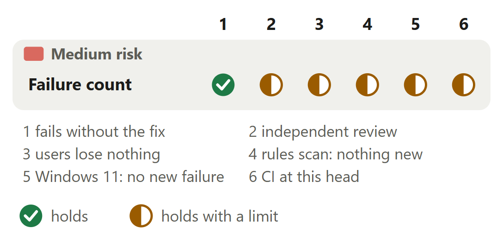

# Hook failures: `rerail status` counts every failure since the time it names

For [pull request #658](https://github.com/neralabs/rerail/pull/658), head e53c23b66. [report.html](report.html) is the same report as one page: download it and open it.

## 1. The decision

**Does `rerail status` count every hook failure since the time it names, while the log moves and hooks record at once, as fast as `main`?**

1. The line leads with an outage on any failure after the last recorded event. **Changes the intent.**
2. With older failures gone, the line names when its count starts.

**We recommend:** rule on #577's three questions first, then read decision 1: a lock around the whole move would be shorter, is not built, and would end the one state slower than `main`.

| Size | Lane | Waits on | Not verified |
|---|---|---|---|
| 1,458 lines in 5 files: 636 ship, 822 are tests and text | Standard. Medium risk; only the automated reviewer approved. | #577's three questions. No maintainer has answered. | 3 |

## 2. Intent, and the gap

| Change | Intended | Found | Now |
|---|---|---|---|
| The count | Full log moves; line counts 24 hours _(code comment, status line)_ | Count falls at each move; lines lost _(#577, measured runs)_ | Closes the gap, changes answer 2. |
| The outage lead | Leads when every failure is newer _(code comment, a test)_ | With `.1` counted, an outage hides _(a failing test)_ | **CHANGES THE INTENT: ANSWER 1.** Leads when any failure is newer. A maintainer must agree. |

Reported in #577, 12 November 2026.

Sources at main, and causes

| Change | Where main states the intent | The cause, and what was measured |
|---|---|---|
| The count | `src/harness/hook-failures.ts` at `main`. Line 14: "Past this size the file is moved to \`&lt;name>.1\`, replacing the one before; a failing hook writes on every event." Line 88, the line's text: "could not be recorded in the last 24 hours". Line 91, above `readHookFailures`: "The failures recorded since \`since\` (epoch ms), oldest first; none when the file is missing or unreadable." Line 46, above `recordHookFailure`: "Appends one failure." | Line 95 reads the live file alone, so the count falls to the failures since each move, every 1,100 to 1,300 failures: 370 where 6,000 were owed at minute 120, at 50 failures a minute read every 5 minutes, on both systems. Line 61 renames the log straight to `.1`: of 30 hooks at once, a later one fails on a file already gone and drops its own line, or renames the new log over the full `.1`. |
| The outage lead | `src/harness/hook-failures.ts` at `main`, lines 76 to 77, above `hookFailureLines`: "When every failure is newer than the last recorded event, hooks run but nothing is recorded, and the line leads with that." `test/harness/hook-failures.test.ts` at `main`, line 46: "names the failures without that lead when events were recorded after some of them, and says nothing without any". | Line 85 at `main` leads only when `since.length === failures.length`. Without f8cf40dd6, the test "leads with an outage that began after the last recorded event once older failures moved aside" fails: the line reads `Hooks: 3 hook events could not be recorded in the last 24 hours`. With it: `Hooks run but nothing was recorded since <time>: 1 hook event failed, of 3 that could not be recorded in the last 24 hours`. The total that follows could go. |

## 3. Where to look

1. **Read first**, 25 min: `hook-failures.ts`: move (`moveAside`, `copyLines`, `removeStrandedLogs`), line (`hookFailureLines`), read (`readLogParts`, `keptSinceOf`), wait (`awaitingMovedAside`, `changedLately`). Can a hook stopped or held up at any step lose a line, or status count one twice?
2. 2 min: `cli.ts`: `hookHealthLines`, one call site.

**Then skim**, 10 min: One `main` test changes its case (answer 1); two get 60 s, up from 5 (30 on Windows); none is removed.

## 4. Risk against verification

Start at check 3: one state slower than `main`, five cases left.

Each half mark's limit

| Change | Check | It holds with this limit |
|---|---|---|
| Failure count | independent review | The automated reviewer approves e53c23b66 with 0 blockers, 0 follow-ups and 0 nits, and lists its five earlier findings as fixed. Second runs from a separate checkout found eight things at four commits, and a fix found a ninth; the description lists each with its fix. The limit: no person on the team has reviewed or commented. |
| Failure count | users lose nothing | With both parts of the log full, `rerail status` takes 172.0 ms against `main`'s 171.5 on Linux x64 (median of 20, 6f563beed). Logs an older version wrote are read right, and `main` reads this version's logs after a downgrade. The limit: one state costs more than `main` (decision 2), and five cases are left (part 8). |
| Failure count | rules scan: nothing new | The automated reviewer's rules, the repository's pack and the complexity pack read at c89f068ed, over the diff against the merge base on Linux x64: no new finding, and 6 existing ones in `cli.ts` functions this change does not edit. The limit: run at 6f563beed. e53c23b66 adds one test and no source line. |
| Failure count | Windows 11: no new failure | `test/harness/hook-failures.test.ts` at e53c23b66 on Windows 11: 44 of 44. CI's two Windows unit jobs pass at e53c23b66. The limit: the 9 test files of the change and of the modules that import it ran at 6f563beed (199 passed, 9 skipped, 0 failed, none outside `main`'s baseline). e53c23b66 adds one test and no source line. |
| Failure count | CI at this head | Run 43554075702 at e53c23b66, read on 14 November 2026: 24 checks on the pull request, 19 pass, 5 are skipped, none fails. The limit: it passes on its second attempt. The first failed one test of `main` that this change does not touch, in the Windows unit job (2 of 2): `test/runtime/merge-assist/runtime-notes.test.ts`. |

## 5. The changes

**The failure log and its count**, medium risk: Reads short under load. Windows 11: `main` 1,722 of 1,911, cd0d87fe2 none of 1,392. Linux x64: cd0d87fe2 7 of 648.

<b>6. The decisions</b>

**A take under each hook's name, or a lock around the move?** (ask 2)

**We chose** the take. `hook-failures.ts` grew from 112 to 668 lines. **Would change our mind:** a maintainer who wants the lock: since #503, an OS lock frees itself when its holder ends.

| Option | What a user gets | Cost | What it breaks |
|---|---|---|---|
| Take under the hook's own name, move on only when full, else give back **(chosen)** | Under load at cd0d87fe2, hooks lost no line and no status read missed a whole part. Built, with 44 tests in its file where `main` has 10. | 668 lines where `main` has 112. Two renames and a size check per move. The status read lists again and pauses while files move, and waits for a log a running hook holds (decision 2). | Five cases stay (part 8). A hook stopped mid-move leaves a file until a later move removes it. |
| An OS lock around the whole move, with the size check under it | It would close three of the five cases (the give-back by copy, the held-up write after it, a log still moving after the last pause), end decision 2's wait and shorten the module. | Not built, so not measured. Every hook that finds the log full takes the lock. The copy lock here takes 0.04 to 0.30 ms, and loading the engine in a fresh process 1.2 to 1.8 ms (d2e27d773, both systems). | It needs a rule for a hook whose engine does not load. The copy lock has one: the copy goes ahead without it. |
| `main`'s single rename | Nothing more. | Nothing. | Lines lost in 20 of 20 burst rounds on Linux x64, and the count short in 20 of 24 readings. |

Before: At main, a hook that finds the log past 256 KB renames it straight to .1. A hook a moment later fails on a log already gone and loses its own line, or renames the new log another hook began over the full .1. After: With this change, a hook renames the log to a name of its own, then checks the size of what it took. Past 256 KB it moves the log to .1. If not, it gives the log back, by hard link or by copying its lines.

**Evidence.** The 30-hook burst and the 2-hour count under "How you tested it". The copy lock already uses `tryLockExclusive`, the engine's lock that #503 brought. #577's first text, kept in its edit history, described the take and set a lock aside because a stopped hook leaves it held. Its text today describes the bug, and its one comment holds the two questions.

**How long may status wait for a log a hook holds?**

**We chose** 2 s past the log's last change. One state costs more than `main`: 420.0 against 162.4 ms, Linux x64. **Would change our mind:** how often that state happens, not measured; or decision 1's lock.

| Option | What a user gets | Cost | What it breaks |
|---|---|---|---|
| The log's change time within 2 s (6f563beed) **(chosen)** | From 2 s after the take, a stopped hook's log whose process id another process has costs what `main` costs: 172.7 against 168.7 ms on Linux x64, 274.4 against 282.5 on Windows 11. A running hook is waited for. | One process query and one stat per taken log. Inside the 2 s, each `rerail status` waits out its pauses: 420.0 against 162.4 ms on Linux x64, 549.9 against 200.0 ms on Windows 11 (medians of 20, real daemon). | That one state, for 2 s after a hook is stopped while it holds `.1` under its own name. The count is right in it, where `main`'s is not. How often it happens was not measured. |
| The process id alone (cd0d87fe2) | A running hook that took `.1` is waited for. | One process query per taken log. | Every status waits out all 8 pauses for as long as that process runs: 431.6 against 168.7 ms on Linux x64, 617.1 against 282.5 on Windows 11. |
| Wait only for a move seen during this read | No wait for a log a stopped hook left. | None. | No wait for a running hook that took `.1` before the first listing: the line says "in the last 24 hours" though the part before was dropped. |
| An OS lock the taking hook holds until it moves the log on | No wait for a log a stopped hook left; a running hook is waited for. | Not built. One lock per move for the hook, one try-lock per taken log for status. | Not built, so not known. Like the lock of decision 1, it needs a rule for a hook whose engine does not load. |

**Evidence.** A rename sets a file's change time and leaves its write time, on Linux x64 and on NTFS: 1.5 s after the write, a rename moved the change time by 1,507.0 and 1,503.9 ms and the write time by 0. The test e53c23b66 adds fails on both systems when the wait reads the write time. A fifth way, the process's start time against the take, costs more than the wait on Windows.

<b>7. How it fits</b>

It stands on `main` alone and merges clean with c89f068ed and the six open pull requests sharing a file.

**Shared files and trial merges.** #503, merged, brought the hook failure log and the OS locks. #578, closed, was the first pull request for #577. `git merge-tree --write-tree` of e53c23b66 is clean with `main` at c89f068ed and with each open pull request that shares a file. `src/cli/cli.ts`: #562 at ad7afa92b, #667 at 34dae62e9, #640 at 3a0233710, #672 at e3e22bd70. `docs/troubleshooting.md`: #562, #506 at 06c94a596, #673 at e5656482d. No other open pull request edits `hook-failures.ts` or its test file. Nothing waits on this one.

<b>8. What is not covered</b>: 3 not verified, 6 smaller gaps, 8 limits that stay

1. **Two cases still lose lines,** in a give-back by copy: a write held up past its second read; a failed append or second read after it removed its name.
2. **Three cases make one status read wrong:** it overlaps a give-back by copy, a log still moves after the last pause, or another program keeps a file from being read.
3. **Not run:** macOS; the whole suite outside CI; the load runs and timings at e53c23b66.

**Smaller gaps**

- **How often a user meets the bug is not known.** The counts come from 50 failures a minute and 30 hooks at once, as #577 reports from one Windows 11 machine with a busy daemon. How often hooks fail at those rates was not measured; #548 tracks the cause.
- **How often decision 2's slow state happens** was not measured: a hook stopped while it holds `.1` under its own name, its process id then taken by another process inside 2 s.
- **A second load run from a separate checkout, 6f563beed:** 0 of 785 Windows 11 reads short; 15 of 734 on Linux x64, the worst by 38 lines, 1 counting lines twice. No whole part missed; 390 of 390 checks with no move in flight exact on each. No line lost.
- **One lost line, seen once.** At 6b1e39b6f one 200-hook burst on Linux x64 lost 1 line: the first case of part 8, a held-up write that lands after a give-back's second read. Hooks lost no line at cd0d87fe2 or 6f563beed.
- **The time the line names starts 16 ms late.** On Windows 11, hook processes' clocks differ by up to one system tick (15 ms measured). Since b661c0880 a mover writes a start 17 ms past its own clock on every system, after every failure in the old part.
- **A log a stopped hook left more than 24 hours ago** is kept for as long as any process has that hook's process id, and each status then reads it: one more file of up to 256 KB.

**Limits that stay**

- The Rerail home can hold new files: a log a hook took, `hook-failures.jsonl.<pid>.<id>.old`, and the lock file `locks/hook-failures.lock`. A later move removes a taken log once its hook has ended and the file is a day old.
- The log gains a line `{"startedAt": <ms>}` per part. `main`'s reader skips it, so `main` reads this version's logs after a downgrade, and logs an older version wrote are read right.
- `readHookFailures` returns `{ failures, keptSince }` where it returned a list. Its one caller in `src/` is `hookHealthLines` in `src/cli/cli.ts`.
- The log still holds two parts of 256 KB, about 2,200 failures. At 50 failures a minute that is 45 minutes, and the line then says since when it counts.
- On a file system with no file numbers, each name of a log counts as a file of its own.
- A give-back by copy waits at most 1 s for its lock, then copies without it, as it does when the engine does not load.
- `recordHookFailure` keeps its signature. What Rerail records, steers and blocks does not change, nor do the rule-file format, the API and installed packs.
- The release-note entry describes a fix to a log no published version has. The branch keeps it, and ask 1 holds the question.

## 9. What we ask of you

Ask 1 rules on answer 1.

1. **On [#577](https://github.com/neralabs/rerail/issues/577#issuecomment-6870428051): when should the line lead with an outage, and does the release note stay?** We recommend lead on any newer failure; drop the note with #503's release.
2. **On [#577](https://github.com/neralabs/rerail/issues/577#issuecomment-6872364440): a lock around the move, not the take (decision 1)?** We recommend your ruling before the code is read.
3. **Keep 0b256407a, which goes past #577's bug at the automated review's request?** We recommend yes: non-text fields read `unknown`.

Answer 2 asks no ruling. #577 expects it.

<b>10. Evidence</b>

The record is the description's "How you tested it".

| Where | What ran | Result |
|---|---|---|
| CI on GitHub | Run 43554075702 at e53c23b66, read on 14 November 2026 | 24 checks on the pull request: 19 pass, 5 are skipped, none fails. The run passes every job on its second attempt. The first attempt failed one test of `main` that this change does not touch, in the Windows unit job (2 of 2): `test/runtime/merge-assist/runtime-notes.test.ts` (never rejects, nor fails the edit's result, when reading the notes fails after a detection). |
| Linux x64 and Windows 11 | The five reproductions at `main` and at d2e27d773: the count after the log moved aside, twenty hooks failing at once, a log under two names, a move during a write, a status read during a write | Each fails at `main` and passes at d2e27d773, on both systems. |
| Linux x64 and Windows 11 | The 9 test files of the change and of the modules that import it, at 6f563beed. Then `test/harness/hook-failures.test.ts` at e53c23b66 | Linux x64: 208 passed, 0 failed. Windows 11: 199 passed, 9 skipped, 0 failed, none outside `main`'s baseline. The changed test file at e53c23b66: 44 of 44 on each. |
| Linux x64 and Windows 11 | 2 hours at 50 failures a minute, read every 5 minutes, and 30 hooks into a full log at once, 20 rounds: `main` against d2e27d773 | The count: `main` 20 of 24 readings short on both, d2e27d773 0 short and 0 over. The burst on Linux x64: `main` lost 1,253 lines and status was right in 0 of 20; d2e27d773 lost none and was right in 20 of 20. On Windows 11 `main` lost no line and printed 30 where 270 were owed in all 20; d2e27d773 was right in 20 of 20. |
| Linux x64 and Windows 11 | Status reads under hook bursts at cd0d87fe2, and checks with no move in flight | Windows 11: 0 of 1,392 reads short. Linux x64: 7 of 648 short, the worst by 63 lines. No read missed a whole part. With no move in flight, 390 of 390 checks exact on each. `main` under the same load: 1,722 of 1,911 Windows 11 reads short, the worst by 5,600. |
| Linux x64 and Windows 11 | `rerail status` in a home where a daemon runs, median of 20, 6f563beed against `main` at c89f068ed | Both parts full: 172.0 against 171.5 ms on Linux x64; on Windows 11, where end-to-end medians moved with the machine's load, the Hooks line's own work, 3.77 against 1.32 ms. A stopped hook's log, its process id another process's, past 2 s: 172.7 against 168.7 ms, and 274.4 against 282.5 ms. Within 2 s: 420.0 against 162.4 ms, and 549.9 against 200.0 ms. |
| Linux x64 and Windows 11 | One-line changes to fix lines, each tried in turn | Every one tried fails a test on Linux x64. The last two: 3c4088212 (a `.1` that opens but cannot be read) and e53c23b66 (the wait reads the log's change time; with the write time, its test fails on Linux x64 and Windows 11). |
| Linux x64 | The automated reviewer's rules, the repository's pack and the complexity pack read at c89f068ed, over the diff against the merge base at 6f563beed. Trial merges of e53c23b66 | No new finding; 6 existing ones in `cli.ts` functions this change does not edit. `git merge-tree --write-tree`: clean with `main` at c89f068ed and with #562, #667, #640, #506, #673 and #672. #672's head is now e3e22bd70, where the description names 98c2462b6: clean with both. |

**What this report adds to the description**

- **The line's lead is a change of intent.** The description lists it as one row of its changes and one question on #577. At `main` a code comment and a test's name both say the line leads only when every failure is newer than the last recorded event. This pull request changes that rule and that test's case, so part 2 marks it as a change of intent and ask 1 asks for the ruling.
- **#577's text no longer describes the approach.** The text on the draft says this change builds the approach #577 describes, and cites #577's reason against a lock. Read on 14 November 2026, #577 describes the bug only: an edit on 13 November removed its approach and its alternatives, which stay in its edit history. The fuller description says so. The text on the draft should say it too.
- **The question is shorter here than in the description.** The callout's question holds 25 words. The description asks whether a status read costs what it costs on `main`; this report asks whether it is as fast as `main`. The answer is the same: yes, except in the one state of decision 2.
- **Two figures for the same wait.** A comment on the pull request gives the wait inside the 2 s as 258 ms on Linux x64 and 358 ms on Windows 11. That is the Hooks line's own work in that state. The description gives the whole `rerail status` there: 420.0 against 162.4 ms, and 549.9 against 200.0 ms.
- **Our answer to the read-first question.** Yes, in the cases part 8 names. By a read of e53c23b66: a hook stopped after its take leaves the log under its own name, where status counts it. A hook held up through both reads of a give-back by copy loses its line. Status counts each file once by file id; a read that overlaps a give-back by copy can miss those lines or count them twice.
- **Two asks are new here.** The description says it asks for no ruling and points at #577's two questions. Part 9 also asks whether a lock should replace the take, and whether 0b256407a stays. Neither question is on #577. The description should carry both.

**Sources.** Pull request #658, its diff, checks and reviews, and issue #577 with its comment and edit history, read on 14 November 2026. Rerail at `main` (c89f068ed) for each quoted intent and its line. The description for the runs, the timings and the load figures, each at the commit named. Each open pull request's files and head for the shared files and trial merges.

