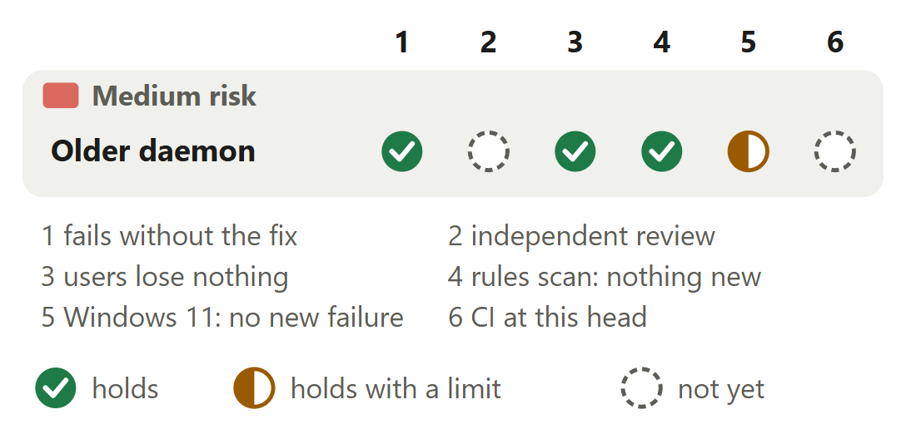

# Windows: a 0.1.4 daemon is found, stopped and replaced

For [pull request #975](https://github.com/neralabs/rerail/pull/975), head 401816762. [report.html](report.html) is the same report as one page: download it and open it.

## 1. The decision

**Can the capability now reach a process that is not this home's daemon?**

**We recommend:** approve it: the capability goes out on a start only from a lookup, and only to a process this user may signal that started no later than `startedAt`.

| Size | Risk and review | Waits on | Not verified |
|---|---|---|---|
| 1,070 lines in 20 files: 355 ship, 715 are tests and text | Fast. Medium risk, no high-risk path. | Nothing. #677, whose start read it uses, merged as c219472639. | 4 |

## 2. Intent, and the gap

| Change | Intended | Found | Now |
|---|---|---|---|
| An older daemon's record | Engine proves it, or busy kept _(docs)_ | Older daemon's record deleted _(real 0.1.4 daemon)_ | Closes the gap. |

Found on 18 November 2026 on Windows 11 virtual machines, by probes of a 0.1.4 daemon from npm.

Sources at main, and causes

| Change | Where main states the intent | The cause, and what was measured |
|---|---|---|
| An older daemon's record | `docs/windows.md` at `main`, the lookup's bullet: a recorded pid counts as the daemon only when the engine on its pipe proves it holds the capability; the proof's answers are in `src/runtime/daemon/engine-proof.ts` (`EngineProofAnswer`), and `PROOF_VERDICT` in `src/runtime/daemon-control.ts` maps a refusal to `gone`, which `checkedLookup` turns into a deleted `daemon.json`. | Releases 0.1.1 to 0.1.4 have no `/proof` route: their engine answers `404` to every path but `POST /events` (0.1.4 `src/runtime/engine-service.ts` line 307). The proof calls any answer but a valid proof `refused`, a refusal maps to `gone`, and the lookup deletes `daemon.json`. 0.1.4 writes it once, so nothing finds the daemon after. Measured: the raw answer is `HTTP 404` with an empty body; the process started 4.6 s before `startedAt`. |

## 3. Where to look

1. **Read first**, 8 min: `daemon-control.ts`: `windowsRecordedDaemon`, `recordedDaemon`, `lookedUpEngine`, `olderDaemon`, `checkedLookup`, `daemonServesPackage`, `daemonEngineEndpoint`, `OtherDaemonKeptError`, `MACHINE_WITHOUT_ENGINE`. Can a process that is not the record's writer get the capability? Does any reader but a lookup read starts?
2. 11 min: `process.rs`, `process-liveness.ts`, `native.ts`, `engine-proof.ts`, `setup-cli.ts`, `hook-host.ts`: the start read, the `404`, set-up, the session start's line.

**Then skim**, 6 min: Seam cases with a fake Windows machine for the lookup, the stop and a hook's start; a Windows case with a real pipe and process; the threat model's residual.

## 4. Risk against verification

Start with the lookup's verdict: it decides who gets the capability. No review by anyone but the author yet.

Each limit, and each check that does not hold yet

| Change | Check | Its limit, or why it does not hold yet |
|---|---|---|
| Older daemon | independent review | No review by anyone but the author yet. |
| Older daemon | Windows 11: no new failure | 109 test files beside `main` on one machine each, on Linux x64 at 9015b9949 and on Windows 11 before `main` 1e80e3b04 was merged: the same failures at both, all for pack test data no test machine holds. |
| Older daemon | CI at this head | CI runs once the pull request opens. |

## 5. The changes

**Older daemon found by its start**, medium risk: Windows 11, 0.1.4 daemon: `main` loses it 8 of 8; here kept and stopped 5 of 5.

<b>6. The decisions</b>

**What decides when the engine on the pipe has no proof?**

**We chose** the process's start against `startedAt`, a fact the system keeps and #677 already reads. **Would change our mind:** a way to read the pipe's server process from Node, which would prove the holder directly.

| Option | What a user gets | Cost | What it breaks |
|---|---|---|---|
| The start against `startedAt` **(chosen)** | The old daemon is found, stopped and replaced; a start not read drops the record as `main` does. | One system call per lookup of an engine without the proof. | A wall clock set back by more than the gap before a reused pid could misread a process; the threat model names it. |
| Skip the proof when `daemon.json` names a version before 0.1.5 | The same while the record is fresh. | Nothing. | A dead daemon's record, its pid now another process's and a listener another user set up where it pointed would get the capability. |
| Read a `404` as a busy engine | The record is kept. | Nothing. | `rerail status` says a healthy daemon is not answering, and every hook waits for it and fails. |
| Give the capability to an engine without the proof | Found. | Nothing. | Any listener that answers `404` on the pipe gets the capability. |

**Evidence.** Through the built CLI and hooks on Windows 11 the 0.1.4 engine answered the challenge `HTTP 404` and its process had started 1.3 to 1.4 s before `startedAt`, read in 0.1 to 16 ms. At the seam: a later start, a start not read and a process this user may not signal each drop the record and send nothing; a reader that is no lookup gets `gone` and reads no start.

**How is a process's creation time read on Windows?**

**We chose** through the engine (`GetProcessTimes`), with no process started; the uninstall alone keeps Windows PowerShell. **Would change our mind:** a reader other than a lookup that must tell such a daemon from a stale record, which would bring the engine's load back into it.

| Option | What a user gets | Cost | What it breaks |
|---|---|---|---|
| The engine's `GetProcessTimes` **(chosen)** | The daemon is found where policy blocks PowerShell too. | One system call per lookup; readers that are no lookup read nothing. | Nothing found. |
| Windows PowerShell's `Get-Process` | The same, where PowerShell runs. | About a second per lookup: 647 to 899 ms per tool call against 244 to 340 at `main`. | Where policy blocks it, every hook event failed. |
| The answer kept beside `daemon.json` | Nothing to read after the first time. | Nothing. | A dead daemon's record keeps its pid, so a reused pid would get the capability. |

**Evidence.** Windows 11, `main`'s hooks and this change's called in turn beside one 0.1.4 daemon where Rerail is off, 160 pairs: median difference 0.5 ms. With the earlier form, where every reader read the start, 22.5 ms, slower in 63 pairs of 77.

<b>7. How it fits</b>

It builds on #677, merged as c219472639: it reads the process start #677 added and edits functions #677 left. Trial merges are clean with `main` 1e80e3b04, which holds #959, #963 and #921; with #967 and #964 one import line conflicts each.

**Shared files and trial merges.** Read from a local clone on 21 November 2026; refresh against GitHub. Clean: `main` at 1e80e3b04, merged here, #963 at 7dba27177, #921 at e7957d7fd. #959's second launcher hands the hook `RERAIL_AUTOSTART` as set and passes on the line the session's start prints. #967 at d7c958574 shares `process-liveness.ts`, its test and `daemon-control.test.ts`, and conflicts in one import line of `process-liveness.test.ts`. #964 at d194de9e4 shares `daemon-control.ts`, `setup-cli.ts`, `hook-host.ts`, `native.ts` and two docs, and conflicts in one import line of `setup-cli.test.ts`. The one that lands second resolves it.

<b>8. What is not covered</b>: 4 not verified, 1 smaller gap, 2 limits that stay

1. **macOS** never ran; it asks no proof, so the change does not reach it.
2. **An elevated daemon** met from a terminal that is not was never run: our test machines' sessions run elevated. The code drops its record, as `main` does.
3. **The uninstall through the product** was not run beside a 0.1.4 daemon; a seam case shows its stops use the read that loads no engine, within the stop's 10 s.
4. **A late answer through the product** (a 0.1.4 daemon that answered only after a hook's start looked) was not run; a seam case covers it.

**Smaller gaps**

- **The engine start beside an older engine with no record.** With `daemon.json` already gone, as after 0.1.5 met such a daemon, a start runs a second daemon on a fallback pipe, at `main` and here: the engine start has no record to weigh a start against.

**Limits that stay**

- `rerail status` beside a 0.1.4 daemon takes 0.2 s on Windows 11, 1 s just after an update. Once, on a cold disk, the engine's load used its 2 s: status said not answering, and kept the record.
- A daemon of 0.1.4 or earlier whose start cannot be read, or that this user may not signal, is handled as at `main`: its record goes and a hook launches its own daemon.

## 9. What we ask of you

We ask no ruling.

<b>10. Evidence</b>

The description is the record: "How you tested it" holds the failing runs, the runs through the product on Windows 11 and Linux x64, and every run with its counts.

| Where | What ran | Result |
|---|---|---|
| Windows 11 | The issue's steps: a 0.1.4 daemon from npm, then another build's status and stop, 5 runs each at `main` 21f86868e, this change and 0.1.5 from npm, one machine | `main` and 0.1.5 remove the record and leave the daemon running, 5 of 5 each; here the record stays and the stop ends the daemon, 5 of 5. |
| Windows 11 | 0.1.4 and 0.1.5 updated in place (`npm install -g`) while their daemon runs, 2 runs each | From 0.1.4: `main` and 0.1.5 lose the daemon and a start leaves two; here one. From 0.1.5: found at both. |
| Windows 11 | A 0.1.4 daemon met by set-up and the hooks of Claude Code, Codex and Cursor, at earlier heads | `main` runs two daemons; here set-up and a session replace it, and with `RERAIL_AUTOSTART=0` the session's start says to stop it, then start, in all three. |
| Windows 11 | Tool calls beside the 0.1.4 daemon where Rerail is off, `main`'s hooks and this change's in turn | 160 pairs: medians 278 and 271 ms, median difference 0.5 ms; before the last fix 22.5 ms over 80 pairs. |
| Linux x64 and Windows 11 | The new cases before this fix and at the head; one-line changes to the change's lines | Before the fix the 6 session-start cases fail on Linux and in 20 of 20 Windows 11 runs; here they pass on both. Each of the 70 one-line changes to the change's lines fails a case: 68 on Linux x64, 2 on Windows 11. |
| Windows 11 and Linux x64 | 109 test files that import a changed module, here and at `main` 21f86868e, one machine each, this change's own engine on Windows | The same failures at both, all for pack test data no test machine holds; on Linux the differences a loaded machine made passed at both on a quiet one. |
| Linux x64 and Windows 11 | At this head and `main` 1e80e3b04, one machine each: the 9 test files that import `daemon-control.ts`; at 9015b9949 and that `main`, the 109 files on Linux, the change's five on Windows | Here none failed: 389 passed, 355 at `main` on Linux; 393 and 358 on Windows. At 9015b9949 the same 957 Linux failures at both, all pack test data; Windows 342 and 302 passed. |
| Linux x64 | CI's lint, type-check and Rust checks, clippy of the engine for Windows, and the rules scan | All pass; 0 new findings with 0.1.5, none different with `main` 1e80e3b04; every edited function counts 6 or under. |

**Sources.** This branch's diff over `main` 1e80e3b04, read on 21 November 2026, the same as over `main` 21f86868e before that merge; `main` at 21f86868e for the quoted intent; Rerail 0.1.0 to 0.1.4's source for their routes and `daemon.json`; the published 0.1.4 and 0.1.5 tarballs from npm for the runs.

