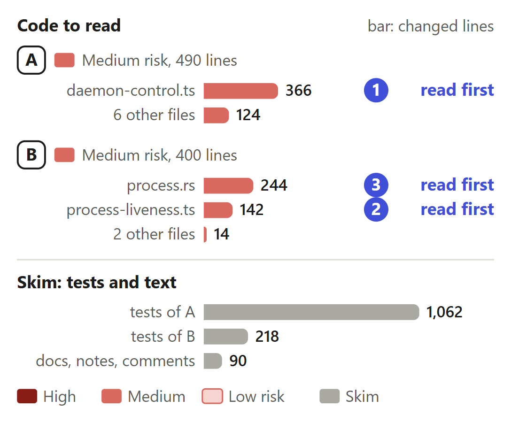

# Windows: a 0.1.4 daemon is found, stopped and replaced

For [pull request #975](https://github.com/neralabs/rerail/pull/975), head f70406093. [report.html](report.html) is the same report as one page: download it and open it.

## 1. The decision

**Can the access token now reach a process that is not this home's daemon?**

**We recommend:** approve it: a daemon of 0.1.4 or earlier is found by its process's start, is sent nothing that carries the token, and is ended through its process.

| Size | Risk and review | Waits on | Not verified |
|---|---|---|---|
| 2,260 lines in 28 files: 890 ship, 1,370 are tests and text | Fast. Medium risk, no high-risk path. | Nothing. #677, whose start read it uses, merged as c219472639. | 4 |

## 2. Intent, and the gap

| Change | Intended | Found | Now |
|---|---|---|---|
| A. An older daemon's record | Engine proves it, or busy kept _(docs)_ | Older daemon's record deleted _(real 0.1.4 daemon)_ | Closes the gap. |
| B. Ending an older daemon | Stop ends only the proven process _(code comment)_ | Older daemon left running _(real 0.1.4 daemon)_ | Closes the gap. |

Found on 18 November 2026 on Windows 11 virtual machines, by probes of a 0.1.4 daemon from npm.

Sources at main, and causes

| Change | Where main states the intent | The cause, and what was measured |
|---|---|---|
| A. An older daemon's record | `docs/windows.md` at `main`, the lookup's bullet: a recorded pid counts as the daemon only when the engine on its pipe proves it holds the capability; the proof's answers are in `src/runtime/daemon/engine-proof.ts` (`EngineProofAnswer`), and `PROOF_VERDICT` in `src/runtime/daemon-control.ts` maps a refusal to `gone`, which `checkedLookup` turns into a deleted `daemon.json`. | Releases 0.1.1 to 0.1.4 have no `/proof` route: their engine answers `404` to every path but `POST /events` (0.1.4 `src/runtime/engine-service.ts` line 307). The proof calls any answer but a valid proof `refused`, a refusal maps to `gone`, and the lookup deletes `daemon.json`. 0.1.4 writes it once, so nothing finds the daemon after. Measured: the raw answer is `HTTP 404` with an empty body; the process started 4.6 s before `startedAt`. |
| B. Ending an older daemon | `provenNow` in `src/runtime/daemon-control.ts`: a stop acts on the process it proved, as the facts the OS keeps show it now. | A daemon that proved nothing cannot be asked to stop over its URL without the token, and a signal by pid can reach a later process. |

## 3. Where to look

1. **Read first**, 9 min: `daemon-control.ts`: `noProofVerdict`, `olderDaemon`, `checkedLookup`, `daemonEngineEndpoint`, `replacedOlderDaemon`, `endOlderDaemon`. Does anything carrying the token reach an endpoint that has not proved itself?
2. **Read first**, 4 min: `process-liveness.ts`: `endProcessStartedByPowerShell`, `powerShellEnd`. Is a PowerShell cut after its mark read as still running?
3. **Read first**, 5 min: `process.rs`: `end_process_started_by`. Does one handle carry the start read, the end and the wait?
4. 6 min: `engine-proof.ts`, `cli.ts`, `setup-cli.ts`, `hook-host.ts`, `audit-cli.ts`, `support-bundle.ts`: what people see.
5. 2 min: `native.ts`, `index.ts`: the binding and the export.

**Then skim**, 6 min: Seam cases with a fake Windows machine for the lookup, the stop and a hook's start; a Windows case with a real pipe and process; the threat model's residual.

## 4. Risk against verification

Start with the lookup's verdict: it decides who gets the capability. No review by anyone but the author yet.

Each limit, and each check that does not hold yet

| Change | Check | Its limit, or why it does not hold yet |
|---|---|---|
| A. Older daemon | independent review | No review by anyone but the author yet. |
| B. End by process | independent review | No review by anyone but the author yet. |
| A and B | CI at this head | CI runs once the pull request opens. |

<b>5. The changes</b>

**A. Older daemon found, sent nothing**, medium risk. Windows 11, 0.1.4 daemon: `main` loses its record; here status names it and exits 4, no token sent.

- **Problem:** On Windows, 0.1.5 and `main` delete the record of a 0.1.4 daemon that still runs: its engine answers the proof's challenge 404, read as a refusal. Status then reports no daemon, and every start runs a second one.
- **Who meets it:** Every Windows user who upgrades from 0.1.1 to 0.1.4 while the old daemon runs, at the first command or session start: every run at `main` and with 0.1.5 from npm. Source: #798.
- **What it does:** `noProofVerdict` reads on only for a record before 0.1.5; `olderDaemon` lets the process's start decide; `checkedLookup` hands on the state without either token and probes nothing. Status names it and exits 4; `rerail daemon start` ends it and says so only when its end ended it; the audit refuses it; the support bundle names its release.
- **Risk:** Medium. It decides what a daemon that proved nothing is sent: a wrong verdict would send the token to another process on the recorded port.
- **Check:** Does anything carrying the token reach an endpoint that has not proved itself? `checkedLookup` must return an `older` daemon with no token and no probe; `withoutCapabilities` strips both tokens; `daemonEngineEndpoint` refuses it whatever the caller may replace; `replacedOlderDaemon` names it only when its end ended it.
- **Picture:** Beside a 0.1.4 daemon on Windows 11, status, the stop, the start, set-up, a session's start and the uninstall: at main none names or ends it; here all six do.
- **Method:** Windows 11, Node 24.21.0: a 0.1.4 daemon from npm in a new Rerail home and profile per command, met by the built CLI of `main` 8b4c74cbe and of this change, each with its own engine, a relay recording every byte sent to the recorded pipe and port; one run per command.

**B. Older daemon ended through its process**, medium risk. Uninstall beside a 0.1.4 daemon: `main` leaves it running; here ended in 761 to 772 ms, 3 runs.

- **Problem:** A daemon of 0.1.4 proved nothing, so it cannot be asked to stop over its URL, and a signal by pid can reach a process Windows gave that pid since.
- **Who meets it:** The same people as A, at `rerail daemon stop`, `rerail daemon start`, set-up, a session's start and the uninstall.
- **What it does:** `end_process_started_by` opens the process, reads its start, ends it and waits on that one handle. `endProcessStartedByPowerShell` does the same for the uninstall, which loads no engine: the call gets the stop's 10 s wait and 5 s kill wait, and `powerShellEnd` reads a run cut after its mark as still running.
- **Risk:** Medium. It decides which process Rerail ends on Windows: a wrong start check would end another of the person's processes.
- **Check:** Is the process ended the one whose start was read? The Rust call holds one handle from open to wait; PowerShell's process object keeps the handle `.Handle` opened. A start later than `startedAt` must be let alone (`later`). A recorded start more than 10 s past the clock names no process: nothing is ended on it (`unread`).
- **Picture:** Beside a 0.1.4 daemon on Windows 11, rerail install --remove at main left it running in its one run; here it ended it in each of 3 runs.
- **Method:** Windows 11, Node 24.21.0: `rerail install --remove` beside a 0.1.4 daemon from npm, 3 runs at ddcb90824 with the engine built for it (761, 772 and 768 ms); `main` 8b4c74cbe's run from the description's table.

<b>6. The decisions</b>

**What decides when the engine has no proof, and what is that daemon sent?**

**We chose** the record's release, then the process's start; it is sent nothing with the token and ended through its process. **Would change our mind:** a way to read the pipe's server process from Node, which would prove the holder directly.

| Option | What a user gets | Cost | What it breaks |
|---|---|---|---|
| The release, then the start; nothing sent; ended through its process **(chosen)** | The old daemon is found, named, ended and replaced; a start not read keeps the record. | One system call per lookup of an engine without the proof. | A wall clock set back by more than the gap before a reused pid could misread a process; the threat model names it. |
| Trust a `404` when the start fits, and probe with the token | The same. | The same. | While a daemon shuts down its pid lives after its pipe and port are free: another user holding both gets the token. |
| Trust a `404` only in a record before 0.1.5, and probe with the token | The same. | The same. | The same window stays for a 0.1.4 daemon, whose token outlives restarts. |
| Read a `404` as a busy engine | The record is kept. | Nothing. | `rerail status` says a healthy daemon is not answering, and every hook waits for it and fails. |

**Evidence.** Windows 11, a 0.1.4 daemon from npm behind a relay in front of its recorded pipe and port: the proof's challenge alone reached them in every run, with no token. Ending it took 3.9 to 24.7 ms through the engine. At the seam, no caller that takes a daemon from a lookup connects to its pipe or port.

**How is a process's creation time read on Windows?**

**We chose** through the engine (`GetProcessTimes`), with no process started; the uninstall alone keeps Windows PowerShell. **Would change our mind:** a reader other than a lookup that must tell such a daemon from a stale record, which would bring the engine's load back into it.

| Option | What a user gets | Cost | What it breaks |
|---|---|---|---|
| The engine's `GetProcessTimes` **(chosen)** | The daemon is found where policy blocks PowerShell too. | One system call per lookup; readers that are no lookup read nothing. | Nothing found. |
| Windows PowerShell's `Get-Process` | The same, where PowerShell runs. | About a second per lookup: 647 to 899 ms per tool call against 244 to 340 at `main`. | Where policy blocks it, every hook event failed. |
| The answer kept beside `daemon.json` | Nothing to read after the first time. | Nothing. | A dead daemon's record keeps its pid, so a reused pid would get the capability. |

**Evidence.** Windows 11, `main`'s hooks and this change's called in turn beside one 0.1.4 daemon where Rerail is off, 160 pairs: median difference 0.5 ms. With the earlier form, where every reader read the start, 22.5 ms, slower in 63 pairs of 77.

<b>7. How it fits</b>

It builds on #677, merged as c219472639: it reads the process start #677 added and edits functions #677 left. Trial merges are clean with `main` 1609ac3a3, #963 and #921; #967 and #964 each conflict in one test file.

Pull request #975 builds on #677, merged as c219472639, whose process start read it uses. In trial merges #967 and #964 each conflict in one test file, and main at 8b4c74cbe, #963 and #921 merge clean.

**Shared files and trial merges.** Read from a local clone on 21 November 2026; refresh against GitHub. Clean: `main` at 1609ac3a3, merged here, #963 at 7dba27177, #921 at d2bfa23b8. #967 at d7c958574 shares `process-liveness.ts` and its test, and conflicts in `process-liveness.test.ts`, each adding cases. #964 at 9a790bf68 shares `daemon-control.ts`, `setup-cli.ts`, `hook-host.ts`, `native.ts` and two docs, and conflicts in `setup-cli.test.ts`. The one that lands second resolves it.

<b>8. What is not covered</b>: 4 not verified, 1 smaller gap, 2 limits that stay

1. **macOS** never ran; it asks no proof, so the change does not reach it.
2. **An elevated daemon** met from a terminal that is not was never run: our test machines' sessions run elevated. The code drops its record, as `main` does.
3. **Constrained Language Mode** by a machine policy is on no test machine; the uninstall's end runs in that mode in its case, set in its own session.
4. **Codex and Cursor** beside a 0.1.4 daemon ran through the product at earlier heads; seam cases cover them here.

**Smaller gaps**

- **The engine start beside an older engine with no record.** With `daemon.json` already gone, as after 0.1.5 met such a daemon, a start runs a second daemon on a fallback pipe, at `main` and here: the engine start has no record to weigh a start against.

**Limits that stay**

- A daemon of 0.1.4 or earlier whose start cannot be read is kept as not answering, and sent nothing; a hook launches no second daemon beside it.
- The ends wait on the process's handle; only an end that hangs meets the stop's 5 s kill wait.

## 9. What we ask of you

We ask no ruling.

<b>10. Evidence</b>

The description is the record: "How you tested it" holds the failing runs, the runs through the product on Windows 11 and Linux x64, and every run with its counts.

| Where | What ran | Result |
|---|---|---|
| Windows 11 | A 0.1.4 daemon from npm, then status, `rerail daemon stop`, `rerail daemon start`, set-up, a session's start and `rerail install --remove` at `main` 8b4c74cbe and here, a relay recording every byte sent to the recorded pipe and port | `main` removes the record or reports no daemon, and the daemon runs on; here status names it and exits 4, and the stop, the start, set-up, a session's start and the uninstall end it. Only the proof's challenge reached the pipe, with no token. |
| Windows 11 | A session's later event beside a 0.1.4 daemon, under `RERAIL_AUTOSTART=0` and with autostart on, here and at the head the second review read | Here only the proof's challenge reached its pipe, and the stream said to stop it, then start, or replaced it; the reviewed head sent `POST /events`. |
| Windows 11 and Linux x64 | This answer's cases over the source the second review read; the earlier answers' over the heads before | Linux 12 fail; earlier, Windows 30 and 2, Linux 30 and 2; here none. |
| Windows 11 and Linux x64 | The 25 test files that changed or import a changed module, and the 14 integration files that start a daemon or a hook, here and at `main` 1609ac3a3, one machine each | Unit: Windows 847 and 765 passed, Linux 850 and 771. Integration: Linux 57 on both; Windows 56 and 57, one Cursor case failing on both, since Windows refuses its listener's path. |
| Windows 11 | The Rust cases of `process.rs`, and three one-line changes to its new lines | 7 passed; each change fails a case. |
| Linux x64 | CI's lint, type-check and Rust checks, the `wasm32-wasip1` checks, and the rules scan | All pass; 0 new findings with 0.1.5, none different with `main` 1609ac3a3. |
| Windows 11 | A 0.1.4 daemon met by set-up and the hooks of Claude Code, Codex and Cursor, at earlier heads | `main` runs two daemons; here set-up and a session replace it, and with `RERAIL_AUTOSTART=0` the session's start says to stop it, then start, in all three. |
| Windows 11 | Tool calls beside the 0.1.4 daemon where Rerail is off, `main`'s hooks and this change's in turn | 160 pairs: medians 278 and 271 ms, median difference 0.5 ms; before the last fix 22.5 ms over 80 pairs. |

**Sources.** This branch's diff over `main` 1609ac3a3, read on 21 November 2026; `main` at 21f86868e for the quoted intent; Rerail 0.1.0 to 0.1.4's source for their routes and `daemon.json`; the published 0.1.4 tarball from npm for the runs.

