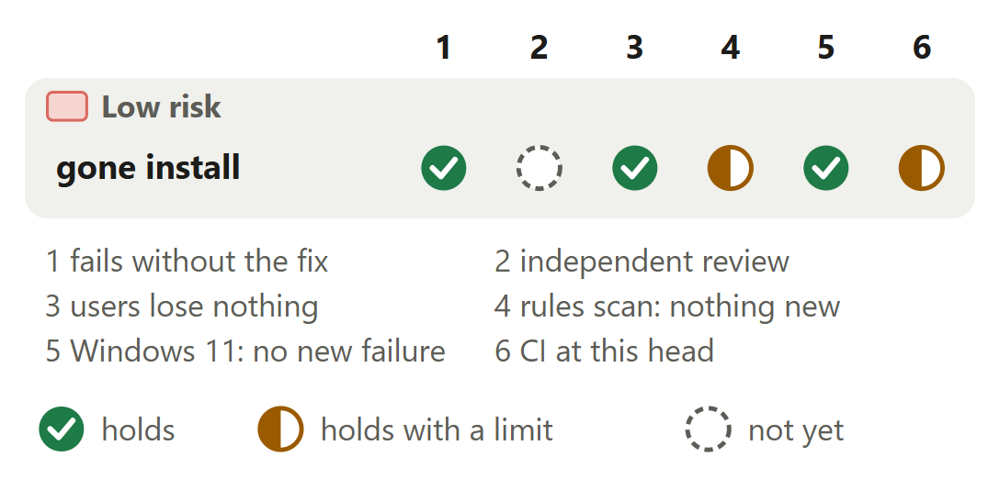

# rerail status names a gone install and set-up for every agent

For [pull request #1187](https://github.com/neralabs/rerail/pull/1187), head 1b2b9ca411. [report.html](report.html) is the same report as one page: download it and open it.

## 1. The decision

**Once `~/.rerail/versions` is deleted, should `rerail status` say so first, for every connected coding agent, and name `npx @neralabs/rerail setup`?**

1. The first line names the gone install, every connected agent and `npx @neralabs/rerail setup`.

**We recommend:** approve it once the command named suits you: it is the one command that still runs then, and set-up installs a version and points `current` at it again.

| Size | Risk and review | Waits on | Not verified |
|---|---|---|---|
| 347 lines in 10 files: 163 ship, 184 are tests and text | Person. `src/setup/` is a high-risk path: a person approves. | Nothing. No CI run at this head yet: not pushed. | 3 |

## 2. Intent, and the gap

| Change | Intended | Found | Now |
|---|---|---|---|
| Status after a removal | Status names what is missing _(docs)_ | Nothing named; named steps fail _(runs through the CLI)_ | Closes the gap, changes answer 1. |

Found on 26 November 2026 through the built CLI on Linux x64 and Windows 11.

Sources at main, and causes

| Change | Where main states the intent | The cause, and what was measured |
|---|---|---|
| Status after a removal | `docs/troubleshooting.md` at e29282a55f: "If `rerail status` instead names Claude Code hook scripts that are missing, Claude Code's settings point at a Rerail that is gone, and every hook fails before Rerail runs. Run `rerail install --refresh` and open a new session." `hookHealthLines` in `src/cli/cli.ts` asks only `missingClaudeHookScripts`. | Only Claude Code's settings were read for missing scripts, and the step named came from no reading of `current`. With `current` dangling, `registrationRoot` is the running package, so the refresh registers nothing, and every `rerail` step the other lines name runs through the launcher, which runs `current` and fails with `Cannot find module`. |

## 3. Where to look

1. **Read first**, 6 min: `cli.ts`: `runStatusCommand`, `connectedCodingAgents`, `goneInstallLine`, `neverSetUp`, `claudeScriptLines`. Can a person whose install is there ever see the gone line?
2. 6 min: `harness-registration.ts`, `coding-agents.ts`, `registered-hooks.ts` and `index.ts`: `realRoot`, `managedInstall`, `statusLineScript`.

**Then skim**, 4 min: A case per agent through `rerail status`, a no-database case, a removed `current`, the refresh case; a registration case for the status line's script; a set-up case.

## 4. Risk against verification

One change, low risk: only a `current` with nothing behind it changes what `rerail status` prints. Start at `goneInstallLine`.

Each limit, and each check that does not hold yet

| Change | Check | Its limit, or why it does not hold yet |
|---|---|---|
| gone install | independent review | No independent review of this head yet. |
| gone install | rules scan: nothing new | The reviewer's rules built from `main` 5b90523a0 over the diff: no new finding, and every function it adds or edits is at 6 or under. The scan with the published Rerail could not load the rule pack. |
| gone install | CI at this head | No CI run at this head on GitHub yet: the branch is not pushed. The commit hook's lint and type-check pass. |

## 5. The changes

**Gone install named for every agent**, low risk: Runs through the built CLI naming the gone install and set-up: merged head 0 of 20, here 20 of 20.

<b>6. The decisions</b>

**Which command should the line name while the install is gone?** (ask 1)

**We chose** set-up through npx: the one command that still runs, and it installs a version again. **Would change our mind:** A launcher that repairs itself, or a refresh that installs a version, would make a shorter command right.

| Option | What a user gets | Cost | What it breaks |
|---|---|---|---|
| `npx @neralabs/rerail setup` **(chosen)** | A command that runs and installs a version, as the first set-up did. | A longer command than the other lines' steps. | Nothing: set-up through npx is how Rerail is installed at all. |
| `rerail setup` | A shorter command. | None in the code. | It runs through the launcher, which runs `current`, so it fails with `Cannot find module` as the hooks do. |
| Make `rerail install --refresh` install a version when `current` is empty | One command for both states. | The refresh would reach the registry, which no refresh does now; a larger change to set-up. | Through the launcher it still fails; it helps only through npx. |

**Evidence.** Through the built CLI on Linux x64 and Windows 11, every command the status lines named failed through the launcher with `Cannot find module` while `current` dangled, 30 of 30 runs; `npx @neralabs/rerail` runs from its own package. The set-up case installs a version with the updater's test registry after the version folders are gone, and every script Claude Code's settings name is there again.

<b>7. How it fits</b>

Nothing has to merge first: it holds `main` 06b02ed311, merged by Git alone. Today's `main` 5b90523a0e merges with it cleanly; #1129 edits `src/setup/updater.ts`, which this does not touch.

<b>8. What is not covered</b>: 3 not verified, 2 smaller gaps, 1 limit that stays

1. **Set-up from the registry** was not run: the set-up case stands in for npm with the updater's own test seam.
2. **macOS** never ran; its paths read as Linux's, and `realRoot` runs there as on Linux.
3. **OMP** was not run; the same dry run of registration reads whether it is connected.

**Smaller gaps**

- **The refresh through npx.** While `current` dangles, `npx @neralabs/rerail install --refresh` still says nothing is connected and changes nothing; it could read the same state and name set-up.
- **The launcher.** `rerail` itself still prints Node's `Cannot find module`; a launcher that tested for its CLI file could name set-up, once set-up has written it again.

**Limits that stay**

- Where `current` holds an install and Claude Code's settings name scripts under another root that is gone, its line names the refresh, as before.

## 9. What we ask of you

Ask 1 rules on answer 1.

1. **Should the line name `npx @neralabs/rerail setup` while the install is gone?** We recommend naming it: the one command that still runs then.

<b>10. Evidence</b>

The description on GitHub is the record: "How you tested it" holds the runs over the merged head and here.

| Where | What ran | Result |
|---|---|---|
| Linux x64 and Windows 11 | The status cases, one per agent, over the merged head's source and here | Merged head: 5 of 8 cases fail on each system. Here: 8 of 8 pass. |
| Linux x64 and Windows 11 | The defects' steps through the built CLI: one agent connected, the version folders deleted, `rerail status` from the package, 5 runs each for Codex, Cursor, Pi and Claude Code | Here 20 of 20 on each system name the gone install, the agent and set-up first; the merged head 0 of 20 on Linux x64. |
| Linux x64 | Each deciding line taken out in turn (8 mutants), the changed test files run | Every one fails a case. |
| Windows 11 | The 13 test files importing a changed module, engine built for this commit | 313 passed, 53 skipped, none failing; the merged head 308 passed, 53 skipped. |
| Windows 11 | Each changed test file 30 times beside the files before and after it in its CI shard | 30 of 30 for each. |
| Linux x64 | The reviewer's rules built from `main` over the diff | No new finding; every function it adds or edits is at 6 or under. |

**Sources.** The branch at e7bfaea881 and its diff against `main` 06b02ed311, read on 27 November 2026; runs on Linux x64 machines and Windows 11 machines.

