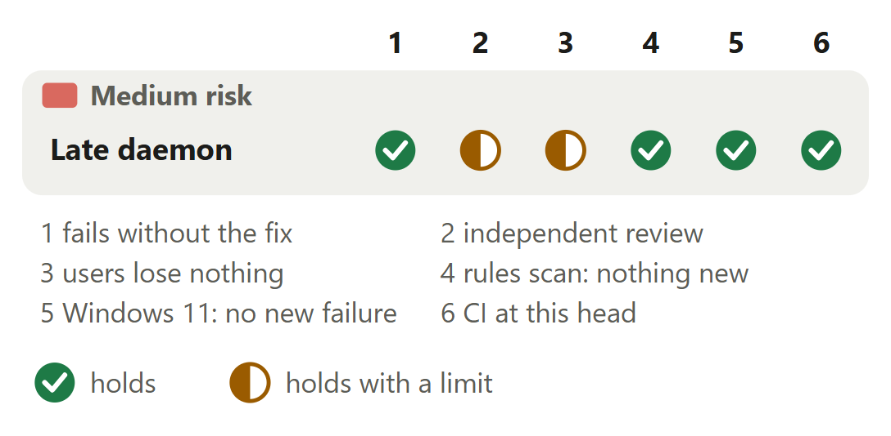

# Status: a daemon that runs but answers late reads as not answering

For [pull request #650](https://github.com/neralabs/rerail/pull/650), head 6b4eb3c6d. [report.html](report.html) is the same report as one page: download it and open it.

## 1. The decision

**Does every case that said not running before, other than a daemon that is alive but slow, still say it?**

1. A running daemon that answers late reads `● not answering`; `/rerail` stops advising a start.

**We recommend:** merge it once its full description is posted: a maintainer approved 6b4eb3c6d on 13 November 2026, CI passes there, and the automated reviewer found 0 blockers, 0 follow-ups and 0 nits.

| Size | Lane | Waits on | Not verified |
|---|---|---|---|
| 404 lines in 10 files: 163 ship, 241 are tests and text | Fast. Medium risk, no high-risk path: a maintainer approved it. | Nothing. CI passed at 6b4eb3c6d; approved 22:24 UTC, 13 November. | 4 |

## 2. Intent, and the gap

| Change | Intended | Found | Now |
|---|---|---|---|
| Footer and `/rerail` | No live daemon; docs' row is wider _(code comment, docs)_ | A live, late daemon read stopped _(one busy hour, #583)_ | Closes the gap, changes answer 1. |

Reported in #583 on 12 November 2026, from a Windows 11 laptop under load.

Sources at main, and causes

| Change | Where main states the intent | The cause, and what was measured |
|---|---|---|
| Footer and `/rerail` | `src/presentation/session-presentation.ts` line 26, the comment above `PresentationStatus`: "not running (no live daemon)". `docs/in-session-surfaces.md` line 100, under "No daemon": "says \`✕ Rerail is not running.\` and how to start it." Line 291 of that page gives the footer row a wider meaning, "No daemon answers", which a late daemon also fits. This pull request rewrites that row. | Line 143 gives each read a 2 s limit. When it runs out the read throws, and the catch at line 488 hands it to `withoutDaemon`, the branch a missing daemon takes. `readRepositoryState` (line 375) returns null on any failure. On Windows since #503, a busy engine is silent to the capability proof, and `recordedDaemonAlive` (`src/runtime/daemon-control.ts` line 613) reads silent as not alive before any read. In #583's hour the 7 timed runs took 2.7 to 7.0 s. |

## 3. Where to look

1. **Read first**, 8 min: `session-presentation.ts`: `get`, `readableDaemon`, `daemonRepositoryState`, `readSummaryState`, `readPresentation`. Apart from the read's own limit and a silent Windows proof, does any failure now read as not answering?
2. 4 min: `daemon-control.ts`: `recordedDaemonStatus`. `rerail-summary.ts`: `repositoryHeadline`, `startedLines` and the two new lines. `host-commands.ts`: the skipped read.

**Then skim**, 3 min: No assertion of `main` is removed. `host-commands.test.ts` now mocks `readSummaryState`, with the real function as its default. The docs narrow the footer's not running row.

## 4. Risk against verification

Two half marks: the two Windows commits were reviewed by the automated reviewer and a maintainer only, and one case is read and not run.

Each half mark's limit

| Change | Check | It holds with this limit |
|---|---|---|
| Late daemon | independent review | A review of the first eight commits found one behaviour defect: `rerail session --open` opened nothing after a read with no answer. e6b989fd2 restores `main`'s second read, with a test. At da71fac2e, 12 of 13 fix lines changed in turn fail a test. The limit: only the automated reviewer and the approving maintainer reviewed 80c7dae00 and da71fac2e. |
| Late daemon | users lose nothing | A real daemon on Linux x64 and Windows 11: a wrong capability, a live pid with nothing listening, a killed daemon whose state file stayed and no daemon give `main`'s text at da71fac2e. `rerail status` is unchanged. The limit: one case is read, not run, a stale state file whose port another program holds (part 8). |

## 5. The changes

**Late daemon reads not answering**, medium risk: Status line, daemon paused, Linux x64: `✕ not running` at `main`, `● not answering` here, each after 2.1 s.

<b>6. The decisions</b>

**What should the footer say of a daemon that runs but answers late?**

**We chose** a new state under the running mark: the daemon runs. **Would change our mind:** a maintainer who wants no new state, or another mark.

| Option | What a user gets | Cost | What it breaks |
|---|---|---|---|
| A new state, `● not answering`, with the running mark **(chosen)** | The footer says the daemon runs and is late. `/rerail` says "● Rerail is running, but its daemon did not answer in time." and to ask again, or to run `rerail status` if it keeps happening. | One more state in the footer's set, one row in the docs' footer table and two new `/rerail` lines. | A script that matches the footer or the `/rerail` lines meets one new state. |
| Reuse `● session unavailable` for a late answer | No new state. | Nothing to add. | It hides that the daemon is busy and gives the person no next step. |
| A longer limit for the footer's read | Fewer late answers read as stopped. | The status line refreshes often, and each refresh then holds longer against a busy daemon. | A daemon that never answers still reads as stopped. |
| The new state under a mark of its own | A late daemon looks different from a running one in the footer. | A new mark to choose and document. | Nothing known. Not built. |

**Evidence.** `rerail status` at `main` already tells the two apart: for a paused daemon it says the pid is alive but not answering and exits 4. The footer and `/rerail` did not: the unit test's listener never answers under a live pid, and `main` returns `R E R A I L ✕ not running`. #583 lists options two and three under "Alternatives" and asks a maintainer about the state and its mark. Nobody answered there; a maintainer approved 6b4eb3c6d, which carries it.

**Which failed read means not answering, and which still means not running?**

**We chose** the read's own time limit running out, or a silent Windows engine proof. Nothing else. **Would change our mind:** a gone daemon that uses up the limit. Our four cases fail in 0.1 to 0.2 s.

| Option | What a user gets | Cost | What it breaks |
|---|---|---|---|
| The read's own limit, and a silent proof on Windows **(chosen)** | A busy daemon reads not answering. A refused read, a dead process, a missing state file and a live process with nothing listening read not running. | No extra read or process. | Nothing in the cases we ran. One case is read from the code and not run: part 8. |
| Decide by the error's name (`TimeoutError`, `AbortError`) | The same, while every transport throws those names. | Nothing. | A transport that wraps the abort in another error reads not running again. Not tried. |
| Probe the process and the port apart | Finer states. | A second probe on each status line refresh. | A slower footer. |

Before: At main, a read in a started checkout says not running when daemon.json names no live process, when the Windows engine proof is refused or silent, and when the read fails for any reason, its time limit included. After: With this change, a silent Windows engine proof reads not answering and a refused one not running. A read that failed reads not answering only when its own time limit ran out. A refused read, or an answer that is not Rerail's, still reads not running.

**Evidence.** The unit listener takes every request and never answers, under a live pid recorded in `daemon.json`: `main` returns `R E R A I L ✕ not running`, this branch `● not answering`. With the catch widened so that every failure reads as not answering, the case "still says not running where the recorded pid is alive but nothing listens" fails. With a real daemon on both platforms, the four cases of part 10 give `main`'s text at da71fac2e.

**After a read with no answer, who still asks for the dashboard link?**

**We chose** `rerail session` only: `--open` needs the link. **Would change our mind:** one function owning both `/rerail` reads: `rerail session` without `--open` then skips too.

| Option | What a user gets | Cost | What it breaks |
|---|---|---|---|
| Skip in OMP and Pi only **(chosen)** | OMP and Pi `/rerail` answer in 2.15 s on Linux x64 and 2.22 s on Windows 11. `rerail session --open` opens the page when the daemon answers the second read. | `rerail session` still takes 4.15 s on Linux x64 and 4.2 s on Windows 11 for a daemon that never answers, as at `main`. | Nothing found. |
| Skip in both | Every surface answers after one wait. | Nothing. | `rerail session --open` opened nothing and exited 3, where `main` opened the page. #583's "Approach" describes this earlier skip. |
| Skip in `rerail session` only without `--open` | Both fast, `--open` kept. | An edit to `runSessionCommand` in `src/cli/cli.ts`, which the rules scan counted 16 at 9a741683, over the ceiling of 6. | Nothing. |
| Keep both reads, as `main` does | As before. | 4.16 s in OMP and Pi on Linux x64. | Nothing. |

Before: At main, /rerail in OMP and Pi waits out the session read's time limit, then the dashboard link read's, and prints its lines with no link after 4.16 s on Linux x64. After: With this change, /rerail in OMP and Pi waits out the session read's time limit, skips the dashboard link read, and prints its lines with no link after 2.15 s on Linux x64.

**Evidence.** A real daemon, paused and then resumed 2.9 to 3.2 s into `rerail session cursor --open` on Linux x64: the page opens with exit 0 at `main` and at da71fac2e. The integration case "rerail session --open asks the daemon again for the dashboard link after a read that did not answer" fails when the CLI drops its second read. The OMP case fails when OMP asks for the link again.

<b>7. How it fits</b>

Nothing has to merge first: it stands on `main` alone, and nothing waits on it. Eleven open pull requests share five of its files. In trial merges only the draft #676 conflicts, in two lines.

**Related work and shared files.** #503, merged, brought the daemon lookup and its verdicts `alive`, `gone` and `silent`; this keeps them, with `rerail status`. `main` has since moved five commits, two changing six of this branch's files: GitHub reports it mergeable at c438bc813, and the changed tests pass merged with `main` at f277c6e29. Sharing `daemon-control.ts`: #657, #667, #672, #673, #678. `session-presentation.ts`: #526, #674, #676. Its test: #526, #674. The docs page: #526, #665, #680. `host-commands.ts`: #562. A trial merge of 6b4eb3c6d with each head is clean but for #676: both edit one call in `daemonRepositoryState`.

<b>8. What is not covered</b>: 4 not verified, 6 smaller gaps, 6 limits that stay

1. **Windows, from the fifth lookup of a stalled daemon:** its engine pipe has no free instance. `rerail session` takes 32.2 s, `rerail status` says not running after 30.2 s, as at `main` (#663).
2. **A stale state file with a silent port holder** is read, not run (part 10): it would say not answering here, not running at `main`.
3. **One line has no test:** the fallback in `readSummaryState`'s catch. With it changed at da71fac2e, the three changed unit files still pass.
4. **macOS** never ran.

**Smaller gaps**

- **The Windows stall's cause.** `src/runtime/engine-proof.ts`, unchanged here, arms its limit once the pipe has connected, and a connect to a pipe with no free instance (4 here) waits about 30 s. That proof also decides for hooks, starts, stops and updates. #663 reports it; the draft #677 fixes it.
- **Stalls like #583's.** #583's own runs took 2.7 to 7.0 s each. For stalls like those, with a free pipe instance, the head says not answering on Windows 11. `rerail session` makes two lookups, the status line one.
- **`rerail session` on a daemon that never answers.** Still 4.15 s on Linux x64 and 4.2 s on Windows 11, as at `main`. Decision 3 says what would remove the second wait.
- **The flaky Windows test.** `claude-status.test.ts`, "ends the prior command, not just its shell": on Windows 11 it failed 4 of 40 runs at `main` and 9 of 40 at 6b4eb3c6d, same message, each beside another run. Its file mocks `session-presentation.js` whole and reaches no changed source file.
- **A daemon that answers after 3 s, Linux x64.** `main` says not running on every surface, da71fac2e not answering. `rerail session` takes 3.03 s and `--open` gives the page, at both. With an answer after 6 s, or never, `--open` exits 3 at both.
- **The automated reviewer's two nits, both fixed.** 135ddbe1c: a test daemon whose listen fails rejects at once and releases the engine endpoint. 6b4eb3c6d: `repositoryHeadline` is a switch the compiler checks, and a new test pins each state's no-session lines. Its review of 6b4eb3c6d found 0 nits.

**Limits that stay**

- The hook start check, `readRepositoryState`, still reads a daemon that does not answer as none, so hooks decide as before.
- `rerail status`, the daemon lookup, the engine proof and `src/cli/cli.ts` stay as `main` has them.
- `rerail manage` still says "Rerail is not running for this checkout" when its dashboard link read gets no answer in time: `readRulesDashboard` is unchanged.
- Once the daemon has answered, a failure later in the same read, such as a session folder that is gone, still says not running, as at `main`.
- A stopped or not set up checkout still follows its local start state.
- A script that reads the footer or the `/rerail` lines meets one new state. No rule file, API, stored data or hook protocol changes.

## 9. What we ask of you

We ask no ruling.

Answer 1 asks no ruling. A maintainer approved 6b4eb3c6d, which carries this state; #583's question has no reply.

<b>10. Evidence</b>

The description on GitHub is the record. "How you tested it" holds the failing runs, the reviewer's question by run and the timings.

| Where | What ran | Result |
|---|---|---|
| CI on GitHub | Run 43515417412 at 6b4eb3c6d, read on 13 November 2026 | 21 jobs: 18 passed, 3 skipped (`Rust engine (${{ matrix.name }})`, `Conformance (${{ matrix.shard }}/${{ strategy.job-total }})` and `Conformance comment`), none failed. `Unit tests (1/2)`, `Unit tests (2/2)`, `Unit tests (Windows, 1/2)`, `Unit tests (Windows, 2/2)`, `Integration tests`, `OMP and Pi real-session runtime paths` and `CI result` are among the 18. The pull request's 3 other checks: 1 passed, 2 skipped. |
| Linux x64 | The three changed unit test files at 6b4eb3c6d over `main`'s source. The integration file at da71fac2e over `main`'s source | 5 unit tests failed and 58 passed. 2 integration tests failed and 5 passed, and the built status line printed `R E R A I L ✕ not running`. |
| Windows 11 | The not-answering cases before the two Windows commits, then at da71fac2e | Before: 3 failed, 2 passed. At da71fac2e: 0 failed, 5 passed. |
| Linux x64 | 23 unit files at 6b4eb3c6d: the changed files, every file that imports a changed module and the host tests beside them. Then `integration/rerail-without-daemon.test.ts` | 367 passed, 2 skipped, 0 failed. The integration file: 7 of 7 passed. A second run on a machine under load: 365 passed, 2 failed, two `claude-hook` tests that timed out; run again at `main` and at 6b4eb3c6d, 0 of 16 failed. |
| Windows 11 | The same 23 unit files and the integration file at 6b4eb3c6d | 24 files: 365 passed, 11 skipped, 0 failed. A second run on a virtual machine: 363 passed, 2 failed, the flaky test of part 8 and an OMP extension test that failed 1 time in 20 at `main` and 1 in 20 at 6b4eb3c6d. |
| Linux x64 and Windows 11 | A real daemon at `main` and at da71fac2e, four cases: a wrong capability in `daemon.json`, a live pid with nothing listening on the recorded port, a killed daemon with `daemon.json` left behind, and no daemon | Each case gives `main`'s text at `main` and at da71fac2e, in 0.1 to 0.2 s. `rerail status` is unchanged in every case. |
| Linux x64 and Windows 11 | 13 fix lines at da71fac2e, each removed or changed in turn | 12 fail at least one test. The thirteenth, the fallback in `readSummaryState`'s catch, fails none. Removing the silent-proof line fails only on Windows, the one platform that runs the proof. |
| Linux x64 | A trial merge with `main` at f277c6e29: five unit files and the integration file. The rules scan as the automated reviewer runs it, at 6b4eb3c6d against 383fc99aa | 97 unit tests and 7 integration tests passed. The scan: 0 new findings, 3 existing ones in functions this does not edit. |

**What this report adds to the description**

- **A stale state file with a silent port holder.** The description names this case in one sentence, under decision 1. A read of the diff finds it, not run: the daemon was killed and its state file stayed, another live process of this user took its pid, and another program holds its port and takes a request without answering. `main` says not running, the head not answering.
- **The docs at `main` call not running "No daemon answers".** The description quotes no intent. At `main` the code comment says not running means "no live daemon", and the docs' footer table says "No daemon answers", which a late daemon also fits. The pull request rewrites that row, so it narrows a meaning the docs state. Part 2 gives both quotes, and its fold their lines.
- **`rerail manage` still says not running for a late daemon.** The description lists what is left alone and does not name it. By a read of the code, not run: `rerail manage` prints "Rerail is not running for this checkout" whenever `readRulesDashboard` gives no link, and that read still treats no answer in time as no daemon.
- **Our answer to the read-first question.** A read of the diff: `get` makes a not-answering error only when its own signal has fired, and `readableDaemon` only for the verdict `silent`. Only an `alive` daemon gets the capability. `liveHealth` still catches every error, so the dashboard link read answers as at `main`. `daemonRepositoryState` catches not answering, and `readRepositoryState` turns it into null. `recordedDaemonAlive` compares the same verdict with `alive`. One case differs: the first item here.

**Sources.** Pull request #650, its diff, CI and reviews, read on 13 November 2026. Rerail at `main` (8a999b339) for each quoted intent and its line; the same text at its base, 383fc99aa. Issues #583 and #663 for how the gaps were found. The description for the runs and the timings. Each open pull request's files and head for the shared files and trial merges. The earlier review's record for its defect.

