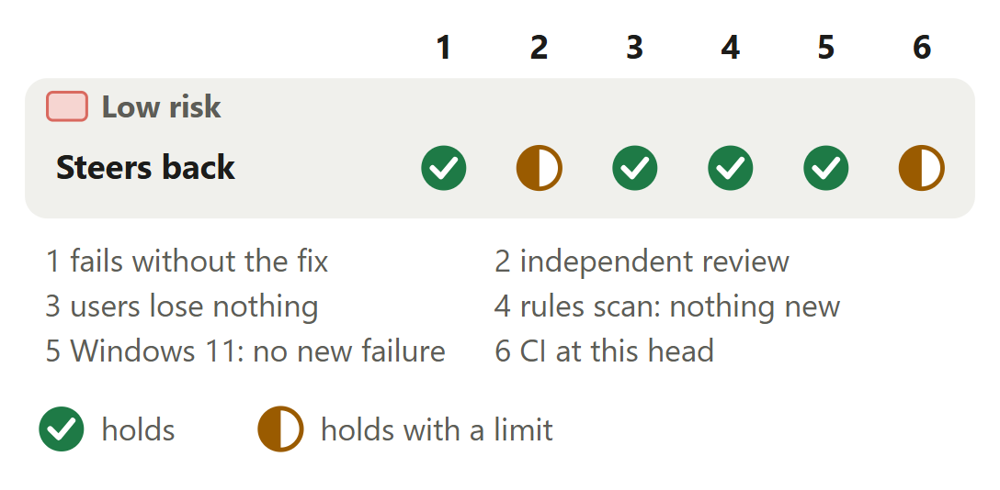

# A steer whose hook gave up reaches the session's next hook

For the pull request of branch `JeanFrancoisGagne/steer-handed-to-a-hook-that-gave-up`, not opened yet, head 3033a9a40. [report.html](report.html) is the same report as one page: download it and open it.

## 1. The decision

**May the daemon give a session back the steers an answer took when the connection shows no waiting hook received it?**

**We recommend:** approve it: a steer handed to a hook that gave up reaches the agent at a later hook, where `main` loses it; no hook waits on the write, and the ledger records each steer once.

| Size | Risk and review | Waits on | Not verified |
|---|---|---|---|
| 737 lines in 8 files: 258 ship, 479 are tests and text | Fast. Low risk, no high-risk path. | Nothing. No CI run on GitHub yet: not pushed. | 3 |

## 2. Intent, and the gap

| Change | Intended | Found | Now |
|---|---|---|---|
| Steered at next hook | A recorded steer reaches the agent _(docs)_ | Lost when its hook gave up _(a held daemon)_ | Closes the gap. |

Found in November 2026 on Linux x64 and Windows 11, holding a daemon until a Claude Code hook hit its own 30 s limit.

Sources at main, and causes

| Change | Where main states the intent | The cause, and what was measured |
|---|---|---|
| Steered at next hook | `docs/in-session-surfaces.md` at cf5d520e4, line 195: "Slower checks steer at the next hook, reply or poll." `src/runtime/engine-service.ts` at cf5d520e4, lines 1035 and 1036: `const deliveries = await engineService.ingest(event, configuration);` then `response.end(...)`, whatever became of the connection. | The runtime's boundary takes the session's pending steers and records each in the ledger as delivered. The socket's handler then writes the answer whatever became of the connection, and Node drops a write to a closed socket without a word. Nothing put the steer back, and the session's close did not owe it. |

## 3. Where to look

1. **Read first**, 10 min: `engine-service.ts`: `answered`, `keepUnheard`, `routeEngineEvent`, `answerEngineEvent`. Can an answer a hook took give its steers back, or one it never took keep them?
2. 10 min: `runtime.ts` and `owed-ledger.ts`: `returnUndelivered`, `#takeHandedOut`, `#takeOwed`, the `recorded` field.

**Then skim**, 5 min: The tests: eleven cases at the engine socket that act as hooks do: one gives up, one closes as its answer is written, one stops reading.

## 4. Risk against verification

One change, low risk: when an answer's steers go back to the session; what is checked and told stays as on `main`, and no hook waits on another's write.

Each half mark's limit

| Change | Check | It holds with this limit |
|---|---|---|
| Steers back | independent review | A second reading with its own runs through the product found eight points at an earlier head; each is closed here by a case, a run or a line in the description. This head's own lines have had no second reading. |
| Steers back | CI at this head | No CI run at this head on GitHub yet: the branch is not pushed. CI's integration job on Linux x64: 3 runs at `main` and 3 here, all passed, 90 tests. |

## 5. The changes

**Unread answers give their steers back**, low risk: Steers taken by a gave-up hook's answer: `main` told nowhere 15 of 15; here all told at a later hook.

<b>6. The decisions</b>

**How does the daemon know a hook got its answer, and when does it decide?**

**We chose** by what the connection did: a refused write before the next event, a close before hand-over when it comes. **Would change our mind:** A maintainer who wants the hook's own receipt to count, which also covers a hook killed after it read the answer.

| Option | What a user gets | Cost | What it breaks |
|---|---|---|---|
| The write's own result, then the connection's close, never waited for **(chosen)** | Every steer whose answer was refused at the next hook; a later close gives its steers to the session's next answer; no hook held. | One look at the connection per answer, and one listener until it is written. | A close that comes after the write may reach a later hook than the next one. |
| Wait in the session's turn for the answer's write to end | The same steers, each before the session's next event. | Nothing more per answer. | A hook alive that stopped reading holds its session once the answer outgrows the connection: hooks beside it gave up at 30 s. |
| The request's close seen before the steers are taken | The same when the daemon read the close in time. | A signal per request. | A daemon too busy to answer often reads the close after it writes: those steers stay lost. |

**Evidence.** Through the built Claude Code hooks and a daemon on Linux x64 and Windows 11: a hook held past 30 s lost every steer its answer took at `main`, and here each was told at a later hook. A hook stopped from reading a 740 KB answer: at the commit before, hooks beside it gave up at 30 s; at `main` and here they answered at once.

**How is a steer given back recorded when the daemon restarts first?**

**We chose** an optional `recorded` field in the `owed` entry: the next daemon hands the steer out without a second delivery entry. **Would change our mind:** A maintainer who would rather keep the ledger's format and accept the second entry.

| Option | What a user gets | Cost | What it breaks |
|---|---|---|---|
| An optional `recorded` on the owed steer **(chosen)** | One delivery entry per steer told, across a restart. | One optional field; an older build ignores it. | Nothing for older builds: they record it once more, as before. |
| Leave it, and say a restart records it twice | The steer told once. | No change to the format. | The ledger shows two deliveries of one steer. |

**Evidence.** Two engine services over one database at the seam: the commit before left two delivery entries, here one. Through the product with a daemon restart between the gave-up hook and the next one, the ledger holds one entry on Linux x64 and Windows 11.

<b>7. How it fits</b>

Nothing has to merge first: it stands on `main` c21947263, with the 0.2.0 engine. A change to follow that stops a turn's end whose hook gave up from waiting shares one line of `routeEngineEvent`.

<b>8. What is not covered</b>: 3 not verified, 1 smaller gap, 2 limits that stay

1. **macOS** never ran.
2. **A hook killed after it read its answer** and before it printed it: the daemon cannot see that, as on `main`.
3. **A steer whose unread answer no hook follows** (the session ends first) stays recorded as delivered and is not told, as on `main`.

**Smaller gaps**

- **Other hand-outs of an unread answer.** The experimental missed-steer digest and conversation-rule matches: no case or run shows what becomes of them. A Merge Assist note given back is recorded and marked given once (a case shows it).

**Limits that stay**

- A hook that stops reading and gives up later: its steers go to the session's next answer from then, which can be a later hook than the next one.
- The native sessions' replies (OMP and Pi through the daemon) can meet the same loss; not changed here.

## 9. What we ask of you

We ask no ruling.

<b>10. Evidence</b>

The description on GitHub is the record: "How you tested it" holds the runs on `main` and here, and where each claim is shown.

| Where | What ran | Result |
|---|---|---|
| Linux x64 and Windows 11 | The built Claude Code hooks and a daemon held at its answer until the hook gave up, four cases in each run, `main` and here in turn | Steers the answer took: `main` told nowhere 15 of 15, here 15 of 15 at a later hook; told twice 0; one ledger entry each, also across a daemon restart. |
| Linux x64 and Windows 11 | A hook stopped from reading its 740 KB answer while a second Read's hooks ran, `main`, the commit before and here | Hooks beside it: `main` and here answered in under half a second; the commit before: 8 of 8 beside a hook stuck 35 s gave up at 30 s, and 4 of 4 beside one stuck 25 s waited for it. |
| Linux x64 and Windows 11 | The eleven cases, 20 runs; each source line taken out alone | Here 0 of 20 failed on each system; each of 21 lines out failed a case on each system. |
| Linux x64 and Windows 11 | The 29 changed and importing test files | Windows: 451 passed, none failed. Linux, on a quieter machine: the four files that lost tests to a 5 s limit under load passed at `main` 3 of 3 and here 2 of 3; the two tests behind it, 14 runs more, failed at `main` once and here twice. |
| Linux x64 | The automated reviewer's rules at `main` cf5d520e4 over the diff against it | No new finding and no new complexity, with the published 0.1.5 and with Rerail built from `main`. |

**Sources.** The branch at 9c1c9cb45 and its diff against `main` cf5d520e4, read on 19 November 2026; runs on Linux x64 machines and Windows 11 virtual machines.

