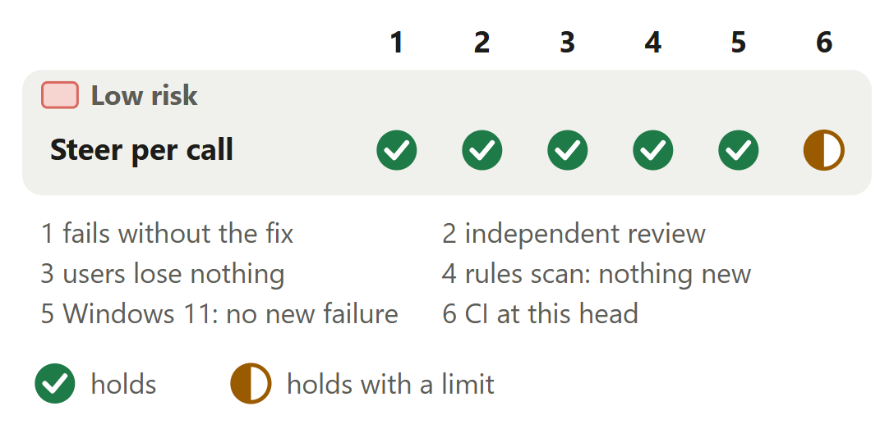

# A recorded steer reaches the agent at the next hook

For the pull request of branch `JeanFrancoisGagne/steer-recorded-never-told`, not opened yet, head ea3463891. [report.html](report.html) is the same report as one page: download it and open it.

## 1. The decision

**May the evaluator ask for a tool call's steer as soon as that call's own edits are checked, rather than once every queued edit is?**

**We recommend:** approve it: a finding already in the Log reaches the agent at the next hook, where on `main` it waited up to six hooks; what is checked, recorded and told stays as on `main`.

| Size | Risk and review | Waits on | Not verified |
|---|---|---|---|
| 189 lines in 3 files: 40 ship, 149 are tests and text | Fast. Low risk, no high-risk path. | Nothing. No CI run on GitHub yet: not pushed. | 3 |

## 2. Intent, and the gap

| Change | Intended | Found | Now |
|---|---|---|---|
| Steered at next hook | A finding steers at the next hook _(docs)_ | It waited for every queued edit _(a traced daemon)_ | Closes the gap. |

Found in November 2026 on Linux x64, tracing a daemon while one session's checks queued behind each other.

Sources at main, and causes

| Change | Where main states the intent | The cause, and what was measured |
|---|---|---|
| Steered at next hook | `docs/in-session-surfaces.md` at cf5d520e4, line 195: "Slower checks steer at the next hook, reply or poll." `src/engine/code-rule/code-rule-enforcer.ts` at cf5d520e4, lines 1230, 1351 and 1377: `if (this.#pending.size === 0) await this.#publishReady();`. | The evaluator records each audit as its check ends, but asked the runtime to steer only on an empty queue, at three places: after an evaluation (`#steerAgainThenPublish`), a read failure (`#evaluatePendingEdit`) and an evaluation error (`#recordPendingEvaluationError`). While edits kept arriving the queue was not empty after a check, so every finding recorded meanwhile waited for the last queued edit's check. |

## 3. Where to look

1. **Read first**, 10 min: `code-rule-enforcer.ts`: `#publishReady`, `#takeReady`, `#answerWith`, `#evaluatePendingEdit`, `#recordPendingEvaluationError`. Can a call's ready findings stay held with nothing left to publish them, or go out twice?

**Then skim**, 5 min: The tests: five cases at the evaluator's seam that record each audit and each steer request in order; two of them hold a read failure and an evaluation error.

## 4. Risk against verification

One change, low risk: when a recorded steer is asked for; what is checked, recorded and told stays as on `main`.

Each half mark's limit

| Change | Check | It holds with this limit |
|---|---|---|
| Steer per call | CI at this head | No CI run at this head on GitHub yet: the branch is not pushed. CI's integration job passed on Linux x64: 22 files, 90 tests. |

## 5. The changes

**Steered once its call is checked**, low risk: Findings that missed a hook: `main` 37 of 120 on Linux x64, 106 of 120 on Windows 11; here 0.

<b>6. The decisions</b>

**When does a finding the evaluator has recorded go out to the agent?**

**We chose** per tool call, as soon as none of its own edits is still queued: one call's files in one steer. **Would change our mind:** A maintainer who wants one steer per burst of tool calls rather than one per call.

| Option | What a user gets | Cost | What it breaks |
|---|---|---|---|
| Per tool call, once its own edits are checked **(chosen)** | Every recorded finding at the next hook; one call's files in one steer, unless one is still being stored. | One pass over the queue after each check: a few entries. | A call with a file spooled to disk can be told in two steers, as on `main` when nothing else is queued. |
| The same, also counting a call's edits still being stored | One steer per call even when a file is spooled to disk. | A second record of what is queued, a publish when the queue empties, and a second pass when a store ends during it. | One of those missed and a steer waits with nothing to send it, the fault this fixes. |
| Keep the empty-queue rule; the hook waits for the queue | The steer under the edit. | Every tool call waits for unrelated checks. | The one-second wait that keeps tool calls fast. |

**Evidence.** Through the built Claude Code hook and a daemon, 24 flagged files written at once, five rounds a side: `main` held 37 of 120 recorded findings past a hook on Linux x64 and 106 of 120 on Windows 11, here 0 on both; told nowhere and told twice 0 on every side.

<b>7. How it fits</b>

Nothing has to merge first: it stands on `main` cf5d520e4. #812 and #738 edit the same source file; this head adds no conflict to either.

<b>8. What is not covered</b>: 3 not verified, 1 limit that stays

1. **macOS** never ran.
2. **A tool call with a file still being stored** when the evaluator ends its others is told in two steers, the same findings, as on `main` when nothing else is queued.
3. **A hook that gave up** at the daemon's 30 s limit still has its steer handed to an answer nobody reads, as on `main`: another part of Rerail.

**Limits that stay**

- A check that ends after the hook's one-second wait steers at the hook after it, by design.

## 9. What we ask of you

We ask no ruling.

<b>10. Evidence</b>

The description on GitHub is the record: "How you tested it" holds the runs on `main` and here.

| Where | What ran | Result |
|---|---|---|
| Linux x64 | The built Claude Code hook against a daemon of `main` cf5d520e4 and of this branch, 24 flagged files written at once, five rounds each, one machine | Findings that missed a hook: `main` 37 of 120 (up to five hooks), here 0; told nowhere and told twice 0 on both. |
| Windows 11 | The same probe, `main` and here on one machine | Findings that missed a hook: `main` 106 of 120 (up to six hooks), here 0; told nowhere and told twice 0 on both. |
| Linux x64 and Windows 11 | Each new case with `main`'s empty-queue condition put back at its place, 20 runs; the cases here, 20 runs | With the condition back: 20 of 20 failed on each system. Here: 0 of 20 failed on Linux x64, 0 of 20 on Windows 11. |
| Linux x64 and Windows 11 | The 26 changed and importing test files | Linux: here 419 passed, `main` 414, one file failing at both for missing pack test data. Windows: 417 passed; the one failure outside main's baseline, a 1 s wait before any edit, failed at main too when repeated. |
| Linux x64 | CI's integration job | Exit 0: 22 files, 90 tests passed, 4 skipped. |
| Linux x64 | The automated reviewer's rules at `main` cf5d520e4 over the diff against it | No new finding and no new complexity, with the published 0.1.5 and with Rerail built from `main`. |

**Sources.** The branch at ea3463891 (19fdb58c7 with `main` ba0545900 merged in, a tests-only change) and its diff against `main`, read on 19 November 2026; runs at 19fdb58c7 on Linux x64 machines and Windows 11 virtual machines.

