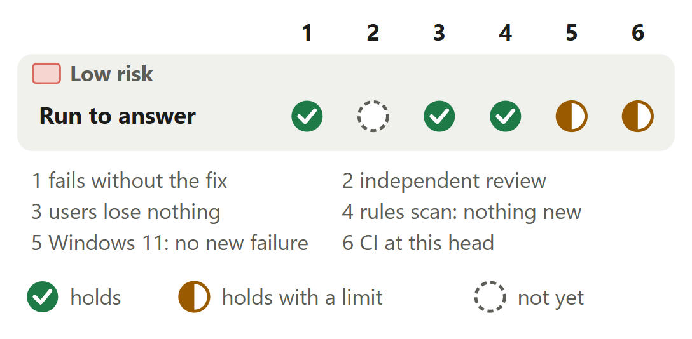

# The stop's Windows PowerShell cases pass when PowerShell starts slowly

For [pull request #1058](https://github.com/neralabs/rerail/pull/1058), head 9163ea7862. [report.html](report.html) is the same report as one page: download it and open it.

## 1. The decision

**May the stop's Windows PowerShell cases run the real PowerShell to its answer and assert its bound, not race that bound in real seconds?**

**We recommend:** approve it: the cases still prove the module-qualified reads on the real PowerShell, and a new case pins the stop's bound for a PowerShell that never answers.

| Size | Risk and review | Waits on | Not verified |
|---|---|---|---|
| 99 lines in 2 files: 0 ship, 99 are the tests it changes, 0 are other tests and text | Fast. Two test files, no product code. | Nothing. No CI run on GitHub yet: not pushed. | 3 |

## 2. Intent, and the gap

| Change | Intended | Found | Now |
|---|---|---|---|
| Stop proves the daemon | Prove the daemon through real PowerShell _(a test's name)_ | Failed when PowerShell started slowly _(a CI run)_ | Closes the gap. |

Found on 24 November 2026: `main`'s Windows unit tests on GitHub failed the stop's case at 302a47d1a.

Sources at main, and causes

| Change | Where main states the intent | The cause, and what was measured |
|---|---|---|
| Stop proves the daemon | `test/runtime/daemon-control.test.ts` at be0def9c35, line 3267: the case ran both reads through the real Windows PowerShell with the options the stop gave, the stop's own 10 s as `spawnSync`'s `timeout`. | The case raced the product's bound in real seconds: a read ended at what is left of 10 s reads nothing (`src/engine/process-liveness.ts:253`), the stop's verdict is then unknown and it ends nothing. On an idle Windows 11 machine the read took 254 ms at the median and 2,030 ms at most over 300 runs. |

## 3. Where to look

1. **Read first**, 5 min: `daemon-control.test.ts`: `stopReadingStartsFor` and the two cases that use it. Does the never-answers stand-in return what Node's `spawnSync` returns for a PowerShell ended at its timeout?
2. 2 min: `process-liveness.test.ts`: the end case under the module-only setting.

**Then skim**, 1 min: No other file changes.

## 4. Risk against verification

One change, tests only: start with the stand-in that answers past the bound.

Each limit, and each check that does not hold yet

| Change | Check | Its limit, or why it does not hold yet |
|---|---|---|
| Run to answer | independent review | No second reader has reviewed this head yet. |
| Run to answer | Windows 11: no new failure | Windows 11, engine built for this tree: the five PowerShell cases of both files passed 30 of 30 rounds beside other test runs. The two files were not run whole on Windows. |
| Run to answer | CI at this head | No CI run on GitHub yet: the branch is not pushed. |

## 5. The changes

**PowerShell run to its answer**, low risk: GitHub's Windows runner: the case took 20,150 ms and failed; an idle Windows 11 read takes 254 ms.

<b>6. The decisions</b>

**What should decide the stop's Windows PowerShell cases?**

**We chose** the real PowerShell run to its answer with its bound asserted, on the case's clock: the module-qualified reads stay proven. **Would change our mind:** A ruling that these cases must also show the real PowerShell answering within the product's bound on the machine that runs them.

| Option | What a user gets | Cost | What it breaks |
|---|---|---|---|
| Run PowerShell to its answer, assert the bound, time on the case's clock **(chosen)** | The real PowerShell still finds the module-qualified cmdlets; a busy runner no longer fails a correct product. | A stand-in answers for a read past its bound, in the never-answers case. | Nothing that works at `main`. |
| The real PowerShell under the product's bound in real seconds, as at `main` | A run that also shows this machine starts PowerShell within the product's bound. | A red on any runner where PowerShell takes about 10 s to start. | Nothing. |
| A stand-in for PowerShell in every read | Fast and fixed answers. | No case shows that the real PowerShell finds the cmdlets under the module-only setting. | The cases' purpose: #965's module path read. |

**Evidence.** The CI log shows the case at 20,150 ms with two reads at about 10 s. On an idle Windows 11 machine, 300 runs read at a median of 254 ms; with 40 more modules on the module path and a cold cache, 504 ms at most over 30 runs.

<b>7. How it fits</b>

Nothing has to merge first: it stands on `main` be0def9c35 and changes no product file. It shares `daemon-control.test.ts` with #1051 but no line; a trial merge of both heads is clean.

<b>8. What is not covered</b>: 3 not verified, 1 limit that stays

1. **macOS** Not run: no machine of ours runs it. The changed cases run on Windows only.
2. **The product's bound** The uninstall still decides by how fast PowerShell starts; it is written up in its own issue, not changed here.
3. **Under load** The runner's slow PowerShell starts were not reproduced here: 300 idle runs at `main` stayed green.

**Limits that stay**

- A machine slower than the cases' own 60 s limit for both reads still fails them.

## 9. What we ask of you

We ask no ruling.

<b>10. Evidence</b>

The description's "How you tested it" holds every run.

| Where | What ran | Result |
|---|---|---|
| Windows 11 | The five PowerShell cases of both files, 30 rounds, engine built for this tree; `main` once | 30 of 30 rounds passed here, beside other test runs; `main` passed its 4 such cases. |
| Windows 11 | Two mutants: the lookup's read given 10 s more with the end given 5 s more; the start read with no bound | The first fails four cases: `expected 20000 to be less than or equal to 10000` and `expected [ 20000 ] to deeply equal [ 15000 ]`. The second fails the stop's case (`expected NaN to be greater than 0`) and the never-answers case. |
| Linux x64 | Both files whole with `dist/` built, 30 rounds on two machines at a load average of 4 to 21 | 30 of 30 passed for each file; the changed cases run on Windows only and skip there. |
| Linux x64 | CI's lint and type-check job | `npm run check`, `check:ui-tokens` and `check:reference` pass at the head. |

**Sources.** The branch at 9163ea7862 and its diff against `main` be0def9c35; the CI log of the failed run on GitHub; runs on shared Windows 11 and Linux x64 test machines.

