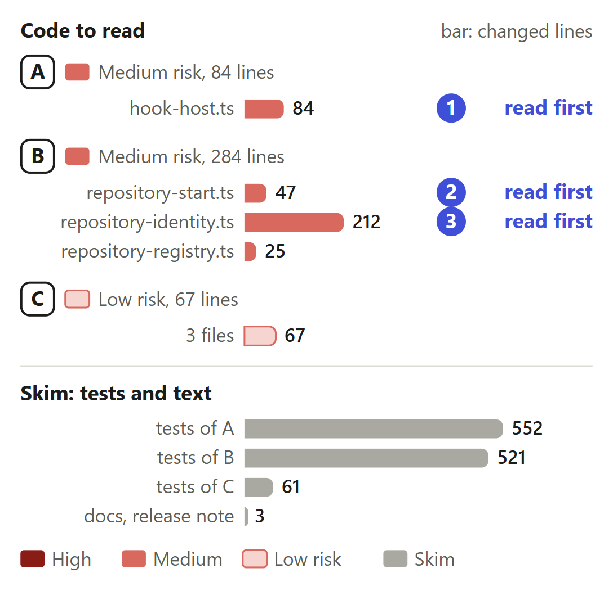
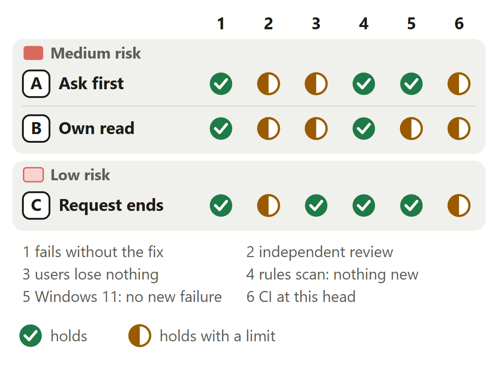

# A stopped checkout's hook answers without waiting for a busy daemon

For [pull request #674](https://github.com/neralabs/rerail/pull/674), head 6993ee854. [report.html](report.html) is the same report as one page: download it and open it.

## 1. The decision

**May a hook answer stopped by itself, from the database and the folders on disk, when the daemon has not answered within 75 ms?**

1. Beside a late daemon, a stopped checkout's hook answers stopped by itself. **Changes the intent.**
2. The reference no longer says these hooks never contact the daemon. **Changes the intent.**

**We recommend:** approve it once a maintainer answers yes in #670: over 40 folder shapes the hook never answers stopped where the daemon reads otherwise, and beside an idle daemon hook times stay inside `main`'s spread.

| Size | Lane | Waits on | Not verified |
|---|---|---|---|
| 1,572 lines in 12 files: 435 ship, 1,137 are tests and text | Standard. Medium risk; only the automated reviewer approved it. | #670's answer. No maintainer has answered; CI passes, second attempt. | 4 |

## 2. Intent, and the gap

| Change | Intended | Found | Now |
|---|---|---|---|
| A. The start check | A running daemon answers first _(code comment)_ | Up to 2 s per hook _(hook timings)_ | **CHANGES THE INTENT: ANSWER 1.** A late daemon: the hook answers stopped. A maintainer must agree. |
| A. The reference | Stopped hooks never contact the daemon _(docs)_ | One request per hook _(request counts)_ | **CHANGES THE INTENT: ANSWER 2.** The reference says it asks first. A maintainer must agree. |
| B. The hook's own read | The daemon answers from its environment _(code comment)_ | No Git-free read of its own _(probe, earlier head)_ | Closes the gap. |
| C. The open request | One request, ended by its limit _(code comment)_ | An open request keeps the process _(a mutation)_ | Closes the gap. |

Reported in #670 on 13 November 2026; timed on Linux x64 and Windows 11.

Sources at main, and causes

| Change | Where main states the intent | The cause, and what was measured |
|---|---|---|
| A. The start check | `src/harness/hook-host.ts` lines 60 and 61, above `hookRerailStarted`: "The check one-shot hooks make. A running daemon answers first, from its own environment and open database; without one, the hook reads the database itself, which never starts a daemon." | `hookRerailStarted` awaits `readRepositoryState` (`src/harness/hook-host.ts` line 66 at `main`), whose read ends after `READ_TIMEOUT_MS`, 2 s (`src/presentation/session-presentation.ts` line 79). A request to a busy daemon waits behind other sessions' work. Measured with a Claude Code `PreToolUse` hook against a stand-in daemon held busy in 900 ms slices, 20 hooks a row, two rounds at `main`. |
| A. The reference | `docs/reference.md` line 837: "A stopped checkout records nothing, runs no rules, delivers no guidance, and its hooks never autostart or contact the daemon." | The stand-in daemon counted one request per hook in a stopped checkout at `main`, on Linux x64 and Windows 11. `hookRerailStarted` asks before it reads anything, in every checkout. An earlier head of this branch read first and kept the reference's words; a started checkout's start check then took 20 against 11 ms on Linux x64 and 25 against 15 ms on Windows 11. |
| B. The hook's own read | `src/harness/hook-host.ts` lines 60 and 61: a running daemon answers "from its own environment and open database". `src/engine/catalog/repository-registry.ts` lines 191 and 192, above `lookupCheckout`: a fresh clone "is still found by its remote, with \`cloneId\` null, so a new clone of a started repository reads started". | `lookupCheckout` calls `repositoryIdentityLocation` (`src/engine/catalog/repository-registry.ts` line 201 at `main`), which runs Git in the caller's environment. At 3977f531f, where the hook answered from that read, `GIT_CEILING_DIRECTORIES` or `GIT_CONFIG_GLOBAL` set otherwise than the daemon's made it read a started checkout as stopped, on Linux x64 and Windows 11. The automated review found the same. |
| C. The open request | `src/presentation/session-presentation.ts` lines 426 and 427, above `readRepositoryState`: "Whether Rerail is started in \`cwd\`'s repository, from the live host daemon, or null when none answers. One request: the recorded pid must be alive and the reply must parse as a presentation." Line 167, in `get`: `AbortSignal.timeout(READ_TIMEOUT_MS)`. | `get` (`src/presentation/session-presentation.ts` line 166 at `main`) ends its read only on its 2 s limit, and on Windows `engineCapabilityProof` waits up to 2 s for the engine. With the request left open at 0c9ad801e, 14 tests fail on Linux x64. Beside a stand-in daemon that answers after 1.8 s, `main` got each of 10 answers after 1.9 s. |

## 3. Where to look

1. **Read first**, 5 min: `hook-host.ts`: `hookRerailStarted`, `daemonAnswer`, `stoppedEndingRequest`, `knownStopped`. Can the hook answer stopped, or throw, where the daemon would say started?
2. **Read first**, 4 min: `repository-start.ts`: `stoppedWithoutGit`. Does every doubt give false?
3. **Read first**, 10 min: `repository-identity.ts`: `gitSearchEnds`, `nearestGitTop`, `takenGitDirectory`. Can Git's search end where this walk names no end?
4. 2 min: B: `repository-registry.ts`.
5. 4 min: C: `session-presentation.ts`, `daemon-control.ts`, `engine-proof.ts`.

**Then skim**, 8 min: `hook-host.test.ts` removes only import lines. Read the tree test's shapes (`generatedTrees`) and the reference's rewritten sentence.

## 4. Risk against verification

Start at B's third mark: macOS and a real case-insensitive Linux folder never ran.

Each half mark's limit

| Change | Check | It holds with this limit |
|---|---|---|
| A. Ask first | independent review | A second reader checked each head cold. Our runs found that reading first cost a started checkout 20 against 11 ms per start check on Linux x64; f75a4e3c3 asks first. The automated reviewer's follow-up, a test that raced the grace, is fixed in 563db627d, and it approved 6993ee854. The limit: no person on the team has reviewed it. |
| A. Ask first | users lose nothing | Every hook answers `{}` with exit 0 at `main` and here. Beside an idle daemon each sends one request and takes the daemon's answer, at both. Paired, 30 pairs a row: -2.8 to +2.5 ms per hook on Linux x64, -7.9 to +1.6 ms on Windows 11. The limit: timed at 120f63573, with Claude Code's hook and a stand-in daemon only. |
| B. Own read | independent review | A second reader checked each head cold. Our runs found a `.git` with unsearchable `objects` read as stopped, a schema step the read wrote, and a case-insensitive Linux folder read as stopped; 26c751118, b9e458780 and d4dd41ecd fix them. The automated reviewer's macOS blocker does not occur, as it agreed. The limit: no person on the team has reviewed it. |
| B. Own read | users lose nothing | The tree test asks hook and daemon about 40 folders, each with and without a ceiling: in 0 of 80 checks does the hook answer stopped where the daemon reads otherwise, on Linux x64 and Windows 11. Eight more letter-case shapes: 0 of 684 and of 888 checks. The limit: macOS and a real case-insensitive Linux folder never ran. |
| B. Own read | Windows 11: no new failure | The same file passes on Windows 11 at 6993ee854. A lower-case path, a `subst` letter and a mapped network letter gave 16 checks, 0 where the hook answers stopped and the daemon reads otherwise. The limit: B's case-insensitive Linux test runs only on Linux, so it is skipped there. |
| C. Request ends | independent review | A second reader checked each head cold. Our runs found that ending a request the daemon had already answered cost 0.3 to 0.4 ms per check on Linux x64; 0c9ad801e ends it only where the hook answers first. The automated reviewer raised nothing in these three files and approved 6993ee854. The limit: no person on the team has reviewed it. |
| A to C | CI at this head | Run 43622328319 at 6993ee854, read on 14 November 2026: 28 checks pass, none fails, the others are skipped. The limit: in the first attempt `Unit tests (Windows, 2/2)` failed on one test of `claude-status.test.ts` (#681), a file this branch does not change. The job was rerun once and passed. |

<b>5. The changes</b>

**A. Ask first, answer after a grace**, medium risk. Hook beside a busy daemon: 1,793 ms at `main`, 160 ms here (Linux x64).

- **Problem:** In a checkout where Rerail is stopped, every Claude Code, Codex and Cursor hook asks the daemon whether Rerail runs there and waits up to 2 s. A daemon busy with other checkouts holds each one, for an answer of `{}`.
- **Who meets it:** A person who stopped Rerail in some checkouts while sessions in others keep the daemon busy: every hook there. How many people work this way is not known. #670 reports one laptop with about 40 such sessions.
- **What it does:** `hookRerailStarted` still asks the daemon first. `daemonAnswer` waits the grace out (`settlesWithin`). Past it, `stoppedEndingRequest` runs the hook's own read (`knownStopped`). Where that shows stopped, the hook answers stopped and ends its request. Elsewhere it goes on waiting. SQLite's error sends the hook back to the daemon; any other error is thrown. A test may hold the grace open (`graceMs`).
- **Risk:** Medium. This check decides whether a hook does anything, for three coding agents. By itself it can only answer stopped, or throw when its own read faults, and only once the daemon is late. Every other path is `main`'s.
- **Check:** Is `stopped` the only answer `daemonAnswer` gives by itself? When the hook's own read throws anything but SQLite's error, `stoppedEndingRequest` ends the request and the hook answers `{}` with a line on stderr, in a started checkout too; at `main` it waits for the daemon there. The timer starts when the request starts, so on a slow machine the hook can answer before its request reaches the daemon. An explicit database path never asks the daemon, as on `main`.
- **Picture:** Median time of one Claude Code hook in a stopped checkout beside a busy daemon. Linux x64: 1,793 ms at main, 160 ms with this change. Windows 11: 901 ms at main, 219 to 232 ms with this change.
- **Method:** a Claude Code `PreToolUse` hook started as Claude Code starts it, against a stand-in daemon held busy in 900 ms slices that counts its requests. 20 hooks a row, two rounds at `main` and at 120f63573 in alternating order, medians. At 5000fa904 a paired run of the same hook is within 1.1 ms of 120f63573 on both systems.

**B. The hook's own read**, medium risk. Of 80 folder checks the hook answers 26 by itself; the daemon reads none otherwise.

- **Problem:** A hook that answers by itself must give the daemon's answer. `main`'s read for a hook with no daemon runs Git in the agent's environment, where a ceiling variable or a config file can move its answer.
- **Who meets it:** Every hook in a stopped checkout beside a late daemon takes this read's answer. A wrong stopped would leave a started checkout unrecorded and unchecked for as long as the daemon stays late. Source: our reading of the code.
- **What it does:** `gitSearchEnds` walks up to the first `.git` Git takes (`takenGitDirectory`: `HEAD`, `objects`, `refs`, no `core.worktree`) and names where Git's search can end: that checkout, or outside Git. `stoppedWithoutGit` is true only when every end reads stopped in the database (`statusWithoutRemote`), which is never written. A checkout with no clone id, an open walk or an unreadable database gives false.
- **Risk:** Medium. A wrong stopped leaves a started checkout unchecked and unrecorded. Every doubt gives false, and the hook then waits as on `main`. No path `REVIEW.md` lists as high-risk is touched: storage is only called.
- **Check:** Does `takenGitDirectory` take exactly the `.git` that Git takes? Our runs found two shapes the walk read wrongly: an `objects` folder Git may not search, and a Linux top the kernel names in another letter case. Each now ends open, so the hook waits. `statusWithoutRemote` shares `lookupAt`'s lookups before the remote (`repositoryWithoutRemote`). Name a folder shape the tree test lacks and it gets a row there.
- **Picture:** Start checks the hook answers by itself beside a late daemon, of the tree test's 80. At main: none, on either system. With this change: 26 on Linux x64 and 30 on Windows 11. In none of them does the daemon read the folder otherwise than stopped.
- **Method:** the tree test builds 40 folders (stopped, started and never-recorded checkouts, nested clones, linked worktrees, links, folders outside Git) and asks the hook, beside a late stand-in daemon, and the daemon's own read about each, with and without `GIT_CEILING_DIRECTORIES` right above the folder. Counted once per system at 5000fa904. At `main` the hook always waits, by its code.

**C. The hook ends its request**, low risk. Daemon 1.8 s late: 1,892 ms per hook at `main`, 158 ms here (Linux x64).

- **Problem:** Node keeps a process alive while a socket or a pipe is open. A hook that answered first would still exit only when the daemon answered or the read's 2 s limit ended its request.
- **Who meets it:** Every hook that answers stopped by itself under change A. Without this change it would have its answer early and its process would end no sooner. Source: our reading of Node, and the mutation that leaves the request open.
- **What it does:** `readRepositoryState` takes an optional stop signal and passes it to `daemonRepositoryState`, `readableDaemon` and `get`, where `endedBy` joins it to the 2 s limit. `recordedDaemonStatus` passes it to Windows' question to the engine, and `engineCapabilityProof` hands it to the request, which then ends as `refused`. A stopped read returns null. No other caller passes a signal.
- **Risk:** Low. Each new parameter is optional and only the hook's start check passes one. The status line, the dashboard and every other reader take `main`'s path.
- **Check:** On Windows a stopped proof answers `refused`, which `recordedDaemonStatus` reads as gone. Only `readableDaemon` passes a stop, and it then returns false, so the read returns null and no state file is touched. In `get`, a stop is not the time limit, so it is not reported as `NotAnswering`.
- **Picture:** Median time of one Claude Code hook in a stopped checkout beside a daemon that answers after 1.8 s. Linux x64: 1,892 ms at main, 158 ms with this change. Windows 11: 1,948 ms at main, 230 ms with this change. The hook ended 10 of 10 requests.
- **Method:** the hook runs of change A, beside a stand-in daemon that answers each request after 1.8 s: two rounds at `main` and at 120f63573 in alternating order, medians of the first round. The stand-in daemon counted 10 of 10 requests ended by the hook, where `main` got each answer after 1.9 s.

<b>6. The decisions</b>

**Ask the daemon first and answer after a grace, or read first?** (ask 1)

**We chose** ask first: beside a prompt daemon a hook costs what `main`'s does. **Would change our mind:** an answer of no in #670: the fix then moves into the daemon.

| Option | What a user gets | Cost | What it breaks |
|---|---|---|---|
| Ask the daemon first; past the grace, answer stopped where the read shows it **(chosen)** | Beside a daemon that answers in time, `main`'s behaviour at `main`'s cost. Beside a busy one, a stopped checkout's hook answers in 160 ms on Linux x64 and 219 to 232 ms on Windows 11. | 75 ms of waiting before the hook's own read. One timer per start check: 0.7 to 1.9 ms in a process that runs only the check, and no difference in a hook process. | Nothing measured. The reference's sentence changes: a stopped checkout's hook still asks a running daemon. |
| Read the database first; ask the daemon only where the read cannot tell | No request in a stopped checkout: 82 ms beside a busy daemon on Linux x64. The reference's words stay true. | The read in every checkout. A started checkout's start check took 20 against 11 ms on Linux x64 and 25 against 15 ms on Windows 11, idle daemon. | The most common case, a started checkout, gets slower than `main`. |
| The daemon answers start-state reads ahead of its queue | Shorter waits in every checkout. | A second thread in the daemon, with its own listener and database connection. Not built. | The hook still waits on the daemon. |
| Do nothing | Nothing new. | 0.9 to 1.8 s per hook beside a busy daemon. | The reference stays untrue. |

Before: At main the hook asks the daemon, waits up to 2 s and takes the daemon's answer. After: With this change the hook asks the daemon and takes an answer that comes within 75 ms, as on main. Past that it reads the database and the folders on disk. If they show stopped, it answers stopped and ends its request. If not, it waits for the daemon.

**Evidence.** With a daemon that answers at once, the three asks-first tests expect no database opened and no folder walked, and fail with the read put before the ask. Paired, one hook process of each build in turn, 30 pairs a row, idle daemon: -2.8 to +2.5 ms on Linux x64 and -7.9 to +1.6 ms on Windows 11, here less `main`.

**How long may the daemon take before the hook reads?** (ask 3)

**We chose** 75 ms: on Windows 11, 25 of 2,100 idle asks miss it, against 145 at 50 ms. **Would change our mind:** Windows machines whose idle daemon often answers later.

| Option | What a user gets | Cost | What it breaks |
|---|---|---|---|
| 75 ms **(chosen)** | Beside a busy daemon the start check answers in 85 ms on Linux x64 and 92 to 98 ms on Windows 11. | 25 of 2,100 idle asks on a Windows 11 virtual machine miss it and pay the hook's own read, and 0 of 2,100 on Linux x64. | Nothing measured. |
| 50 ms | An answer 25 ms sooner beside a busy daemon. | 145 of 2,100 idle asks on Windows 11 miss it, 6.9%. | Idle hooks on Windows 11 pay the hook's own read six times as often. |
| 100 ms | 8 of 2,100 idle asks on Windows 11 miss it. | 25 ms more for every hook beside a busy daemon. | Nothing measured. |
| 150 ms | 0 of 2,100 idle asks on Windows 11 miss it. | 75 ms more for every hook beside a busy daemon. | Nothing measured. |

**Evidence.** A real daemon (`rerail daemon start`), each ask in a process of its own, 2,100 idle asks per system, at 60bbe3e51. Linux x64, 16 cores: median 16.5 ms, 99th percentile 20.0 ms, longest 25.9 ms. A Windows 11 virtual machine with no other run: median 23.2 ms, 90th percentile 46.1 ms, 99th 76.5 ms, longest 139.1 ms. At 40 ms, 364 of 2,100 miss it there.

**May the hook's own answer run Git?**

**We chose** no: an agent's Git variables and config files cannot then move it. **Would change our mind:** a folder shape the walk reads otherwise than Git.

| Option | What a user gets | Cost | What it breaks |
|---|---|---|---|
| The folders on disk and the database, no Git **(chosen)** | An answer no Git variable or config file can move, and no wait when Git hangs. | 211 lines that follow Git's search: `.git` folders and files, `commondir`, `HEAD`, and whether Git may search `objects` and `refs`. | A Git repository Rerail never recorded and a new clone still wait: only their remote places them, and Git reads it. |
| Git in the hook's own environment | An answer for repositories never recorded too. | A Git process per hook, and 10 s when `rev-parse` hangs. | With `GIT_CEILING_DIRECTORIES` or `GIT_CONFIG_GLOBAL` set otherwise than the daemon's, the hook reads a started checkout as stopped, on Linux x64 and Windows 11. `XDG_CONFIG_HOME` and `HOME` move it as well. |
| Which recorded checkout holds the folder, from the database alone | The smallest read. | Nothing. | A new clone of a started repository and an unrecorded worktree of a started clone, inside a stopped checkout, read started in the daemon and stopped in the hook. |
| The daemon records its Git settings; the hook trusts Git on a match | Git's own answer where the settings match. | A new field in the daemon's state file. Not built. | Still a Git process per hook. |

**Evidence.** The tree test asks the hook and the daemon about 40 folders, each with and without a ceiling right above the folder in the daemon's environment: 0 where the hook answers stopped and the daemon reads otherwise, on Linux x64 and Windows 11. A test sets each of seven variables in the hook's environment, `GIT_DIR`, `HOME` and `XDG_CONFIG_HOME` among them: none moves the answer.

<b>7. How it fits</b>

It stands on `main` alone and merges clean. No other change needs it. Four of our open pull requests conflict with it, one file each.

Pull request #674 is based on main at c89f068ed, which is merged in. Its merge waits for a maintainer's answer on #670. No pull request needs it. In trial merges it conflicts with #673 and #677 in one file each, and with #678 and #676 on one import line each. Eight more open pull requests that share a file merge clean.

**Shared files and trial merges.** Trial merges with 6993ee854, 14 November 2026. #673: `hook-host.test.ts` conflicts in five places, where both add imports and cases. #677: `engine-proof.ts` conflicts once; it splits `engineCapabilityProof`, and this adds a stop signal to it. #678: one import line of `daemon-control.test.ts`. #676, a draft: one import line of `repository-start.ts`, beyond its five conflicts with `main` alone. Eight more share a file and merge clean: #652, #657, #665, #672, #680, #562, #640 and #667. #548 reports the busy daemon itself, which this does not fix.

<b>8. What is not covered</b>: 4 not verified, 6 smaller gaps, 8 limits that stay

1. **macOS** never ran. A test injects its two realpath answers.
2. **A real case-insensitive Linux folder** never ran. A test emulates one with links.
3. **A real session beside a busy daemon** never ran. Every timing is a hook process against a stand-in daemon.
4. **A daemon whose Git reads otherwise:** one started with `GIT_DIR` set, for one. Late, the hook can answer stopped where that daemon reads started. Read, not run.

**Smaller gaps**

- **A loaded Windows machine with few cores was not run.** Each letter-case check asserts that the stand-in daemon got its request, and fails by name where the hook gave up before sending it. It passed 50 of 50 on Windows 11 beside four busy processes, on 32 logical processors.
- **One mutation turns no test red.** It changes the default open of `readOnly` in `repository-start.ts`, a line `main` and this head share: the status line would then refuse a database that lacks a schema step. `main` has no test for it either.
- **Test callbacks over complexity 6.** The rules scan reads no test file. By lizard 1.24.0, two callbacks this change adds in `hook-host.test.ts` count 12 and 10: the stand-in daemon's request handler and the tree test's body.
- **Timings at an earlier head.** The hook figures are from 120f63573. At 5000fa904 a paired run of a stopped checkout's hook is within 1.1 ms of it on both systems, inside the spread. 6993ee854 changes one test file.
- **The first twelve commits hold an earlier design.** They read the database first, through Git. 104944b0c and f75a4e3c3 replaced that code. Read the diff against `main`, not commit by commit.
- **Codex and Cursor hooks were not timed; the event stream not run.** Their tests check the answer in a stopped checkout beside a busy daemon, as Claude Code's do. The event stream calls the same `hookRerailStarted` per event (`event-stream.ts` line 133); no test runs it beside a late daemon.

**Limits that stay**

- A Git repository Rerail never recorded and a new clone wait for the daemon: 1,794 ms on Linux x64 and 900 to 901 ms on Windows 11 beside a busy one, at `main` and here. Only their remote places them.
- A started checkout beside a busy daemon waits as on `main`: 3,593 ms per hook on Linux x64 and 2,703 ms on Windows 11, at both.
- With a stale `daemon.json` or none, the hook reads through Git, as on `main`: 10 s with a Git that hangs, at both, and an agent's ceiling variable still moves that read, by the code.
- A database this version has yet to upgrade, or one the hook cannot read, sends the hook to the daemon, as on `main`.
- An idle daemon whose answer lands just after the grace costs the hook its own read: median 7 ms on Linux x64, 8 to 9 ms on Windows 11. 0 of 1,800 and 0 of 1,200 idle asks did.
- On a slower, shared Windows 11 virtual machine, at an earlier head, 8 of 900 idle asks fell in that band, each a median 15 to 22 ms slower.
- On Windows 11 the hook beside a busy daemon stays at 219 to 232 ms: the hook process itself costs 128 to 206 ms there.
- In 17 of the tree test's 80 checks on Linux x64 and 14 on Windows 11 the hook waited though the daemon read stopped: it answers only where every end of Git's search reads stopped.

## 9. What we ask of you

Asks 1 and 2 rule on answers 1 and 2.

1. **On [#670](https://github.com/neralabs/rerail/issues/670): may a hook answer stopped by itself beside a late daemon?** We recommend yes: in no tested folder did the daemon read otherwise.
2. **May the reference drop "never contact the daemon"?** We recommend yes: `main` already asks first.
3. **Is the grace right for the Windows machines you see?** We recommend keep it until a machine shows otherwise.

<b>10. Evidence</b>

The description is the record: "How you tested it" holds the timings and the runs.

| Where | What ran | Result |
|---|---|---|
| CI on GitHub | Run 43622328319 at 6993ee854, read on 14 November 2026 | 28 checks pass, none fails, the others are skipped, on the run's second attempt. In the first, `Unit tests (Windows, 2/2)` failed on one test, in `test/hosts/claude/claude-status.test.ts` (#681), a file this branch does not change. The job was rerun once and passed. |
| Linux x64, two machines | The change's test files and those that import a module it changes, 34 files, at 5000fa904 | 631 passed, 6 skipped, 0 failed, on each. |
| Windows 11, Node 24.21.0 | The same 34 files at 5000fa904, two runs | 612 passed, 25 skipped, 0 failed, on each. |
| Linux x64; Windows 11 | `test/harness/hook-host.test.ts` at 6993ee854, the one file that commit changes | Linux x64: 60 passed. Windows 11: 58 passed, 2 skipped (the case-insensitive Linux test and a symlink test), 0 failed. |
| Linux x64; Windows 11 | Both letter-case tests 20 times in a row at 6993ee854, and on Windows 11 50 times beside four busy processes | 20 of 20 on each system, and 50 of 50 on Windows 11, where only the macOS-injected test runs. |
| Linux x64; Windows 11 | Eight more letter-case shapes, each under every row state, at 5000fa904; on Windows 11 also through a `subst` letter and a mapped network letter | 684 and 888 checks: 0 where the hook answers stopped and the daemon reads otherwise. |
| Linux x64; Windows 11 | Mutations of the change's lines, at 120f63573 and at 5000fa904 | Each of 35 turned a test red at 120f63573, two of them only on Windows 11, and each of the four made since at 5000fa904. One more, on a line `main` and this head share, turns none red. |
| Linux x64 | The rules scan as the automated reviewer runs it, over the diff against `main`, at 6993ee854 | No new finding. Every source function the change adds or edits counts 6 or under; `nearestGitTop` counts 6. |

**What this report adds to the description**

- **The automated reviewer approved 6993ee854.** The description says its review of that commit is not yet in. Read on GitHub: it approved 6993ee854 on 14 November 2026 at 18:06 UTC, with 0 blockers, 0 follow-ups and 0 nits, and wrote that its nit is fixed. It left the question on #670 to a maintainer.
- **The two intents at `main`, quoted.** The description quotes the reference's sentence. A code comment at `main` says otherwise: "A running daemon answers first". This pull request keeps the comment's order and rewrites the reference. Part 2 gives both quotes, and its folds their lines.
- **A second answer changed on purpose: the reference's sentence.** The description lists the reference under docs, at low risk. The sentence it rewrites says a stopped checkout's hooks "never autostart or contact the daemon". After this change a hook there still asks a running daemon first. Ask 2 puts it to a maintainer.
- **A fault in the hook's own read fails the hook.** Read in `stoppedEndingRequest`, `knownStopped` and `serveHook`: beside a late daemon, an error of the hook's own read that is not SQLite's ends the request and is thrown. The hook entry then answers `{}` with one line on stderr, in a started checkout too: that event is neither checked nor recorded. At `main` the hook waits for the daemon there. The description does not say it. A test case holds the throw.
- **The event stream makes the same start check.** The description names Claude Code, Codex and Cursor hooks. `src/harness/event-stream.ts` line 133 at `main` calls `hookRerailStarted` for each event too, so a stream in a stopped checkout beside a late daemon now gets the hook's own answer. Read, not run.
- **Our answers to the three read-first questions.** Read in the diff. `daemonAnswer` returns the daemon's answer or the literal `stopped`, and runs the hook's read only after the grace. `stoppedWithoutGit` is true only when the walk closed, no end is a Git checkout without a clone id, and every end reads not started; a database it cannot open gives false. `nearestGitTop` returns open for a `.git` it cannot settle and for a folder that holds a `HEAD`.

**Sources.** Pull request #674, its diff, CI and reviews, and issue #670, read on GitHub on 14 November 2026. Rerail at `main` (c89f068ed) for each quoted intent and its line. The description for the runs and the timings, each at the commit it names. The split of `hook-host.test.ts`'s lines between A and B is our count by block.

