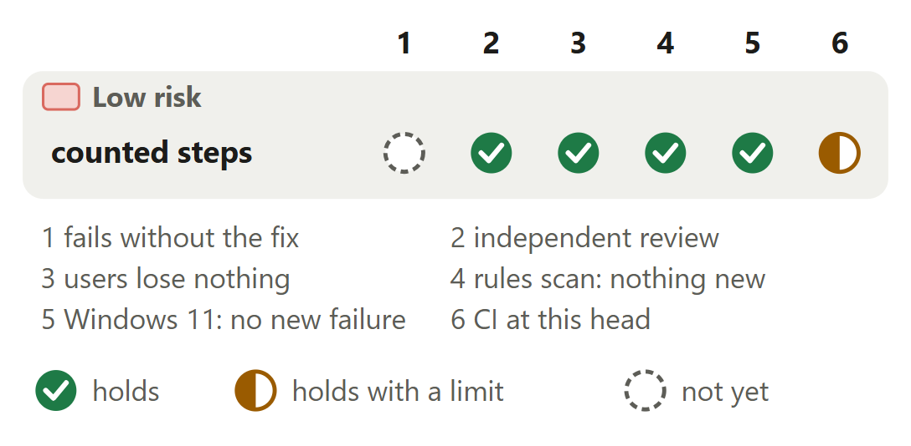

# Submodule time-limit cases no longer time the runner

For [pull request #1114](https://github.com/neralabs/rerail/pull/1114), head 515205af54. [report.html](report.html) is the same report as one page: download it and open it.

## 1. The decision

**May the submodule cases of the call's one time limit count the call's time in steps of their own, rather than on the runner's clock?**

**We recommend:** approve it: test code only; the cases now hold each stand-in Git until they let it go, and only their steps spend the call's limit.

| Size | Risk and review | Waits on | Not verified |
|---|---|---|---|
| 184 lines in 1 file: 0 ship, 184 are the tests it changes, 0 are other tests and text | Fast. One test file, no product code. | Nothing. CI on GitHub runs at this head. | 3 |

## 2. Intent, and the gap

| Change | Intended | Found | Now |
|---|---|---|---|
| The tenth case | Gits at once fit the limit _(a test's name)_ | The runner's starts spent it _(CI run)_ | Closes the gap. |

Found on 25 November 2026: `main`'s own CI failed `Unit tests (Windows, 2/5)` on this case at 2a7a2b776 and again at aee140dd91.

Sources at main, and causes

| Change | Where main states the intent | The cause, and what was measured |
|---|---|---|
| The tenth case | `test/engine/git-guard/submodules.test.ts:1489` at `main` aee140dd91; `runGitWithoutBlocking` and its limit of 10 s in `src/engine/git.ts`. | Each of the call's 8 Gits waited 1 s first, in a chain of 5, against the real 10 s: a runner 1 s slower for each, or one start stalled for seconds, spent the limit. |

## 3. Where to look

1. **Read first**, 4 min: `submodules.test.ts`: `heldBy` and the tenth case. Does only the case's step move the clock, and each step wait for the call's look at each held Git?
2. 2 min: `submodules.test.ts`: the case that ends at the limit, and `startedBy`.

**Then skim**, 1 min: Nothing else changes.

## 4. Risk against verification

One change, low risk: one test file; the product and the cases' subjects are as they were.

Each limit, and each check that does not hold yet

| Change | Check | Its limit, or why it does not hold yet |
|---|---|---|
| counted steps | fails without the fix | `main`'s CI failed the tenth case twice on 25 November. With every Git's start 2 s later than the case's own wait, `main`'s cases fail and this head's pass, on Linux x64 and Windows 11. |
| counted steps | CI at this head | CI on GitHub runs at this head; the tenth case failed a job of `main` twice on 25 November. |

## 5. The changes

**The time-limit cases count steps**, low risk: The case gave each of 8 Gits 1 s of a real 10 s; a slow runner spent it.

<b>6. The decisions</b>

**Count the call's time in held steps, or give the case more time?**

**We chose** held Gits on a clock only the case's steps move: the case waits for facts, not the runner's clock. **Would change our mind:** A product promise about real time that a step cannot show.

| Option | What a user gets | Cost | What it breaks |
|---|---|---|---|
| Held Gits on a counted clock **(chosen)** | The cases answer the same on any machine. | A helper of about 60 lines in the test file; each step waits up to 1 s for the call's next look. | Nothing found. |
| A longer limit, or shorter waits | Passes the run that failed. | One number. | A clock in place of a fact: a slower runner fails it again. |
| A longer product limit for many submodules | Nothing a person needs: real Gits take about 0.5 s for this call. | A product change for a test. | The limit a person's audit keeps. |

**Evidence.** At `main`, with each Git started D ms later than its 1 s, the case passed at 900 ms and failed from 1,000 ms on Linux x64, 2 runs of 2, and failed from 900 ms on Windows 11 beside another run, where one start stalled 2.3 s.

<b>7. How it fits</b>

Nothing has to merge first: one commit on one test file, on today's `main`. No open pull request edits the file; once on `main`, the case no longer fails a job by its runner's speed.

<b>8. What is not covered</b>: 3 not verified, 1 limit that stays

1. **macOS** never ran.
2. **A failed start** the first failure's 0xC0000142, a process Windows could not initialise, cannot be made on purpose; the cases still start 16 processes.
3. **Cases left** four cases keep a real bound with a wide margin or a real-time subject; the description names them.

**Limits that stay**

- A product that starts the statuses in turn fails the held case at its 60 s time limit, not at once.

## 9. What we ask of you

We ask no ruling.

<b>10. Evidence</b>

The description on GitHub is the record: "How you tested it" holds the runs.

| Where | What ran | Result |
|---|---|---|
| Linux x64, Windows 11 | `main`'s case with each Git started D ms later, two runs at each D | Linux: passes to 900 ms, fails from 1,000 ms; Windows 11: passes to 800 ms, fails 1 of 2 at 900 ms and 2 of 2 from 1,000 ms. |
| Linux x64, Windows 11 | The group's cases with every Git started 2 s later, at `main` and here | `main` failed the tenth case and the group's first in 2 of 2 runs on Windows 11 and 1 of 1 on Linux x64; this head passed every case of the group, 2 of 2 on Windows 11 and 3 of 3 on Linux x64. |
| Windows 11 | The changed file, 30 rounds beside another test run, at this head | The changed file passed 30 of 30 rounds on Windows 11 at this head, beside other runs on each machine. |

**Sources.** The branch at 515205af54 and its diff against `main` aee140dd91, read on 26 November 2026; `main`'s CI logs at 2a7a2b776 and aee140dd91; runs on two Windows 11 x64 machines, a Linux x64 machine and GitHub's Windows runner in our fork.

