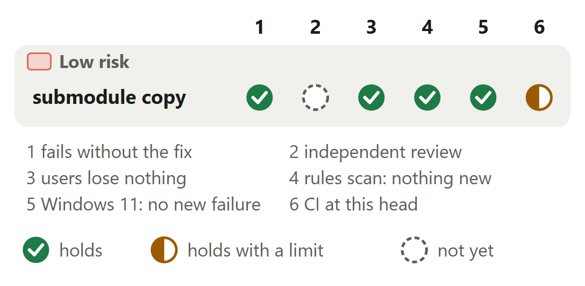

# The submodule cases start half the Git processes

For [pull request #1060](https://github.com/neralabs/rerail/pull/1060), head 5a776e8ba4. [report.html](report.html) is the same report as one page: download it and open it.

## 1. The decision

**May the 19 cases of `submodules.test.ts` that compare Rerail's diffs with Git's each diff a copy of one checkout built once per file?**

**We recommend:** approve it: test code only; the file starts half the Git processes and takes 59% less time on Windows 11, no `expect` line changes, and a failed scan now says why.

| Size | Risk and review | Waits on | Not verified |
|---|---|---|---|
| 51 lines in 2 files: 0 ship, 51 are the tests it changes, 0 are other tests and text | Fast. Two test files, no product code. | Nothing. CI on GitHub runs at this head. | 3 |

## 2. Intent, and the gap

| Change | Intended | Found | Now |
|---|---|---|---|
| The checkout's cost | 19 cases compare both diffs _(test name)_ | 320 Git processes a case _(CI run)_ | Closes the gap. |
| The scan case's message | Both scans list the same paths _(test name)_ | The message blamed the wrong scan _(CI run)_ | Closes the gap. |

Found on 24 November 2026: `main`'s own CI failed on six of its seven pushes, each on a different case; these are two.

Sources at main, and causes

| Change | Where main states the intent | The cause, and what was measured |
|---|---|---|
| The checkout's cost | `test/engine/git-guard/submodules.test.ts:1020` at `main` be0def9c35: the `describe` and its `it.each(CONFIGS)`, each case building its checkout with `submodulesInEachState`. | Three repositories, eleven `git submodule add`, a recursive update, a deinit and seven commits for each of 19 cases: 6,179 Git processes on Windows 11, any one of which a busy runner may refuse. |
| The scan case's message | `integration/rerail-without-daemon.test.ts:329` at `main` be0def9c35: `expect(scans[1]).toEqual(scans[0])`; `scannedPaths` (line 306) keeps no stderr. | The case took the first scan as the reference for the second, so the message read as if the second scan were wrong. Why the first scan failed is not known: at `main`, 866 scans, 81 runs of the case and 40 of the whole file never failed. |

## 3. Where to look

1. **Read first**, 5 min: `submodules.test.ts`: the `beforeAll`, `inEachState` and `git()`. Does each case configure its own copy, so that no case's change reaches the next?
2. 2 min: `rerail-without-daemon.test.ts`: `scannedPaths` and the scan case.

**Then skim**, 1 min: Nothing else changes.

## 4. Risk against verification

One change, low risk: two test files; the code under test and the Git processes it starts are as they were.

Each limit, and each check that does not hold yet

| Change | Check | Its limit, or why it does not hold yet |
|---|---|---|
| submodule copy | independent review | No second reader of ours reviewed this head. |
| submodule copy | CI at this head | CI on GitHub runs at this head, every integration file included; each case failed a job of `main` on 24 November. |

## 5. The changes

**Copy one checkout per case**, low risk: `submodules.test.ts` started 10,108 Git processes on Windows 11 at `main`; it starts 4,984 here, in 265 s where 646.

<b>6. The decisions</b>

**How do the 19 cases get their checkout?**

**We chose** a copy of one checkout built once per file: each case changes its checkout's config, `.gitmodules` or index. **Would change our mind:** A file still too long for its shard: the cases with one submodule that only read it could share a copy too.

| Option | What a user gets | Cost | What it breaks |
|---|---|---|---|
| A copy of one checkout built once per file **(chosen)** | The same cases and assertions; about 60 to 90 Git processes a case. | One `beforeAll` and a copy per case. | Nothing seen in the runs at this head. |
| One checkout shared by the 19 cases, each undoing its change | Fewer copies. | An undo for each of 18 configurations. | A case whose undo misses a file passes its state to the next; shared with no undo, 4 of the 19 fail. |
| Each case builds its own, as at `main` | Nothing new. | About 320 Git processes a case, 6,179 for the 19 on Windows 11. | A busy Windows runner refuses one of them now and then. |

**Evidence.** Git processes counted through `GIT_TRACE2_EVENT`, one run at `main` and one here on the same Windows 11 machine; the shared checkout ran once on Linux x64 and once on Windows 11 with the same four failures.

<b>7. How it fits</b>

Nothing has to merge first: two commits on `main` be0def9c35, and no other pull request needs it. A pull request that edits either file meets these lines only in the `git()` helper, the one `describe` and `scannedPaths`.

<b>8. What is not covered</b>: 3 not verified, 3 limits that stay

1. **macOS** never ran.
2. **The other test files** not run here on either system: only the two changed files ran; CI on GitHub runs the rest at this head.
3. **Why the scan failed on CI** not shown: the case passed every run here; its next failure prints that scan's stderr.

**Limits that stay**

- A start refused while the `beforeAll` builds the checkout fails the 19 cases at once, where at `main` it failed one.
- The cases with one or two submodules still build their own checkout, about 20 Git processes each.
- Each count and time comes from one run on a shared machine: the share saved is the figure to read, not the seconds.

## 9. What we ask of you

We ask no ruling.

<b>10. Evidence</b>

The description on GitHub is the record: "How you tested it" holds the counts, the runs at this head and the run with no copy.

| Where | What ran | Result |
|---|---|---|
| Windows 11 | Git processes counted through `GIT_TRACE2_EVENT`, the whole `submodules.test.ts` once at `main` and once here, 8 processors | At `main` 10,108 in 646 s; here 4,984 in 265 s; 98 passed and 13 skipped at both. |
| Linux x64 | The same count, 16 processors at load 29 to 34, Git 2.53.0 | At `main` 9,228 in 165 s; here 4,998 in 112 s; 111 passed at both. |
| Windows 11 | At 357b23b868, whose `submodules.test.ts` is this head's: the 19 cases 30 times and the whole file 4 times; at this head the two scan cases 30 times | 30 of 30; 4 of 4, 176 to 201 s a run; 30 of 30. |
| Linux x64 | Each changed file 30 times, two runs at once, under Git 2.53.0 and 2.56.1 | 30 of 30 each, at load 15 to 35. |
| Linux x64, Windows 11 | 54e1225ae6: the 19 cases share one checkout with no copy, and the scan case's first scan is turned off; the two files once on each system | Vitest exit 1 on each: the same 4 of the 19 fail on both, and the scan case fails on its first scan with `rerail: Headless scan is experimental and off`. |
| Linux x64 | The scan case at `main`: its steps in a script that keeps stderr, the case alone, and the whole file | 866 of 866 scans right under Git 2.47.3 and 2.56.1; 81 of 81; 40 of 40; no scan failed. |
| Linux x64 | CI's Lint and type-check job; the automated reviewer's rules against `main` | Passed; no new finding. |

**Sources.** The branch at 5a776e8ba4 and its diff against `main` be0def9c35, read on 25 November 2026; runs at its commits on Linux x64 and Windows 11 machines.

