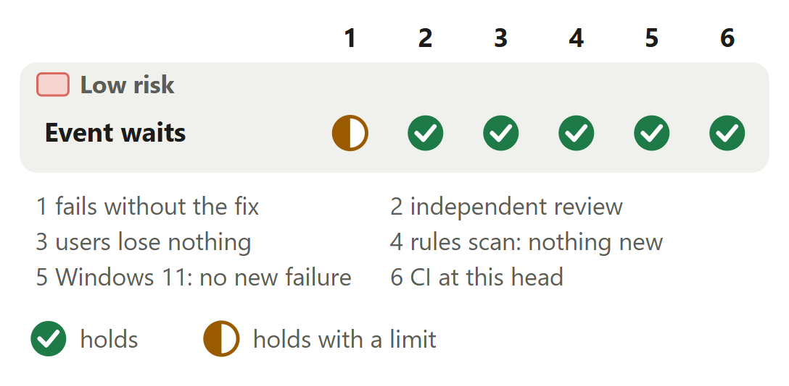

# Tests: the superseded spooled edit case can no longer hang

For [pull request #747](https://github.com/neralabs/rerail/pull/747), head d755a29b5. [report.html](report.html) is the same report as one page: download it and open it.

## 1. The decision

**Do the case's two new waits each end on an event that always comes, so the case can no longer hang?**

**We recommend:** approve it: one test file and no product line; with the slow spool write #700 describes, `main` timed out in every run and this change in none.

| Size | Risk and review | Waits on | Not verified |
|---|---|---|---|
| 54 lines in 1 file: 0 ship, 54 are the tests it changes, 0 are other tests and text | Fast. Tests only, a fast lane: the automated reviewer can approve. | Nothing. CI passed at this head; no pull request needs it. | 3 |

## 2. Intent, and the gap

| Change | Intended | Found | Now |
|---|---|---|---|
| The superseded edit case | A superseded spooled edit is never evaluated _(a test's name)_ | Hung one CI job for 60 s _(one CI job)_ | Closes the gap. |

Found on 16 November 2026 (UTC), in one `Unit tests (1/2)` job of the repository's CI on GitHub, on Linux x64.

Sources at main, and causes

| Change | Where main states the intent | The cause, and what was measured |
|---|---|---|
| The superseded edit case | `test/engine/code-rule/code-rule-enforcer-mechanical.test.ts` line 1012 at `main` (e8a6b0b5a), the case's name. `src/engine/code-rule/code-rule-enforcer.ts` line 915, a code comment in `#queueGeneratedEdit`, gives the rule the case checks: "Out of the queue before any await, so the pump never evaluates an edit whose audit ends here." | The spy holds the first spool read while `snapshotStatus().pending` is true (line 1022), taking it for the queue's read-back of the older edit (enforcer line 922). The newer edit awaits its spool write first (line 2220). When that write outlasts the pump's eight 1 MB evaluations, 12 to 38 ms on two Linux x64 machines, the first spool read is the pump's own (line 1188). The pump is held, so `pending` stays true, and `close()` awaits it (line 1017). |

## 3. Where to look

1. **Read first**, 5 min: `code-rule-enforcer-mechanical.test.ts`: `hold`, `lookedForOlder`. Can either wait outlast the event that ends it: the pump's at `api/ahead.py`, or the queue's on the older edit?

**Then skim**, 2 min: The eight 1 MB edits now run first, as revision 1, so the asserted revisions are 2 and 3. The statuses and violation counts are `main`'s.

## 4. Risk against verification

One half mark: with no slowed spool write, `main`'s case passed every run.

Each half mark's limit

| Change | Check | It holds with this limit |
|---|---|---|
| Event waits | fails without the fix | With the newer edit's spool write 1 s later, `main` e8a6b0b5a timed out at 60 s in 3 of 3 runs on Linux x64 and this change failed 0 of 3. On Windows 11, on `main` cb5040824 with the same file: 5 of 5 timed out, 0 of 5 here. The limit: with no delay `main` never failed either. |

## 5. The changes

**The case waits on events**, low risk: With a slow spool write, the case timed out in every run at `main`, none here.

<b>6. The decisions</b>

**Stop the pump at an edit queued ahead, or bound the old hold by time?**

**We chose** the pump stop: the case sets up the order it checks, and no wait rests on timing. **Would change our mind:** A maintainer who wants this case to keep the other order too, where the pump takes the older edit before the newer one arrives.

| Option | What a user gets | Cost | What it breaks |
|---|---|---|---|
| Stop the pump at a spooled edit queued ahead **(chosen)** | The pump cannot take the older edit before the newer one has looked for it, so every run checks the order the case names. A slow write, a slow pump and a slow queue read each passed 30 of 30. | 40 lines added and 14 removed in one case: one more spooled edit, `api/ahead.py`, and a parse of each spool file in the spy. | Nothing the case asserts. The order where the pump takes the older edit first no longer happens in this case. |
| Bound the old hold with a timer | No hang: the hold gives up at the bound. | A few lines. | A slow write still fails the case, on its assertion: the pump evaluated an edit not yet superseded, so its audit reads `completed`. All 80 such runs with a 10 s bound ended that way. |
| Hold only a read whose call stack names `#preimageOf` | The spy holds the queue's read and never the pump's. | A stack read in the spy. | It rests on private method names in a stack's text, and the order the case checks is still left to timing. |

**Evidence.** At this change's lines with the write 1 s later, 0 of 10 runs failed on Linux x64 and 0 of 5 on Windows 11. With the line that stops the pump taken out, 5 of 5 failed at 16 s, on the case's 15 s settle wait: the `finally` lets both holds go, so none reaches 60 s. A queue that evaluates the superseded edit failed 30 of 30 runs.

<b>7. How it fits</b>

Nothing has to merge first: it stands on `main` e8a6b0b5a, merged in with no conflict. #508, a draft, also edits this test file in other cases. The file merges with it.

**The shared file and the trial merges.** #508 edits this test file away from the case; `git merge-tree` of its head 0e2cdfec2 with this branch gives no conflict. #665 edited the file until 17 November and no longer does at its head 5904369c2. `main` at c1a7904d6 adds #742, which touches neither this file nor the enforcer, and merges with no conflict. Any order works.

<b>8. What is not covered</b>: 3 not verified, 2 smaller gaps, 1 limit that stays

1. **How often CI meets it** is not known: one timeout seen, in run 43811372438. With no delay, `main`'s case passed 500 of 500 runs alone and 500 of 500 on four busy cores.
2. **The other order** has no case of its own: the pump takes the older edit before the newer one arrives. In 80 such runs the enforcer settled and the newer edit reported both edits' lines.
3. **macOS** never ran.

**Smaller gaps**

- **Runs made before `main` was merged in.** The runs under load, with other delays and against changed source ran on `main` at c89f068ed and cb5040824, with the same added and removed lines. `main` has not changed the enforcer or this file since cb5040824.
- **Windows 11 engine.** The Windows runs at d755a29b5 used the engine already built on that machine, not one built from this tree's native code, which `main` changed since cb5040824 only in the TypeScript grammar. The case under test edits Python files.

**Limits that stay**

- The case keeps its 60 s limit. A native apply that hangs still times the case out, and a spool file that cannot be read still fails it, here as at `main`.

## 9. What we ask of you

We ask no ruling.

<b>10. Evidence</b>

The description on GitHub is the record: "How you tested it" holds the slow-write runs at `main` and here, the whole-file runs and the runs against changed source; "Where it lands" holds the cause with its order of events.

| Where | What ran | Result |
|---|---|---|
| CI on GitHub | Passed at d755a29b5: 18 checks, 9 skipped, none failed | `CI result` passed. |
| Linux x64 | The whole test file at d755a29b5, 20 runs in a row, one vitest process each | 20 of 20 runs passed. |
| Windows 11 | The whole test file at d755a29b5, 20 runs in a row | 20 of 20 runs passed: 58 passed and 1 skipped in each. |
| Linux x64 | The case with the newer edit's spool write 1 s later, as #700's steps give it, at `main` e8a6b0b5a and at d755a29b5 | `main`: 3 of 3 timed out at 60 s. This change: 0 of 3 failed, 2 to 3 s a run. |
| Windows 11 | The same slow write at `main` cb5040824 and at the same lines on it | `main`: 5 of 5 timed out at 60 s. This change: 0 of 5 failed, 6 to 7 s a run. |
| Linux x64 | This change's lines without the line that stops the pump, the write 1 s later | 5 of 5 runs failed at 16 s on the settle wait's assertion, `expected true to be false`. None reached 60 s. |
| Linux x64 | The same lines against source changed to break the rule the case checks | A queue that leaves the superseded edit queued until after its read-back: 30 of 30 runs failed. One that drops the lines the older edit never reported: 30 of 30 failed. |
| Linux x64 | The automated reviewer's rules over the diff against `main` e8a6b0b5a, with published 0.1.1 and with `main`'s build | No new finding, none existing in the file, and no difference with `main`'s build. |

**What this report adds to the description**

- **Our answer to the read-first question.** A read of the case at d755a29b5: the pump's wait at `api/ahead.py` ends when the queue reads the older edit back, when the newer edit's batch ends (`.finally(lookedForOlder)`), or in the case's `finally`. The queue's wait ends when the pump reads the older edit or when `settleGeneratedEdits()` resolves. The description's row under "The changes" names both waits, not each end.

**Sources.** The branch at d755a29b5 and its diff against `main` e8a6b0b5a, read on 17 November 2026; GitHub's checks on #747, read on 18 November at 00:11 UTC. Rerail at `main` e8a6b0b5a for the quoted intent and the cause's line numbers. Issue #700 for the reproduction. The heads of #508, #665 and `main` on GitHub for the trial merges. The description for the runs.

