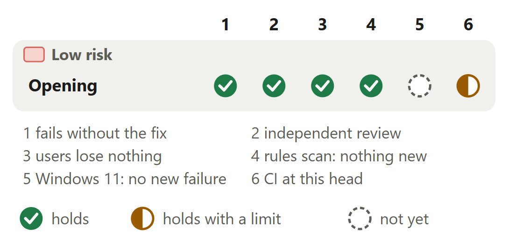

# Nine runtime tests wait for the session's opening instead of racing it

For [pull request #824](https://github.com/neralabs/rerail/pull/824), head 027ff35f3. [report.html](report.html) is the same report as one page: download it and open it.

## 1. The decision

**Do nine test cases now check what they name, however long a session takes to open and whatever order its first walk takes?**

**We recommend:** approve it: no source changes, and each case waits for or holds the session's opening by a fact; the one turn end is bounded by the product's 10 s wait.

| Size | Risk and review | Waits on | Not verified |
|---|---|---|---|
| 40 lines in 4 files: 0 ship, 40 are the tests it changes, 0 are other tests and text | Quick. Four test files, 37 lines added and 3 removed. | Nothing. No CI at this head yet: the branch is unpushed. | 3 |

## 2. Intent, and the gap

| Change | Intended | Found | Now |
|---|---|---|---|
| An overtaken edit's steer | An overtaken steer told once _(a test's name)_ | No steer, now and then _(CI and repeated runs)_ | Closes the gap. |
| Racing the first walk | No steer from a racing walk _(three tests' names)_ | A steer, now and then _(CI and repeated runs)_ | Closes the gap. |

Found on 19 November 2026 in `main`'s and two pull requests' Windows CI shards, and in test runs on Linux x64 and Windows 11.

Sources at main, and causes

| Change | Where main states the intent | The cause, and what was measured |
|---|---|---|
| An overtaken edit's steer | `test/engine/code-rule/ai-output-redelivery.test.ts` at cf5d520e4, line 66: the first tool call follows the session start with no wait, and a first start does not wait for its evaluator. | In the runtime as the cases drive it, a call that arrives while the evaluator opens is answered without code rules and never begun. The second call then captures a file that already holds the first edit's line, and no steer comes. On the one Linux x64 machine where we traced it, the cases won that race by 2 to 5 ms. |
| Racing the first walk | `test/runtime/runtime.test.ts` line 585 and `test/engine/code-rule/code-rule-runtime-lifecycle.test.ts` lines 568 and 805 at cf5d520e4: each writes right after `codeRulesOpened`, which does not wait for the first walk. | That walk, applied after the call opened its window but before the result, finds the write inside the window, takes it as the session's own and checks it; the result carries its steer. For the Codex case the write and the window's start must carry one filesystem stamp, which Windows's coarse clock makes common. |

## 3. Where to look

1. **Read first**, 2 min: `ai-output-redelivery.test.ts`: `await runtime.codeRulesOpened(sessionId)` after the session start. Do the cases still fail when an overtaken steer is lost or told twice?
2. 3 min: `session-store.test.ts`: two more waits; `runtime.test.ts`: a turn end; `code-rule-runtime-lifecycle.test.ts`: two held walks.

**Then skim**, 1 min: No source, docs or release notes change.

## 4. Risk against verification

One change, low risk: nine test cases, no source.

Each limit, and each check that does not hold yet

| Change | Check | Its limit, or why it does not hold yet |
|---|---|---|
| Opening | Windows 11: no new failure | No review by anyone outside our team yet. |
| Opening | CI at this head | No CI run at this head on GitHub yet: the branch is not pushed. |

## 5. The changes

**Tests wait for the session's opening**, low risk: `main` lost the races in CI's Windows shards, 1 of 60 on Windows 11, 6 of 6 on Linux x64.

<b>6. The decisions</b>

**Should the cases wait for the session's opening, or should the product change?**

**We chose** the tests: a first start answers at once by design, and the walk's check is right. **Would change our mind:** A case that fails after its wait, or a first start the product means to hold.

| Option | What a user gets | Cost | What it breaks |
|---|---|---|---|
| The cases wait for `codeRulesOpened`, a turn end or a held walk **(chosen)** | Each case tests what it names; Rerail does exactly what it does today. | One wait per case; 33 other calls in the test suite wait for `codeRulesOpened` this way. | Nothing found: each changed case passed 20 of 20 rounds on Linux x64 and on Windows 11. |
| Make a first start's boundaries wait for the evaluator | The overtaken-edit cases pass as written. | The agent waits for a first index at its first tool call. | The speed of a session's first seconds. |
| Stop a walk from taking a write stamped at a window's start | The Codex case passes as written. | A session's own first write in a stamp tick would go unchecked: file stamps lag and step. | Checks users get today. |

**Evidence.** With every evaluator's open held 300 ms, and with the first walk's order forced, `main`'s cases fail and this head's pass on Linux x64 and Windows 11. The runtime's unit case "steers a Codex write no hook showed ... as the session's own" shows the walk's check is the design; we did not run it through a daemon and a Codex hook.

<b>7. How it fits</b>

Nothing has to merge first: it stands on `main` cf5d520e4. No open pull request edits any of its four test files.

**The trial merges.** `git merge-tree --write-tree` of this head with the head of each pull request open on GitHub on 19 November 2026: none of the 16 edits a file of this change, and each merges with this head as it does with `main` cf5d520e4.

<b>8. What is not covered</b>: 3 not verified, 2 limits that stay

1. **A gap in Rerail** an edit made while the evaluator opens goes unchecked if its file is edited again first. Seen only in the runtime with the open held; being run through the product.
2. **Windows's rate at cf5d520e4** what raised it was not found: a 150 ms synchronous hold where the open now asks Git left the order as it was on Linux x64.
3. **macOS** never ran.

**Limits that stay**

- An edit made while a first start's evaluator opens is still checked only by the evaluator's first walk, as at `main`.
- A late Codex write is checked only when a walk finds it inside one of the session's windows, as at `main`.

## 9. What we ask of you

We ask no ruling.

<b>10. Evidence</b>

The description on GitHub is the record: "How you tested it" holds every run at `main` and here.

| Where | What ran | Result |
|---|---|---|
| Linux x64 | The four files, 5 rounds, `main` beside this head | 0 of 5 runs failed on each side; 88 of 88 passed in each. |
| Windows 11 | The four files, 5 rounds, `main` beside this head | `main`: 2 of 5 runs failed, its "(dropped)" cases; here 0 of 5. |
| Linux x64 and Windows 11 | Every evaluator's open held 300 ms, the six cases, `main` against this head | `main`: five of six cases failed on each system; here none. |
| Linux x64 and Windows 11 | The first walk's order forced, the three cases, `main` against this head | `main`: all three failed with the walk's steer on each system; here none. |
| Windows 11 | The two "violation stays" cases alone at `main`, 60 runs on one machine | 1 of 60 failed with the CI message. |
| Windows 11 | A copy of `main`'s Codex case, 40 runs one at a time in one process | 1 answered the first walk's steer. |
| Linux x64 | The six cases at `main`, no hold, one machine | 6 of 6 runs failed. |
| Linux x64 and Windows 11 | Mutants against the changed cases | Every case still fails when the product breaks what it names: 3 of 3 and 20 of 20 runs. |

**Sources.** The branch at 027ff35f3 and its diff against `main` cf5d520e4, read on 19 November 2026; `main`'s CI run 44473781015, #756's run 44491301557 and #813's run 44484803192.

