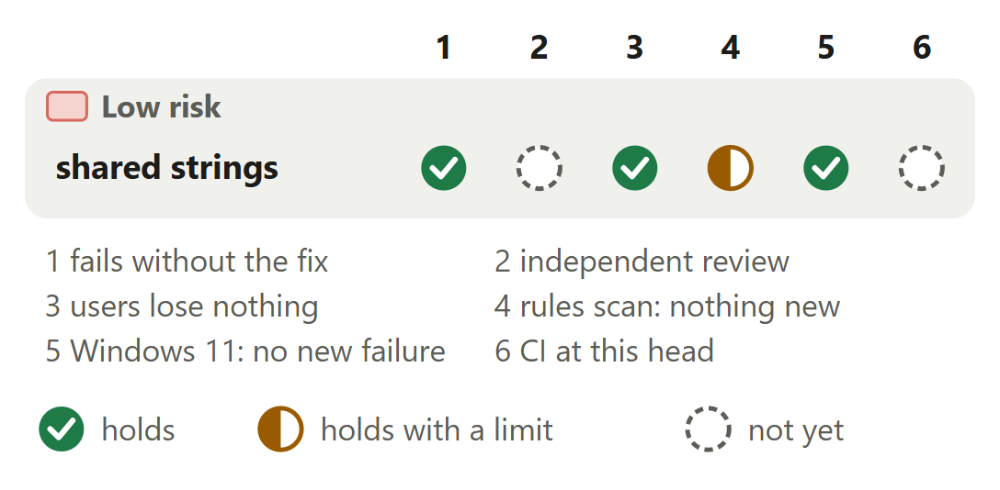

# The walks share a file's path and digest across worktrees

For [pull request #1186](https://github.com/neralabs/rerail/pull/1186), head 171478636a. [report.html](report.html) is the same report as one page: download it and open it.

## 1. The decision

**Should the walks take a file's path and digest strings from the same file's observation in another worktree, instead of keeping a copy per worktree?**

**We recommend:** approve it: strings compare by their text, so every answer is as before, and at 190 worktrees the walks keep 470 MB where `main` keeps 700.

| Size | Risk and review | Waits on | Not verified |
|---|---|---|---|
| 193 lines in 3 files: 48 ship, 145 are tests and text | Standard. The automated reviewer can approve. | Nothing. No CI run at this head yet: not pushed. | 2 |

## 2. Intent, and the gap

| Change | Intended | Found | Now |
|---|---|---|---|
| Strings kept per worktree | One walk, kept once for all _(code comment)_ | A path and digest copy per worktree _(heap snapshot)_ | Closes the gap. |

Found on 27 November 2026 in heap snapshots of a daemon on Linux x64, with 10 to 190 worktrees.

Sources at main, and causes

| Change | Where main states the intent | The cause, and what was measured |
|---|---|---|
| Strings kept per worktree | `src/engine/code-rule/worktree-walks.ts` at `main`, its header: "each kept an observation of every file of every other worktree, so with sessions in many worktrees the daemon's memory, and the time it spent walking, grew with the sessions times the worktrees times their files. Here one walk reads each worktree once, for every session watching it". | `observed` (line 427) keeps the read's own object without its text, and `nextSnapshot` keys the snapshot by the scan's path string. Each read makes new path and digest strings, so `#kept` holds a copy of each for every watched worktree: in a heap snapshot at 190 worktrees, 76.3 MB of path strings and 152.8 MB of digest strings. |

## 3. Where to look

1. **Read first**, 4 min: `worktree-walks.ts`: `observed`, `nextSnapshot`, `keptObservation`, `#twinOf`. Does a new observation take another worktree's strings only where their text is equal?

**Then skim**, 3 min: One test file counts, in a heap snapshot, the strings holding 200 files' paths and digests with walks of two worktrees and of six. One release note.

## 4. Risk against verification

Start with `observed`; the rest hands it the other worktree's snapshot.

Each limit, and each check that does not hold yet

| Change | Check | Its limit, or why it does not hold yet |
|---|---|---|
| shared strings | independent review | No second reader has reviewed this head yet; the repository's automated reviewer reads it when it opens. |
| shared strings | rules scan: nothing new | Rerail's own rule pack and the complexity pack, built from `main`: 0 new findings, no function over 6. The published Rerail the reviewer pins could not read the pack, so that side gave no verdict. |
| shared strings | CI at this head | No CI run at this head yet. |

## 5. The changes

**Strings shared across worktrees**, low risk: At 190 worktrees of 10,000 files the walks keep 470 MB where `main` keeps 700.

**6. The decisions:** we made no choice here that a maintainer could have made differently.

<b>7. How it fits</b>

It merges with `main` as it stands and with every open pull request but #1181, which Git cannot merge with `main` itself either. It keeps what #1162 and #1176 added to the walks; their cases pass here unedited.

<b>8. What is not covered</b>: 2 not verified, 2 limits that stay

1. **A Windows daemon** was not measured: the case ran on Windows 11, the memory figures come from Linux x64.
2. **macOS** never ran.

**Limits that stay**

- Each worktree still keeps its own observation object, stamp and times: about 250 bytes a file.
- Git's ignore answers, 185 MB at 190 worktrees, stay as they are: the rule engine keeps them.

## 9. What we ask of you

We ask no ruling.

<b>10. Evidence</b>

The description on GitHub is the record. "Why it is worth landing" holds the memory measure, and "How you tested it" the runs at `main` and at this head.

| Where | What ran | Result |
|---|---|---|
| Linux x64 | The case over `main`'s source and here | `main`: `expected 800 to be +0`. Here: passes. |
| Windows 11 | The case over `main`'s source and here | `main`: `expected 800 to be +0`. Here: passes. |
| Linux x64 | The 11 test files that import `worktree-walks.ts` or drive the walks, at `main` and here | `main`: 649 passed. Here, with the case: 650 passed. |
| Linux x64 | 4 mutants of the deciding lines | Each fails the case. |
| Linux x64 | Two daemons at once, 190 worktrees of 10,000 files, 4 Claude Code sessions | Heap 977 MiB at `main`, 758 MiB here; the same processor time, first pass and hook wait. |

**Sources.** The branch and its diff, read on 27 November 2026. Rerail at `main` ab31c290e6 for the quoted intent.

