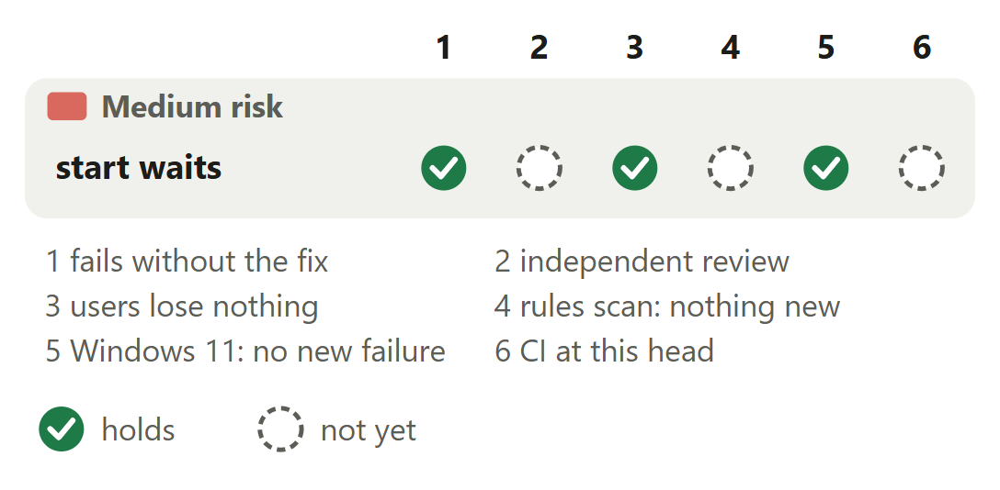

# The event stream waits for the daemon only at a session's start

For [pull request #1175](https://github.com/neralabs/rerail/pull/1175), head abb2599b80. [report.html](report.html) is the same report as one page: download it and open it.

## 1. The decision

**May `rerail events` hand its events to the daemon as the hooks do, with only a session's start waiting for a daemon to start?**

1. With no daemon, a later event answers at once; a start launches behind it.
2. An event no daemon took answers `internal-error`, not `invalid-event`.

**We recommend:** approve it once you agree to answers 1 and 2: with no daemon and a failing start, ten events waited about 5.6 s each at `main`, unrecorded; here nine answer at once, all recorded.

| Size | Risk and review | Waits on | Not verified |
|---|---|---|---|
| 381 lines in 8 files: 163 ship, 218 are tests and text | Standard. The automated reviewer can approve. | Nothing. No CI run at this head yet: not pushed. | 2 |

## 2. Intent, and the gap

| Change | Intended | Found | Now |
|---|---|---|---|
| A later event | Only a session's start waits _(the hooks' code)_ | Every event waited a start out _(real daemon, Linux x64)_ | Closes the gap, changes answer 1. |
| A lost event | Lost events recorded _(the hooks' code)_ | Nothing recorded _(real daemon, Linux x64)_ | Closes the gap, changes answer 2. |

Found on 26 November 2026 through the built CLI, laid out as an installed Rerail, on Linux x64.

Sources at main, and causes

| Change | Where main states the intent | The cause, and what was measured |
|---|---|---|
| A later event | `runHostHook` in `src/harness/hook-host.ts` at `main`: "Only the hook that starts a session (`startsSession`) waits for a daemon to start; any other hook that finds none running answers `{}` at once". | The stream's `ingest` called `daemonEngineEndpoint` at every event, which starts a daemon and waits for its start, never cut at the event's deadline. |
| A lost event | `runHostHook` and `lostEvent` in `src/harness/hook-host.ts` at `main` call `recordHookFailure` for each failed hook. | No code of the stream called `recordHookFailure`; its error frame said `invalid-event` for every failure after the frame was read. |

## 3. Where to look

1. **Read first**, 8 min: `event-stream.ts`: `daemonEventLoop` and `endpointOrWhyNot`. Does every event other than a session's start avoid a start, and is every failure recorded but under `RERAIL_AUTOSTART=0`?
2. 5 min: `daemon-control.ts` and `hook-host.ts`: `runningDaemonEngineEndpoint`, `launchAutostart`, two exports.

**Then skim**, 5 min: Three new cases in `event-stream.test.ts`, two in `daemon-control.test.ts`, one expected code changed. Two docs sentences, one release note.

## 4. Risk against verification

Start with `endpointOrWhyNot`: it decides, for every event, between a start, the running daemon and an answer at once.

Each limit, and each check that does not hold yet

| Change | Check | Its limit, or why it does not hold yet |
|---|---|---|
| start waits | independent review | No review by another reader yet: our own reading against the repository's review points only. |
| start waits | rules scan: nothing new | The rules review gave no verdict: its published Rerail cannot load the repository's pack; the side built from `main` found nothing new. |
| start waits | CI at this head | No CI run at this head yet. |

## 5. The changes

**Only a session's start waits**, medium risk: Ten events with no daemon: at `main` each waited about 5.6 s; here nine answer at once, all recorded.

**6. The decisions:** we made no choice here that a maintainer could have made differently.

<b>7. How it fits</b>

It stands on `main` alone. No open pull request touches its files, and Git merges it with each.

<b>8. What is not covered</b>: 2 not verified, 2 limits that stay

1. **The rules review** gave no verdict: its published Rerail cannot load the repository's pack.
2. **macOS** never ran.

**Limits that stay**

- A daemon that runs but does not answer is still waited for up to 12 s at each event, as at `main`.
- A failure the daemon answers keeps `invalid-event`, an event of a session it has not started included.

## 9. What we ask of you

Asks 1 and 2 rule on answers 1 and 2.

1. **May the stream launch a start in the background whenever the last one has ended?** We recommend yes: a stream lives for a whole session.
2. **May an event no daemon took answer `internal-error`?** We recommend yes: the event was sound, and the code was unused.
3. **May a later event take the running daemon without replacing another package's?** We recommend yes: after an update the stream keeps the newer daemon.

<b>10. Evidence</b>

The description on GitHub is the record. "How you tested it" holds the runs at `main` and at this head.

| Where | What ran | Result |
|---|---|---|
| Linux x64 | The built CLI as an installed Rerail, a real daemon whose start fails, ten events, 5 runs | `main`: each event waited 5.5 to 5.9 s, nothing recorded. Here: the start 5.8 to 6.0 s, each prompt 1 to 11 ms, ten recorded. |
| Windows 11 | The new cases over `main`'s source, then here | `main`: 6 of 288 fail; the longest wait between answers 2,017 ms, nothing recorded. Here: 288 of 288. |
| Windows 11, Linux x64 | Mutants, one deciding line each | Nine of nine fail a case. |
| Windows 11 | Every test file that imports a changed module | `main`: 637 passed, 28 skipped. Here: 642 passed, the same 28 skipped. |
| Linux x64 | The same files | `main`: 636 passed. Here: 641 passed. |

**Sources.** The pull request and its diff, read on 26 November 2026. Rerail at `main` e29282a55f for the quoted intent; the issue's runs at `main` 8d62b17476.

