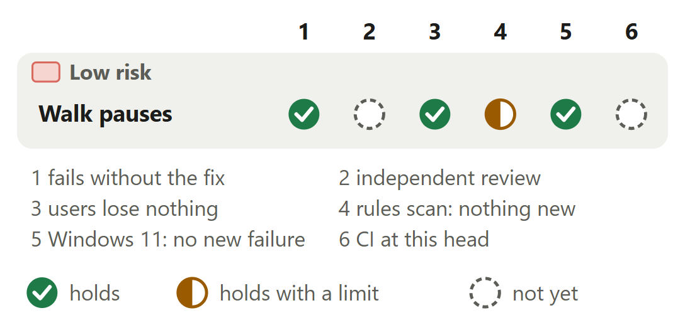

# The other worktrees' walk lets an awaited answer go first

For [pull request #1194](https://github.com/neralabs/rerail/pull/1194), head 5f4ff39f01. [report.html](report.html) is the same report as one page: download it and open it.

## 1. The decision

**Should the other worktrees' walk, which no answer waits for, pause after each batch of looks while a hook or agent awaits an answer?**

1. The walk waits after its batch until no answer is awaited.

**We recommend:** approve it: the answer's reads stop queueing behind that walk, and the walk loses nothing but time while answers are awaited.

| Size | Risk and review | Waits on | Not verified |
|---|---|---|---|
| 451 lines in 8 files: 69 ship, 382 are tests and text | Reviewer approval. REVIEW.md lists no high-risk path among the changed files. | Nothing. It holds Git's own merge of `main` ab31c290e6. | 3 |

## 2. Intent, and the gap

| Change | Intended | Found | Now |
|---|---|---|---|
| Walk beside a hook | Command never waits for walk _(docs)_ | Answer's reads queue behind it _(our measure)_ | Closes the gap, changes answer 1. |

Measured on 27 November 2026 at `main` f340b24d8d on a Windows 11 virtual machine with 14 worktrees of 2,000 files and 4 sessions.

Sources at main, and causes

| Change | Where main states the intent | The cause, and what was measured |
|---|---|---|
| Walk beside a hook | `docs/rule-scoping.md` at `main`: "One walk of them, shared by the repository's open sessions ..., runs behind their own folders' walks. A command doesn't wait for this." | The walk's batches of 16 looks and the answer's reads share Node's 4 thread-pool threads and the event loop. |

## 3. Where to look

1. **Read first**, 3 min: `worktree-walks.ts`: `AwaitedAnswers`, `WorktreeScan.pause`, `#readWorktree`, `RepositoryWorktreeWalks`. Does the walk go on once the last awaited answer settles, and only then?
2. 2 min: `engine-service.ts`: the two `ingest` paths; `code-rule-bridge.ts`: `#observeStack`, `#scanWorktree`.

**Then skim**, 3 min: The cases hold another session's answer open and count the walk's looks meanwhile, check a command's own steer, and when a removed source is recorded.

## 4. Risk against verification

One change. Start at `AwaitedAnswers` in `worktree-walks.ts`.

Each limit, and each check that does not hold yet

| Change | Check | Its limit, or why it does not hold yet |
|---|---|---|
| Walk pauses | independent review | No reader outside the author has read this head yet. |
| Walk pauses | rules scan: nothing new | Rules scan before the merges of `main`, with Rerail built from `main`: no new finding; every function this adds or edits counts 4 or less. |
| Walk pauses | CI at this head | No CI run at this head on GitHub yet: the branch is not on GitHub. |

## 5. The changes

**The walk gives way**, low risk: Hook after a command, Windows 11: 232.6 ms p95 at `main`, 92.5 ms with this change.

<b>6. The decisions</b>

**How does the walk give way to an answer?**

**We chose** it waits after each batch while the engine service counts an awaited answer, so a count decides, not a time. **Would change our mind:** A maintainer who wants the walk never held longer than one turn end, which a bound in batches could give.

| Option | What a user gets | Cost | What it breaks |
|---|---|---|---|
| Wait after each batch while an answer is awaited **(chosen)** | The answer's reads meet at most one batch of the walk's read; the walk keeps its speed when nothing is awaited. | The walk takes longer while answers come one after another. | Nothing found: no answer waits for that walk. |
| Smaller batches, always | Less queued at any moment. | Every walk slower, with or without a hook waiting. | Nothing. |
| Pause the walk for a time after each hook | Simple. | A clock decides where a fact can. | The repository owner's rule; closed before as a way. |

**Evidence.** Windows 11, `main` and this change run in turn: the hooks the walk overlapped waited 71.2 ms at the median at `main` and 30.0 ms with it.

<b>7. How it fits</b>

It holds Git's own merge of `main` ab31c290e6, with #1162, #1176 and #1182; the files both changed were read and both changes hold. #1076 and #1183 edit shared files in other lines; #1174, #1179 and #1181 share none; #1181 alone meets a Git merge conflict, with `main`.

<b>8. What is not covered</b>: 3 not verified, 1 limit that stays

1. **One shared checkout** there the larger wait is Git's verdicts on other sessions' changes, about 150 ms a hook on Windows; a change to follow.
2. **Left-out sources** a walk's one `lstat` of each source a session saw where its read did not look (#1162) follows the read, but once begun it does not wait again.
3. **macOS** never ran.

**Limits that stay**

- A turn end that waits long for its edit checks holds the walk that long; what the walk finds reaches the session at a later answer, as at `main`.

## 9. What we ask of you

Ask 1 rules on answer 1.

1. **May the other worktrees' walk wait after each batch while a hook or an agent awaits an answer?** We recommend yes: no answer waits for that walk.

<b>10. Evidence</b>

The description on GitHub is the record: "How you tested it" holds the runs at this head.

| Where | What ran | Result |
|---|---|---|
| Linux x64 | The cases over `main`'s source and here; 5 mutants | Over `main` all 5 cases fail, 337 looks against at most 17; here 5 passed; each mutant fails a case. |
| Linux x64 | The 37 test files that import a changed module, here and at `main`; 30 rounds beside CI neighbours | The same 6 daemon-control failures on each side, where the run had no built `dist/`; 30 of 30 rounds pass. |
| Windows 11 | The cases over `main`'s source and here; the importers; 30 rounds beside CI neighbours | 342 looks against at most 17 over `main`; here 5 passed; 37 of 37 importer files pass; 30 of 30 rounds pass. |
| Windows 11 | Built hook and a real daemon, 14 worktrees, 4 sessions, `main` and this change in turn six times | Hook after a command 23.3 / 232.6 ms at `main`, 20.8 / 92.5 ms with it; overlapped hooks 71.2 ms, 30.0 ms. |

**Sources.** The branch at 4a0aacbb95, five commits on `main` 5b90523a0e and Git's own merges of `main` f340b24d8d and ab31c290e6, read on 27 November 2026; runs on Linux x64 and Windows 11 x64 machines.

