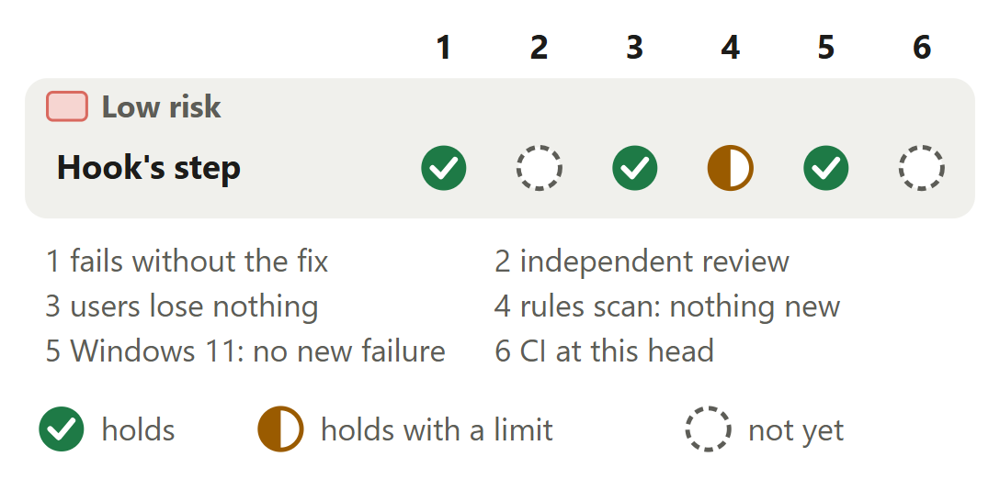

# Older Node at the recorded path: hooks name a step that works

For [pull request #1179](https://github.com/neralabs/rerail/pull/1179), head 272cbdce3b. [report.html](report.html) is the same report as one page: download it and open it.

## 1. The decision

**Should the hooks' line, while the launcher still runs the recorded Node, name the launcher's own command with `node` from `PATH` in that Node's place?**

1. With an older Node at the recorded path, the line names a launcher-free refresh.

**We recommend:** approve it: the line names a step that brings Rerail back in the one case where it named none, and keeps its words where the recorded Node is gone.

| Size | Risk and review | Waits on | Not verified |
|---|---|---|---|
| 430 lines in 8 files: 131 ship, 299 are tests and text | Reviewer approval. REVIEW.md lists no high-risk path among the changed files. | Nothing. It stands alone on `main` 5b90523a0e. | 3 |

## 2. Intent, and the gap

| Change | Intended | Found | Now |
|---|---|---|---|
| Older Node, same path | Line names the working step _(docs)_ | Step refuses on recorded Node _(the issue's runs)_ | Closes the gap, changes answer 1. |

Reported on 26 November 2026 at `main` e29282a55f on Linux x64; still shows over `main` 5b90523a0e's source.

Sources at main, and causes

| Change | Where main states the intent | The cause, and what was measured |
|---|---|---|
| Older Node, same path | `docs/how-setup-works.md` at `main`: "After moving to another Node, run `rerail install --refresh` with it first on `PATH` to record it for the launcher, hooks and status line." | The launcher (`shLauncher`) runs its recorded `NODE` while `[ -x ]` finds it and `node` from `PATH` only once it is gone; `refuseUnsupportedNode` then refuses the refresh on that Node. |

## 3. Where to look

1. **Read first**, 4 min: `launcher-node.ts`: `launcherRecordedNode`, `shRecordedNode`, `batchRecordedNode`, `launcherFinds`. Does the reader take the node exactly as `launcherShim` writes it, and test it as the launcher does?
2. 3 min: `hook-adapter.ts`: `olderNodeStep`, `serveHook`, `hookAnswer`, `hookInput`, `sayHookFailed`; `harness/index.ts`: exports.

**Then skim**, 3 min: The integration case runs the issue's steps with the built CLI and hooks for Claude Code and Codex; the unit cases read back what `launcherShim` writes.

## 4. Risk against verification

One change. Start at `launcherRecordedNode` in `launcher-node.ts`.

Each limit, and each check that does not hold yet

| Change | Check | Its limit, or why it does not hold yet |
|---|---|---|
| Hook's step | independent review | No reader outside the author has read this head yet. |
| Hook's step | rules scan: nothing new | Rules scan at this head against `main` 5b90523a0e with Rerail built from `main`: no new finding; `serveHook` 2, every added function 4 or under. The published 0.1.1 cannot load `main`'s pack: no verdict there. |
| Hook's step | CI at this head | No CI run at this head on GitHub yet: the branch is not on GitHub. |

## 5. The changes

**The line follows the launcher**, low risk: Older Node at the recorded path: the step refused 5 of 5 at `main`; here it works.

<b>6. The decisions</b>

**How does the hook know which step works?**

**We chose** read the node the launcher records and test it as the launcher does, so the gone case keeps its line. **Would change our mind:** A maintainer preferring one launcher-free line for both states, which reads no file.

| Option | What a user gets | Cost | What it breaks |
|---|---|---|---|
| Read the launcher's node; name the launcher's command while it is there **(chosen)** | The line follows what `rerail` runs in both states; the gone state keeps its words. | One small file read on a Node older than 24; the reader knows the two forms `launcherShim` writes. | Nothing found. |
| One launcher-free line for both states | No file read. | A longer line where `rerail install --refresh` works. | Nothing. |
| `npx @neralabs/rerail install --refresh` | A short command. | Needs the registry; runs the newest published refresh over the installed version. | Offline machines; an install of another version. |

**Evidence.** The issue's runs: with the recorded Node gone, `rerail install --refresh` works 5 of 5; with an older Node at its path, it refuses 5 of 5.

<b>7. How it fits</b>

It stands alone on `main` 5b90523a0e. #1076 and #1126 merge with it with no conflict and share no file.

<b>8. What is not covered</b>: 3 not verified, 2 limits that stay

1. **macOS** never ran.
2. **Homebrew** a relink of `<prefix>/bin/node` to `node@22` was not run; the cases replace the file at the path.
3. **The CLI's own refusal** `rerail <command>` on the recorded older Node still ends `Then run the same command again.`; an issue to follow.

**Limits that stay**

- On Windows a path with a space is single-quoted for PowerShell; `cmd.exe` does not take single quotes.
- The step names the Rerail home the hook ran with; a terminal with another `RERAIL_HOME` runs another launcher.

## 9. What we ask of you

Ask 1 rules on answer 1.

1. **May the hooks' line name `node <home>/current/dist/cli/cli.js install --refresh` while the recorded Node is there?** We recommend yes: it is the one step that works there.

<b>10. Evidence</b>

The description on GitHub is the record: "How you tested it" holds the runs at this head.

| Where | What ran | Result |
|---|---|---|
| Linux x64 | At 9553cf244d: the two new test files; the integration case over `main`'s hook source; 6 mutants | 8 passed; over `main` both integration cases fail on the refusal; each mutant fails a case, again at 1623b81dc3. |
| Linux x64 | At 9553cf244d: the 20 test files that import a changed module, and over `main`'s source | 653 passed, 0 failed on each side. |
| Linux x64 | The issue's steps through the built CLI, hook and a real daemon with Node 22.21.1, 5 runs a state | Older Node at the path: 5 of 5 here, 0 of 5 over `main`. Recorded Node gone: 5 of 5 on each side. |
| Linux x64 | At a42cd7a95d: the integration file 60 times under load; a throwaway case in which each `git` the case starts exits first | 60 of 60. The throwaway case fails 10 of 10 at 1623b81dc3 on an unhandled `write EPIPE` and passes 10 of 10 here. |
| Windows 11 | At 9553cf244d and `main`: the 20 test files that import a changed module | 625 passed, 45 skipped, 0 failed on each side. |
| Windows 11 | At 1623b81dc3: the two new test files; the integration case over `main`'s source; the unit file 30 times. At a42cd7a95d: the integration file 30 times | 8 passed, 2 skipped; over `main` 2 of 2 fail on the refusal; the unit file 30 of 30 beside its CI shard neighbours; the integration file 30 of 30 at a42cd7a95d. |

**Sources.** The branch at a42cd7a95d, four commits on `main` 5b90523a0e, read on 27 November 2026; runs on Linux x64 and Windows 11 x64 machines.

