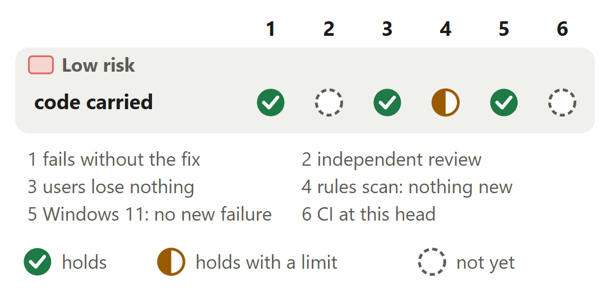

# An installed Rerail's stream answers an event of no running session `inactive-session`

For [pull request #1182](https://github.com/neralabs/rerail/pull/1182), head d6d5ff8593. [report.html](report.html) is the same report as one page: download it and open it.

## 1. The decision

**May the daemon's answer to an event it refuses carry the protocol's error code beside its message, for the stream to hand on?**

1. An event of no running session reads `inactive-session` in both builds, with the runtime's message.

**We recommend:** approve it once you agree to answer 1: through an installed Rerail every run read `invalid-event` on `main` and reads `inactive-session` here, as a checkout's build does.

| Size | Risk and review | Waits on | Not verified |
|---|---|---|---|
| 301 lines in 8 files: 94 ship, 207 are tests and text | Standard. The automated reviewer can approve. | Nothing. One commit on `main` after #1175; it stands alone. | 3 |

## 2. Intent, and the gap

| Change | Intended | Found | Now |
|---|---|---|---|
| A session not started | Such an event is `inactive-session` _(code comment)_ | Installed Rerail said `invalid-event` _(real daemon, Linux x64)_ | Closes the gap, changes answer 1. |

Found on 27 November 2026 through the built CLI, laid out as an installed Rerail with its daemon, on Linux x64.

Sources at main, and causes

| Change | Where main states the intent | The cause, and what was measured |
|---|---|---|
| A session not started | `InactiveSessionError` in `src/runtime/event-protocol.ts`: "An event for a session the runtime has not started or has ended; the event stream answers it as `inactive-session`." | `answerEngineRequest` in `src/runtime/engine-service.ts` wrote every error of an event as HTTP 400 with its message alone, and `postEngineEvent` threw a plain error for any status but 200, so the code was lost on the way. |

## 3. Where to look

1. **Read first**, 6 min: `event-protocol.ts`: `eventErrorCode`, `encodeEngineRefusal`, `decodeEngineRefusal`. Does only a protocol code travel, and does an older daemon's answer read as before?
2. 4 min: `engine-service.ts` and `event-stream.ts`: the daemon's answer, `failedAnswer`, `errorCode`.

**Then skim**, 6 min: Three new cases: through an installed Rerail and its daemon, at the engine socket, and in the stream with an older daemon's answer.

## 4. Risk against verification

Start with `decodeEngineRefusal`: it decides which answers become a code and which keep the status and the text.

Each limit, and each check that does not hold yet

| Change | Check | Its limit, or why it does not hold yet |
|---|---|---|
| code carried | independent review | No review by another reader yet: our own reading against the repository's review points only. |
| code carried | rules scan: nothing new | The side built from `main` found nothing new and no function above a complexity of 6; the published Rerail cannot load the repository's pack and gave no verdict. |
| code carried | CI at this head | No CI run at this head yet: not pushed. |

## 5. The changes

**The refusal carries its code**, low risk: Installed Rerail, an event of no running session: `invalid-event` before, `inactive-session` here, in each of 5 runs.

**6. The decisions:** we made no choice here that a maintainer could have made differently.

<b>7. How it fits</b>

One commit on `main` after #1175, the fix of #1132, which changed the same lines of the stream. Nothing waits on it. Git merges it with each open pull request of ours; #1076 also edits the engine service, #1165 the reference.

<b>8. What is not covered</b>: 3 not verified, 2 limits that stay

1. **macOS** never ran.
2. **The rules review** gave no verdict: its published Rerail cannot load the repository's pack.
3. **Windows 11 mutants** were not run: each would need a commit of its own; the six ran on Linux x64.

**Limits that stay**

- An event the daemon timed out on, or refused before reading it (a refused capability, a path it does not serve), still reads `invalid-event`.
- OMP and Pi read the daemon's native session answers by their words, not a code; this change does not touch that route.

## 9. What we ask of you

Ask 1 rules on answer 1.

1. **May the daemon's refusal carry the protocol's code in its body, with the status left at 400?** We recommend yes: one rule for each code, and older hooks read it unchanged.

<b>10. Evidence</b>

The description on GitHub is the record. "How you tested it" holds the runs on `main` and at this head.

| Where | What ran | Result |
|---|---|---|
| Linux x64 | The built CLI laid out as an installed Rerail with its daemon, five events, 5 runs | On `main`: `e1` and `e5` `invalid-event` in 5 of 5. Here: `inactive-session` in 5 of 5, as the checkout's build in every run. |
| Windows 11 | The changed test files over `main`'s source, then here, one machine | Over `main`'s source: the 3 new cases fail and no other, 38 pass. Here: 41 pass, the same 13 skipped. |
| Linux x64 | Mutants, one deciding line each | Six of six fail a case. |
| Windows 11 | Every test file that imports a changed module | `main`: 504 passed, 16 skipped. Here: 507 passed, the same 16 skipped. |
| Windows 11 | The changed files beside their CI shard neighbours, 30 rounds | 30 of 30 rounds pass, 82 cases passed and 13 skipped in each. |
| Linux x64 | The changed files, 30 rounds; the unit files beside their CI shard neighbours | 30 of 30 rounds pass for each file. |

**Sources.** The change and its diff, read on 27 November 2026; the base is `main` e310499b33, after #1175.

