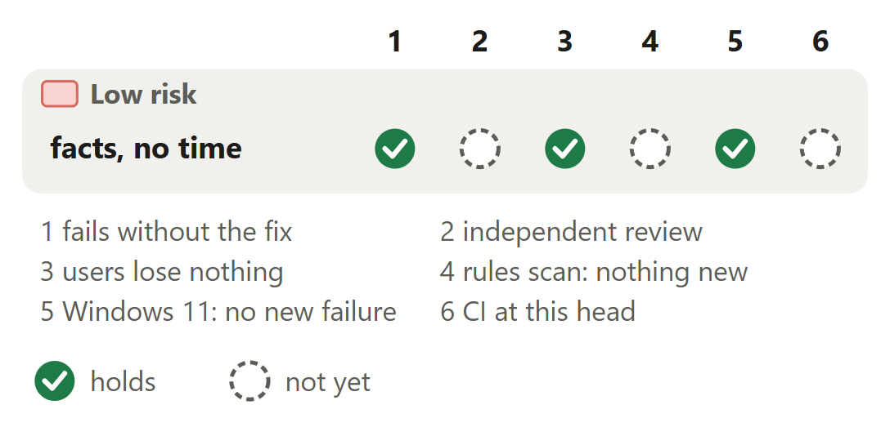

# The held write lock cases decide by facts, not by time

For [pull request #1204](https://github.com/neralabs/rerail/pull/1204), head e1953ee95f. [report.html](report.html) is the same report as one page: download it and open it.

## 1. The decision

**Should `hook-write-lock.test.ts` tell a hook that waited for the write lock by what that wait changes, not by the hook's time against its lock-free twin?**

**We recommend:** approve it: a runner that paused one hook 2 s failed the first case with no lock wait anywhere, and the facts catch both waits we tried while passing that pause.

| Size | Risk and review | Waits on | Not verified |
|---|---|---|---|
| 42 lines in 1 file: 0 ship, 42 are the tests it changes, 0 are other tests and text | Fast. One test file, no product code. | Nothing. It stands alone on `main` cce09e3c36. | 3 |

## 2. Intent, and the gap

| Change | Intended | Found | Now |
|---|---|---|---|
| No lock wait | Hooks answer beside a held lock _(a test's name)_ | A 2 s pause failed it _(a Windows run, traced)_ | Closes the gap. |

Found on 27 November 2026: one of 30 runs on a Windows 11 machine with a second test run beside it.

Sources at main, and causes

| Change | Where main states the intent | The cause, and what was measured |
|---|---|---|
| No lock wait | `integration/daemon/hook-write-lock.test.ts:191` at `main` cce09e3c36; the bound at line 216: `expect(turn.stop.ms, report).toBeLessThan(free.stop.ms + 2_000)`. | A time stood for a fact. Traced with the lock held 6 s, such 2 s pauses met a hook with the lock free too, and in held turns fell on the hook process's start or on its read of an answer sent in 78 ms; no turn-end write waited for the lock. |

## 3. Where to look

1. **Read first**, 5 min: `hook-write-lock.test.ts`: the four cases' facts in place of their time bounds. Would each fact change if a hook waited for the lock?

**Then skim**, 1 min: Nothing else changes.

## 4. Risk against verification

One change, low risk: one test file; no product code changes.

Each limit, and each check that does not hold yet

| Change | Check | Its limit, or why it does not hold yet |
|---|---|---|
| facts, no time | independent review | No reader outside the author has read this head yet. |
| facts, no time | rules scan: nothing new | The rules review did not run on this head; the change is one test file. |
| facts, no time | CI at this head | GitHub's CI has no result at this head yet. |

## 5. The changes

**Four cases read facts**, low risk: A runner's 2 s pause failed the first case at `main`; here only a wait for the lock fails it.

<b>6. The decisions</b>

**How does a case tell that a hook waited for the write lock?**

**We chose** by what a wait changes: answers, stderr, records while the lock is held and after, the save still waiting. **Would change our mind:** A maintainer who wants a bounded wait that then goes on as if made caught too, which only a time shows.

| Option | What a user gets | Cost | What it breaks |
|---|---|---|---|
| The facts a wait changes **(chosen)** | No clock: a paused runner cannot fail it, and a hook that waits fails with its own error in the message. | 29 added and 13 removed lines in one test file. | A wait that ends at SQLite's 5 s and then goes on as if made shows only its time; no hook path does that today. |
| A wider margin over the lock-free twin | One number a line. | Nothing. | Still a clock: a longer pause fails it again. |
| Time against SQLite's 5 s busy timeout | Every bounded wait. | A few lines. | A record writer's flush waits only to its first write's deadline, under 5 s from the turn's start: a margin of a few hundred ms. |

**Evidence.** Both mutants fail the new cases on Linux x64 with the hook's own error; a 2.5 s pause of the held `Stop` passes them and fails `main`'s case.

<b>7. How it fits</b>

It stands alone on `main` cce09e3c36: Git merges it with `main`, #1076 and #1126 alone. The fix of #1199 adds two cases to this file; it takes this change in and drops its own two time checks.

<b>8. What is not covered</b>: 3 not verified, 1 limit that stays

1. **A wait that then goes on** a record writer's flush on a hook's path, ending at SQLite's 5 s, changes no answer: only its time shows it.
2. **Mutants on Windows 11** not run: they ran on Linux x64.
3. **macOS** never ran.

**Limits that stay**

- The save case still rests on the save's own 5 s: a hook paused past it would see the save answered first.

## 9. What we ask of you

We ask no ruling.

<b>10. Evidence</b>

The description on GitHub is the record: "How you tested it" holds the runs at `main` and here.

| Where | What ran | Result |
|---|---|---|
| Linux x64 | The file at this head | 4 of 4 passed. |
| Linux x64 | Two mutants, each alone: the event's row on the daemon's own connection; the steer's receipt never handed over | The first fails 4 of 4 cases, the second the first case, each with the hook's error; `main`'s case misses the second. |
| Linux x64 | The held `Stop` paused 2.5 s, no lock wait, here and with `main`'s case | Here 4 of 4 passed; `main`'s case failed, `expected 2643 to be less than 2136`. |
| Windows 11 | The file 30 times at this head, a second test run beside it | 30 of 30. |
| Windows 11, Linux x64 | A test script repeating the first case's held turn, the lock held 6 s, every wait traced, at `main` and with the fix of #1199 | No hook answered after the release in 268 turns; the 2 s pauses met a hook with the lock free too. |

**Sources.** The branch at e1953ee95f and its diff against `main` cce09e3c36, read on 28 November 2026; runs on Linux x64 and Windows 11 x64 machines.

