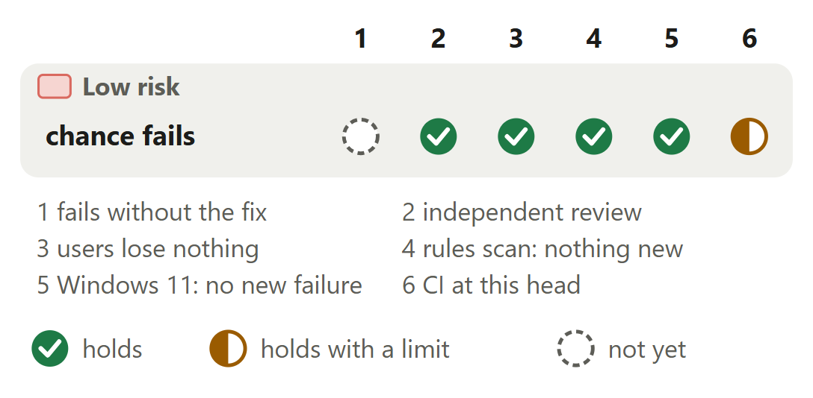

# Three test cases no longer fail by chance

For [pull request #1075](https://github.com/neralabs/rerail/pull/1075), head b0d7cf85d1. [report.html](report.html) is the same report as one page: download it and open it.

## 1. The decision

**May three test fixes for cases `main`'s CI failed by chance on 25 November land together?**

**We recommend:** approve it: test code only; an owner case's child writes its ready file whole, two pack-rule files read their rule documents once, and the session-records cases wait for the records folder's repair.

| Size | Risk and review | Waits on | Not verified |
|---|---|---|---|
| 55 lines in 4 files: 0 ship, 55 are the tests it changes, 0 are other tests and text | Fast. Four test files, no product code. | Nothing. CI on GitHub runs at this head. | 4 |

## 2. Intent, and the gap

| Change | Intended | Found | Now |
|---|---|---|---|
| The owner cases | Each run reports the store it owns _(a test's name)_ | A ready file read as empty _(CI run)_ | Closes the gap. |
| The pack-rule file | A case tests one rule's compile _(a test's name)_ | Each compile read 4.4 MB _(CI run)_ | Closes the gap. |
| The session-records cases | Each case cleans up after its session _(a test's name)_ | A running icacls blocked the removal _(CI run, #990)_ | Closes the gap. |

Found on 25 November 2026: `main`'s own CI failed three pushes in one hour, each on a case the push did not touch.

Sources at main, and causes

| Change | Where main states the intent | The cause, and what was measured |
|---|---|---|
| The owner cases | `native/src/code_rule_dsl/logic/plan/corpus/owner.rs:409` at `main` 4c49132c6e; the child writes its ready file at line 525, the parent reads it in `ready()` at line 374. | `std::fs::write` creates the file empty and then writes the store's path; `ready()` polls every 10 ms and takes the first text it reads, so a read between the two calls returns an empty path. |
| The pack-rule file | `test/engine/code-rule/pack-rules/node-callback-literal-fs-watch.test.ts:73` at `main` 4c49132c6e; its helper `compile()` at line 33. | Each compile read all 42 rule documents of packs/node and its candidates, 4.4 MB of JSON, inside the case: three times in the first case, which compiles three times. |
| The session-records cases | `test/runtime/session-records-gitignore.test.ts` at `main` 4c49132c6e, `openOneSession`; #990. | The session waits by design only for the folder's ACL to be read; `openOneSession` returned before the repair's last `icacls` exited. |

## 3. Where to look

1. **Read first**, 3 min: `owner.rs`: `a_run_holding_its_store` and `ready`. Does the rename make every call of `ready()` and the absence check read only a whole file?
2. 3 min: `node-callback-literal-fs-watch.test.ts`, `python-harmful-steers.test.ts` and `session-records-gitignore.test.ts`.

**Then skim**, 1 min: Nothing else changes.

## 4. Risk against verification

One change, low risk: four test files; the product, every rule and the store ownership are as they were.

Each limit, and each check that does not hold yet

| Change | Check | Its limit, or why it does not hold yet |
|---|---|---|
| chance fails | fails without the fix | `main`'s CI failed each case once on 25 November. On Linux x64 the pack-rule file's cases took 402 to 2,061 ms at `main` and 1 to 26 ms here. With a 50 ms pause before the ready file's text, both owner cases fail at `main` and all pass here, on GitHub's Linux runner in our fork. |
| chance fails | CI at this head | CI on GitHub runs at this head; each of the three cases failed a job of `main` on 25 November. |

## 5. The changes

**Three cases read whole facts**, low risk: `main`'s CI read an empty ready file, timed out reading 4.4 MB of rules, and met a running `icacls`.

<b>6. The decisions</b>

**How does the parent read a child's ready file only once it is whole?**

**We chose** the child writes it beside the file and renames it into place, so it exists only whole. **Would change our mind:** A ready file written by a program that cannot rename.

| Option | What a user gets | Cost | What it breaks |
|---|---|---|---|
| Write beside, then rename **(chosen)** | The file exists only with its whole text, for every call of `ready()` and for the case that checks a file is not there. | Two lines in the child. | Nothing found. |
| A closing newline the reader waits for | The same for `ready()`. | A rule in the writer and one in the reader. | The absence check still reads a half-written file as there. |
| Read again after an empty read | Passes the case that failed. | One line. | A partly written path is still taken. |

**Evidence.** The CI log read `""` where the store's path was expected; `std::fs::write` opens the file with truncation and writes in a second call; the owner cases call `ready()` five times and one checks a ready file's absence.

**Read the rule documents once, or raise the case's time limit?**

**We chose** read them once for the file: they are its set-up, and each case compiles one rule. **Would change our mind:** A measure that shows one compile of the rule near 5 s on CI's runner.

| Option | What a user gets | Cost | What it breaks |
|---|---|---|---|
| Read the documents once for the file **(chosen)** | A case's time is its own compile and evaluation. | One constant in each of two files. | Nothing: the same documents. |
| Raise the case's time limit | One edited number. | Nothing. | Each case still reads 4.4 MB it does not test, and a slower runner fails it again. |

**Evidence.** On Linux x64, `main`'s file and this head's in turns, 6 runs each: at `main` the first case took 1,565 to 2,061 ms and each other case 402 to 972 ms; here every case took 1 to 26 ms. A compile takes milliseconds; each read of the 42 documents about half a second.

<b>7. How it fits</b>

Nothing has to merge first: three commits, one a case, with no file in common; the branch holds `main` 2a7a2b7766 by merges Git made alone. No other open pull request of ours edits these files; once on `main`, none of the three fails a job by its runner's load.

<b>8. What is not covered</b>: 4 not verified, 1 limit that stays

1. **macOS** never ran.
2. **The files under `integration/`** not run: none reads or imports a changed file.
3. **The owner cases' loop** run on GitHub's Linux runner in our fork: with the pause, two cases fail at `main` and none here.
4. **Linux x64** 30 of 30 rounds on GitHub's Linux runner in our fork; no Linux test machine of ours started them that night.

**Limits that stay**

- The `php-*` files and `python-steer-safety.test.ts` compile inside a case after reading one rule document each, not a pack: left as they are.

## 9. What we ask of you

We ask no ruling.

<b>10. Evidence</b>

The description on GitHub is the record: "How you tested it" holds the runs at this head.

| Where | What ran | Result |
|---|---|---|
| Windows 11 | The three changed test files together, 30 runs, engine built from this head's `native/` | 30 of 30; 60 cases passed and 6 skipped each run, as on CI's Windows runner. |
| Linux x64 | `main`'s fs-watch file and this head's in turns, 6 runs each, 3 of them beside a vitest run of the code-rule folder | At `main` the first case took 1,565 to 2,061 ms and each other case 402 to 972; here every case took 1 to 26 ms, the file 0.84 to 1.5 s against 5.1 to 6.9. |
| Linux x64 | The rule pack's review of the change against `main` | Nothing new; Rerail built from `main` gave no difference. |
| Linux x64 | The repository's check before a commit, at each of the three commits | Passed. |

**Sources.** The branch at aa19e43f45 and its diff against `main` 4c49132c6e, read on 25 November 2026; `main`'s CI logs of 25 November; runs at the head on a Windows 11 x64 machine and a Linux x64 machine.

