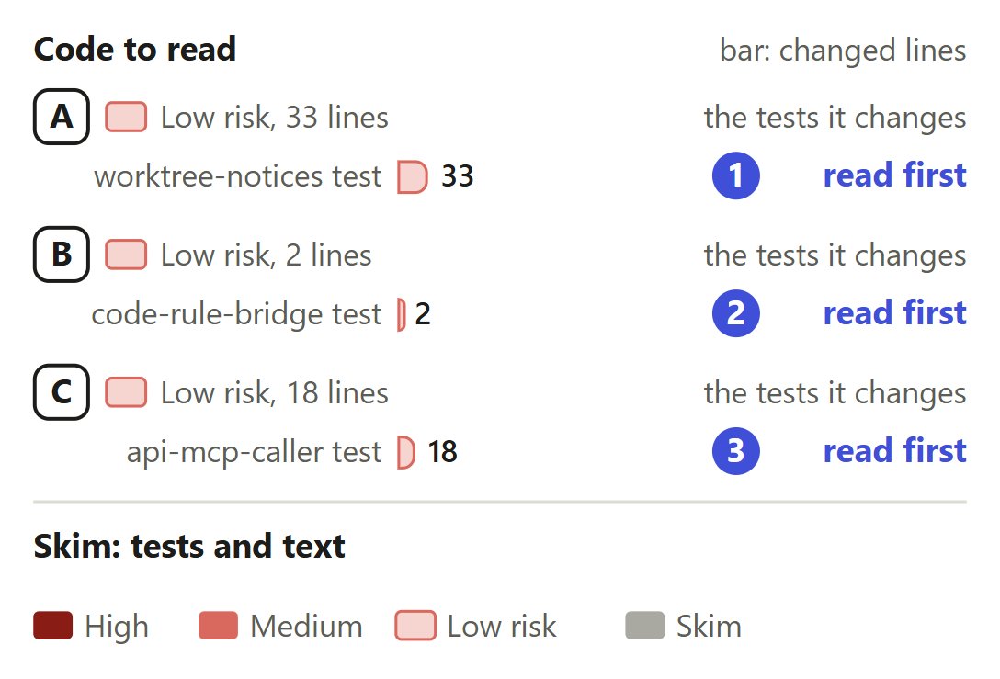
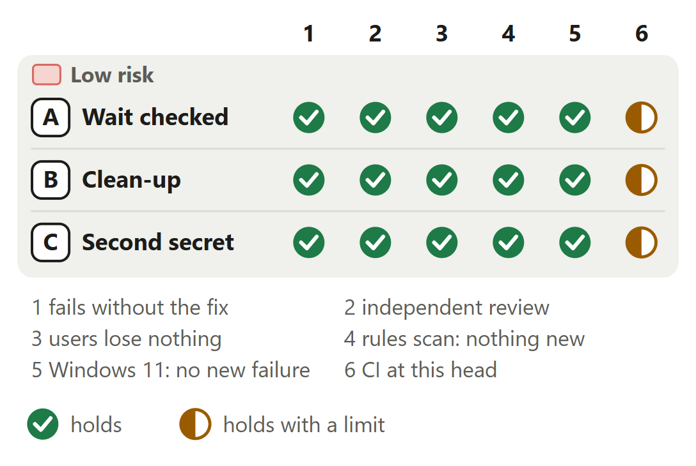

# Three test follow-ups: a wait, a clean-up, a limit

For [pull request #948](https://github.com/neralabs/rerail/pull/948), head 8a20e72f8. [report.html](report.html) is the same report as one page: download it and open it.

## 1. The decision

**May the refused-watch case check the walk's wait, the close case build its bridge with `createBridge`, and the limit case add a second linked secret?**

**We recommend:** approve all three: the wait and limit cases fail when what they name breaks, a failing close case no longer fails the next one, and each passed 10 of 10 runs on Linux x64.

| Size | Risk and review | Waits on | Not verified |
|---|---|---|---|
| 53 lines in 3 files: 0 ship, 53 are the tests it changes, 0 are other tests and text | Fast. Three test cases, no product code. | Nothing. No CI run on GitHub yet: not pushed. | 1 |

## 2. Intent, and the gap

| Change | Intended | Found | Now |
|---|---|---|---|
| A. Two orders of ending | Two orders of ending tested _(test name)_ | One order ran twice _(code reading)_ | Closes the gap. |
| B. Clean-up after a failure | Clean-up closes every bridge _(code comment)_ | One case's bridge stayed open _(a failing copy)_ | Closes the gap. |
| C. The limit, both sides | At most 256 paths, then by name _(code comment)_ | Any limit from 1 to 256 passed _(a review of #881)_ | Closes the gap. |

Found on 19 and 20 November 2026 by the reviewers of #881, #909 and #935, as the one follow-up on each.

Sources at main, and causes

| Change | Where main states the intent | The cause, and what was measured |
|---|---|---|
| A. Two orders of ending | `test/engine/code-rule/worktree-walks/worktree-notices.test.ts` at cc7237f19, the case's `it.each`. | `#openSettled` waits for the read after the refusal before `#open` reads the path, which the variants did not count. |
| B. Clean-up after a failure | `test/engine/code-rule/code-rule-bridge.test.ts` at e3b4112ce, afterEach's first comment, line 377; `createBridge`, line 352, adds each bridge to the list afterEach closes, line 402. | afterEach closes only the bridges in `bridges`, then removes the folders. This case's bridge was not there, so its held Git ran on: `removeFolder` refused the folder, naming that process, and the next case found no Git in its own folder. On Linux the stand-in ended at Git's 10 s read limit, before the file did. |
| C. The limit, both sides | `test/api/api-mcp-caller.test.ts` at 622a9b11a, the comment above the case: "One answer resolves at most 256 distinct paths on disk (CHECKOUT_PATH_RESOLUTIONS in src/engine/path-boundary.ts) across every folder its findings were recorded in, and judges the rest by name." | The first audit withholds its first finding for any limit of 1 or more, and the second serves its first finding whole for any limit of 256 or less. Nothing checked the 256th path, so a lower limit, which would serve later secret findings whole to coding agents, still passed. |

## 3. Where to look

1. **Read first**, 2 min: `worktree-notices.test.ts`: the case "when a walk asks before the read after the refusal ends". Do the read counts at the walk's request show that it waits for the read after the refusal?
2. **Read first**, 1 min: `code-rule-bridge.test.ts`: the case "closes mid-walk with no Git it started still running". Does its bridge now enter the list afterEach closes?
3. **Read first**, 3 min: `api-mcp-caller.test.ts`: the case "resolves at most 256 paths per answer". Does a limit of 255 fail the first audit, one of 257 the second, and does the comment say why?

**Then skim**, 1 min: The helper `refusedAfterRead` loses `stamped`, which only the second variant read.

## 4. Risk against verification

Three changes, all low risk: one test case each; the product is as it was.

Each half mark's limit

| Change | Check | It holds with this limit |
|---|---|---|
| A to C | CI at this head | No CI run at this head on GitHub yet: the branch is not pushed. |

<b>5. The changes</b>

**A. One case checks the wait**, low risk. Linux x64: without the wait, the case failed 5 of 5 runs at its first check.

- **Problem:** #909's case ran as two variants, one per order in which two reads end, but both ran the same steps.
- **Who meets it:** Anyone reading or changing this case: every run of both variants took the same order.
- **What it does:** One case counts the reads as the walk asks: two, one held; once the held read finds the folder, the walk answers true and reads nothing.
- **Risk:** Low: one test case and its helper; the product is unchanged.
- **Check:** Do the read counts at the walk's request show that it waits for the read after the refusal?
- **Picture:** With the wait in #openSettled taken out, main's two variants failed 0 of 5 runs at their first check, only at their last; the new case failed 5 of 5 runs at its first check, where the walk asks.
- **Method:** Linux x64: the case alone, 10 runs at this head and 20 at 61e5823c2; the same case and `main` cc7237f19's two variants with the wait taken out of `#openSettled`, 5 runs each.

**B. A failed close case cleaned up**, low risk. A failing copy on Linux x64: `main` 2 cases failed and the clean-up; this change 1 case.

- **Problem:** When the case failed before its close, its bridge stayed open: the file's clean-up failed on the stand-in Git still running in its folder, and the next case failed.
- **Who meets it:** Anyone whose change makes this case fail: the one failure shows as three, on every platform.
- **What it does:** The case builds its bridge with `createBridge`, as the file's other cases do, so afterEach closes it, ending its Git, before it removes the folder.
- **Risk:** Low: one line of one test case; the product is unchanged.
- **Check:** Does the case's bridge now enter the list afterEach closes, with its own close kept?
- **Picture:** In a copy of the file whose close case fails before its close, main failed 2 cases and the clean-up named a stand-in Git still running; this change failed only the case.
- **Method:** Linux x64: one run each of a copy of `code-rule-bridge.test.ts` at `main` e3b4112ce and at 1a536bc96, with a check that fails added before the case's close, then a look for its stand-in Git.

**C. A second secret at the end**, low risk. Limit at 1, 255 or 257: the case now fails; at 256 it passes.

- **Problem:** #881's case had its one linked secret at each audit's first path, so any limit from 1 to 256 passed it.
- **Who meets it:** Anyone who changes the limit: at `main` the case passes with it at 1 and at 255.
- **What it does:** The case also puts a linked secret at the 256th path and expects it withheld, so a limit moved either way fails it.
- **Risk:** Low: a test's data and expected values; the product is unchanged.
- **Check:** Does a limit of 255 fail the first audit, one of 257 the second, and does the comment say why?
- **Picture:** With the limit set to 1, 255 and 257, main's case passed at 1 and 255 and failed at 257; this change's case failed at all three.
- **Method:** Linux x64, throwaway checkouts at `main` 622a9b11a and 16c8d911f: the case once with `CHECKOUT_PATH_RESOLUTIONS` at 1, 255 and 257, and once with the judge's limit clause taken out.

<b>6. The decisions</b>

**How does the case show that a walk waits for the read after a refusal?**

**We chose** it counts the reads as the walk asks and after the held read is answered. **Would change our mind:** A maintainer who wants the order the second variant named, which the code no longer allows.

| Option | What a user gets | Cost | What it breaks |
|---|---|---|---|
| Count the reads as the walk asks **(chosen)** | A failure that names the read the walk asked too early. | 10 added and 23 removed lines in one test file. | One case where there were two. |
| Keep both variants | Nothing more: the walk asks no read to hold. | None. | Two variants that run the same steps. |

**Evidence.** On Linux x64 the case passed 20 of 20 runs alone at 61e5823c2 and failed 5 of 5 without the wait; the old variants failed 5 of 5 each without it, at their last check.

**How does the close case's bridge reach the file's clean-up?**

**We chose** `createBridge`, as the file's other cases build theirs, keeping the case's own close. **Would change our mind:** A maintainer who wants this case to own its clean-up, which a `finally` in the case would give.

| Option | What a user gets | Cost | What it breaks |
|---|---|---|---|
| Build it with `createBridge` **(chosen)** | The clean-up every other case gets, from the file's one list. | One changed line. | The bridge is closed twice when the case passes; the second close returns at once. |
| A `try` and `finally` in the case | The same close, written in the case. | Four more lines. | A second way to close a bridge in a file that has one. |

**Evidence.** In a copy of the file whose close case fails before its close, `main` failed 2 cases and its clean-up; this change failed only the case, on Linux x64.

**Import the limit or keep the literal?**

**We chose** the literal, with a comment saying why: the boundary check refuses the import, and a new limit fails the case. **Would change our mind:** A maintainer who wants the limit exported from the engine's entry point for tests to read.

| Option | What a user gets | Cost | What it breaks |
|---|---|---|---|
| The literal 256, with a comment **(chosen)** | The case pins 256 itself; nothing outside the test changes. | Two places say 256. | Nothing found. |
| Export the limit from `src/engine/index.ts` and import it | One place says 256. | A product source change, and a name added to the engine's entry point for one test. | Nothing, but the case would follow any new limit without a second look. |
| Import `src/engine/path-boundary.ts` directly | One place says 256. | None in code. | `npm run check`: the boundary check's entry-points rule refuses it from `test/api/`. |

**Evidence.** `node scripts/check/check-boundaries.mjs` with the import: "[entry-points] imports src/engine/path-boundary.ts; outside src/, import src/engine/index.ts", exit 1.

<b>7. How it fits</b>

Nothing has to merge first: three commits and merges of `main`, the last 9b93ecd80, each with no merge conflict. It edits one case in each of `worktree-notices.test.ts`, `code-rule-bridge.test.ts` and `api-mcp-caller.test.ts`.

The pull request stands on main at 9b93ecd80, which merged into it with no merge conflict; nothing else has to merge first, and nothing waits on it.

<b>8. What is not covered</b>: 1 not verified, 3 limits that stay

1. **macOS** never ran.

**Limits that stay**

- At `main` the old refused-watch variants also fail without the wait, so that change moves where the failure shows and adds no red run.
- On Linux `main`'s stand-in Git ended before the file did, at Git's 10 s read limit: the close case's gap shows inside the file, not after it.
- The runs without the wait, the failing copies and the limits at 1, 255 and 257 ran at each change's own commit, not here; since then `main` changed only the close case's file and source.

## 9. What we ask of you

We ask no ruling.

<b>10. Evidence</b>

The description on GitHub is the record: "How you tested it" holds the runs here, at each change's own commit and at `main`.

| Where | What ran | Result |
|---|---|---|
| Linux x64 | The three files whole once, each changed case alone 10 runs, and `tsc --noEmit`, at this head | 382 passed and 5 skipped; 10 of 10 for each case; the type check passed. |
| Linux x64 | The refused-watch case with the wait taken out of `#openSettled` at 61e5823c2, and `main` cc7237f19's two variants the same way | The case failed 5 of 5 at its first check; each variant failed 5 of 5 at its last. |
| Linux x64 | A copy of `code-rule-bridge.test.ts` that fails the close case before its close, at `main` e3b4112ce and at 1a536bc96 | `main`: 2 failed and the clean-up named the stand-in still running. 1a536bc96: 1 failed, 253 passed. |
| Linux x64 | The limit case with the limit at 1, 255 and 257, and without the judge's limit clause, at `main` 622a9b11a and at 16c8d911f | `main`: passed at 1 and 255, failed at 257 and without the clause. 16c8d911f: failed at all four. |
| Windows 11 | The three files whole once at this head, with the engine built for its native tree | 386 passed and 1 skipped; each changed case passed. |
| Windows 11 | The limit case 20 times at 16c8d911f, with the engine built for that commit's native tree | 20 of 20 passed. |

**Sources.** The branch at 8a20e72f8 and its diff against `main` 9b93ecd80, read on 20 November 2026; runs at 8a20e72f8, 61e5823c2, 1a536bc96, 16c8d911f and at `main` on Linux x64 machines and a Windows 11 virtual machine.

