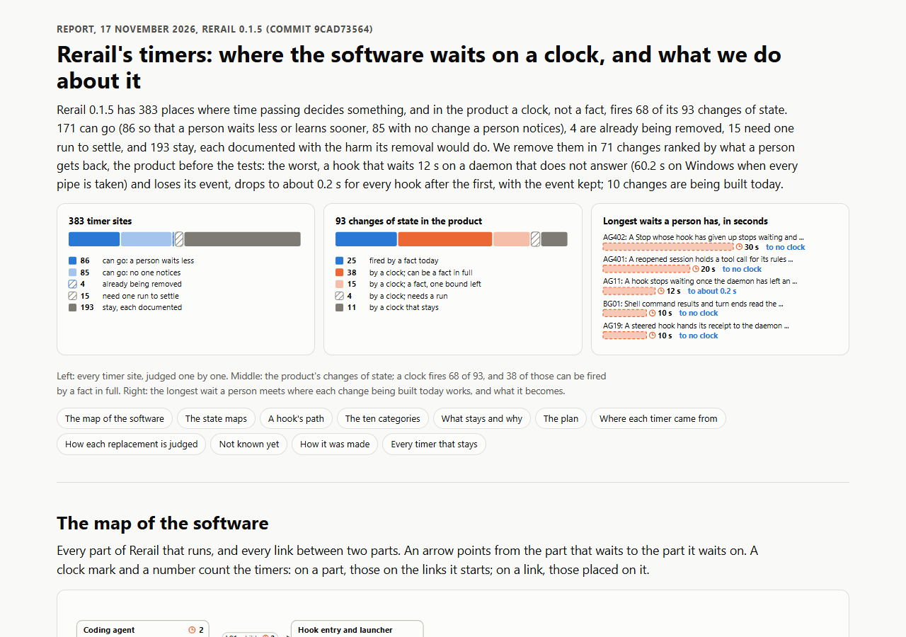
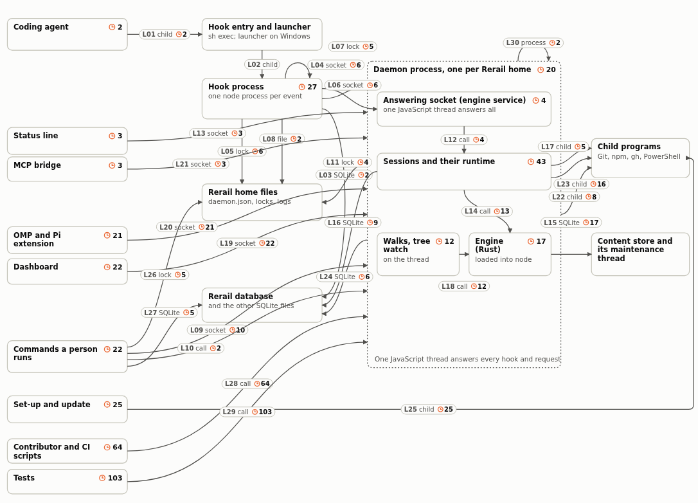
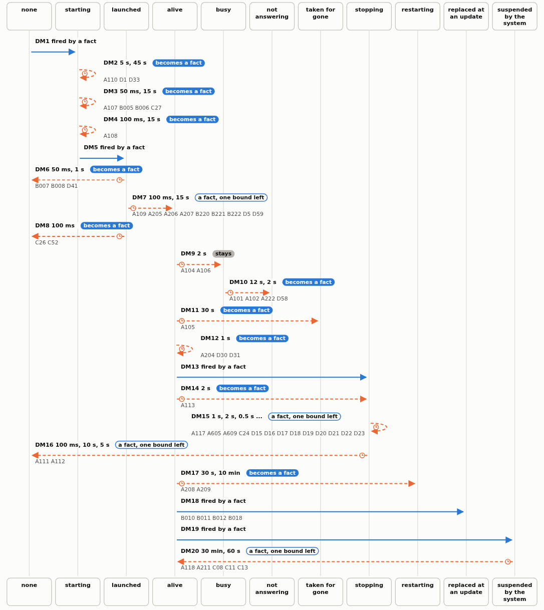
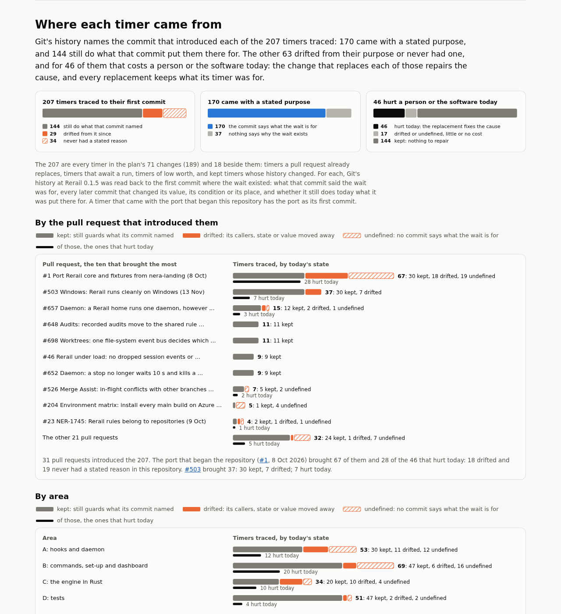

# Rerail's timers: where the software waits on a clock, and what we do about it

Rerail 0.1.5 (commit 9cad73564), 17 November 2026.

Rerail 0.1.5 has 383 places where time passing decides something: a sleep, a poll, a limit on a wait, a retry with a pause, a lease. In the product, a clock, not a fact, fires 68 of its 93 changes of state. 171 of the 383 can go (86 so that a person waits less or learns sooner, 85 with no change a person notices), 4 are already being removed, 15 need one run to settle, and 193 stay, each documented with the harm its removal would do.

| Read | Open in the browser | File |
|---|---|---|
| The full report: the map, the state maps, the ten categories, the plan, where each timer came from, how each replacement is judged | [open](https://htmlpreview.github.io/?https://github.com/neralabs/rerail/blob/JeanFrancoisGagne/pr-reports/timers-to-facts/rerail-timers-map.html) | [rerail-timers-map.html](rerail-timers-map.html) |
| Every timer that stays, and why | [open](https://htmlpreview.github.io/?https://github.com/neralabs/rerail/blob/JeanFrancoisGagne/pr-reports/timers-to-facts/rerail-timers-kept.html) | [rerail-timers-kept.html](rerail-timers-kept.html) |

Each page is one self-standing file with no outside request: if the browser view does not load, download the file and open it.

## The longest waits a person has today, and what they become

| Where | Today | Once its change is in |
|---|---|---|
| The next prompt and tool calls after a turn's end whose hook gave up | 30 s each, and they fail | no clock |
| A hook beside a daemon that does not answer, every hook after the first | 12 s (60.2 s on Windows when every pipe is taken), and the event is lost | about 0.2 s, the event kept |
| A checked edit behind another writer of the content store | up to 10 s, then 30 s with no reuse | one batch |
| Every shell command result and turn end in a large checkout | up to 10 s | no clock |
| Each session start beside a busy daemon | up to 4 s | no clock |

## The map of the software

Every part of Rerail that runs and every link between two parts. An arrow points from the part that waits to the part it waits on; the number beside a clock mark counts the timers there.

## One of the state maps: the daemon

A solid blue arrow is a change of state fired by a fact. A dashed orange arrow with a clock is fired by time passing; its label says what it becomes: a fact, a fact with one bound left, or a clock that stays. The report has one such map for each of a checkout, the daemon, a session, a hook event, the content store and the databases.

## Where each timer came from

Git's history names the commit that introduced each of the 207 timers a change replaces: 170 came with a stated purpose, and 144 still do what that commit put them there for. The other 63 drifted from their purpose or never had one, and for 46 of them that costs a person or the software today: the change that replaces each of those repairs the cause, and every replacement keeps what its timer was for. 31 pull requests introduced them; the port that began the repository (#1) brought 67, and 28 of the 46 that hurt today.

The report's part "Where each timer came from" (after the plan) draws them by pull request, by area and by week, lists the 46 one by one (the commit and pull request that introduced each, the intent then, what went wrong since, what the replacing change must restore or define), and gives every traced timer under the change that replaces it. Each change in the plan's table says what it keeps.

## How each replacement is judged

Every change of the branch meets four requirements before it joins it:

1. The intent kept, or its root cause fixed: each timer is traced to the commit that introduced it, and the replacement keeps what that commit wanted; where the intent was never stated or drifted, and that hurts today, the change fixes the cause and says what it now defines.
2. One owner for the fact that replaces the clock: three designs ranked, each judged for its design, its code and its performance; one module owns the fact, with a small interface, and its callers stop knowing about time.
3. A measured net gain: the wait in the state the timer guarded is better; the common path and the idle cost are no worse. A change that is not a net gain is dropped, with its figures.
4. A guard, with a case that fails without it, for each thing the clock protected against: a holder that never finishes, a process that died, a disk that stalls, a peer of an older version, a machine that slept.

## The ten categories of use, and the practice that replaces each

| Category | Sites | Can go | Stay | The practice that replaces it |
|---|---|---|---|---|
| A wait for another process to come up or go away | 28 | 13 | 15 | Wait on the process itself: a ready line on an inherited pipe to come up, the process handle (pidfd, kqueue NOTE_EXIT, WaitForSingleObject) to go away. |
| A wait for a lock | 29 | 14 | 14 | A first-come queue inside one process; an OS lock the system frees across processes (flock, LockFileEx), waited on in a worker thread. |
| A poll for a file, a record or a change | 16 | 13 | 2 | Tell the reader directly when the writer is in the same process; otherwise a held request, a stream or a file watch. |
| A limit on a request or a child process | 106 | 22 | 79 | Let the answer end the wait; keep one deadline per request, from its arrival, only for a party that may never answer. |
| A retry with a pause | 37 | 15 | 14 | Wait for the fact that can change the answer (a release, an exit, a queue's turn); POSIX-semantics rename and delete on Windows. |
| A lease or an age that declares something dead or stale | 38 | 23 | 14 | Make the owner's end the fact: an OS lock held for its life, a connection that closes with it, its process handle. |
| A periodic sweep | 9 | 4 | 4 | Wake on the write that makes the work (unpark, a condition variable, a GC performance entry). |
| A debounce, batch or pacing window | 7 | 2 | 4 | Count work, not time: run one more pass when the running one ends if something arrived. |
| A clock that only changes what is shown | 10 | 3 | 7 | End a display on the person's next action; keep the clock where time is what is shown. |
| A test's own wait | 103 | 62 | 40 | Wait for the fact the code under test produces; inject the clock where the product's clock is the subject. |

## How the work arrives

As one pull request from one branch. Each change is verified on Linux x64 and on Windows 11, then joins that branch as commits of its own, each saying which wait goes and what replaces it, so the pull request can be read change by change; the product before the tests. Six changes are being built now, the largest waits first. A design issue in this repository asks for agreement on the approach before that pull request opens.

## How it was made

Four audits of Rerail 0.1.5 by area (hooks and daemon; commands, set-up and dashboard; the Rust engine; tests), one row per timer site read in the code, then the map of the software and its states with every timer placed on it. Figures marked measured in the report come from runs on Linux x64 and Windows 11; the rest are read from the code at 0.1.5.
