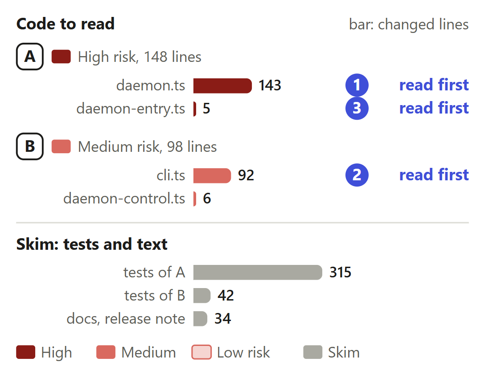
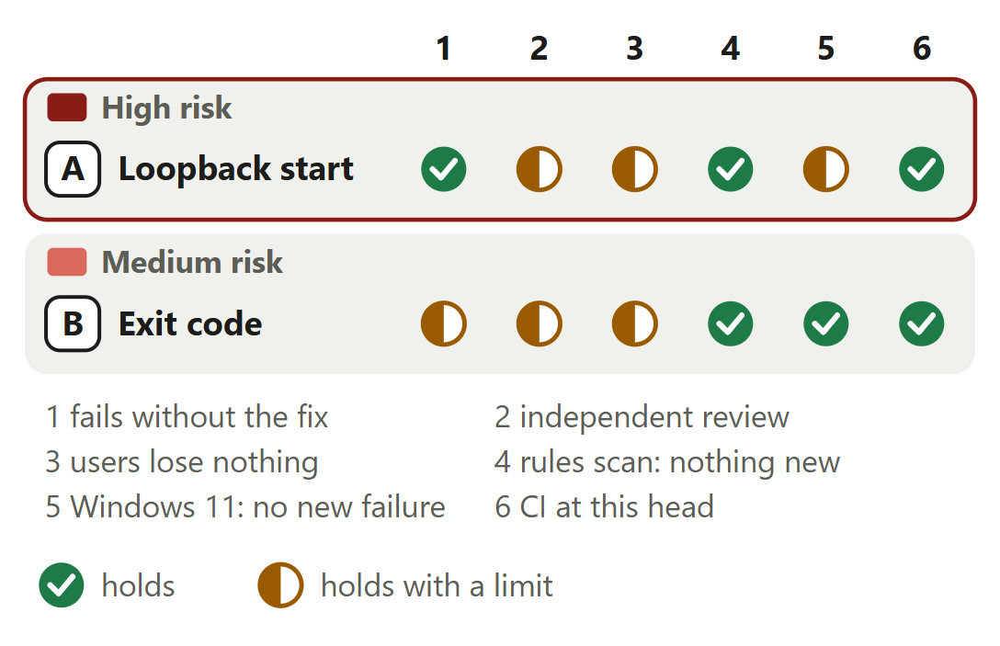

# Daemon: a TLS key others can read stops remote access, not recording

For [pull request #672](https://github.com/neralabs/rerail/pull/672), head e3e22bd70. [report.html](report.html) is the same report as one page: download it and open it.

## 1. The decision

**A TLS key others can read: does the daemon serve this computer alone, fail a remote start, and stop on every other key main refuses?**

1. With a key others can read, the daemon serves this computer alone, over http. **Changes the intent.**
2. The start reads that key once, to tell it from another file.
3. A TLS start on loopback only then exits 0, on http.

**We recommend:** review e3e22bd70, since a code owner ruled on #664 and found the security side holds at 646270e08; this head builds the three conditions and the restart fix, and refactor 11cb52c2a can leave on your word.

| Size | Lane | Waits on | Not verified |
|---|---|---|---|
| 637 lines in 10 files: 246 ship, 391 are tests and text | Careful. A code owner approves. | A code owner. CI passed at e3e22bd70. | 4 |

## 2. Intent, and the gap

| Change | Intended | Found | Now |
|---|---|---|---|
| A. Exposed key | Refuse a key others can read _(threat model, T9)_ | Nothing recorded, autostart off _(issue #664)_ | **CHANGES THE INTENT: ANSWER 1.** Serves this computer alone, over http. A maintainer must agree. |
| A. Which key | Unread is refused too _(code comment)_ | Any refused path fell back _(a code owner's check)_ | Closes the gap, changes answer 2. |
| B. Exit code | A key others can read is refused _(docs)_ | Exit 0, though remote was asked _(a code owner's check)_ | Closes the gap, changes answer 3. |

Issue #664; a code owner's check of 646270e08, 13 November 2026.

Sources at main, and causes

| Change | Where main states the intent | The cause, and what was measured |
|---|---|---|
| A. Exposed key | `docs/threat-model.md` line 643, under T9: "\`rerail daemon start --tls-cert &lt;pem> --tls-key &lt;pem>\` serves HTTPS, and refuses a key file other users could read." `src/daemon/daemon.ts` lines 774 and 775, above `loadDaemonTls`: "a key other users can read lets any of them impersonate the daemon, so a key with any group or other permission is refused". | `runRerailDaemon` calls `loadDaemonTls` before it opens a store or a socket (`src/daemon/daemon.ts` line 851 at main), and the throw ends the process. Under `RERAIL_AUTOSTART=0` no hook starts a daemon. One hand start on Linux x64 at main (a9101752c): exit 1 after 686 ms. On Windows the refusal is new with #503: 0.1.4 served with such a key. |
| A. Which key | `src/daemon/daemon.ts` line 785 at main, a code comment in `loadDaemonTls`: "Unread is refused, as a key others can read is: the daemon would otherwise serve with it unchecked." | At 646270e08 the catch in `loadDaemonTls` made every failed read of who may read the key a `TlsKeyExposedError`, and any path others could read counted as a key. Hand starts on Linux x64: a missing file, a misspelled path, a folder, a file of text, the certificate and a FIFO exit 0 at 646270e08 and exit 1 with main's message at 01138399c. `readPrivateKey` (line 804 at the head) is the read; since e076420d3 `certificateServes` then pairs the key with `--tls-cert`. |
| B. Exit code | `docs/reference.md` line 560 at main: "A key file with any group or other permission bit (such as \`0644\`) is refused; \`chmod 600\` it." `src/cli/cli.ts` line 267 at main: `runDaemonStartCommand` ends `return 0;` once a daemon runs, and at main none runs with such a key. | At 646270e08 `runDaemonStartCommand` returned a literal 0 for the loopback daemon. It counted 13 in the complexity scan, so 11cb52c2a first moves its launch options and dashboard link out, which brings it to 4, and 75d17d6d9 adds `remoteAccessExit`. The test at b8bd0f7e3 fails before that with "expected +0 to be 1" (Linux x64). |

## 3. Where to look

1. **Read first**, 7 min: `daemon.ts`: `loadDaemonTls`, `readPrivateKey`, `certificateServes`, `serveRerailDaemon`, `remoteRefusal`, `serveLoopback`, `loopbackArguments`. Can a remote option, or the key's bytes, reach the loopback daemon or its restart?
2. **Read first**, 4 min: `cli.ts`: `remoteAccessExit`, refactor 11cb52c2a. Does every remote start exit 1, and does the refactor keep each check?
3. **Read first**, 1 min: `daemon-entry.ts`: the one call. Can #657's lock hold both starts from here?
4. 1 min: B: `daemon-control.ts`.

**Then skim**, 4 min: No assertion of main's goes. T9 states the three conditions.

## 4. Risk against verification

Start at A: it decides what other machines reach.

Each half mark's limit

| Change | Check | It holds with this limit |
|---|---|---|
| A. Loopback start | independent review | A code owner checked 646270e08, not this head. The automated reviewer approved e3e22bd70 with no blocker, follow-up or nit. It marks its two nits at 98c2462b6, both in `daemon.ts`, fixed: e076420d3 and 3d3459746 stop a start whose `--tls-cert` would not serve, and e3e22bd70 writes a restart's reason to `daemon.log`. |
| A. Loopback start | users lose nothing | Hand starts on Linux x64 at e3e22bd70: nine kinds of `--tls-key` that main refuses, and seven kinds of `--tls-cert` that would not serve, stop the start with main's exit code and message for that file; a private key serves https. On purpose: the exposed key is read once; a Windows daemon 0.1.4 served to other machines serves this computer alone. |
| A. Loopback start | Windows 11: no new failure | Windows 11 x64 at e3e22bd70: 52 test files passed, 0 failed, none outside main's baseline. The exposed-key case runs through `icacls`; the `Get-Acl` failure is a key in an NTFS stream. Not run there: the two FIFO cases, the hand starts, and a key others read that this account may not, which the test adds only where its read fails. |
| B. Exit code | fails without the fix | Linux x64, 01138399c, a second run from a separate checkout: with `remoteAccessExit` returning 0, with the exit checked only for a daemon this start launched, or with the stderr line removed, the exposed-key CLI case fails. One line has no test: the state reader's check that `remoteRefused` is a string. |
| B. Exit code | independent review | A code owner asked for this exit code in the check of 646270e08 and has not read it. The automated reviewer approved e3e22bd70 with no blocker and no finding in these two files. Commit 11cb52c2a is a refactor inside a fix, which a code owner may want apart. |
| B. Exit code | users lose nothing | A remote start with an exposed key exits 1, as at main, now with a loopback daemon running; a plain start and `rerail status` exit 0. On purpose: a TLS start on loopback only exits 0 on http where main exits 1. In 11cb52c2a the four checks of the start's options run in main's order: one reading, no test. |

<b>5. The changes</b>

**A. Loopback start**, high risk. Exposed key, remote start: no daemon at main, a loopback daemon here.

- **Problem:** A person starts the daemon for other machines with a TLS key other accounts can read. The start exits 1, and under `RERAIL_AUTOSTART=0` no hook starts a daemon, so no session on the computer is checked or recorded.
- **Who meets it:** Whoever starts the daemon themselves for other machines, at every start while others can read the key. On Windows a key under `C:\certs` inherits such an ACL. Source: issue #664. We have no count of these people.
- **What it does:** `loadDaemonTls` throws `TlsKeyExposedError` only for a file this account reads that parses as a private key (`readPrivateKey`) and whose certificate would serve (`certificateServes`). `serveRerailDaemon` catches it, and `serveLoopback` runs the daemon with `loopbackArguments` after it writes those arguments and `--remote-refused` with the reason into `process.argv`. A daemon launched with `--remote-refused` serves loopback from its start. `runRerailDaemon` loses only its `export`.
- **Risk:** High. It decides whether a daemon with an exposed key is reachable from another machine, it reads that key on the refusal path, and it rewrites T9 of the threat model.
- **Check:** `loopbackArguments` must drop every argument that binds off loopback or names a public host; `parseArguments` takes only `--option value`. `--remote-refused` can only narrow: `remoteRefusal` strips it and `serveLoopback` filters the rest again. `readPrivateKey` runs only after `openToOthers` found other readers; its bytes go to `certificateServes` and nowhere else. Any error but `TlsKeyExposedError` still ends the process with exit 1. `certificateServes` throws what an https start throws for that certificate, and never reads a FIFO.
- **Picture:** Time until rerail daemon start answers on Linux x64. Remote start with a key at mode 0644: exit 1 after 686 ms at main, exit 1 after 706 ms here with a loopback daemon running. TLS on loopback only: exit 1 after 691 ms, exit 0 after 697 ms. Missing key file: exit 1 after 675 ms at both.
- **Method:** one hand start per bar on Linux x64, Node 24.21.0, a fresh Rerail home each, at main (a9101752c) and 01138399c. The first and third pairs start with `--host 0.0.0.0 --allow-remote` and the TLS files; the second with the TLS files alone. A second run from a separate checkout, main at c438bc813: 692 ms and 714 ms for the first pair.

**B. Exit code and notice**, medium risk. Holds refactor 11cb52c2a. Loopback TLS start: exit 1 at main, exit 0 here.

- **Problem:** A daemon that serves this computer alone looks like any running daemon. A script or a remote client that asked for other machines must not take the start for started as asked, and a person must learn the key's fix.
- **Who meets it:** The same person, and any script that starts the daemon and reads its exit code. Source: condition 2 of the ruling on issue #664.
- **What it does:** `remoteAccessExit` returns 1 and writes one stderr line when the start had `--allow-remote` or `--public-host` and the daemon it started or found has `remoteRefused`. `printDaemon` prints `loopbackOnlyNotice` for the start and `rerail status`. `DaemonState` gains an optional `remoteRefused`. First, 11cb52c2a moves the launch options and dashboard link into `daemonStartLaunch`, `daemonStartReach` and `printDashboardLink`: 49 lines added, 26 removed, no behaviour change.
- **Risk:** Medium. A wrong exit code tells a script that other machines are served when they are not. The refactor moves the checks of `--host` and of the transport, and must keep their order.
- **Check:** Is exit 1 right while a daemon runs, or a code of its own (the description's decision 2)? Main gives 1 to this command line. `remoteAccessExit` reads `--allow-remote` and `--public-host`; `--host` off loopback needs `--allow-remote`, so it is covered. A TLS start on loopback only exits 0 on http: [ask 3](#9-what-we-ask-of-you). In 11cb52c2a compare the old body with `daemonStartLaunch` and `daemonStartReach`: `assertHostBindable`, `parsePublicHosts`, `parseDaemonTransport`, then `parsePort`, as at main. A reader that does not know `remoteRefused` ignores it.
- **Picture:** Exit codes of rerail daemon start with a key at mode 0644. A start that asked for other machines exits 1 at main with no daemon, and exits 1 here with a loopback daemon running. A TLS start on loopback only exits 1 at main and exits 0 here, on http.
- **Method:** hand starts on Linux x64 at main (a9101752c) and at 01138399c, a key at mode `0644`, one run each. A second run from a separate checkout gave the same exit codes. On Windows 11 the daemon CLI test asserts both of the head's codes.

<b>6. The decisions</b>

**An exposed key: no daemon, or a loopback daemon?** (ask 1)

**We chose** the loopback daemon, on the ruling's three conditions. **Would change our mind:** a route to it from another machine, a forwarder aside.

| Option | What a user gets | Cost | What it breaks |
|---|---|---|---|
| Start again on loopback, without the remote options **(chosen)** | Hooks keep checking and recording. Other machines reach nothing. The key is never served. | A second start attempt in the same process, only on an exposed key: 432 ms at e3e22bd70 against 421 ms at main on Linux x64, one start each. | A remote start exits 1 with a daemon running, so a script must not read exit 1 as no daemon. |
| Refuse to start, as main does | No daemon to reason about. | Nothing. | Under `RERAIL_AUTOSTART=0` nothing on the computer is checked or recorded until the key is fixed. |
| Serve with the key and warn, as 0.1.4 does on Windows | Remote access works. | Nothing. | Any local account that can read the key can pose as the daemon. |

Before: At main a daemon started with --host and a TLS key others can read reaches loadDaemonTls, which refuses the key. The process exits 1, no daemon runs, and nothing is recorded. After: With this change loadDaemonTls finds a private key others can read. The daemon starts again without --host, --public-host, --allow-remote and the TLS files, serves 127.0.0.1 over http and says why. The start that asked for other machines exits 1 while that daemon runs.

**Evidence.** A code owner ruled on #664: serving this computer alone is within #503's intent, on three conditions. The same code owner checked 646270e08: in every fallback case only `127.0.0.1` listens. Measured at 646270e08: every off-loopback IPv4 address refuses the port, 4 on Windows 11 and 11 on Linux x64, and a TLS handshake on loopback fails. `loopbackArguments` is unchanged since. The restart is the one new path, and its test fails without the fix.

**To tell a key from another file: read the exposed key?** (ask 2)

**We chose** one read on the refusal path; nothing keeps, logs or serves it. **Would change our mind:** a way to tell without reading it.

| Option | What a user gets | Cost | What it breaks |
|---|---|---|---|
| Parse the file once, on the refusal path **(chosen)** | A certificate, a file of text, a folder or a FIFO given as the key stops the start, as at main. So does a `--tls-cert` that would not serve with the key. | One read of a key other accounts can already read, and one of the certificate, in the daemon process, before the loopback start. | A code owner listed "the exposed key is never read" among what held at 646270e08. At this head it is read once. |
| Never read it: any regular file others can read falls back | The key's bytes never enter the daemon process. | Nothing. Not built as such: at d93341c02 any regular file others can read fell back, and the start still read it once, to learn that this account can. | A certificate given as the key, or a file of text, starts a loopback daemon. The code owner's check asks that only a file that parses as a key falls back. |

**Evidence.** At the head `readPrivateKey` (`src/daemon/daemon.ts` line 804) runs only when `openToOthers` found other readers and calls `createPrivateKey` on the file's bytes; `certificateServes` pairs them with the certificate and keeps nothing. The loopback start gets `loopbackArguments`, which drop `--tls-key`, and a `--remote-refused` relaunch never calls `loadDaemonTls`. Linux x64 at 01138399c: without the parse the no-key unit case and the CLI case fail, and without the file check the FIFO case times out at 5,000 ms.

**The restart: `--remote-refused`, or an edit to `runRerailDaemon`?**

**We chose** `--remote-refused`: editing `runRerailDaemon`, at complexity 15, is a new finding. **Would change our mind:** a code owner who wants it refactored first.

| Option | What a user gets | Cost | What it breaks |
|---|---|---|---|
| `serveLoopback` rewrites `process.argv` with `--remote-refused` and the reason **(chosen)** | The restart relaunches a loopback daemon that still says why, also after the key is fixed. `runRerailDaemon` keeps main's body. | A daemon argument no person types, and a process that edits its own arguments, as the hook launcher does for a hook. | After a restart the reason, key path included, sits on the daemon's command line, as `--tls-key` did at the first start. Anyone who can launch the daemon can pass it; it only narrows what the daemon serves. |
| Hand the relaunch arguments to `runRerailDaemon` | No argument is rewritten, and the restart's arguments are explicit. | An edit to a function at complexity 15, so a refactor of it first. Not built. | Not run. |

**Evidence.** At main the restart relaunches with `process.argv.slice(1)` (`src/daemon/daemon.ts` line 906). Linux x64: at 74eb6f8c7 the restart test fails, the relaunch arguments holding 12 entries, not 7; at 01138399c it passes there and on Windows 11. A real restart at the heap ceiling, the key made `0600` after the start: `https://0.0.0.0` at 646270e08, `http://127.0.0.1` with `remoteRefused` at 01138399c. `daemon.log` then holds 1 reason line at 98c2462b6, 2 at e3e22bd70. No test passes `--remote-refused` together with remote options.

<b>7. How it fits</b>

It merges clean with main. Refactor 11cb52c2a rides in it. Draft #657 conflicts in two files; the second to merge holds the home's lock around both starts.

Pull request #672 is based on main at a9101752c and merges clean with main at c89f068ed. A code owner ruled on issue #664: yes, with three conditions. Nothing stands on it. It holds two changes and one refactor commit. In a trial merge it conflicts with the draft #657 in two files, and the release #631 removes the release note it rewrites.

**The shared files, by pull request.** #657 (a draft): trial merges of e3e22bd70 with 50705c972 and with its head on 14 November, 2cb75efa0, conflict in `src/cli/daemon-entry.ts`, at the entry's call, and in `src/daemon/daemon.ts`, at `RerailDaemonServices`. Composed at 50705c972 with 01138399c, the entry calls #657's `runHomeDaemon`, which takes the home's lock once and calls `serveRerailDaemon` for both starts: `tsc` and 97 daemon tests pass on Linux x64. #631 (the team's release) removes the release note this branch rewrites; if it merges first, this branch adds an entry of its own. The description's "What and why" names both.

<b>8. What is not covered</b>: 4 not verified, 6 smaller gaps, 8 limits that stay

1. **No code owner** has read e3e22bd70.
2. **Reach from another machine:** measured at 646270e08, not since.
3. **Hand starts:** Linux x64 only.
4. **macOS** never ran.

**Smaller gaps**

- **A forwarder the person runs.** Behind one, the loopback daemon answers plain http, a request naming the public host gets 421, and every route but the page's files needs the access capability. Rerail's clients send it only once the pinned certificate matches, which an http listener never presents.
- **`--remote-refused` with remote options.** No test launches a daemon with both. Read from the code: `remoteRefusal` strips the argument and `serveLoopback` passes the rest through `loopbackArguments`. One unit case would close it.
- **The state reader's check of `remoteRefused`.** At 646270e08, with that line removed, every test passed. The line is unchanged, and no test at the head writes a `daemon.json` whose `remoteRefused` is not a string.
- **The refactor's order of checks.** That 11cb52c2a keeps main's order rests on one reading and on the CLI tests that already start a daemon. No test compares the launch options before and after.
- **A real restart on Windows.** The restart test relaunches through Node's `spawn`. A daemon's own restart there goes through the native launcher, with a reason that holds double quotes. That path did not run.
- **The whole suites.** The whole suites ran only in CI. Outside CI at e3e22bd70: the 49 unit test files and 15 integration files that import a changed module, start a real daemon or run `status`, and on Windows 11 the 49 and three of the 15.

**Limits that stay**

- A forwarder the person runs in front of the port reaches the loopback listener, as it reaches any daemon started with no options.
- A script that reads exit 1 from `rerail daemon start` as no daemon is wrong for an exposed key: the loopback daemon runs. It can read stderr, `rerail status` or `remoteRefused` in `daemon.json`.
- From 0.1.4: a Windows daemon that served other machines with such a key serves this computer alone, and a macOS or Linux start that failed leaves a loopback daemon. To serve them, fix the key and start again.
- The key is checked once, at the start. A key fixed while the daemon runs changes nothing, also across a restart at the heap ceiling, until `rerail daemon stop` and a new start.
- An exposed key costs one more start attempt, one read of the key and one of the certificate: 432 ms at e3e22bd70 against 421 ms at main for the remote start on Linux x64, one start each.
- `runRerailDaemon` stays at complexity 15: this branch removes its `export` and nothing else.
- With an exposed key beside a `--tls-cert` that would not serve, the start exits 1 as at main and names the certificate, where main names the key. The key's refusal shows at the next start.
- A defect of main, not changed here: with a private key and a FIFO as `--tls-cert`, the daemon blocks reading it and `rerail daemon start` gives up after 15 s. This change never reads a FIFO beside an exposed key.

## 9. What we ask of you

Asks 1 to 3 rule on answers 1 to 3.

1. **Does e3e22bd70 meet the three conditions of the ruling on [#664](https://github.com/neralabs/rerail/issues/664)?** We recommend yes: a test fails without each fix.
2. **May the start read an exposed key once, to tell it from another file?** We recommend yes: condition 3 needs it.
3. **Should a loopback-only TLS start, which gets http, exit 0?** We recommend yes: condition 2 names remote starts only.
4. **Should refactor 11cb52c2a be its own pull request first?** We recommend keeping it; it leaves on your word.

<b>10. Evidence</b>

The description's "How you tested it" is the record; one comment answers the code owner's check.

| Where | What ran | Result |
|---|---|---|
| CI on GitHub | Run 43560638959 at e3e22bd70, read on 14 November 2026 | Success at 05:24 UTC, on its first attempt: 18 jobs passed, 3 skipped (the Rust engine and two conformance jobs), none failed. The pull request lists 24 checks: 19 passed and 5 skipped, two of the skipped being jobs that follow an approval. |
| Linux x64 | Each fix at the commit that adds its test, Node 24.21.0; the certificate and `daemon.log` cases over 98c2462b6 | The exposed-key CLI case over main's source fails with the refusal. At 16f501b78 a certificate given as the key starts the daemon ("promise resolved instead of rejecting"). At b8bd0f7e3 the remote start exits 0 ("expected +0 to be 1"). At 74eb6f8c7 the restart's arguments hold 12 entries, not 7. Over 98c2462b6 a misspelled `--tls-cert` starts a loopback daemon, and a restart logs 1 reason line, not 2. |
| Linux x64 | Hand starts at main (a9101752c), at 646270e08 and at 01138399c, a fresh Rerail home each: 11 starts, by `--tls-key`, reach and `--tls-cert`; run again at e3e22bd70 against main at c89f068ed | Exit codes at main, 646270e08, 01138399c. A key at `0644`, remote: 1, 0, and 1 beside a loopback daemon. The same key, TLS on loopback only: 1, 0, 0. Missing, misspelled, in an unreadable directory, a directory, a file of text, the certificate, a FIFO: 1, 0, and 1 with main's message. A key at mode `000`, or no `--tls-cert`: 1, 1, 1. The 01138399c codes hold at e3e22bd70. |
| Linux x64 | Hand starts with a key at `0644` beside eight kinds of `--tls-cert`, on loopback and with `--allow-remote`, at main (a9101752c), 98c2462b6 and e3e22bd70 | Missing, a path through a file, a folder, a file at mode `000`, a file of text, the key itself, another key's certificate: on loopback 1, 0, 1; remote 1, 1 beside a loopback daemon, 1. At e3e22bd70 no daemon runs and stderr is main's for that certificate beside a private key. A FIFO, on loopback: 1, 0, 1 with main's refusal of the key, after 451 ms. |
| Linux x64 and Windows 11 x64 | At e3e22bd70: 49 unit test files and 15 integration files, those that import a changed module, start a real daemon or run `status`; on Windows 11 the 49 and three of the 15, `integration/daemon-cli.test.ts` among them | Linux, unit: 48 files passed, 1 skipped; 1,191 tests passed, 5 skipped, 0 failed. Linux, integration: 14 files passed, 1 skipped; 49 tests passed, 4 skipped, 0 failed, `integration/updater-cli.test.ts` on a second machine after npm failed on the first. Windows 11: 52 files passed; 1,196 tests passed, 22 skipped, 0 failed, none outside main's baseline; `daemon-cli` 8 of 8, `daemon-tls` 13 and 3 POSIX-only skipped. |
| Linux x64, a separate checkout | Each fix removed in turn, eight at 01138399c and two at e3e22bd70, then the two changed test files | At 01138399c eight removals each fail a test: the exit code, the found-running exit, the stderr line, the key parse, the file check (the FIFO case times out at 5,000 ms), the plain error for unread readers, the argument rewrite, the read of `--remote-refused`. At e3e22bd70: the certificate check, and the reason line ("expected 1 to be 2"). Unchanged, the head passes 8 of 8 and 16 of 16. |
| Linux x64 | A real restart at the heap ceiling: at 646270e08 and 01138399c with the key made `0600` after the start, at 98c2462b6 and e3e22bd70 for `daemon.log` | At 646270e08 the next daemon listened at `https://0.0.0.0` with a TLS fingerprint. At 01138399c it listened at `http://127.0.0.1` with `remoteRefused` kept. `daemon.log` held 1 reason line for the 2 daemons at 98c2462b6, and 2 at e3e22bd70. |
| Linux x64 | The automated reviewer's complexity scan, main against 01138399c, and again over the diff at e3e22bd70; a trial composition of 01138399c with #657 at 50705c972 | Scan: 12 functions over the ceiling at main, 11 at the head, 0 new; `runDaemonStartCommand` goes from 13 to 4; at e3e22bd70 no new finding. Composition: `tsc` exits 0, the build exits 0, and 97 daemon tests pass; not run again at e3e22bd70. |

**What this report adds to the description**

- **`--remote-refused` with remote options.** The description says the restart comes back on loopback. Read at the head: a daemon launched with `--remote-refused` and `--host 0.0.0.0` together also serves loopback, since `serveLoopback` filters its arguments through `loopbackArguments`. No test launches that pair.
- **What runs before the refusal.** Read at the head: before `loadDaemonTls`, `runRerailDaemon` parses its arguments and calls `searchGitFrom` with the workspace root (`src/daemon/daemon.ts` lines 957 to 962). Between the refusal and the second start the process writes one line to stderr and rewrites `process.argv`. The second start parses and searches again, and opens everything else for the first time.
- **The refactor's order of checks.** Read in 11cb52c2a: `assertHostBindable`, `parsePublicHosts`, `parseDaemonTransport`, then `parsePort` run in main's order. The launch object's keys change order, `port` and `cwd` now after the transport; `daemonArguments` reads each by name.
- **Four asks.** The description's "For the maintainers to decide" asks no new ruling and points here for the four points the review settles. This report puts them as asks: whether e3e22bd70 meets the three conditions, the one read of the exposed key, exit 0 for a loopback-only TLS start, and whether refactor 11cb52c2a leaves as its own pull request. The comment on the pull request asks only the last.

**Sources.** Pull request #672, its diff, a code owner's comment, the three automated reviews and its CI, and issue #664 with its ruling, read on GitHub on 14 November 2026 at about 05:30 UTC. Rerail at main (c89f068ed) for each quoted intent. The run records of the change for the measurements, each with the commit it ran at.

