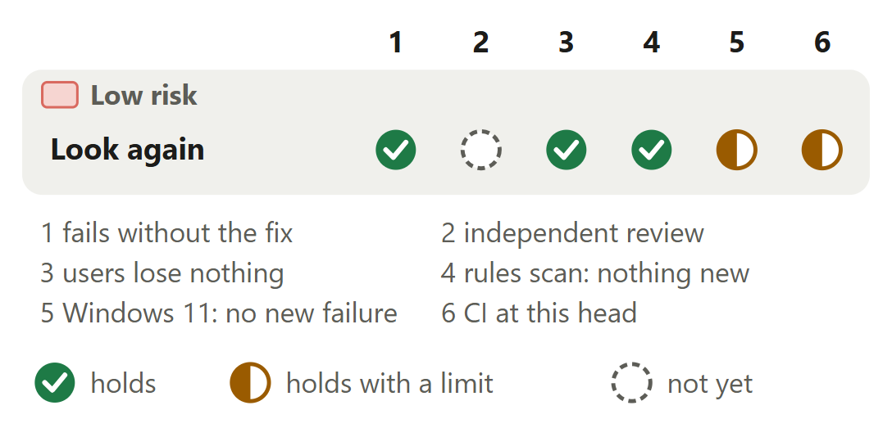

# A folder removed while a turn ends is no place left unchecked

For [pull request #1064](https://github.com/neralabs/rerail/pull/1064), head 24fd6bc491. [report.html](report.html) is the same report as one page: download it and open it.

## 1. The decision

**May the checkout lookup take a path whose real path failed for gone when a look right after finds nothing there, whatever the code?**

**We recommend:** approve it: on Windows a folder removed as its real path is read answers EBADF, and every such path in 77,000 calls on Windows 11 was gone at the second look.

| Size | Risk and review | Waits on | Not verified |
|---|---|---|---|
| 108 lines in 5 files: 44 ship, 64 are tests and text | Standard. One lookup and one walk test; no setting or format. | Nothing. No CI run here yet: the branch is not pushed. | 2 |

## 2. Intent, and the gap

| Change | Intended | Found | Now |
|---|---|---|---|
| Removed folders: no gap | A folder being removed is no gap _(docs)_ | EBADF recorded as a place unchecked _(CI run on Windows)_ | Closes the gap. |
| Real failures stay recorded | A place unread is recorded _(docs)_ | EBADF taken for a removal _(our reading)_ | Closes the gap. |

Found on 24 November 2026, when the repository's case of 30 turn ends beside a churning process failed on GitHub's Windows runner.

Sources at main, and causes

| Change | Where main states the intent | The cause, and what was measured |
|---|---|---|
| Removed folders: no gap | `docs/in-session-surfaces.md` at be0def9c35. `physicalPath` in `src/engine/catalog/checkout-control.ts` took a part gone only on ENOENT (`REFUSED_OR_GONE`), and threw every other code. | On Windows the native realpath of a folder removed as it reads answers EBADF when the removal lands between its open of the folder and its read of the final path. `physicalPath` threw it, and a lookup the turn end makes outside the walk's own handling of a removed path failed the walk whole. On Windows 11: 112 EBADF in 77,000 lookups, all gone at the second look. |
| Real failures stay recorded | `docs/in-session-surfaces.md` at be0def9c35. `vanished` in `src/engine/code-rule/code-rule-bridge.ts` took any EBADF from a realpath for a removal, so a path still there that failed so was never recorded. | The walk's own test for a removed path held a code, EBADF from a realpath, in place of the fact; with the lookup answering for a gone path itself, that code now comes only from a path still there. |

## 3. Where to look

1. **Read first**, 5 min: `checkout-control.ts`: `resolvedUnlessRefused` and `entryNow`. Should a path still there that answers ENOENT keep resolving below its folder, as at `main`?
2. 2 min: `code-rule-bridge.ts`: `vanished`.

**Then skim**, 3 min: The lookup's two cases inject the native realpath: one removes the folder then fails, one fails while it stays. The bridge's case injects the walk view.

## 4. Risk against verification

One change, low risk: read the lookup first, where the look after a failure decides what is gone.

Each limit, and each check that does not hold yet

| Change | Check | Its limit, or why it does not hold yet |
|---|---|---|
| Look again | independent review | No second reader has reviewed this head yet. |
| Look again | Windows 11: no new failure | Windows 11: the case of 30 turn ends passes 30 of 30 runs here. At `main` it passed 15 of 15 as written and failed 1 of 15 with 120 turn ends. The changed test files' 30 runs here have not finished. |
| Look again | CI at this head | No CI run here yet: the branch is not pushed. |

## 5. The changes

**Tell a removed path by looking**, low risk: Windows 11, 77,000 lookups of churned folders: 112 threw EBADF at `main`; all 112 were gone when looked at again.

<b>6. The decisions</b>

**Tell a removed path by its error code, or by a look after?**

**We chose** a look after the failure: a code says what the call met, not whether the path is still there. **Would change our mind:** A path that `lstat` finds gone while a realpath still resolves it a moment later.

| Option | What a user gets | Cost | What it breaks |
|---|---|---|---|
| Look again after any failed realpath; gone then is gone **(chosen)** | A folder removed as it is read resolves below its folder whatever the code; a path still there keeps its failure. | One `lstat` after a failed realpath, which only a refused or vanishing path pays. | Nothing that works at `main`. |
| Add EBADF to the codes taken for gone | The same for the cases seen so far. | Nothing. | An EBADF from a path still there is taken for a removal and never recorded, and the next code Windows gives a vanishing path needs its own line. |

**Evidence.** On Windows 11, two processes making and removing 200 folders for 150 s: four realpath calls answered EBADF 643 times in 308,000, every path gone at the look after; lstat, opendir, readdir, open and access never answered EBADF.

**Keep the walk's own EBADF test beside the lookup's look?**

**We chose** drop it: the lookup answers for a gone path itself, and the walk's test hid a present path's failure. **Would change our mind:** Another call in the walk that answers EBADF for a removed path without going through the lookup.

| Option | What a user gets | Cost | What it breaks |
|---|---|---|---|
| Drop the walk's EBADF arm **(chosen)** | One rule for a removed path, in the lookup; a present path's EBADF is recorded. | Nothing. | Nothing: the walk's own calls never answered EBADF in the loop. |
| Keep it | The same for removed paths. | The rule written twice. | An EBADF from a path still there goes unrecorded. |

**Evidence.** The walk's realpath calls all go through the owner lookup (`physicalPath`); its own `lstat`, `opendir` and reads answered ENOENT or EPERM in the loop, never EBADF.

<b>7. How it fits</b>

Nothing has to merge first: the branch holds `main` 4c49132c6e by a merge Git made alone. No open pull request of ours edits `resolvedUnlessRefused` or `vanished`.

<b>8. What is not covered</b>: 2 not verified, 1 limit that stays

1. **macOS** Not run: no machine of ours runs it. The change has no platform arm.
2. **A tool's own read** A tool call's read of a file it names takes only ENOENT for deleted; a file removed as its real path is read would be a read error.

**Limits that stay**

- The repository audit's own walk records any failure of a path, ENOENT included, as a source it could not read, as at `main`.

## 9. What we ask of you

We ask no ruling.

<b>10. Evidence</b>

The description's "How you tested it" holds every run; "What is not covered" holds the limits.

| Where | What ran | Result |
|---|---|---|
| Windows 11 | Two processes making and removing 200 folders for 150 s, each call asked of each folder | Realpath after `existsSync`: 112 EBADF in 77,000, all gone at the look after. |
| Linux x64 | The two test files at `main` with the new cases | The lookup case throws EBADF; the bridge case records nothing. |
| Linux x64 | Two mutants of the lookup's link test | Each fails a case. |
| Windows 11 | The case of 30 turn ends beside a churning process, at this head | 30 of 30 runs passed; at `main`, 1 of 15 runs with 120 turn ends failed with the record. |
| Linux x64 | CI's lint and type-check job | The release-note check, `npm run check`, `check:ui-tokens` and `check:reference` pass. |

**Sources.** The change's one commit, c7a4bcd527, made on `main` be0def9c35 (the head, 24fd6bc491, adds Git's own merge of `main` 4c49132c6e), and its diff against `main`; a loop of calls on a Windows 11 test machine; the failed CI run on GitHub's Windows runner.

