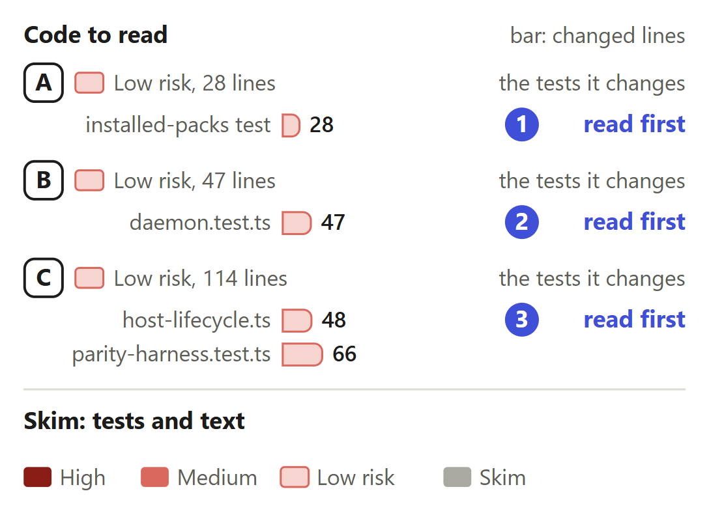
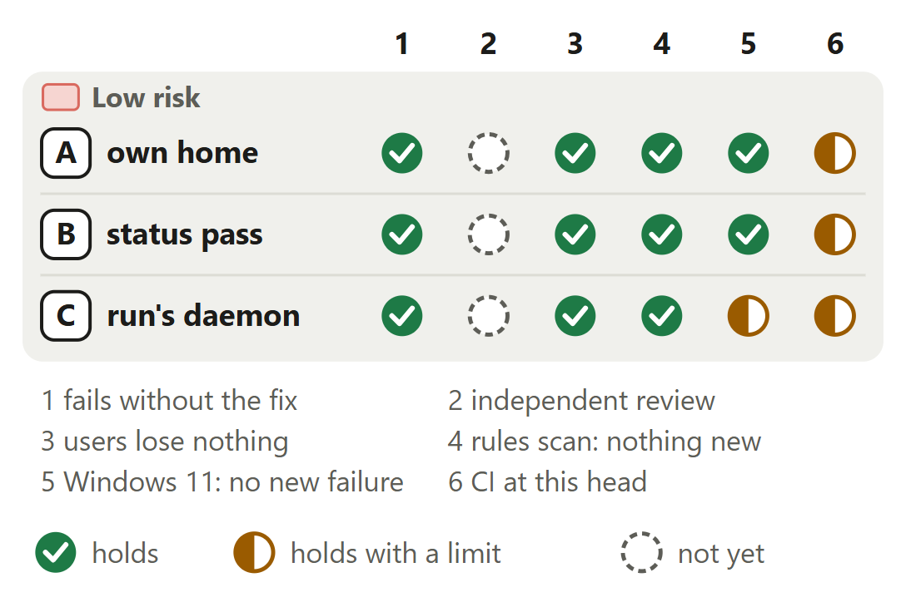

# Two cases decide by facts; the lifecycle run stops its daemon

For [pull request #1217](https://github.com/neralabs/rerail/pull/1217), head 3fe1ce6f10. [report.html](report.html) is the same report as one page: download it and open it.

## 1. The decision

**May three small fixes land together: two test cases that fail by chance, and a developer's script that leaves a daemon?**

**We recommend:** approve it: no line of product source changes, and no user meets any of the three through Rerail.

| Size | Risk and review | Waits on | Not verified |
|---|---|---|---|
| 189 lines in 4 files: 0 ship, 189 are the tests it changes, 0 are other tests and text | Fast. No high-risk path; no product source. | Nothing. CI on GitHub runs at this head. | 3 |

## 2. Intent, and the gap

| Change | Intended | Found | Now |
|---|---|---|---|
| A. The installed-pack cases | Each case reads its own pack _(a test's name)_ | One clock tick gave the old one _(CI run, #1211)_ | Closes the gap. |
| B. The status line case | The file goes when the session closes _(a test's name)_ | A 10 s wait missed the pass _(CI run, #1211)_ | Closes the gap. |
| C. The lifecycle run | A run leaves nothing behind _(code comment)_ | Each run left a daemon _(Linux runs, #1212)_ | Closes the gap. |

Found on 28 November 2026: two CI failures with nothing wrong, and runs on a Linux x64 machine (#1211, #1212).

Sources at main, and causes

| Change | Where main states the intent | The cause, and what was measured |
|---|---|---|
| A. The installed-pack cases | `test/engine/catalog/installed-packs.test.ts:219` at `main` 4e22417229: each case links its own broken copy of the complexity pack at one install path; `installedStamp` (`src/engine/catalog/rule-catalog.ts:479`) holds that path and its files' times and sizes. | Both cases link a copy of one pack at one path; their stamped files have one size, and two writes within a 4 ms file clock tick have one time, so the stamp is equal and the kept catalog comes back. |
| B. The status line case | `test/daemon/daemon.test.ts:408` at `main` 4e22417229; `PACE = 10` in `src/presentation/claude-status-files.ts:58`. | After each pass the keeper rests ten times as long as the pass took, so a 1 s pass on a loaded machine puts the removal 11 s after the close. |
| C. The lifecycle run | `scripts/host/host-lifecycle.ts:10` and `main()` at line 457 at `main` 4e22417229: the run removes `workspace.root` in `finally`. | The OMP session's attach starts a daemon in the run's Rerail home, and nothing stopped it before the removal. |

## 3. Where to look

1. **Read first**, 2 min: `installed-packs.test.ts`: `installBroken` and the relational rule case. Does every case that links a copy of one pack at one install path read a home of its own?
2. **Read first**, 3 min: `daemon.test.ts`: `statusKeeper` and the two status line cases. Does each awaited pass start after the change it reads, and is the steer's wait the only clock left?
3. **Read first**, 2 min: `host-lifecycle.ts`: `leave`, `stopRunDaemon`, `main`. Does a stop that fails leave the run's error and report, and does Pi's run stop nothing?
4. 1 min: `parity-harness.test.ts`: the lifecycle run's end.

**Then skim**, 1 min: Nothing more: the change has no product source and no release note.

## 4. Risk against verification

Three changes, all low risk and none in product source: start at A, the case the issue names.

Each limit, and each check that does not hold yet

| Change | Check | Its limit, or why it does not hold yet |
|---|---|---|
| A. own home | independent review | No review by a second reader has read this head yet. |
| B. status pass | independent review | No review by a second reader has read this head yet. |
| C. run's daemon | independent review | No review by a second reader has read this head yet. |
| C. run's daemon | Windows 11: no new failure | Windows read, not run: there a daemon left running holds the home open, so the removal fails and the run ends with that error. |
| A to C | CI at this head | CI on GitHub runs at this head; its real-session job is the only run of the changed script with a model. |

<b>5. The changes</b>

**A. Pack cases get their own homes**, low risk. Under one clock tick, `main`'s test gave 3 of 33 cases the case before's catalog; now 0.

- **Problem:** A pull request's CI could fail with nothing wrong: an installed-pack case read the skipped reason the case before it expects.
- **Who meets it:** A pull request's CI: `installed-packs.test.ts` failed 1 of 30 runs of its file on a Linux x64 machine with 4 workers (#1211).
- **What it does:** `installBroken` installs `valid` and the broken copy into a Rerail home of the case's own and returns it; each case reads that home's catalog. The relational rule case does the same. The home is the first part of the catalog's stamp, so two cases' stamps differ whatever their files' times.
- **Risk:** Low: test code only; the catalog and its stamp are `main`'s.
- **Check:** That every case linking a copy of one pack at one install path now has a home of its own, that the stand-in fails `main`'s cases and not these, and that the cases still check Rerail's own package name.
- **Picture:** With every link's stamped files given one time, main's installed-pack test file failed 3 of 33 cases on Linux x64 and on Windows 11 x64; this test file failed 0 of 33 on both.
- **Method:** A test-only patch wraps the file's install helper so that after each link the record of installed packs and the linked folder's `package.json` and `pack.json` take one time; applied to `main`'s test file and to this one, one run each system.

**B. Status line cases await the pass**, low risk. A 1 s pass put the next one 11 s later; each step now awaits a pass.

- **Problem:** The status line case could fail on a loaded machine: the closed session's file was still there when its 10 s wait gave up.
- **Who meets it:** A pull request's CI: once on a Windows 11 machine running a second test run, 1 of 790 cases of that run.
- **What it does:** The two status line cases hold their keeper (`statusKeeper`) and await `refresh()` before reading the file; the steer's step waits within the case's bound.
- **Risk:** Low: test code only; the product's keeper is unchanged.
- **Check:** That each awaited pass starts after the change it reads, and that the steer's step still proves the keeper's own check.
- **Picture:** With each status line draw held 1.1 s from the steer on, main's case fails at the close on Linux x64 and on Windows 11, and this case passes on both.
- **Method:** A test-only patch holds the stores' `dashboardOrigin` 1.1 s a draw from the steer on, applied to `main`'s case and to this one, one run each system, at the third commit, whose test file this head keeps.

**C. The lifecycle run stops its daemon**, low risk. 3 of 3 runs left a daemon; with the stop, 0 of 3.

- **Problem:** Each `npm run test:e2e:lifecycle` run left the OMP session's daemon running in the folder the run removed, out of reach of `rerail daemon stop`.
- **Who meets it:** A developer who runs the lifecycle run: 3 of 3 runs, each about 318 MB at its start.
- **What it does:** `leave` stops the daemon in `<project>/.rerail-home` with `stopDaemon` before the removal, on every way out of `main()`; a stop that throws goes to stderr, and a kept run's line says what the stop did.
- **Risk:** Low: a development script; Pi's run is unchanged.
- **Check:** That a stop that fails keeps the run's own error or report, and that Pi's run stops nothing.
- **Picture:** Three lifecycle runs on Linux x64 with the pinned OMP host and no provider key: main's script left 3 daemons running 30 s later; this one left 0.
- **Method:** Three runs of each script with the pinned OMP host and no provider key or model, processes counted by their Rerail home at once and 30 s later, on Linux x64, at the third commit and again at this head.

<b>6. The decisions</b>

**Give each case its own home, or put each pack's real path in the stamp?**

**We chose** the test: only its own install helper links two copies at one path within one clock tick. **Would change our mind:** A person who relinks pack folders by hand and meets the old rules.

| Option | What a user gets | Cost | What it breaks |
|---|---|---|---|
| Each case installs into a Rerail home of its own **(chosen)** | Rerail as on `main`; CI stops failing by chance. | Nothing at run time. | A folder relinked by hand within the same file times still reads the old catalog, as on `main`. |
| The real path of each pack's folder in the stamp | A relinked folder is read again at the next lookup, by a test or by a person. | One real path a pack at every lookup: about 75 us more on Linux x64 and 344 us on Windows 11 with five packs. | Nothing found. |
| Each case installs under a package name of its own | The test stops failing. | Nothing at run time. | The cases check Rerail's own package name and its reasons, so another name changes what they test. |

**Evidence.** With five packs, a lookup that finds nothing changed took 77 to 82 us of CPU at `main` and 152 to 165 us with the real paths on Linux x64; on Windows 11 the real paths took 344 of a lookup's 1,243 us. The daemon looks the catalog up at each status line draw and dashboard read. `rerail packs add` goes through npm, which rewrites `node_modules/.package-lock.json`, in the stamp.

**Await the keeper's pass at the steer too, or keep a wait there?**

**We chose** a wait within the case's bound: that step proves the keeper's own check, which `refresh()` would replace. **Would change our mind:** A hook in the keeper that says when its own check ran a pass.

| Option | What a user gets | Cost | What it breaks |
|---|---|---|---|
| A wait within the case's bound at the steer **(chosen)** | The keeper's own check stays covered; no other test covers it. | A missing draw fails at 50 s, not 10 s. | Nothing found. |
| Await `refresh()` at the steer too | No clock left in the case. | One line. | The case no longer shows that a change reaches the file with nothing asking for it. |
| Keep the 10 s wait at the steer | Nothing changes there. | Nothing. | A 1 s pass before the steer fails the case at that step, one step before the old failure. |

**Evidence.** Every case of `claude-status-files.test.ts` runs the keeper with its checks off, so the steer's step is the one place its own check runs. With draws held 1.1 s from the steer on, this case passes on Linux x64 and Windows 11.

<b>7. How it fits</b>

Nothing has to merge first: six commits on `main` 4e22417229; the fourth undoes the first's catalog change, so no product source changes. The draft #1197 edits `test/scripts/parity-harness.test.ts` too, and Git cannot merge the two there: the second to land keeps both sets of imports and cases.

This change stands on main 4e22417229, which holds #1209. Git merges it alone with main and with each of our open pull requests. The draft #1197 edits one of its test files too, and Git cannot merge the two there: the second to land keeps both sets of imports and cases.

<b>8. What is not covered</b>: 3 not verified, 1 smaller gap, 1 limit that stays

1. **The real-session job** runs the changed script with a model and provider keys; only GitHub's CI on this pull request runs it.
2. **Windows, change C** read, not run: the removal fails there while a daemon holds the home, which the stop prevents; after a stop that fails, it fails as on `main`.
3. **macOS** never ran.

**Smaller gaps**

- **A pack folder relinked by hand** at one install path within the same file times still reads the old catalog until another change, as on `main`; Rerail's own commands do not make it.

**Limits that stay**

- Two 4 s timer races in `daemon.test.ts` stay: each already awaits the daemon's own report of its check, and the timer only bounds a missing check under the case's 5 s limit on Linux.

## 9. What we ask of you

We ask no ruling.

<b>10. Evidence</b>

The description on GitHub is the record: "How you tested it" holds the runs.

| Where | What ran | Result |
|---|---|---|
| Linux x64, Windows 11 | `main`'s installed-pack test file and this one, every link's stamped files given one time | `main`'s failed 3 of 33 cases on both systems, the issue's failure among them; this one passed 33 of 33 on both. |
| Linux x64, Windows 11 | `main`'s status line case and this one, each draw held 1.1 s from the steer on | `main` failed at the close on both systems; this case passed on both. |
| Linux x64 | Three lifecycle runs with the pinned OMP host and no provider key, `main`'s script and this one | `main`'s left 3 of 3 daemons, about 318 MB each; this one left 0 of 3, and a kept run left none. |
| Linux x64 | The lifecycle run's end with a stop that throws or gives each answer | The run's own error or evidence stands, the project goes, and each kept line says what the stop did; each case fails at 040dcb8381 but the one whose line was already true. |
| Linux x64, Windows 11 | Each changed test file, 30 rounds beside its CI shard neighbours | 30 of 30 for each. |
| Linux x64, Windows 11 | The two test files that import the lifecycle script, at this head, at 040dcb8381 and over `main` | Both pass on both systems. |

**Sources.** The branch at 3fe1ce6f10 and its diff against `main` 4e22417229, read on 28 November 2026; runs on Linux x64 and Windows 11 x64 machines.

