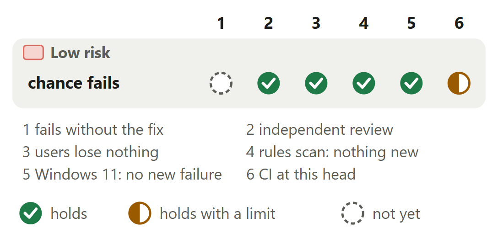

# Two test cases no longer fail by chance

For [pull request #1109](https://github.com/neralabs/rerail/pull/1109), head 2d9557c24f. [report.html](report.html) is the same report as one page: download it and open it.

## 1. The decision

**May two test fixes for cases `main`'s CI failed by chance at b36d166291 land together?**

**We recommend:** approve it: test code only; the idle close's cases wait for a walk's look itself, and two `.rerail` rule cases end their turn once the session's code rules run.

| Size | Risk and review | Waits on | Not verified |
|---|---|---|---|
| 76 lines in 2 files: 0 ship, 76 are the tests it changes, 0 are other tests and text | Fast. Two test files, no product code. | Nothing. CI on GitHub runs at this head. | 3 |

## 2. Intent, and the gap

| Change | Intended | Found | Now |
|---|---|---|---|
| The idle close's cases | A case waits for the walk's look _(a test's name)_ | It waited one second of the clock _(CI run, #1106)_ | Closes the gap. |
| The `.rerail` rule cases | A turn's end starts the rule's run _(a test's name)_ | The turn ended before rules opened _(CI run, #1107)_ | Closes the gap. |

Found on 25 November 2026: `main`'s own CI failed two jobs at a commit that changes only the changelog (#1106, #1107).

Sources at main, and causes

| Change | Where main states the intent | The cause, and what was measured |
|---|---|---|
| The idle close's cases | `test/runtime/engine-service/engine-service-runtimes.test.ts:1505` at `main` b36d166291; the recording evaluator `recordingAuditor` and its `looked` set. | `vi.waitFor` with no options gives up after 1,000 ms, and the session's first walk runs after its start is answered: on a busy Windows runner it came later. |
| The `.rerail` rule cases | `integration/rerail-pack-rules.test.ts:168` at `main` b36d166291; `docs/in-session-surfaces.md` on a first start's hooks while code rules open. | The case wrote and ended its turn before the session's code rules had opened; a first start answers that turn end without them, so no run started, and the case sent no later hook. |

## 3. Where to look

1. **Read first**, 4 min: `engine-service-runtimes.test.ts`: `recordingAuditor`, `lookedAt` and `scanBegun`. Does each wait now settle at the look or scan itself, also when the look came before the case asked?
2. 2 min: `rerail-pack-rules.test.ts`: the first two cases.

**Then skim**, 1 min: Nothing else changes.

## 4. Risk against verification

One change, low risk: two test files; the product and every assertion of the cases are as they were.

Each limit, and each check that does not hold yet

| Change | Check | Its limit, or why it does not hold yet |
|---|---|---|
| chance fails | fails without the fix | `main`'s CI failed each case once at b36d166291. With a 1.5 s late look, `main`'s file fails three cases in each of two runs on Windows 11 and this one passes; with the rules' open delayed 5 s on Linux x64, `main`'s case fails 3 of 3 and this one passes 3 of 3. |
| chance fails | CI at this head | CI on GitHub runs at this head; each of the two cases failed a job of `main` on 25 November. |

## 5. The changes

**Two cases wait for their facts**, low risk: `main`'s CI gave a walk one second to look, and ended a turn before the rules had opened.

<b>6. The decisions</b>

**Wait for the walk's look by a promise, or give `vi.waitFor` a longer time?**

**We chose** a promise the recording evaluator settles at the look: the case waits for the fact, with no clock. **Would change our mind:** A walk that may never look at the file in a passing run, where a bound would be the case's subject.

| Option | What a user gets | Cost | What it breaks |
|---|---|---|---|
| A promise settled at the look **(chosen)** | The case waits exactly as long as the walk takes. | A missing look fails at the case's own time limit, later than before. | Nothing found. |
| A longer `vi.waitFor` timeout | Passes the run that failed. | One number. | A wait in place of a fact: a slower runner fails it again. |
| Await the walk's end from the engine service | The same fact. | A promise added to product code for a test. | Nothing, but the service exposes none today. |

**Evidence.** With a test-only delay of 1.5 s on the record of each look, `main`'s file fails the three look cases in each of two runs on Windows 11 with the message of `main`'s CI, and this file passes all four.

**The two cases wait for the code rules, or the product changes?**

**We chose** the cases wait: a first start answers hooks without code rules on purpose, and the first pass checks the edits. **Would change our mind:** A person who loses a check in that window, rather than getting it a turn later.

| Option | What a user gets | Cost | What it breaks |
|---|---|---|---|
| The cases wait for the code rules **(chosen)** | The turn's end starts the run the case reads. | One call in each of two cases, the helper the deadline case uses. | Nothing found. |
| Check the turn's edits when the rules open | A first turn's steers sooner, in use too. | A product change to how a first start's turn end is taken up. | Not known: it is not what these cases test. |

**Evidence.** With the session's evaluator open delayed 5 s on Linux x64, `main`'s case fails 3 of 3 with a pending event for the turn's end and no audit 40 s later; with this change it passes 3 of 3. Without the delay it passed 60 of 60 at `main`: the window is rare.

<b>7. How it fits</b>

Nothing has to merge first: three commits on two test files; the branch holds today's `main` by a merge Git made alone. No open pull request edits either file; once on `main`, neither case fails a job by its runner's load.

<b>8. What is not covered</b>: 3 not verified, 1 limit that stays

1. **macOS** never ran.
2. **One guard no run met** a look that came before the case asked settles at once; in every case the ask comes first, so no run shows that line deciding.
3. **The other waits** three waits of the file that are not for a walk, a look or a scan keep `vi.waitFor`; they are named in the description.

**Limits that stay**

- The product's choice to answer a first start's turn end without code rules stays; a first turn's edits are checked at the session's next hook.

## 9. What we ask of you

We ask no ruling.

<b>10. Evidence</b>

The description on GitHub is the record: "How you tested it" holds the runs.

| Where | What ran | Result |
|---|---|---|
| Windows 11 | `main`'s unit file and this one with a 1.5 s late record of each look, two runs each | `main` failed three look cases in each run; this file passed all four in both. |
| Linux x64 | The first `.rerail` case with the rules' open delayed 5 s, at `main` and here | `main` failed 3 of 3; this change passed 3 of 3. Both changed cases together: 2 of 2 failed at `main`, 2 of 2 passed here. |
| Linux x64, Windows | The unit file, 30 rounds on each of GitHub's runners in our fork, at this head | 30 of 30 on each, 69 cases a round. |
| Linux x64, Windows 11 | The integration file, 30 rounds on each system on our machines, at the change's last commit | 30 of 30 on each. |

**Sources.** The branch at 2d9557c24f and its diff against `main` 80cfc21dec, read on 25 November 2026; `main`'s CI logs at b36d166291; runs on a Windows 11 x64 machine, a Linux x64 machine and GitHub's runners in our fork.

