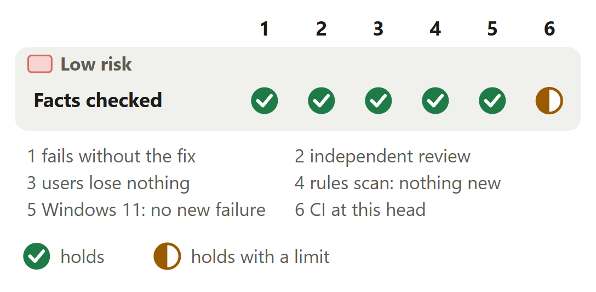

# Two test follow-ups: the idle close and the dropped answer

For [pull request #958](https://github.com/neralabs/rerail/pull/958), head 835a21ac8. [report.html](report.html) is the same report as one page: download it and open it.

## 1. The decision

**May the close-and-restart case check that the idle close took effect, and the mixed case check what the answer its hook never read carried?**

**We recommend:** approve both: each now fails when the product line it names breaks, where at `main` it passed, and each passed 10 of 10 runs on Linux x64.

| Size | Risk and review | Waits on | Not verified |
|---|---|---|---|
| 38 lines in 1 file: 0 ship, 38 are the tests it changes, 0 are other tests and text | Fast. Two test cases, no product code. | Nothing. No CI run on GitHub yet: not pushed. | 1 |

## 2. Intent, and the gap

| Change | Intended | Found | Now |
|---|---|---|---|
| Through its next close | The close keeps the steer _(test name)_ | The close was not checked _(review)_ | Closes the gap. |
| Both in the answer | The answer took both _(test name)_ | Only the next prompt was checked _(review)_ | Closes the gap. |

Found on 20 November 2026 by the reviewer of #894, as its two nits.

Sources at main, and causes

| Change | Where main states the intent | The cause, and what was measured |
|---|---|---|
| Through its next close | `test/runtime/engine-service/engine-service-unheard-answers.test.ts` at d54b586a8, the case at line 151. | With the default idle runtime time the runtime stays open after the close, and the case asserted only after the restart. |
| Both in the answer | `test/runtime/engine-service/engine-service-unheard-answers.test.ts` at d54b586a8, the case at line 164. | The case asserted only `prompt-3`'s steers and the delivery counts. |

## 3. Where to look

1. **Read first**, 4 min: `engine-service-unheard-answers.test.ts`: the cases "through its next close and a restart" and "the owed one first". Do `openRuntimes()` at 0 and the decoded body of the dropped answer show what each case names?

**Then skim**, 1 min: `owingService` takes `{ owed, idleRuntimeMs }`; `atItsAnswer` hands its action the body it writes.

## 4. Risk against verification

One change, low risk: two test cases of one file; the product is as it was.

Each half mark's limit

| Change | Check | It holds with this limit |
|---|---|---|
| Facts checked | CI at this head | No CI run at this head on GitHub yet: the branch is not pushed. |

## 5. The changes

**Two cases check their facts**, low risk: Linux x64: with the line each names changed, each case failed 3 of 3 runs, where main's passed.

<b>6. The decisions</b>

**How does the close case show that the idle close took effect?**

**We chose** it runs with no idle runtime time and counts the open runtimes after the close. **Would change our mind:** A maintainer who wants the close checked with its rules already open, the reviewer's other suggestion.

| Option | What a user gets | Cost | What it breaks |
|---|---|---|---|
| `idleRuntimeMs: 0` and `openRuntimes()` after the close **(chosen)** | A failure when the close of a session whose rules still open is skipped. | The session opens again in a new runtime, as in a daemon after 15 minutes. | Nothing. |
| Resolve the rules before the close | A close of a session whose rules are open. | None. | The case named, a close while the rules still open. |

**Evidence.** On Linux x64 the case passed 10 of 10 runs alone; with the close skipped it failed 3 of 3, where main's case passed 3 of 3.

**How does the mixed case read the answer its hook never read?**

**We chose** `atItsAnswer` hands its action the body the server writes. **Would change our mind:** A maintainer who wants a hook that reads its answer instead.

| Option | What a user gets | Cost | What it breaks |
|---|---|---|---|
| The body at the write **(chosen)** | The answer as the server writes it, before the hook goes. | One argument the other callers ignore. | Nothing. |
| A hook that reads and then goes | The same steers. | None. | The answer would reach its hook, which is not the case under test. |

**Evidence.** On Linux x64 the case passed 10 of 10 runs alone; with the found steer left out it failed 3 of 3, where main's case passed 3 of 3.

<b>7. How it fits</b>

Nothing has to merge first: one commit on `main` d54b586a8. It edits two cases and two helpers of `engine-service-unheard-answers.test.ts`.

The pull request stands on main at d54b586a8; nothing else has to merge first, and nothing waits on it.

<b>8. What is not covered</b>: 1 not verified, 2 limits that stay

1. **macOS** never ran.

**Limits that stay**

- The product lines were changed in throwaway copies, 3 runs each; no other line was tried.
- A turn end that does not wait for its checks leaves the mixed case passing: the case lets the check finish as soon as it starts.

## 9. What we ask of you

We ask no ruling.

<b>10. Evidence</b>

The description on GitHub is the record: "How you tested it" holds the runs here and with `main`'s copy of each case.

| Where | What ran | Result |
|---|---|---|
| Linux x64 | The file whole once, each changed case alone 10 runs, and `tsc --noEmit`, at this head | 15 passed; 10 of 10 for each case; the type check passed. |
| Linux x64 | The close case with line 2472 of `src/runtime/runtime.ts` skipping a session whose rules still open, here and with main's copy | Here 3 of 3 failed at the new check; main's 3 of 3 passed. |
| Linux x64 | The mixed case with line 1372 taking only the owed steers into a turn end's answer, here and with main's copy | Here 3 of 3 failed at the new check; main's 3 of 3 passed. |
| Windows 11 | The file whole once at this head | the whole file passed once, 15 passed, with the engine built for this head's native tree. |

**Sources.** The branch at b28f395bf and its diff against `main` d54b586a8, read on 20 November 2026; runs at b28f395bf on Linux x64 machines and a Windows 11 virtual machine.

