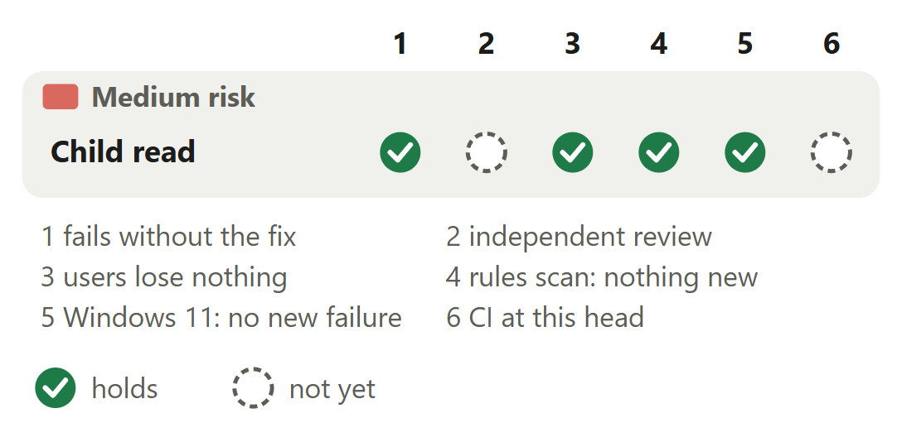

# The uninstall reads its daemon's start through the engine

For [pull request #1077](https://github.com/neralabs/rerail/pull/1077), head 9c6a873214. [report.html](report.html) is the same report as one page: download it and open it.

## 1. The decision

**May `rerail install --remove` read the daemon's start through the engine in a child Node process it waits for, in place of Windows PowerShell?**

**We recommend:** approve it: the stop's facts stay the same, PowerShell's start time no longer decides the verdict, and the uninstall now works where a policy blocks `powershell.exe`.

| Size | Risk and review | Waits on | Not verified |
|---|---|---|---|
| 782 lines in 12 files: 281 ship, 48 run in every test run, 453 are tests and text | Standard. Product code on the uninstall's stop; a maintainer approves. | Nothing. CI on GitHub runs once the branch is pushed. | 3 |

## 2. Intent, and the gap

| Change | Intended | Found | Now |
|---|---|---|---|
| Uninstall stops its daemon | Stop the daemon, then remove Rerail _(docs)_ | Stopped half done on slow machines _(runs on Windows 11)_ | Closes the gap. |

Found on 24 November 2026: the repository's own test of this path failed on GitHub's Windows runner (#1056).

Sources at main, and causes

| Change | Where main states the intent | The cause, and what was measured |
|---|---|---|
| Uninstall stops its daemon | `docs/reference.md` at `main` 4c49132c6e, the uninstall's paragraph: it "disconnects every coding agent, takes Rerail off `PATH` and stops the daemon". | The uninstall read the daemon's start through Windows PowerShell, ended at what was left of the stop's 10 s (`src/engine/process-liveness.ts:253` at `main`); a read ended there reads nothing, so a daemon too busy to answer that the home's lock does not prove stayed unproven. |

## 3. Where to look

1. **Read first**, 6 min: `process-liveness.ts`: `processStartedAtInChild`, `endProcessStartedByInChild`, `askEngineReader`. Is a child ended at its bound told from one that gave no answer, which alone goes to PowerShell?
2. 6 min: `daemon-control.ts`, `process-reader.ts`, `index.ts`, `package-root.ts`, `slow-powershell.mjs`: the machine, the verdict, the test's stand-in.

**Then skim**, 4 min: The end-to-end test runs the built CLI from a home laid out as the installer leaves it; the seam cases mock only `spawnSync`.

## 4. Risk against verification

One change on the uninstall's stop: start with the child's three outcomes.

Each limit, and each check that does not hold yet

| Change | Check | Its limit, or why it does not hold yet |
|---|---|---|
| Child read | independent review | No review by anyone outside the change at this head. |
| Child read | CI at this head | CI on GitHub runs once the branch is pushed. |

## 5. The changes

**Start read through a child**, medium risk: Windows 11, PowerShell at 30 s a start: `main` ends nothing; this change stops the daemon in 5.8 s.

<b>6. The decisions</b>

**Who should read the daemon's start for the uninstall?**

**We chose** the engine in a child Node process the uninstall waits for: `rerail daemon stop`'s facts, read where PowerShell was. **Would change our mind:** A ruling that the uninstall must start no Node process of its own.

| Option | What a user gets | Cost | What it breaks |
|---|---|---|---|
| The engine in a child Node process the uninstall waits for **(chosen)** | The engine's read; PowerShell's start time plays no part; it works where a policy blocks `powershell.exe`. | A Node start and an engine load for each read. | Only an install whose engine load never ends: it is ended at 30 s, where `main`'s PowerShell might have answered. |
| Windows PowerShell with longer bounds | No new process. | A machine slower than the new bound meets the same message. | Nothing. |
| The engine in the uninstall's own process | No child at all. | Windows keeps the loaded engine from being deleted. | The removal of `versions/`. |
| The whole stop in a child Node process | One reader for every step of the stop. | Every uninstall pays a Node start and the CLI bundle's load, even with no read to make. | Nothing. |

**Evidence.** Windows 11, end to end: with PowerShell slow to start and with `powershell.exe` blocked, `main` exits 1 and keeps the daemon running; this change stops it in 5.8 to 6.0 s.

<b>7. How it fits</b>

Nothing has to merge first: this head holds `main` 70892dfacf, merged by Git alone. It shares files with #1051, #1076 and three maintainers' pull requests (#1046, #1045, #1037), each on other lines; Git merges every shared file alone.

<b>8. What is not covered</b>: 3 not verified, 1 limit that stays

1. **0.2.1's daemon stop** Rerail 0.2.1's `rerail daemon stop` still reads through PowerShell; a release with #975 reads through the engine.
2. **The PATH step** Where set-up recorded a `PATH` change, the uninstall still undoes it through PowerShell under its own bound.
3. **macOS** Not run: no machine of ours runs it. It reads no start, and nothing there changes.

**Limits that stay**

- The Windows test slows or blocks PowerShell inside the uninstall's own process, not by loading the machine, and its daemon is a process that holds the engine pipe and never answers.

## 9. What we ask of you

We ask no ruling.

<b>10. Evidence</b>

The description's "How you tested it" holds every run.

| Where | What ran | Result |
|---|---|---|
| Windows 11 | `rerail install --remove` and `--delete-data`, PowerShell at 1 s, 9 s, 30 s and blocked, at `main` and here | `main`: 1 s and 9 s stopped; 30 s and blocked exited 1, the daemon running. Here all stopped and `versions/` went. |
| Windows 11 | The end-to-end test and the reader's tests 30 rounds; the new stop cases 30 rounds; the 21 importing test files once | 30 of 30 and 30 of 30; the importing files: 538 passed, none failed. |
| Linux x64 | The pre-commit check at each commit | `tsc --noEmit`, the structure and boundary checks, `check:ui-tokens` and `check:reference` pass. |
| Linux x64, Windows | The three changed test files, 30 rounds on GitHub's runners in our fork | 30 of 30 on each. |
| Windows 11 | The uninstall's time alone on its machine, 30 a side | `main` 5.11 s at the median, here 4.76 s; all 60 stopped the daemon. |

**Sources.** The branch at 32adec5ced and its diff against `main` 4c49132c6e; the CI log of the failed run on GitHub; runs on shared Windows 11 and Linux x64 test machines.

