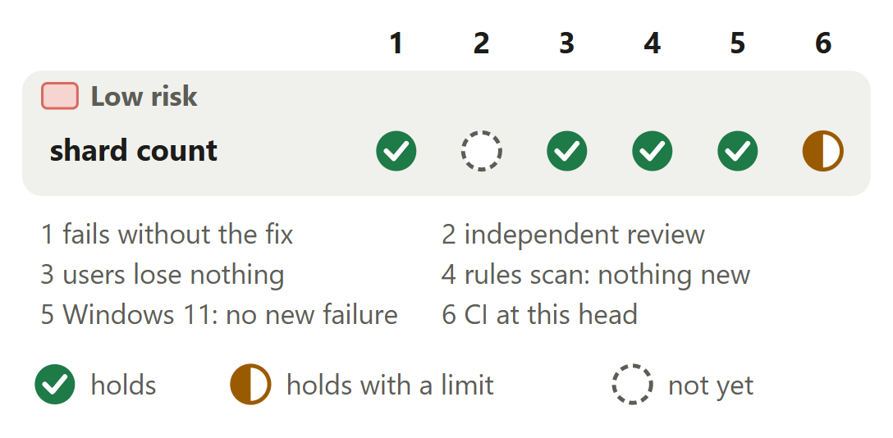

# A selection's unit shards follow its recorded test time

For [pull request #1117](https://github.com/neralabs/rerail/pull/1117), head ff54c37eb4. [report.html](report.html) is the same report as one page: download it and open it.

## 1. The decision

**May `select-tests` give a selection the larger of its shards by file count and by recorded test time?**

**We recommend:** approve it: CI only, never fewer shards than today, and a selection's shards hold on average no more test time than a shard of every file.

| Size | Risk and review | Waits on | Not verified |
|---|---|---|---|
| 493 lines in 9 files: 0 ship, 208 run in every test run, 285 are tests and text | Fast. CI's shard count and its tests, no product code. | Nothing. CI on GitHub runs at this head. | 2 |

## 2. Intent, and the gap

| Change | Intended | Found | Now |
|---|---|---|---|
| The shard count | Shards as the selection's share needs _(code comment)_ | The share was of files, not time _(CI run, #1111)_ | Closes the gap. |

Found on 25 November 2026: a Windows unit job of #1103 was cancelled at 15 minutes in two attempts with no failed test.

Sources at main, and causes

| Change | Where main states the intent | The cause, and what was measured |
|---|---|---|
| The shard count | `.github/workflows/ci.yml:446` at `main` a2c652432f, above `select-tests`; `shards()` at `scripts/check/ci/test-selection.mjs:346` reads the share as `ceil(total * count / all)`, the count of test files. | The share is of the count of files, not of their time. By the times in `unit-test-times.generated.ts`, with the first shard's step as the sequencer counts it, the selection is 0.614 of a whole Windows run: 3.07 of 5 shards, so 4. |

## 3. Where to look

1. **Read first**, 5 min: `test-selection.mjs`: `shards`, `selectionShards`, `windowsShards`, `outputs`. Does each case of today (every file, none, prose alone, the hook test alone) keep its shards?
2. 4 min: `shard-split.ts`, `time-balanced-sequencer.ts` and `ci.yml`.

**Then skim**, 3 min: Three cases in the selection's test file and three in the sequencer's; the 186 paths are the list CI selected.

## 4. Risk against verification

One change, low risk: CI's count of unit shards; which files run and how a shard's files are split stay as they were.

Each limit, and each check that does not hold yet

| Change | Check | Its limit, or why it does not hold yet |
|---|---|---|
| shard count | independent review | No review by anyone but its author yet. |
| shard count | CI at this head | CI on GitHub runs at this head; the failure it fixes was a cancelled Windows job of #1103. |

## 5. The changes

**Shards counted by time too**, low risk: #1103's 186 files got 2 Windows shards of 1,318 s each; they now get 4 of 659 s.

<b>6. The decisions</b>

**Read the weights by importing the split's module, or from a JSON copy?**

**We chose** import `shard-split.ts` and the times: one rule for what a file weighs, which Node 24 runs with types stripped. **Would change our mind:** A Node version for CI without type stripping.

| Option | What a user gets | Cost | What it breaks |
|---|---|---|---|
| Import `shard-split.ts` and the times table **(chosen)** | One rule for a file's weight, in one file. | The module must keep importing nothing at run time; its header says why. | Nothing found. |
| A JSON copy the generator writes, held equal by a check | A script that reads plain JSON. | Two copies of the times and a new check. | The weight rule would still be written again in the script. |

**Evidence.** The `select-tests` job sets up Node 24 before `npm ci` (`.github/actions/node-deps`); `scripts/generate/packs/react-policies.mjs` already imports a generated `.ts` table. At this head, `node scripts/check/ci/test-selection.mjs <changed files> --github` on Node v24.21.0 exits 0 and prints only the selection's own line on stderr.

**The larger of the two counts, or the count by time alone?**

**We chose** the larger: the times leave out each file's import and collection, which a shard of many light files pays. **Would change our mind:** CI's logs of light selections' shards showing the time share alone keeps them well within 15 minutes.

| Option | What a user gets | Cost | What it breaks |
|---|---|---|---|
| The larger of the two **(chosen)** | Never fewer shards than today; a heavy selection gets its time's share. | 18 more Windows shards and 9 more Linux shards over `main`'s last 40 merged pull requests. | Nothing found. |
| The count by time alone | Fewer runners for many light files. | Shards whose cost the times do not hold. | Not measured: no CI log of such shards was read. |

**Evidence.** Over `main`'s last 40 merged pull requests, each selected at its own merge's tree, 13 get one or two more Windows shards (124 to 142 in all) and 9 a third Linux shard (91 to 100); none gets fewer. The 13 select 202 to 407 of 538 to 551 files. Counted by time alone, a selection of many light files would get fewer shards than today, which no run here measured.

**Count the first shard's step in both shares?**

**We chose** yes: the sequencer starts the first shard holding it, so each shard of a selection carries its part. **Would change our mind:** A first shard that no longer runs that step.

| Option | What a user gets | Cost | What it breaks |
|---|---|---|---|
| The step in both shares **(chosen)** | A selection's shards hold on average no more than a shard of every file. | #1103 gets 4 Windows shards, not 3. | Nothing found. |
| The files' time alone | 3 Windows shards for #1103. | Each holds 879 s on average, 2.4% above the 858 s of a shard of every file. | The promise the count makes. |

**Evidence.** The step is 200.6 s on Windows and 55.0 s on Linux in `unit-test-times.generated.ts`; #1103's selection is 2,435 s of 4,091 s of Windows file time, 0.614 with the step and 0.595 without.

<b>7. How it fits</b>

Nothing has to merge first: five commits on `main` a2c652432f, no product code. Git merges it alone with #1076, #1103, #1110 and #1113; its head adds Git's own merges of `main` up to c10a645a1c.

<b>8. What is not covered</b>: 2 not verified, 1 limit that stays

1. **Stale times** a file that grew slower counts at its old time, so a selection can again get fewer shards than its time needs, never fewer than its count's.
2. **One long file** no count splits a file; `service-stop.test.ts` takes 266 s of a Windows shard's 858 s.

**Limits that stay**

- The count bounds a shard's test time by a whole run's shard, not its wall time: a runner slower than usual still takes longer.

## 9. What we ask of you

We ask no ruling.

<b>10. Evidence</b>

The description on GitHub is the record: "How you tested it" holds the runs, and "What it costs" the table.

| Where | What ran | Result |
|---|---|---|
| Windows 11 x64 | Both changed test files at the red commit 21b3f4a19 | 3 failed, 20 passed: #1103's selection on 2 Windows shards of 1,318 s and 2 Linux shards of 660 s; the 10 heaviest Linux files on 1 shard. |
| Windows 11 x64 | Both changed test files at this head | 24 of 24 cases passed, the engine built from its tree. |
| Windows 11 x64 | 16 mutants of the lines that decide the count, each alone | 15 of 16 failed a case at ac1c1a49aa; the 16th, Windows counted by Linux's times, fails the case 3002b63fce adds. |
| Windows 11 x64 | The script from plain `node` 24.21 with #1104's changed files, as CI runs it | Exit 0; 3 Linux and 5 Windows shards; no warning on stderr. |
| Linux x64 | Both changed test files at 21b3f4a19 and at this head | At 21b3f4a19 3 failed and 20 passed, with the same figures as on Windows; at this head 24 of 24 passed. |
| Linux x64 | The script from plain `node` 24.21 with a change to `src/cli/cli.ts`, as CI runs it | Exit 0; 390 of 551 test files; 3 Linux and 5 Windows shards; no warning. |
| Linux x64 | The selection of each of `main`'s last 40 merged pull requests at its merge's tree, counted by both rules | Windows: 13 more, 0 fewer, 27 the same, 124 to 142 shards. Linux: 9 more (2 to 3), 0 fewer, 91 to 100 shards. |

**Sources.** The branch at ff54c37eb4 and its diff against `main` a2c652432f, read on 26 November 2026; #1103's CI run 45747008368; `git diff --name-only` of `main`'s last 40 merges; runs on Windows 11 x64 and Linux x64 machines.

