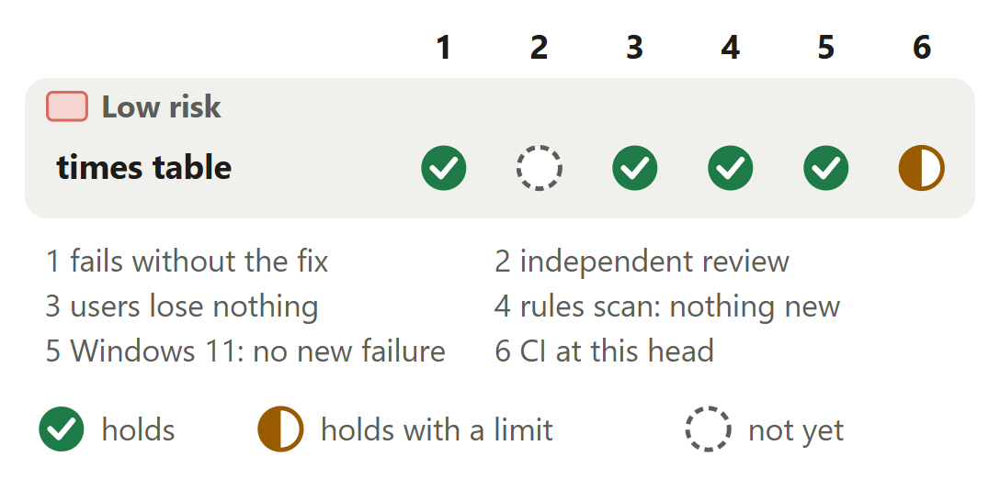

# CI's unit shards are split by what each test file takes today

For [pull request #1020](https://github.com/neralabs/rerail/pull/1020), head e8b6bc3f59. [report.html](report.html) is the same report as one page: download it and open it.

## 1. The decision

**May the unit test times generator find CI's suite step by its command's `--shard=`, refuse an empty table, and write the table again?**

**We recommend:** approve it: the generator wrote an empty table from every log since #830, and the new table names all 511 test files, so a slow new file no longer counts as a 0.3 s one.

| Size | Risk and review | Waits on | Not verified |
|---|---|---|---|
| 1,856 lines in 3 files: 0 ship, 1,856 are the tests it changes, 0 are other tests and text | Fast. Test script, its test, generated table; no product code. | Nothing. No CI run on GitHub yet: not pushed. | 1 |

## 2. Intent, and the gap

| Change | Intended | Found | Now |
|---|---|---|---|
| The generator's suite step | The table can be made again _(generators' README)_ | An empty table, exit 0 _(a run)_ | Closes the gap. |
| Files the table omits | New files count as the median _(code comment)_ | A 343 s file counted 0.3 s _(the sequencer)_ | Closes the gap. |

Found on 24 November 2026: a Windows unit shard of #997 was cancelled at 15 minutes twice with no failed test.

Sources at main, and causes

| Change | Where main states the intent | The cause, and what was measured |
|---|---|---|
| The generator's suite step | `scripts/generate/README.md` at `main` b6e0bf959, the row of `test/support/shards/unit-test-times.generated.ts`. | Since #830 the unit step's command starts with `read -ra tests`, and the generator looked for the header `Run npm test -- --shard=`. |
| Files the table omits | `test/support/shards/time-balanced-sequencer.ts` at `main` b6e0bf959. | The table was last made on 19 November, the day #830 changed the step. |

## 3. Where to look

1. **Read first**, 3 min: `unit-test-times.mjs`: `runsSuite`, `unitTestTimes`. Is the step whose echoed command passes `--shard=` always the sharded suite, never a later step?
2. 2 min: `unit-test-times.test.mjs` and `unit-test-times.generated.ts`.

**Then skim**, 1 min: Nothing else changes.

## 4. Risk against verification

One low-risk change: a test script, its test and the table it writes; no product code.

Each limit, and each check that does not hold yet

| Change | Check | Its limit, or why it does not hold yet |
|---|---|---|
| times table | independent review | No reader but its author has reviewed it yet. |
| times table | CI at this head | No CI run at this head on GitHub yet: the branch is not pushed. |

## 5. The changes

**The generator reads today's logs**, low risk: #997's Windows shards: 1,688, 1,172 and 1,203 s of test time before, 1,354 s each after.

<b>6. The decisions</b>

**How does the generator find the suite step?**

**We chose** the step whose command, as the log echoes it up to the group's end, passes vitest `--shard=`. **Would change our mind:** A log field that names the step, which the Actions log does not hold.

| Option | What a user gets | Cost | What it breaks |
|---|---|---|---|
| The echoed command's `--shard=` **(chosen)** | Any shape of the step's script. | 22 lines in the generator. | It reads the command's text. |
| The new header, `Run read -ra tests` | The same table today. | One string. | Breaks on the next change to the step's first line. |
| The step by its position in the job | No text read. | A step count. | Breaks when a step is added before it. |

**Evidence.** From the 32 unit job logs of `main`'s four latest runs the generator reads 511 files per platform; at `main` it reads none.

<b>7. How it fits</b>

Nothing has to merge first: it is three commits on `main` b6e0bf959. No other open pull request of ours edits the generator, its test or the table; they overlap nowhere.

<b>8. What is not covered</b>: 1 not verified, 1 limit that stays

1. **macOS** never ran.

**Limits that stay**

- `select-tests` counts a selection's share of the files, not of their time: #997 still gets 3 Windows shards for 94% of the suite's Windows test time. That rule and the 15-minute limit are in the issue.

## 9. What we ask of you

We ask no ruling.

<b>10. Evidence</b>

The description on GitHub is the record: "How you tested it" holds the runs on `main` and here.

| Where | What ran | Result |
|---|---|---|
| Linux x64 | The generator on the 32 unit job logs of runs 45329881923, 45328793087, 45316265586 and 45303256180 | At `main`: 0 files per platform, exit 0. Here: 511 files per platform. |
| Linux x64, Windows 11 | The generator's test 30 times here, and at `main` on Windows | 30 of 30 here on each; 30 of 30 at `main` on Windows 11. |
| Linux x64 | The sequencer on #997's 290 files and on every file, with the old and the new table | #997's Windows shards: 1,688, 1,172 and 1,203 s before, 1,354 s each after; a whole run's five Windows shards 858 s each, where the heaviest held 1,115 s. |
| Linux x64 | CI's lint and type-check job, and the automated reviewer's rules at `main` b6e0bf959 | Lint passed; no new finding, with the published 0.1.5 and with Rerail built from `main`. |

**Sources.** The branch at e8b6bc3f59 and its diff against `main` b6e0bf959, read on 24 November 2026; runs at e8b6bc3f59 and at `main` b6e0bf959 on a Linux x64 machine and a Windows 11 machine.

