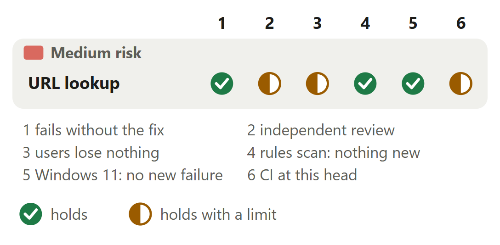

# A tool call's URL is looked up on no other machine

For the pull request of branch `JeanFrancoisGagne/url-in-tool-call-not-looked-up`, not opened yet, head 0603dea82. [report.html](report.html) is the same report as one page: download it and open it.

## 1. The decision

**May the check judge by name, with no lookup, another machine's share written with `//` after a `:`, and a web URL under `/net`?**

1. A link behind another machine's share written with `//` after a `:` is not followed.
2. A drive path written with doubled backslashes is looked up as that drive path.

**We recommend:** approve it as built: the lookup is itself the contact, so no form keeps `main`'s verdict in those rare states without reaching that host, and an agent's text should not make Rerail reach one.

| Size | Risk and review | Waits on | Not verified |
|---|---|---|---|
| 976 lines in 6 files: 239 ship, 737 are tests and text | Careful. It changes which tool calls count as naming a secret. | Nothing. No CI run on GitHub yet: not pushed. | 2 |

## 2. Intent, and the gap

| Change | Intended | Found | Now |
|---|---|---|---|
| Lookups that stay local | Paths judged by where links lead _(code comment)_ | URLs looked up as shares _(CPU profile, then tests)_ | Closes the gap, changes answer 1. |
| Escaped drive paths | Paths judged by where links lead _(code comment)_ | Escaped drive paths read as shares _(tests)_ | Closes the gap, changes answer 2. |

Found on 11 November 2026, in a CPU profile of a daemon serving real sessions on a Windows laptop.

Sources at main, and causes

| Change | Where main states the intent | The cause, and what was measured |
|---|---|---|
| Lookups that stay local | `src/engine/transcript-boundary.ts` at `main`, the comment on `callNamesDeniedPath`: "With the checkout the call ran in (`root`), a path is also outside when it links to a secret-like one"; T5 of `docs/threat-model.md`: "Symlink targets count wherever a checkout root is known". | `textNamesPath` splits each string at `:` (`TOKEN_BREAK`), so `https://host/api/v1` leaves `//host/api/v1`; `checkoutPathBoundary` calls `realpathSync.native(resolve(root, path))`, which on Windows opens the share `\\host\api\v1`. A CPU profile caught one call holding the daemon 21,187 ms, 43.7 % of its samples, under `persistEvent`. |
| Escaped drive paths | The same comment on `callNamesDeniedPath` at `main`. | The split at `:` leaves `\\data\\notes\\a.txt` from `"C:\\data\\notes\\a.txt"`, which Windows reads as the share `\\data\notes\a.txt`; the published 0.1.5 looks it up so. |

## 3. Where to look

1. **Read first**, 15 min: `transcript-boundary.ts`: `windowsLookup`, `onAnotherMachine`, `posixLookup`, `lookupOf`, `textNamesPath`. Is every word `main` looks up still looked up, but a `//` word after a `:` that leaves the machine?

**Then skim**, 10 min: Fourteen cases in `transcript-boundary.test.ts`, one at the runtime's ingest, one at an agent's `session_events` read, the threat model's T5 and a release note.

## 4. Risk against verification

Start with answer 1: the states where the check now judges by name a word `main` looks up.

Each half mark's limit

| Change | Check | It holds with this limit |
|---|---|---|
| URL lookup | independent review | An independent check on both systems found the stall gone and robocopy's `/LOG:` and `smb://` skipped where `main` follows a link; both are now looked up as on `main`. Each of its 9 one-line mutants fails a case. |
| URL lookup | users lose nothing | A link behind a `//` word after a `:` that is no URL (a Git Bash `PATH` entry), behind a name of this machine other than its host name, or behind a `/net` mount of another host is not followed. Its lookup is the contact this removes. |
| URL lookup | CI at this head | CI's integration job passed on Linux x64 at e3f8b0017: 22 files, 90 tests, as at `main` 7efcac9c6. |

## 5. The changes

**No lookup of a URL's host**, medium risk: A URL whose host does not answer: `main` held the daemon about 21 s on Windows 11; here no lookup.

<b>6. The decisions</b>

**Which words right after a `:` skip the lookup?** (ask 1)

**We chose** another machine's share written with `//`, unless `file:` or `smb:` names it, and a web URL under `/net`. **Would change our mind:** A common tool that writes another machine's share with `//` after a `:`. Robocopy and PowerShell write backslashes, which are looked up.

| Option | What a user gets | Cost | What it breaks |
|---|---|---|---|
| Skip a `//` share on another machine after a `:`; own name looked up **(chosen)** | No lookup and no wait for a URL in any spelling tested; every other word as on `main`. | One string comparison for each skipped word; 0.94 to 1.07 times `main`'s time per call on Linux x64, 1.21 for 8,000 `/net` URLs in one write. | A link behind a `//` word after a `:` that is no URL, behind another name of this machine, or behind a `/net` mount of another host. |
| `main`: every path-shaped word looked up | Every link `main` follows. | About 21 s per URL whose host does not answer, with the daemon held for every session. | Nothing. |
| Lookups that may leave the machine off the event loop, one deadline per event | No wait for the daemon's other work. | An asynchronous check where events are recorded and read; each URL still waits on its host, and its verdict waits with it until the deadline. | Nothing `main` finds within the deadline, but Rerail still reaches every host a call names. |
| Skip another machine's share after any `:` but a `file:` URL's | No lookup for a web URL written with backslashes too. | As built. | Also links behind robocopy's `/LOG:\\server\share`, PowerShell's `-Path:\\server\share` and `smb://` URLs, which `main` follows. |

**Evidence.** On Windows 11 on 13 November, `main`'s check took 21,020 to 21,065 ms for a URL whose host never answers. With a 1,000 ms stand-in hold, the hook took 1,102 ms at `main` 7efcac9c6 and 28 ms here on Linux x64, 1,078 to 1,157 and 59 to 80 ms on Windows 11. At an earlier head on 13 November, no local lookup or verdict was lost over 88,420 generated strings on Windows 11 and 87,720 on Linux x64.

<b>7. How it fits</b>

It stands alone on `main` 7efcac9c6 (the 0.2.0 engine), merged in with no conflict: nothing has to merge first and nothing waits on it. #738 and #807 also edit `docs/threat-model.md`; trial merges add no conflicted file.

<b>8. What is not covered</b>: 2 not verified, 3 limits that stay

1. **macOS** never ran; its `/net` automount and letter-case rules are read from the code and the platform.
2. **Windows timing** of the check alone was not run; through a daemon the hook's time was.

**Limits that stay**

- A share path written out (`type \\server\share\x`), a URL with no scheme (`//cdn.example.com/x.js`) and a `file://host/` or `smb://host/` URL are looked up, as on `main`.
- A share written with backslashes after a `:` is looked up as on `main`, a web URL written so (`https:\\server\x`) too.
- Another name of this machine after a `:` (its full DNS name, `wsl.localhost`, `localhost.`, its own addresses, a name given while the daemon runs) is judged by name.

## 9. What we ask of you

Ask 1 rules on answer 1.

1. **May another machine's share written with `//` after a `:`, which text cannot tell from a URL, be judged by name?** We recommend yes: its lookup is the contact and the wait this removes.

Answer 2 asks no ruling. A gain: `main` looked it up as a share named after its first folder.

<b>10. Evidence</b>

The description holds the failing cases, the daemon runs and the test files, under How you tested it.

| Where | What ran | Result |
|---|---|---|
| Linux x64 and Windows 11 | The new cases of e3f8b0017, 5 runs; with `main`'s check; with each fix line taken out | 10 passed each run on both. `main`'s check: 5 of 10 fail on Linux, 6 of 10 on Windows. The URL line out: 5 fail on both; the own-name line out: its case fails. |
| Linux x64 and Windows 11 | The cases at this head, and at 8ce30a6b0, which holds e3f8b0017's source | Windows: here 19 passed; at 8ce30a6b0 robocopy's switch, the PowerShell parameter, `smb://` and the device list fail. Linux: here 16 passed; the one-slash `PATH` entry fails at e3f8b0017's source. |
| Linux x64 | A daemon and the Claude Code hook, `curl -s https://net/192.0.2.7/api/v2`, 5 runs, the lookup held 1,000 ms by a stand-in, at `main` 7efcac9c6, at ba0545900 and at e3f8b0017 | `main` 7efcac9c6 looked it up 5 of 5, hook 1,102 ms (ba0545900: 5 of 5, 1,094 ms); e3f8b0017 0, 28 ms. A second session's longest gap: 1,294 ms at `main`, 82 ms at e3f8b0017. |
| Windows 11 | The same probe with `curl -s https://192.0.2.7/api/v2`, and with `main`'s check under e3f8b0017 in turn | `main` 7efcac9c6 asked for `\\192.0.2.7\api\v2` in 10 of 10 runs, 1,111 and 1,203 ms; e3f8b0017 none in 25 runs, 59 to 80 ms. A second session's longest gap: 1,187 to 1,433 ms with `main`'s check, 189 to 404 ms. |
| Windows 11 | A daemon and the hook, 3 runs, `main` 7efcac9c6 and this head on one machine, each share answered as a link to a credential folder | robocopy's `/LOG:`, PowerShell's `-Path:`, `smb://` and `https:\\`: withheld 3 of 3 at both, one lookup a run. A web URL, lookup held 600 ms: `main` 696 ms; here no lookup, 72 ms. A Git Bash `PATH` entry: withheld at `main` only. |
| Linux x64 and Windows 11 | The 23 changed and importing test files, here and at `main` 7efcac9c6 on one machine | Windows: here 328 passed, `main` 315, none failed at either. Linux: here 316 passed, none failed; `main` 304, with two 5 s load timeouts. |
| Linux x64 | CI's integration job | Exit 0 at e3f8b0017: 22 files, 90 tests passed, 4 skipped, as at `main` 7efcac9c6. Two earlier runs each failed one test, a different one each time, that passed in the other runs and in most runs alone, there and at `main`. |
| Linux x64 | The automated reviewer's rules at `main` 7efcac9c6 over the diff against it | No new finding and no new complexity, with the published 0.1.5 and with Rerail built from `main`; every added or edited function at 5 or under. |

**Sources.** A CPU profile of a daemon serving real sessions on a Windows laptop (11 November 2026); Rerail at `main` 7efcac9c6 (the 0.2.0 engine) and ba0545900 before it; the published 0.1.5 from npm; the branch at ae8eb5c2d, read on 19 November 2026.

