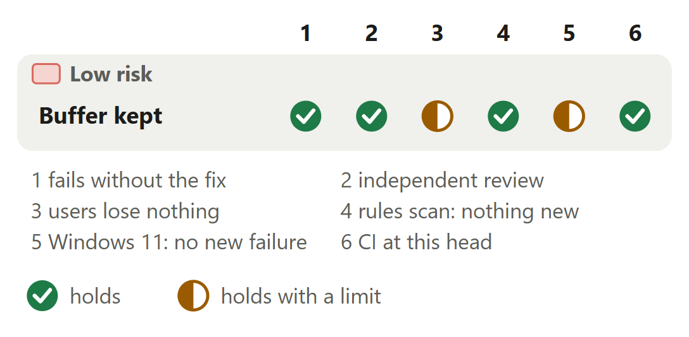

# Code rules: a failed read gives back the buffer it ended in

For [pull request #659](https://github.com/neralabs/rerail/pull/659), head 1e7206f8f. [report.html](report.html) is the same report as one page: download it and open it.

## 1. The decision

**Does every read still return the bytes `readFile` returns and reject with the error `main` rejects with, with only which buffer goes back changed?**

**We recommend:** approve it: one module with one caller, of 11,886 probe reads over six shapes none that ended differs from `readFile`, each new test fails without its fix, and decision 2 states its one cost.

| Size | Lane | Waits on | Not verified |
|---|---|---|---|
| 117 lines in 2 files: 64 ship, 53 are tests and text | Fast. No high-risk path; the automated reviewer approved it. | A merge. CI passed at 1e7206f8f; approved 20:43 UTC, 13 November. | 4 |

## 2. Intent, and the gap

| Change | Intended | Found | Now |
|---|---|---|---|
| A read that fails | A failed read gives its buffer back _(code comment)_ | The grown buffer was dropped _(approval of #638)_ | Closes the gap. |
| A close that fails | One buffer per read at once _(code comment, our reading)_ | A failed close dropped its buffer _(reading every exit)_ | Closes the gap. |

Found on 13 November 2026: the first in a code owner's approval of #638, the second in our read of every exit. Measured on Linux.

Sources at main, and causes

| Change | Where main states the intent | The cause, and what was measured |
|---|---|---|
| A read that fails | `src/engine/code-rule/walk-read-buffers.ts` lines 50 and 51 at `main`, the comment on `#read`: "A read that fails (\`EISDIR\` once the file is a folder, \`EIO\`) gives back the buffer it took, so the next read does not allocate one again." The comment's letter holds on `main`: the buffer the read took goes back. Its purpose does not, once the read has moved to a larger one. | At `main`, `#read` takes `start` (line 55) and its `catch` gives `start` back (line 59). `fill` moves to each larger buffer in a local variable (lines 79 and 82), so a read that rejects at line 84 drops it. The new "read" case on `main`, on Linux x64: the read after the failed one gets a new 100,001-byte buffer, not the 131,072-byte one the failed read grew (`expected 100001 to be 131072`). |
| A close that fails | `src/engine/code-rule/walk-read-buffers.ts` lines 21 to 25 at `main`, the comment on `WalkReadBuffers`: the buffers are "each lent to one read at a time and taken back once that read's caller is done with it", and "With these, a walk holds one buffer per read it runs at once, grown to the largest file it read." No comment names a failed close: that its buffer goes back is our reading. | At `main`, `#read` closes the file in its `finally` (line 62). When the read ended, a close that rejects there never reaches the `catch` at line 58, and `lend` awaits `#read` at line 41, before its own `try`. So no buffer goes back. Measured on Linux x64: `main`'s module and this one each walk this repository's 3,819 tracked files, 16 reads at once, 382 closes failing, three rounds, counting calls to `Buffer.allocUnsafeSlow`. |

## 3. Where to look

1. **Read first**, 5 min: `walk-read-buffers.ts`: `lend`, `readAndClose`, `fill`. Can any exit give a buffer back twice, or while a read still writes into it?

**Then skim**, 2 min: The test mocks `node:fs/promises` for every case: `open` fails the next file's second `read` or its `close` only when a case asks. No assertion of `main` is removed.

## 4. Risk against verification

Start at check 3: short walks where most reads fail allocate about 10 percent more than `main` (decision 2). The other half mark: probes ran on Linux only.

Each half mark's limit

| Change | Check | It holds with this limit |
|---|---|---|
| Buffer kept | users lose nothing | 0 of 1,681 reads per shape reject with an error other than `main`'s. With no failure: 2,473 allocations against `main`'s 2,448 in short walks, 3 against 3 in one walk. The limit: short walks where most reads fail (12 reads, 8 at once) made 2,338 allocations against `main`'s 2,108, in one run on Linux x64. |
| Buffer kept | Windows 11: no new failure | `walk-read-buffers.test.ts` and the 9 test files that reach the module passed on Windows 11: 272 passed, 0 failed, none differing from `main`'s results. CI's Windows unit test jobs passed. The limit: the failing run on `main` and both probes ran on Linux only. |

## 5. The changes

**One give-back at every exit**, low risk: A walk with 382 failed closes: 484 to 496 allocations on `main`, 55 to 64 here.

<b>6. The decisions</b>

**One place that gives the buffer back, or the remark's narrow fix?**

**We chose** one `finally` in `lend`: it also covers a failed close, and two give-back places made both defects. **Would change our mind:** a reviewer who wants the close path in its own pull request. The commit then splits by exit.

| Option | What a user gets | Cost | What it breaks |
|---|---|---|---|
| `lend` holds the read's record, and its one `finally` gives the buffer back **(chosen)** | Every exit gives the buffer back: the read ends, the read fails, the close fails, `use` throws, an allocation in `grown` fails. | 30 lines added, 34 removed. A failed read gives its buffer back after the close settles: decision 2. | Nothing measured: 0 bytes differ from `readFile`, and 0 of 1,681 reads per shape reject with an error other than `main`'s. |
| `fill` hands its grown buffer to the `catch` that `main` has | The remark's case: a read that fails after a growth gives the grown buffer back. | About 10 lines added, 5 removed. Not built. | A failed close still gives back no buffer, and two places still give buffers back. |
| `fill` gets the free list and gives back from a `catch` of its own | The same case as the second option. | About 8 lines added, 4 removed, and `fill` learns the pool. Not built. | The same as the second option. |

Before: On main, #read takes a 64 KiB buffer. fill fills it and moves to one of 128 KiB that only fill holds. The next read call fails. The catch gives back the 64 KiB buffer, the file closes, and the 128 KiB buffer is dropped. After: With this change, lend takes a 64 KiB buffer onto a record. fill moves the record to the 128 KiB buffer. The next read call fails, readAndClose closes the file, and lend's finally gives back the 128 KiB buffer.

**Evidence.** The description's "The decisions" holds the same three options. The second and third were not built, so their sizes are estimates. The fold under "The changes" there lists each way a read ends and the buffer that goes back on `main` and here. Both new cases fail on `main`, one per exit.

**Does a failed read give its buffer back before the close, or after?**

**We chose** after the close settles, in the one `finally`. Short walks where most reads fail then allocate about 10 percent more. **Would change our mind:** a reviewer who wants no failing shape above `main`. We then push the second option, which the same probe covered.

| Option | What a user gets | Cost | What it breaks |
|---|---|---|---|
| After the close settles, in `lend`'s one `finally` **(chosen)** | One place gives buffers back. One walk of 2,000 reads with failures: 39 allocations at 8 at once and 3 in turn, against `main`'s 416 and 429. | Short walks of 12 reads, 8 at once: 2,338 allocations (478.5 MB) against `main`'s 2,108 (443.6 MB). | Nothing a person sees. While a failed read's close is pending, another read can find the free list one buffer short and allocate: at most one allocation per failure. |
| Before the close for a failed read, after it for a failed close | No shape with failures above `main`: 2,087 allocations (442.9 MB) in the short shape at 8 at once, 42 in one walk at 8 at once. | A flag and a second give-back place in `lend`. Measured, not pushed. | Nothing measured: 0 bytes differing and no buffer in two reads at once, in the same probe. |

**Evidence.** One run of each on Linux x64, over the same 2,000 reads with injected failures per shape, 1,108 to 1,130 of them rejected at this head, counting calls to `Buffer.allocUnsafeSlow`. In turn, both options make 963 allocations in short walks and 3 in one walk, against `main`'s 1,205 and 429. Three earlier rounds of the short shape at 8 at once: 2,317 against 2,095, 2,334 against 2,092, 2,322 against 2,110.

<b>7. How it fits</b>

Nothing has to merge first: one commit on `main` at f277c6e29, clean to merge with `main` at 8a999b339. No open pull request needs it. No other open pull request edits these two files. #665, #671 and the team's #532 edit `code-rule-bridge.ts`, the module's one importer, which this leaves alone.

**Related pull requests.** #638, merged, added the module; this answers the one remark in its approval. #665 and #671 (ours, drafts) and #532 (the team's, a draft) share no file with this one. Each edits `code-rule-bridge.ts`. A trial merge with the heads of #665 and #532 conflicts in that file only, as each does with `main` today; one with #671 is clean. Any order works. 31 pull requests were open at 21:06 UTC on 13 November 2026. `main` has since taken #529, which touches neither file.

<b>8. What is not covered</b>: 4 not verified, 3 smaller gaps, 2 limits that stay

1. **How often a walk meets it** is not known: we have no count from the field. The figures are a cost per failure.
2. **A real disk error, a network share, a Windows byte-range lock** did not run: every failure is injected in JavaScript.
3. **The probes and the failing run on Windows** did not run. The 10 test files pass there.
4. **macOS** never ran.

**Smaller gaps**

- **Failures at a read's n-th call.** 319 of each shape's 2,000 reads fail at their n-th call, and 2 to 11 of them end differently here than on `main`: a kept larger buffer takes fewer calls, so the n-th is never made. A failure at a byte fails at both.
- **The allocation counts' spread.** The comparison of four shapes is one run of each. Only the short shape at 8 at once has three earlier rounds. The walk of this repository has three rounds per scenario.
- **Our own whole suite.** Not run: CI ran it at this head. Our runs cover `walk-read-buffers.test.ts` and the 9 test files that reach the module through `code-rule-bridge.ts`.

**Limits that stay**

- If the buffer's allocation itself throws (out of memory), `lend` does not close the handle it opened, on `main` as here. That is another defect, for a bug report of its own.
- A read that fails and a close that fails together reject with the close's error, on `main` and here: a `finally` that throws replaces the error.

## 9. What we ask of you

We ask no ruling.

<b>10. Evidence</b>

The description on GitHub is the record. "How you tested it" holds the failing run, the runs at this head and both probes. "The decisions" holds the options and the allocations each measured.

| Where | What ran | Result |
|---|---|---|
| CI on GitHub | The checks at 1e7206f8f, read at 21:01 UTC on 13 November 2026 | 34 checks passed, 6 were skipped, none failed. The CI run and the pack data publish request: 28 passed, the Linux and the Windows unit test jobs among them, and 1 was skipped, the Rust engine job. The automated reviewer's run: 6 passed, 3 skipped. 2 Dependabot jobs skipped. |
| Linux x64, Node 24.21.0 | `main` plus the new test; then `walk-read-buffers.test.ts` and the 9 test files that reach the module through `code-rule-bridge.ts`, at 1e7206f8f | On `main`: 2 failed, 8 passed, both new cases with `expected 100001 to be 131072`. At this head: 271 passed, 1 skipped, 0 failed. |
| Windows 11 | The same 10 files at 1e7206f8f, compared with `main`'s results | 272 passed, 0 failed. No result differs from `main`'s. |
| Linux x64, a second machine | An independent check: this head's test file over `main`'s source, then over this head with each fix taken out alone | Over `main`'s source both new cases fail and the 8 others pass. With only the read fix out, only the "read" case fails. With only the close fix out, only the "close" case fails. |
| Linux x64 | The independent check's probe at this head and on `main`: four shapes of 2,000 reads with injected failures and two of 1,943 without, over 106 files around the 64 KiB growth steps and three limits | 0 bytes differ from `readFile` in the reads that ended. 0 of 1,681 reads per shape reject with an error other than `main`'s. No buffer served two reads at once. 45 reads went into a buffer a failed read had grown. A mutant that gives a buffer back twice was caught 48 times in short walks and 2,105 times in one walk. |
| Linux x64 | The same probe's count of allocations at this head, on `main` and with decision 2's second option, one run of each | Short walks of 12 reads, 8 at once: 2,338 here, 2,108 on `main`, 2,087 with the second option. One walk, 8 at once: 39, 416, 42. Short walks in turn: 963, 1,205, 963. One walk in turn: 3, 429, 3. |
| Linux x64 | Our cost probe: `main`'s module and this one each walk this repository's 3,819 tracked files, 16 reads at once, three rounds per scenario | With 382 failed closes: 484 to 496 allocations (50.3 to 52.0 MB) on `main`, 55 to 64 (15.0 to 18.4 MB) here. With no failure: 56 to 60 against 55 to 62. 0 of the 155,290 reads that ended differ from `readFile`. |
| Linux x64 | The rules scan as the automated reviewer runs it, against the merge base | 0 findings. `fill` counts 6, as on `main`. |

**What this report adds to the description**

- **Read and close both fail: `main` gives one buffer back.** `main` gives back no buffer when the close fails after the read ended. When the read failed first, `main`'s `catch` has given back the buffer the read took (line 59) before the close throws (line 62). Here the buffer the read ended in goes back in both cases.
- **Three open pull requests edit the importer.** Read at 21:06 UTC on 13 November 2026, 31 pull requests are open. #665 and #671 (ours, drafts) and #532 (the team's, a draft) edit `code-rule-bridge.ts`. None shares a file with this one, and a trial merge of this branch with #671 is clean.
- **"About 10 percent" is 10.0 to 11.6 percent, over four rounds.** The four rounds of the short shape at 8 at once give 2,338, 2,317, 2,334 and 2,322 allocations here against 2,108, 2,095, 2,092 and 2,110 on `main`. In bytes the same rounds give 6.7 to 8.3 percent more: 478.5, 473.0, 475.5 and 473.8 MB against 443.6, 440.4, 439.1 and 444.2 MB.
- **The 11,886 reads include those that rejected.** 11,886 is every read the probe started: four shapes of 2,000 and two of 1,943. 4,468 of them rejected at this head, on the probe's injected failures. So the bytes of at least 7,418 reads were compared with `readFile`, each at the start of `use` and again after other reads ran.
- **Our answer to the read-first question.** A read of the diff: `lend` gives `filled.buffer` back once, in its one `finally`, after `readAndClose` has settled, so no read still writes into it. `fill` sets the record before each `handle.read`, so a rejected read leaves the record on the buffer it read into. `open` still runs before `#take`, and the file is still closed before `use` runs.
- **The automated reviewer approved this head at 20:43 UTC.** Read at 21:01 UTC on 13 November 2026: its review of 1e7206f8f approves with 0 blockers, 0 follow-ups and 0 nits.

**Sources.** Pull request #659, its diff, its checks and its review on GitHub, read on 13 November 2026. Rerail at `main` (8a999b339) for each quoted intent and cause; the file is the same at f277c6e29, this branch's base. The approval of #638 for the remark. The description for the runs and both probes. The open pull requests on GitHub and their changed files for the related ones.

