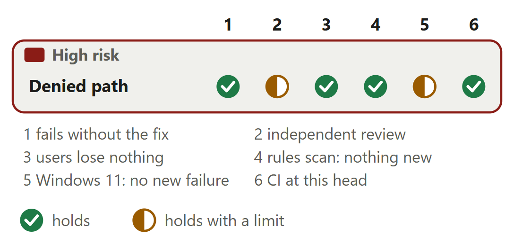

# On Windows, a denied path no longer stops shell edits being checked

For [pull request #742](https://github.com/neralabs/rerail/pull/742), head d1b8ffe7b. [report.html](report.html) is the same report as one page: download it and open it.

## 1. The decision

**Can a lookup that now answers for a refused path, where `main` throws, place a file in the wrong checkout or follow a link?**

**We recommend:** approve it: on Windows 11 every shell edit beside a denied file, folder, worktree or submodule gets its finding, where `main` misses at least one in each case, and a refused link stays refused.

| Size | Risk and review | Waits on | Not verified |
|---|---|---|---|
| 406 lines in 4 files: 50 ship, 356 are tests and text | Careful. A code owner approves: it changes what is checked. | Nothing. CI passed at this head; no pull request needs it. | 3 |

## 2. Intent, and the gap

| Change | Intended | Found | Now |
|---|---|---|---|
| The checkout lookup | A location for any path _(code comment)_ | Throws on a denied path _(Windows 11 runs)_ | Closes the gap. |
| A walk's unreadable path | Record that path, check the rest _(code comment)_ | One denied file: 0 of 2 _(a real daemon)_ | Closes the gap. |

Found on 15 November 2026 by replaying Claude Code sessions against a daemon of `main` on Windows 11, beside a file under a deny rule.

Sources at main, and causes

| Change | Where main states the intent | The cause, and what was measured |
|---|---|---|
| The checkout lookup | `src/engine/catalog/checkout-control.ts` lines 28 and 29 at `main`, on `physicalPath`: "The canonical location of \`path\`: its deepest existing ancestor resolved through symlinks (as {@link checkoutRealpath} does on \`platform\`), plus the part not yet created." Line 13 takes `realpathSync.native` on Windows, and `resolvedThrough` (line 60) has no catch. | `resolvedThrough` walks up from the path until `existsSync` answers, then takes the real path of what it found. On Windows that is `realpathSync.native`, which gives `EPERM` for a file or folder the user is denied and for one whose delete is pending. `storedPath` takes the native call on every system. From the daemon's token on Windows 11 with no backup privilege: `lstat` and `realpathSync` answer for the denied file, `realpathSync.native` and `open` give `EPERM`. |
| A walk's unreadable path | `src/engine/code-rule/code-rule-bridge.ts` line 683 at `main`: "Something a walk could not read, at its path (\`""\` for the folder the walk started at)." Line 384: "A folder the walk could not read: its first sight next time is a baseline, and each source seen under it keeps the error." `#recordObservationFailure` (line 2989) records one path's failed read. | The walk asks the lookup outside any catch for one path: `#walkSources` through `#syncWorktrees` and the router's `worktreeRoots` (a denied worktree), `#firstSeenModifiedOrUntracked` through `#byOwningCheckout` (a denied file), `#walksInto` through the walk view's `ignoresPath`, inside the parent folder's listing (a denied folder), and `declaredSubmodules` in `checkout-owner.ts` (a denied submodule, in the repository audit). On Linux the same paths fail only at `open` and `opendir`. |

## 3. Where to look

1. **Read first**, 6 min: `checkout-control.ts`: `resolvedThrough`, `resolvedUnlessRefused`, `refusedOrGone`, `isLink`. Can a path that is refused and no link have a real path other than its folder's plus its name?

**Then skim**, 5 min: Two new test files. `checkout-refused-path.test.ts` refuses the real path and `lstat` through mocks. `walk-refused-paths.test.ts` runs real walks, with `icacls` deny rules on Windows. The release note is one line.

## 4. Risk against verification

Two half marks: the denied path's name reaches no one, as at `main`, and one timing test `main` holds failed once on Windows 11.

Each half mark's limit

| Change | Check | It holds with this limit |
|---|---|---|
| Denied path | independent review | A second set of runs from a separate checkout, with its own harness, found no defect in the change: six one-line changes to the fix each fail the test aimed at them, on both systems. The limit: the walk names the denied path only in its own answer, which reaches no one at `main` or here. |
| Denied path | Windows 11: no new failure | Windows 11 x64, Node 24.21.0, real `icacls` deny rules, no backup privilege: the 11 new tests pass in each of 20 runs, none skipped. With 35 other test files: 1,041 pass and 2 are skipped. The limit: 1 fails, a timing test `main` holds, which passes 10 of 10 alone at `main` and at the head. |

## 5. The changes

**A denied path costs only itself**, high risk: Beside a denied file on Windows 11, `main` checks 0 of 2 shell edits and this change 2 of 2.

<b>6. The decisions</b>

**Where is a refused path handled: in the lookup, or in each walk that asks?**

**We chose** the lookup: one place answers for every caller, and a refused link keeps its refusal. **Would change our mind:** a path the system refuses and `lstat` calls no link, whose real path is not its folder's plus its name.

| Option | What a user gets | Cost | What it breaks |
|---|---|---|---|
| The lookup passes over a refused part that is no link **(chosen)** | Every walk and the repository audit check the rest beside a denied file, folder, worktree or submodule, as on Linux. A refused link still throws, as at `main`. | One `lstat`, only after a refused real path; 50 changed lines in one file. With nothing denied the calls are `main`'s. | Nothing measured: in 11 cases through a real daemon none checks fewer edits than `main`. The 21 call sites get an answer where `main` threw, only for a refused path that is no link. |
| A catch around each lookup in each walk | The walk goes on past the denied path. | A catch in four walk paths and the audit, in `code-rule-bridge.ts`. Not built. | Each catch drops the path's checkout answer, so the entries beside a denied folder are judged by no checkout. |
| Node's JS real path on Windows again, as in 0.1.4 | A denied file, folder or submodule resolves, as in 0.1.4. | One line. | It keeps the caller's spelling, so a session opened at `c:\work\app` matches no checkout Git names `C:/work/app`: the defect the native call removed. A denied worktree still stops the checks, as in 0.1.4. |
| Go up on any error, as `storedPathAsync` does | The same denied paths resolve. | Fewer lines: no `lstat` and no list of codes. | A refused link resolves through its folder, a link `main` does not follow, and any other failure reads as a path. |

Before: At main on Windows the walk asks which checkout owns a path, and the lookup takes its native real path. The system refuses a denied path with EPERM, and the throw ends the walk or its folder's listing: 0 of 2 shell edits beside a denied file get a finding. After: With this change a refused real path leads to an lstat of the path. For a path that is no link the lookup answers its folder's real path plus its name, and the walk goes on: 2 of 2 shell edits get a finding. A link keeps the refusal.

**Evidence.** Through a real daemon on Windows 11, edits that got their finding at `main` against the head: a denied file 0 of 2 against 2 of 2, a denied folder 1 of 2 against 2 of 2, a denied worktree and a denied submodule each 0 of 2 against 2 of 2. A junction the user is denied gives 2 of 3 at both: the refusal is kept. Six one-line changes to the fix each fail their test.

<b>7. How it fits</b>

Nothing has to merge first: it holds `main` at 44576f751 and merges with a9a543d04, today's `main`, with no merge conflict. No pull request needs it. Our four other open pull requests, #665, #674, #676 and #677, edit none of its four files, and each merges as with `main` alone.

**Related pull requests and issues.** #708, merged, added `storedPathAsync` beside this change's code in `checkout-control.ts`: the merge of `main` kept both sides, and that function is as #708 wrote it. #693 reports that a turn end's walk gaps are told to no one; this change needs nothing of its fix, which is not open yet. Trial merges on 17 November 2026: each of #665, #674, #676 and #677 merges with this head as it merges with `main` alone.

<b>8. What is not covered</b>: 3 not verified, 3 smaller gaps, 5 limits that stay

1. **The denied path's name** reaches no one, at `main` or here: the runtime drops the walk's answer that names it. #693 reports that.
2. **The published 0.1.5** was read, not run: its lookup and the walks' calls are `main`'s. Every case ran at `main`, four commits later.
3. **macOS** never ran. By the code its real path answers for a denied path, as on Linux.

**Smaller gaps**

- **A reparse point `lstat` does not call a link,** such as a cloud placeholder, was not run: it would resolve as a plain name, and the walk's own read would then fail for it alone. Read in the code.
- **The 0.1.4 run.** With a daemon of 0.1.4 on Windows 11 a denied worktree left 0 of 2 shell edits checked, and a denied file or folder 2 of 2. It ran beside an earlier head, 8c20d263d, whose fix lines are this head's.
- **0.1.3.** Read, not run: `storedPath`, the router's `worktreeRoots` and the walk's call to it are as in 0.1.4, so the denied-worktree part is there by the code. 0.1.2 and earlier have neither function; their other native real-path calls were not traced.

**Limits that stay**

- A denied worktree is left out of the walk without a word, as on Linux and macOS at `main`.
- An edit inside another worktree whose `.git` file is denied stays unchecked, at `main` and here: 2 of 3 edits get their finding at both.
- A write through a junction the user is denied stays unchecked, at `main` and here: a refused link keeps its refusal.
- A recorded worktree whose folder is denied makes the pruning pass keep every checkout of its clone, at `main` and here.
- `storedPathAsync` still goes up on any error, a refused link included: it is #708's code, and no path of this defect reaches it.

## 9. What we ask of you

We ask no ruling.

<b>10. Evidence</b>

The description on GitHub is the record. "How you tested it" holds the failing tests, each run and its counts.

| Where | What ran | Result |
|---|---|---|
| Windows 11 | A real daemon and Claude Code's hook launcher, `icacls` deny rules, no backup privilege, `main` 44576f751 and the head on one machine at one time: shell edits that got their finding | `main` against the head: a denied file 0 of 2 against 2 of 2; a denied folder 1 of 2 against 2 of 2; another worktree's denied file 2 of 3 against 3 of 3; a denied worktree 0 of 2 against 2 of 2; a denied submodule 0 of 2 against 2 of 2; nothing denied 2 of 2 at both. |
| Linux x64 | The same six cases with mode 000 in place of deny rules, at `main` and at the head | Every edit gets its finding in every case at both: no gain and no loss. |
| Windows 11 | Five states next to the change, at `main` and at the head | A file whose delete is pending 2 of 2 at both; a junction the user is denied 2 of 3 at both; a junction to a denied folder 2 of 2 at both; another worktree whose `.git` file is denied 2 of 3 at both; a file held open with no sharing 2 of 2 at both. |
| Windows 11 and Linux x64 | The two new test files over `main`'s source, then at the head 20 times in a row | Over `main`: 8 of 11 fail on both systems. At the head: 11 of 11 in each of 20 runs on each system, none skipped. |
| Windows 11 and Linux x64 | Six one-line changes to the fix, one at a time, at the head | Each fails the test aimed at it, on both systems. |
| Windows 11 | The change's two test files and 35 others of the catalog, the walks, the runtime, the command line and the daemon, at the head | 36 files passed and 1 failed: 1,041 tests passed, 2 skipped, 1 failed. The failure is a timing test `main` holds in `checkout-pruning-share.test.ts`; alone it passed 10 of 10 at `main` and 10 of 10 at the head. |
| Linux x64 | The same 37 files, and CI's `Integration tests` job, at the head | 35 files passed, 1 skipped and 1 failed: 1,033 tests passed, 10 skipped, 1 failed, a test in `checkout-owner.test.ts` that failed the same way in a run of `main` at cb5040824. Integration: 104 passed, 4 skipped, 0 failed. |
| Linux x64 | The rules scan as the automated reviewer runs it, at the head against `main` at 44576f751 | No new finding with the published 0.1.1 or with Rerail built from `main`. The highest complexity of a function added or edited is 5. |

**Sources.** Pull request #742 and issue #695. Rerail at `main` (a9a543d04) for each quoted intent, at the release commit of 0.1.5 (9cad73564) and at the tag v0.1.4 for the versions. Each count names the commit it ran at. Our four other open pull requests, each trial-merged with this head on 17 November 2026.

