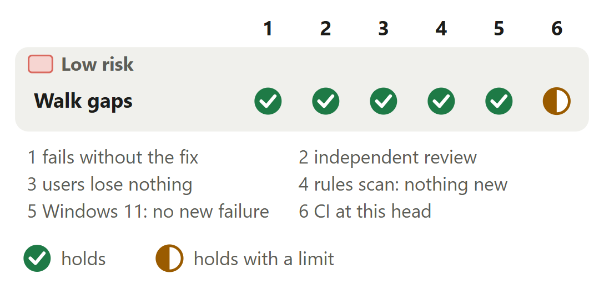

# Places a turn end's walk could not check are recorded and shown

For [pull request #922](https://github.com/neralabs/rerail/pull/922), head ab3865c6c. [report.html](report.html) is the same report as one page: download it and open it.

## 1. The decision

**May each place a turn end's walk could not check go on the session's record once, and show in `sessions_get` and on the dashboard?**

**We recommend:** approve it: nothing is checked less, the agent's answer stays as it is, and a person can now see which parts of a session went unchecked.

| Size | Risk and review | Waits on | Not verified |
|---|---|---|---|
| 3,022 lines in 28 files: 905 ship, 2,117 are tests and text | Careful. It adds to what the session's record and API show. | Nothing. No CI run on GitHub yet: not pushed. | 3 |

## 2. Intent, and the gap

| Change | Intended | Found | Now |
|---|---|---|---|
| A walk's gaps, recorded | A person sees what went unchecked _(docs)_ | Gaps reached no record _(a replayed session)_ | Closes the gap. |

Found in November 2026 on Linux x64, replaying a Claude Code session against a daemon of `main`.

Sources at main, and causes

| Change | Where main states the intent | The cause, and what was measured |
|---|---|---|
| A walk's gaps, recorded | `docs/in-session-surfaces.md` at 88446abff: "Later finds are steered at a later step, and the dashboard timeline says rules had not yet seen shell edits there." `src/runtime/runtime.ts` at 88446abff, line 1306: `await bridge?.checkpoint("turn");`, its answer unread. | `#discoveryResponse` puts the walks' gaps on the value `checkpoint` returns, as one `source-incomplete` failure, and the runtime's one call, at the turn end, does not read it. A walk still running at the boundary takes another route, `onDiscoveryPending`, which records `source-discovery-pending`; a gap had none. |

## 3. Where to look

1. **Read first**, 15 min: `code-rule-bridge.ts`: `#tellGaps`, `#readToldGaps`, `noteRefusal`, `judgeRefusals`, `lookedAgain`, `settleRefusals`, `gaveUpOn`, `holdMissedFiles`. Can a place be told twice, a file being deleted become one, or a lost path let a call go?
2. 10 min: `runtime.ts`, `session-store.ts`, `operations.ts`, `timeline.js`, `sessions-model.js`, `worktree-walks.ts`, `sessions.css`: the record, the API's fields, the timeline's words, another worktree read again.

**Then skim**, 10 min: The tests: stand-ins for `access`, `lstat` and `opendir` that refuse with EPERM, a delete held pending on Windows, and a real daemon through the Claude Code hook.

## 4. Risk against verification

One change, low risk: a new event kind on the session's record; what is checked and told stays as on `main`.

Each half mark's limit

| Change | Check | It holds with this limit |
|---|---|---|
| Walk gaps | CI at this head | No CI run at this head on GitHub yet: the branch is not pushed. CI's lint job passed on Linux x64 at this head; its integration and browser jobs at 7738448f0. |

## 5. The changes

**Unchecked places recorded once**, low risk: An unreadable folder, built hook and daemon: recorded on `main` in 0 of 7 runs, here 10 of 10.

<b>6. The decisions</b>

**Record each place once per session, or at each turn end?**

**We chose** once per place and reason: rows grow with places, not turns, across reopens and restarts. **Would change our mind:** A maintainer who wants how many turn ends met a place: then a small row per turn end, without the text.

| Option | What a user gets | Cost | What it breaks |
|---|---|---|---|
| Once per place and reason in the session **(chosen)** | Each place once, with path and reason, after a reopen and a daemon restart too. | One row per new place; at most 100 a turn end and 1,000 a session. | How many turn ends met a place is not recorded. |
| One row per turn end with the joined text | Every turn end's text. | Rows grow with turns: 400 rows for one unreadable folder over 400 turn ends. | The text varies with the order a walk meets its places, so one place shows many ways. |
| The runtime parses `checkpoint`'s answer | The same places. | Every caller of `checkpoint` repeats the parsing. | The answer holds one joined text, with no parts to read safely. |

**Evidence.** Through a real daemon and the Claude Code hook: ten unchanged places stay ten rows over 20 turn ends, a folder recorded before a daemon restart is not recorded again after it, and a process making and removing files beside 30 turn ends records nothing.

**On Windows, record every EPERM refusal, or look once more first?**

**We chose** look once more at the attributes and lstat: a pending delete refuses the attributes, a denial gives them. **Would change our mind:** A volume or filter driver that refuses a denied path's attributes, or gives those of a path being deleted.

| Option | What a user gets | Cost | What it breaks |
|---|---|---|---|
| Look once more at the attributes, then lstat **(chosen)** | A file being deleted is no place; a denied file is one. | One attributes call and one lstat per EPERM path, at most 100 a walk, none once recorded. | Nothing found. |
| Record every EPERM refusal | Every refusal at once. | None. | A file whose delete is pending, while another program holds it, becomes a false place. |
| Record a refusal only when the next walk meets it again | Fewer false places. | Every denied place reaches the record one turn end later. | A delete held across two turn ends still gives a false place. |

**Evidence.** On Windows 11, from a test token without backup privileges: a file whose delete is pending, classic or POSIX, answers `lstat` and refuses its attributes with EPERM; a denied file answers both. Each call took 5 to 81 microseconds.

**Keep every ended call when a path vanished, or only for an unlisted folder?**

**We chose** one fact that the walk gave up on a path, set wherever it does, a place or not. **Would change our mind:** A case where keeping the calls one walk longer takes another program's write for the session's.

| Option | What a user gets | Cost | What it breaks |
|---|---|---|---|
| One fact that the walk gave up on a path **(chosen)** | A command's write in a folder moved during the walk is checked at the next walk. | Every ended call kept one walk longer after a path vanished. | Nothing found. |
| Read the folders the walk could not list | Calls kept for an unlisted folder only. | None. | A write in a folder moved during the walk goes unchecked, since a path gone is no failed folder. |

**Evidence.** A folder renamed as the walk lists it: the write was never checked at the branch's previous head, and is checked at the next walk at `main` and here, on Linux x64 and Windows 11.

<b>7. How it fits</b>

Nothing has to merge first: it stands on `main` 0a3ce014c, merged in; one conflict, in the bridge's test file, one `lstat` hook kept for both. Trial merges with #909 and #812 are clean; #904 and #883 each conflict in one test file, clean with `main`; #912 shares no file.

**The files it shares.** #904 edits the bridge, `worktree-walks.ts`, `runtime.ts`, a doc and two test files, and conflicts in the bridge's test file, where both change the stand-in for `lstat`. #909 edits the bridge, `worktree-walks.ts` and its test file. #883 conflicts in `api-mcp-caller.test.ts`, where each adds a case. #911 drops the changes of a worktree being removed; here it leaves no place either. #916 starts Git for preimages only for audited edits, code this change leaves alone; its two cases pass here. Any order works; the second to land keeps both sides.

<b>8. What is not covered</b>: 3 not verified, 2 smaller gaps, 4 limits that stay

1. **macOS** never ran.
2. **The dashboard's browser case** reads a record its scenario writes through the store; the record a real walk writes rests on the hook runs.
3. **A whole failure of the walk of the other worktrees** is recorded as one place with no path; no case covers it, since such a failure clears at the next walk.

**Smaller gaps**

- **A whole failure of the shared worktree walk.** It is one place with no path, from the walk's text alone, so on Windows a refused link whose delete is pending would give one false place there. Carrying the error itself through the shared walk would close it.
- **A refused path beside a session's folder inside another worktree.** That session never records it, so the shared read looks at it again at every walk, and past 100 such paths never reaches the ones after. Counting what a session never takes as held would close it.

**Limits that stay**

- A Git listing that ran late is said in the checkpoint's text and not recorded: rules still check those files, against Git's text or whole.
- Past 1,000 places in a session, one more record says the walks met more, and no other place is recorded.
- Only the walks a turn end answers after are recorded: a file the walk at a command's result could not read, readable again by the turn end, is never a place, and its write goes unchecked, as on `main`.
- A file another program renames while a walk runs takes the rename's time, so its write reads as that program's and is not checked, here as on `main`; a renamed folder keeps its files' times.

## 9. What we ask of you

We ask no ruling.

<b>10. Evidence</b>

The description on GitHub is the record: "How you tested it" holds the runs on `main` and here.

| Where | What ran | Result |
|---|---|---|
| Linux x64 and Windows 11 | The built Claude Code hook against a daemon of `main` bf24c778f and of this branch, in homes of their own | `main` recorded the folder in none of 3 runs on Linux x64 and none of 3 on Windows 11; here 3 of 3 and 6 of 6, once each, with its reason; every Stop answered `{}`. At be2cad611 and `main` 2221b5ec9, one run each on Linux x64: once there, nothing at `main`. |
| Linux x64 and Windows 11 | A folder renamed as the walk at a command's result lists it | The write is checked at the next walk at `main` (1 of 1, 2 of 2) and here; the branch's previous head failed 1 of 1 and 2 of 2. |
| Linux x64 | Each new case with its line taken out, at 7738448f0, at ec1db9af4 and at be2cad611 | Each fails: the two moved-folder cases, the refused file's, #865's unlisted folder, another worktree read again, a reopen whose record cannot be read, the browser case's reasons; at ec1db9af4, another worktree's refusals past the first 100 and a session that opens later there, and the session folder's own refusal. At be2cad611, a removed worktree: the merge recorded its path in 2 of 2 cases. |
| Linux x64 and Windows 11 | The bridge's test file, #916's two cases 20 times, and the 47 changed and importing test files, here and at `main` 0a3ce014c | Bridge file: Linux x64 287 passed, 3 skipped; Windows 11 290 passed. #916's cases: 20 of 20 on each. The 47 files, Linux x64 at once: here 1,065 passed, none failed; `main` 1,010 passed, 1 failed at the 5 s limit. Windows 11: at once, here 1,059 passed, 15 failed; `main` 1,002 passed, 17 failed. Each failure passed at both run again at once. |
| Linux x64 | The 177 changed and importing test files, at 7738448f0 and at `main` bf24c778f at once on one machine | At 7738448f0, 3,696 passed, 67 skipped, 3 failed; `main` 3,645 passed, 66 skipped, 4 failed. Each failure there is one `main` has: a 5 s timeout, or a case that fails alone 4 of 20 runs there and 8 of 20 at `main`. |
| Windows 11 | The same files, at 7738448f0 and at `main` bf24c778f in turn on one machine | On Windows 11 the 177 files, at 7738448f0 and at main bf24c778f in turn on one machine: 7738448f0 3,636 passed, 108 skipped, none failed; main 3,584 passed, 108 skipped, 1 failed, a case that passes at 7738448f0. |
| Linux x64 and Windows 11 | A turn end's Stop answer, every folder readable, 12 turn ends a run | Linux x64, 5 runs a side at once: run medians 127 to 146 ms here, 125 to 135 ms at `main`. Windows 11, 20 runs a side alternating: run medians 228 to 353 ms here (median 264), 225 to 592 ms at main (median 268). |
| Linux x64 | CI's lint, integration and browser jobs at 7738448f0 and `main` bf24c778f; lint, the sessions browser cases and the reviewer's rules at this head | Lint and type-check passed at both heads. Integration: 22 files passed, 1 skipped; 92 tests passed, 4 skipped, at each. Browser: 82 passed; here, `e2e/sessions.spec.ts` 16 passed, 15 at `main` 0a3ce014c. Rules at `main` 0a3ce014c: no new finding; 173 functions added or edited, the highest at 6. |

**Sources.** The branch at ab3865c6c and its diff against `main` 0a3ce014c, read on 20 November 2026; runs at ab3865c6c, at be2cad611, at e2d7cabfd, its merge of `main` 2221b5ec9, at ec1db9af4, at 1568b890c and at 7738448f0, on Linux x64 machines and Windows 11 machines.

