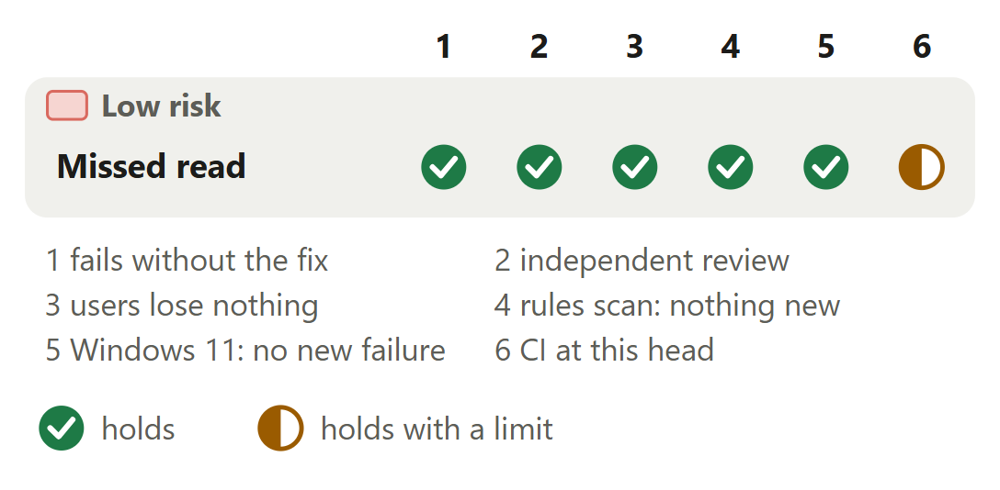

# An unread write is checked at the next walk that reads it

For the pull request of branch `JeanFrancoisGagne/walk-unreadable-own-write`, not opened yet, head 3670fbdb2. [report.html](report.html) is the same report as one page: download it and open it.

## 1. The decision

**Should a walk that could not read a file keep the calls that may have written it, until a walk reads the file?**

**We recommend:** approve it: a walk that could not read a file keeps only the calls that may have written it, and the write is checked at the first walk that reads the file.

| Size | Risk and review | Waits on | Not verified |
|---|---|---|---|
| 674 lines in 5 files: 89 ship, 585 are tests and text | Quick. Two source files, 76 lines added and 13 removed. | Nothing. GitHub's CI runs at 3670fbdb2, with `main` 90075faa3 merged. | 6 |

## 2. Intent, and the gap

| Change | Intended | Found | Now |
|---|---|---|---|
| A write never read | The next walk judges it _(the line's comment)_ | No walk took it _(built hook, five sessions)_ | Closes the gap. |

Found on 19 November 2026 (UTC) in a bridge case of another change, then shown through the built hook on Linux x64 and Windows 11.

Sources at main, and causes

| Change | Where main states the intent | The cause, and what was measured |
|---|---|---|
| A write never read | `src/engine/code-rule/code-rule-bridge.ts` at cf5d520e4, `#finishSessionWalk`: `if (scan.failedRoots.size === 0) discovery.toolCalls.answered(walk.callsEnded)`. | Only a folder the walk could not list held the calls back. A file whose read failed left no stamp, so the walk forgot the command; the next walk found no call over the file's stamp and took the write for another program's. |

## 3. Where to look

1. **Read first**, 4 min: `code-rule-bridge.ts`: `#finishSessionWalk`, `holdMissedFiles`, `missedFiles`, `missedThrough`, `#writtenByCall` and `#auditEdits`. Can a call that may have written a file no walk has read go before a walk reads it?
2. 1 min: `tool-call-windows.ts`: `answered` and `ranDuring`.

**Then skim**, 4 min: Fifteen bridge cases (held writes of commands and edit tools, a file held again, a folder, a later write, a file held for good, Log) and a hook case.

## 4. Risk against verification

One change, low risk: which calls a walk keeps for a file it could not read.

Each half mark's limit

| Change | Check | It holds with this limit |
|---|---|---|
| Missed read | CI at this head | GitHub's CI runs at 3670fbdb2; its result is not in this report. |

## 5. The changes

**Calls kept while reads are missed**, low risk: A held write: `main` cf5d520e4 steered 0 of 5 sessions; this change's first commit 5 of 5.

<b>6. The decisions</b>

**Keep a missed file's calls until a walk reads it, or claim the file?**

**We chose** keep its calls: the walk that reads the file judges the write by its stamp, as for any file. **Would change our mind:** A real program that holds files and moves their times as it lets go, often enough that the stamps miss the command.

| Option | What a user gets | Cost | What it breaks |
|---|---|---|---|
| Keep a missed file's calls until a walk reads it **(chosen)** | The write is checked at the next walk that reads the file; a later write by another program is still that program's. | The calls from the last walk that listed every folder before the first miss to the last walk that missed the file, for its writes alone. | Nothing found; a holder that moves the file's times reads as the writer. |
| Let every call go once each missed file failed the walk before | The write is checked only when the walk right after the first miss reads the file. | Nothing kept. | A command's write that the walk at its result and the next walk both miss is taken for another program's. |
| Claim the unread file for the command | The same write checked. | A set of paths. | Another program's later write is audited as the agent's. |

**Evidence.** With the claim built, the case of a later write by another program fails: that write is audited as the agent's. With every call let go once each missed file failed the walk before, the case of a file two walks miss fails on Linux x64. The chosen form passes both at 3670fbdb2, on Linux x64 and Windows 11.

<b>7. How it fits</b>

Nothing has to merge first: it stands on `main` cf5d520e4. Two waiting changes edit `code-rule-bridge.ts` and its test file; both trial merges are clean.

**The files it shares.** A change that records each place a walk could not check edits the lines above; a change that leaves a file a command is emptying edits `stampOfRead`. Any order works.

<b>8. What is not covered</b>: 6 not verified, 1 limit that stays

1. **The run through the product** (a daemon, the built hook, 5 sessions a side) ran at 41c1dddb9, this change's first commit, before the 0.2.0 engine; the hook case stands for it since.
2. **A write during the walk** that first misses the file has no case: in the case of a command still running as that walk began, the command writes before the walk starts.
3. **The hook case** ran with no mutant; each line this change adds fails a bridge case when taken out alone.
4. **A holder that moves the times** of the file as it lets go makes the write read as that holder's, as at `main` for any such write.
5. **How often** a person's machine holds a file as a command ends was not measured.
6. **macOS** never ran: CI runs unit tests on Linux and Windows, not on macOS.

**Limits that stay**

- On Windows 11 at `main` cf5d520e4, the first session after a daemon start was once not steered at the result about a write with no holder: its command came while the session's rules were still opening, a separate effect.

## 9. What we ask of you

We ask no ruling.

<b>10. Evidence</b>

The description on GitHub is the record: "How you tested it" holds the runs at `main` and here.

| Where | What ran | Result |
|---|---|---|
| Linux x64 and Windows 11 | At 3670fbdb2 and at 05fae1a0f, on one machine per system: the bridge test file, the 13 other test files that import the changed modules, and the hook file | Linux x64: 235 of 235, 213 passed and 1 skipped, 4 passed and 1 skipped at 3670fbdb2; 231 of 231 and the same at 05fae1a0f. Windows 11, each with its own engine: 453 passed and 1 skipped at 3670fbdb2, 448 and 1 at 05fae1a0f with one timing case failed once. |
| Linux x64 and Windows 11 | The 15 new bridge cases, 20 runs at 3670fbdb2; the two cases of the third review, at 05fae1a0f | 20 of 20 passed on each system; at 05fae1a0f both cases fail on each system. |
| Linux x64 and Windows 11 | The three cases of which calls a file keeps that 2ada1a494 added or rewrote, over the code of 8d16bd8c8 and at 719006237 | They fail over the code of 8d16bd8c8 on Linux x64 and pass 20 of 20 runs at 719006237 on each system. |
| Linux x64 and Windows 11 | At 5c9ac6453: the first bridge cases and the hook case, 20 runs, and mutants of its two changed lines | 20 of 20 passed on each system, the hook case also 10 of 10 beside a CPU load on Linux x64; with the sources of `main` cf5d520e4 four bridge cases and the hook case fail; each mutant fails a case. |
| Linux x64 and Windows 11 | On the 0.2.0 engine: the changed modules' test files and the hook file at 8d16bd8c8 and `main` c21947263, and the new cases over the sources of `main` c21947263 | On each system the 15 test files pass at 8d16bd8c8 (415) and at `main` c21947263 (408), the hook file too; over the sources of `main` c21947263 the four bridge cases and the hook case fail. |
| Linux x64 and Windows 11 | A daemon and the built Claude Code hook, a held write, 5 sessions a side: 41c1dddb9, `main` cf5d520e4 and 0.1.5 from npm | Steered and recorded 5 of 5 at 41c1dddb9 on both; 0 of 5 at `main` cf5d520e4 and with 0.1.5, on both. |
| Linux x64 and Windows 11 | The issue's steps as written, with 0.1.5 from npm | The held write lost 3 of 3 times on Linux x64 and 1 of 1 on Windows 11. |
| The maintainers' machine | Their own run on #825, the release candidate (`main` 7efcac9c6) | The bug shows, as on `main` cf5d520e4. |

**Sources.** The branch at 3670fbdb2 (05fae1a0f and four commits for the third review) and its diff against `main` 90075faa3, read on 19 November 2026.

