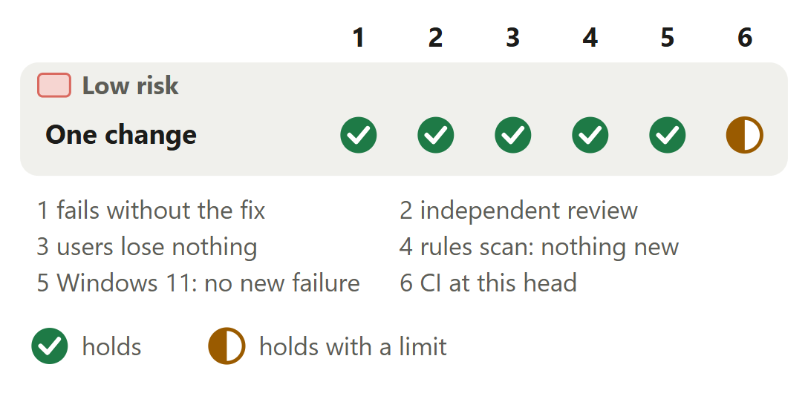

# The merge case records the shell edit once on a loaded machine

For [pull request #943](https://github.com/neralabs/rerail/pull/943), head 5c9e5e247. [report.html](report.html) is the same report as one page: download it and open it.

## 1. The decision

**May the two worktree-walks cases write their shell edit as one change, so no walk reads the file between its two steps?**

**We recommend:** approve it: with the write's two steps held apart by hand, the merge case passes every one of 20 runs where `main` fails every one, and it fails when a merge's write is recorded.

| Size | Risk and review | Waits on | Not verified |
|---|---|---|---|
| 44 lines in 1 file: 0 ship, 44 are the tests it changes, 0 are other tests and text | Fast. Two test cases and one helper, no product code. | Nothing. No CI run on GitHub yet: not pushed. | 1 |

## 2. Intent, and the gap

| Change | Intended | Found | Now |
|---|---|---|---|
| One record per edit | One record of the edit _(case title)_ | The file read empty between _(timed runs)_ | Closes the gap. |

Found on 20 November 2026: `main`'s CI run 44772512810 failed on the merge case at d1650acb4.

Sources at main, and causes

| Change | Where main states the intent | The cause, and what was measured |
|---|---|---|
| One record per edit | `test/engine/code-rule/worktree-walks/worktree-walks.test.ts` at 622a9b11a, the merge case's title. | The case's `writeFile` is two steps, and the case did not keep walks off the file between them. |

## 3. Where to look

1. **Read first**, 3 min: `worktree-walks.test.ts`: `writeAsOneChange` and the merge case. Does holding the worktree's notices while the write runs keep the case's assertions as strong?

**Then skim**, 1 min: The branch switch case and `bothWays` change the same way.

## 4. Risk against verification

One change, low risk: two test cases and a helper; the walks, the notices and the bridge are as they were.

Each half mark's limit

| Change | Check | It holds with this limit |
|---|---|---|
| One change | CI at this head | No CI run at this head on GitHub yet: the branch is not pushed. |

## 5. The changes

**Shell edit written as one change**, low risk: Linux x64, the write held apart by hand: `main` failed every one of 20 runs; here none did.

<b>6. The decisions</b>

**How do the cases keep walks off the file between the write's two steps?**

**We chose** they wait until no walk runs and hold the worktree's notices while the write runs. **Would change our mind:** A maintainer who wants a case of its own for what a walk records of a file read half written.

| Option | What a user gets | Cost | What it breaks |
|---|---|---|---|
| Hold the notices while the write runs **(chosen)** | Each case records the edit once, as it asserts, on any machine. | 35 added and 9 removed lines in one test file. | The notice reaches the walk after the write, not during it. |
| Write a new file and rename it over the old one | A file that is never empty. | A rename in each case. | Another inode and a rename notice: a different edit than the cases describe. |

**Evidence.** On Linux x64, with the write's two steps held apart by hand, `main` failed the merge case in 20 of 20 runs and this head passed 20 of 20; with `stopped: false` in the bridge this head failed 5 of 5.

<b>7. How it fits</b>

Nothing has to merge first: it is one commit on `main` 622a9b11a. It edits `worktree-walks.test.ts`: a helper, `bothWays` and two cases.

<b>8. What is not covered</b>: 1 not verified, 1 limit that stays

1. **macOS** never ran.

**Limits that stay**

- Other cases of the file write a file in a watched worktree the same way; none failed in these runs, so they are left as they are.

## 9. What we ask of you

We ask no ruling.

<b>10. Evidence</b>

The description on GitHub is the record: "How you tested it" holds the runs on `main` and here.

| Where | What ran | Result |
|---|---|---|
| Linux x64 | The merge case with the write's two steps held apart by hand, at `main` 622a9b11a and here | `main`: failed 20 of 20 with CI's message. Here: passed 20 of 20. |
| Linux x64 | The merge case here with `stopped: false` in place of `stoppedSince(read, named)` | Failed 5 of 5 at the assertion after the merge. |
| Linux x64 | The merge case alone and the whole file here, quiet and on one or two CPUs | Alone 20 of 20 and 40 of 40; the file 20 of 20 and 20 of 20. |
| Linux x64 | The merge case and the file at d5f941195, 0a3ce014c and e3b4112ce, quiet and on one or two CPUs | All passed but one whole-file run at d5f941195 on two CPUs: the branch switch case, its edit measured from the empty file. |

**Sources.** The branch at 05f9d954c and its diff against `main` 622a9b11a, read on 20 November 2026; runs at 05f9d954c, at `main` 622a9b11a, e3b4112ce, d5f941195 and 0a3ce014c on three Linux x64 machines.

