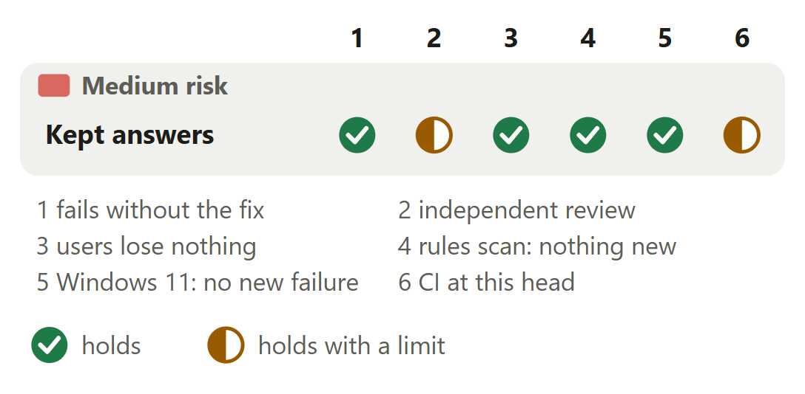

# Walks keep Git's ignore answers per checkout for every session

For [pull request #1104](https://github.com/neralabs/rerail/pull/1104), head 787c515934. [report.html](report.html) is the same report as one page: download it and open it.

## 1. The decision

**May every session's walks of a checkout take the Git ignore answers an earlier walk learnt, until the index, a `.gitignore` or the matcher changes?**

**We recommend:** approve it: each walk then asks the engine about new paths only, and every walk first checks each fact that ends an answer.

| Size | Risk and review | Waits on | Not verified |
|---|---|---|---|
| 751 lines in 7 files: 311 ship, 440 are tests and text | Careful. It decides which files a walk leaves out. | Nothing. CI has not run at this head. | 3 |

## 2. Intent, and the gap

| Change | Intended | Found | Now |
|---|---|---|---|
| A walk's ignore questions | Ask Git's rules about each path _(code comment)_ | Asked again at every walk _(CPU profiles)_ | Closes the gap. |

Found 24 November 2026 in CPU profiles of the daemon on a Windows 11 machine with 17 repositories and about 180 worktrees.

Sources at main, and causes

| Change | Where main states the intent | The cause, and what was measured |
|---|---|---|
| A walk's ignore questions | `src/engine/code-rule/checkout-code-rule-router.ts` at d54013c841, `ignoresPath` (the comment quoted); `walkView` sends each question to `#accepts` and `#ignores` (lines 360 and 361), and `code-rule-enforcer.ts:858` asks `matcher.ignored(path, directory)` at every call. | No answer outlives a walk or passes to another session, and a walk asks a file twice: whether Git ignores it, then whether the checkout's rules read it. Every session's turn end walks its folder and the walk of the other worktrees runs at most every 5 s, so the same questions reach the engine again and again. A test script at `main`: 8,248 questions every later walk of four checkouts, 29 percent of the samples over 20 s. |

## 3. Where to look

1. **Read first**, 8 min: `git-ignore-answers.ts`: `check`, `indexStamp`, `ignored`, `#learnt`, `#folder`, `#stamped`, `#rulesChanged`. Can a fact that changes Git's answer pass a walk's checks unseen?
2. 4 min: `git-ignore-matchers.ts`, `checkout-code-rule-router.ts` and `code-rule-enforcer.ts`: `look` and the walk's questions.

**Then skim**, 4 min: Cases in `git-ignore-answers.test.ts`: the counting cases, then one or more per fact that ends an answer; each fails when its line is taken out.

## 4. Risk against verification

One change, medium risk: start with `check` and `#stamped`, where each fact that ends an answer is read once per walk.

Each half mark's limit

| Change | Check | It holds with this limit |
|---|---|---|
| Kept answers | independent review | Our own review read an earlier form of these lines; each of its findings on them is answered here with a case. No review of this head yet. |
| Kept answers | CI at this head | The repository's CI has not run at this head. The commit hook's checks pass at each commit. |

## 5. The changes

**Ignore answers kept per checkout**, medium risk: Four sessions, four checkouts of 2,080 files: 8,248 engine questions a walk at `main` d54013c841, none after the first here.

<b>6. The decisions</b>

**Keep answers per checkout for all sessions, ask again, ask Git, or keep per session?**

**We chose** per checkout's matcher for every session: one question a path until a fact ends it. **Would change our mind:** A load where a walk's reads of the index and the `.gitignore` files cost more than the questions they save.

| Option | What a user gets | Cost | What it breaks |
|---|---|---|---|
| Keep answers per checkout's matcher, shared by every session **(chosen)** | One engine question a path a checkout, until the index, a `.gitignore` on the way or the matcher changes. | Once per walk, 32 bytes of each checkout's index and each asked folder's `.gitignore`; 89 bytes a kept path. | Nothing `main` answers: every fact the engine reads again is read again first. |
| Ask the engine at every walk, as `main` does | No memory kept. | One or two questions a path a walk a session: 8,248 a walk in the test script. | Nothing. |
| Ask Git itself once per walk | Git's own listing of ignored paths. | A process per walk per checkout, and Git's whole listing where the walk needs only what it meets. | The walk's questions are synchronous; a process does not fit them. |
| Keep answers per session | Repeat walks of one session ask nothing. | Each session learns the checkout again and holds its own copy: with 8 sessions, 8 times the questions and the memory. | Nothing. |

**Evidence.** A test script at `main` d54013c841 and here (787c515934), Linux x64: four sessions sharing the daemon's matchers, a repository and three worktrees of 2,080 files each, 20 s under the CPU profiler. `main` asked 8,248 questions every walk after the first, 29 percent of the samples; here the first session's first walk asked 8,416, every later walk none, and a walk took 33.4 ms where it took 50.8.

**Tell the index apart by Git's checksum, or by its file's identity, size and times?**

**We chose** Git's checksum at its end: any byte changes it, and a touch changes nothing. **Would change our mind:** A file system where reading 32 bytes of the index costs far more than a stat.

| Option | What a user gets | Cost | What it breaks |
|---|---|---|---|
| Git's checksum at the index's end, or its bytes' SHA-256 where Git writes none **(chosen)** | An index with other bytes always ends the answers; one rewritten with the same bytes keeps them. | 0.04 ms a walk for 100,000 entries; 8.4 ms where Git writes no checksum (`index.skipHash`). | Nothing. |
| The file's identity, size and times | One stat a walk. | Answers end at every rewrite, a touch included. | On ext4 a freed inode number goes to the next file at once: two writes of one size in one clock tick look unchanged. |

**Evidence.** The case of an index whose times moved keeps its answers here; the case of an index with no checksum swaps one tracked file for another of the same size and ends them. A stamp by size and times in place of the checksum fails the first, by size alone the second.

**Have the engine read a folder's `.gitignore` again before a walk keeps answers there?**

**We chose** yes: one question about `.git` before the first new answer in each folder; a walk that learns nothing asks nothing. **Would change our mind:** An engine that reads a folder's `.gitignore` at each question, which would make the question needless.

| Option | What a user gets | Cost | What it breaks |
|---|---|---|---|
| Ask about `.git` before the first new answer in each folder **(chosen)** | No kept answer comes from a text the walk did not read. | One more question per folder a walk learns in. | Nothing. |
| Ask once per walk | Fewer questions. | None. | A tool call's question during a walk can leave the engine in a folder whose `.gitignore` then changes, and the old text is kept. |
| Never ask | No question more. | None. | After a tool call's question in a folder, an edit of its `.gitignore` is answered by the old text until another fact. |

**Evidence.** Two cases: a question outside the walks enters a folder before the walk, or during it, and the folder's `.gitignore` then changes. Both pass here; at `main` both answer by the old text, two walks on in the first; asking once per walk fails the second, never asking both.

<b>7. How it fits</b>

It holds `main` 80cfc21dec, by Git's own merge; Git merges it with #1076 and #1095 with no conflict. A change to come for the other worktrees' walk shares `walkView`, #1095, the fix for #581, the rule checker; Git merges each cleanly.

**Shared files and the trial merges.** #1078, the fix for #995, put `sourceRoot` beside this change's look in `walkView`; the merge of `main` keeps both, and #1078's own view for its grouping asks no ignore question. It builds on #1053 and #930, merged: the question whether a checkout's rules read a file still asks whether a `.rerail` run takes it.

<b>8. What is not covered</b>: 3 not verified, 3 smaller gaps, 2 limits that stay

1. **Its own load** A 20-minute load with 190 worktrees, this change beside `main`, run by us on a machine alone, is not in yet; the 35 percent comes from an earlier Rerail's profiles.
2. **macOS** never ran; by reading, answers are keyed by the walk's spelling of a path, so a file renamed in case alone is asked once more.
3. **Linux 30 runs** the changed test file's 30 runs on Linux x64 run on GitHub's runner before the pull request opens.

**Smaller gaps**

- **A change mid-walk.** A change Git or a person makes while a walk runs reaches the next walk; at `main` the same holds for the paths the walk had passed.
- **Rules read with the index.** The root `.gitignore`, `info/exclude` or `core.excludesFile` changed alone reach an earlier session's kept answers when the index next changes, as its matcher does at `main`; a session that takes the matcher after gets a new one.
- **A linked `.gitignore`.** The walk reads a `.gitignore` that is a symbolic link through the link, where Git and the engine do not follow it: a change of its target costs questions, never a stale answer.

**Limits that stay**

- A walk's reads of the index and of each folder's `.gitignore` run on the daemon's thread with no time limit of their own, as the engine's own reads for a question do.
- Where Git writes no checksum (`index.skipHash`, which `feature.manyFiles` turns on), each walk reads and hashes the whole index: 8.4 ms for 100,000 entries.

## 9. What we ask of you

We ask no ruling.

<b>10. Evidence</b>

The description on GitHub is the record: "How you tested it" holds the runs on `main` and here.

| Where | What ran | Result |
|---|---|---|
| Linux x64, load 7 to 8 | A test script: four sessions, a repository and three worktrees of 2,080 files, 20 s profiled, at `main` d54013c841 and here (787c515934) | `main`: 8,248 engine questions every walk after the first, 29 percent of the samples, 50.8 ms a walk. Here: 8,416 in the first session's first walk, none after, 33.4 ms a walk. |
| Linux x64 | The new test file over `main` 70892dfacf's source, and here | 11 of 21 fail over `main`'s source; all 22 pass here, at c765a4a456 and at 787c515934. |
| Linux x64 | 20 one-line mutants at 787c515934: 17 of the deciding lines, 3 of the walk's view lines the merge joined | Each fails a case: the new file's, or for `sourceRoot` #1078's. |
| Linux x64, Windows 11 | The 28 test files importing the changed modules, here and at `main` | Linux x64: 938 passed here, 916 at `main` d54013c841. Windows 11: 942 here, 920 at `main`. None failed; the pack-data file fails at both, since the machines hold no pack test data. |
| Windows 11 | The new test file over `main` 70892dfacf's source, and 30 runs here (787c515934) beside the shared matchers' test files | 11 of 21 fail over `main`'s source, as on Linux x64; 30 of 30 runs pass here. |
| Linux x64 | Memory and cost: 100,000 paths kept; a walk's check of a 100,000-entry index | 8.9 MB of heap after a forced collection, 89 bytes a path; 0.04 ms with Git's checksum, 8.4 ms with none. |

**Sources.** The branch at 787c515934 and its diff against `main` d54013c841, read on 25 November 2026; runs on Linux x64 machines and Windows 11 machines; the 35 percent from CPU profiles of the daemon on a Windows 11 machine with 17 repositories.

