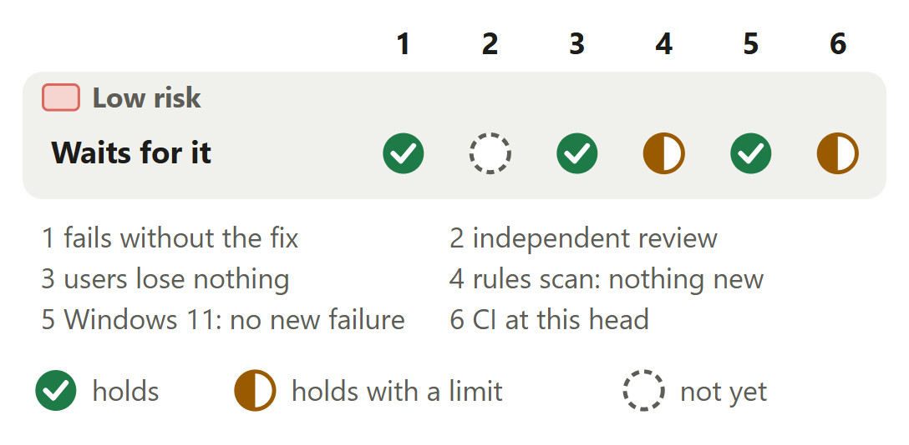

# The notice-after-walk case waits for its record, not a fixed time

For [pull request #969](https://github.com/neralabs/rerail/pull/969), head 624d5676a. [report.html](report.html) is the same report as one page: download it and open it.

## 1. The decision

**May the worktree-walks case for a notice that came after the walk wait for the session's next audit, not 5 s?**

**We recommend:** approve it: with the walk's read held 5.5 s by hand, `main` fails the case in 10 of 10 runs and this head passes 10 of 10; a pump asking for no walk fails it.

| Size | Risk and review | Waits on | Not verified |
|---|---|---|---|
| 7 lines in 1 file: 0 ship, 7 are the tests it changes, 0 are other tests and text | Fast. One test case, no product code. | Nothing. No CI run on GitHub yet: not pushed. | 1 |

## 2. Intent, and the gap

| Change | Intended | Found | Now |
|---|---|---|---|
| Recorded with no event | The record comes unasked _(case title)_ | It came after the wait _(timed runs)_ | Closes the gap. |

Found on 20 November 2026: the case failed on GitHub's Windows runner in a run of a change that does not touch it.

Sources at main, and causes

| Change | Where main states the intent | The cause, and what was measured |
|---|---|---|
| Recorded with no event | `test/engine/code-rule/worktree-walks/worktree-walks.test.ts` at 92fae67d8, the case's title. | The case waited a fixed time for a walk whose start the walks' gap sets. |

## 3. Where to look

1. **Read first**, 2 min: `worktree-walks.test.ts`: the case's wait for the session's next audit. Does the wait for the audit keep the case's assertion as strong?

**Then skim**, 1 min: `nextAudit`, and the two worktree-removed cases that wait the same way.

## 4. Risk against verification

One change, low risk: one test case; the walks, the notices and the pump are as they were.

Each limit, and each check that does not hold yet

| Change | Check | Its limit, or why it does not hold yet |
|---|---|---|
| Waits for it | independent review | No review at this head yet. |
| Waits for it | rules scan: nothing new | No rules review ran: the change is one test case, which the rules do not read. |
| Waits for it | CI at this head | No CI run at this head on GitHub yet: the branch is not pushed. |

## 5. The changes

**The case waits for the record**, low risk: Linux x64, the walk's read held by hand: `main` failed every run; here none did.

<b>6. The decisions</b>

**How does the case wait for the walk the notice pump asks for?**

**We chose** it waits for the session's next audit, within the test's own limit. **Would change our mind:** A maintainer who wants a case of its own that bounds how soon the record comes, with the gap held.

| Option | What a user gets | Cost | What it breaks |
|---|---|---|---|
| Wait for the session's next audit **(chosen)** | The case passes on any machine and asserts the same one record. | 6 added and 1 removed lines in one test file. | A pump that asks for no walk fails it at the 60 s limit, not at once. |
| Wait longer | A case that fails less often. | One number. | Any fixed wait still fails on a machine slow enough. |

**Evidence.** On Linux x64, with the walk's read held 5.5 s by hand, `main` failed the case in 10 of 10 runs and this head passed 10 of 10.

<b>7. How it fits</b>

Nothing has to merge first: one commit on `main` 92fae67d8. It edits one case of `worktree-walks.test.ts`.

<b>8. What is not covered</b>: 1 not verified, 1 limit that stays

1. **macOS** never ran.

**Limits that stay**

- No run at `main` met the failure itself: the slow walk is held by hand.

## 9. What we ask of you

We ask no ruling.

<b>10. Evidence</b>

The description on GitHub is the record: "How you tested it" holds the runs on `main` and here.

| Where | What ran | Result |
|---|---|---|
| Linux x64 | The case with the walk's read held 5.5 s by hand, at `main` 92fae67d8 and here | `main`: failed 10 of 10 with CI's message. Here: passed 10 of 10. |
| Linux x64 | The case here with the notice pump asking for no walk | Failed 3 of 3 at the test's 60 s limit. |
| Linux x64 | The case alone and the whole file at `main`, and the whole file here | `main`: alone 30 of 30, the file 15 of 15. Here: the file 20 of 20, 49 passed in each. |
| Windows 11 | The case alone and the whole file at `main`, without the Backup and Restore privileges and as GitHub's runner runs it, two machines | Alone: 30 of 30 each way on each machine. The file: 15 of 15 each way on each machine. |
| Windows 11 | The whole file here, as GitHub's runner runs it | Passed 15 of 15 runs, 48 passed and 1 skipped in each. |

**Sources.** The branch at 624d5676a and its diff against `main` 92fae67d8, read on 21 November 2026; runs at 624d5676a and at `main` 92fae67d8 on Linux x64 machines and three Windows 11 machines.

