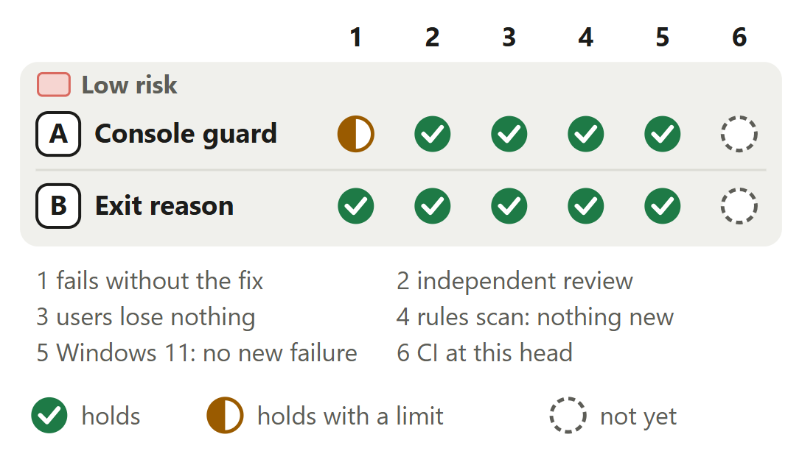

# Tests that fail if the Windows daemon starts with no console

For [pull request #678](https://github.com/neralabs/rerail/pull/678), head b9088adf5. [report.html](report.html) is the same report as one page: download it and open it.

## 1. The decision

**Would these tests fail if any way Rerail starts the daemon gave it no console again, or if a child were started around the helper?**

**We recommend:** approve it once `Unit tests (Windows, 2/2)` passes on a rerun: tests, docs, a comment and two source lines no caller can observe, and each test failed when we put back what it guards.

| Size | Lane | Waits on | Not verified |
|---|---|---|---|
| 263 lines in 5 files: 9 ship, 176 run in every test run, 78 are tests and text | Fast. A code owner or the automated reviewer approves. | A CI rerun. One Windows unit job failed on another file's test. | 4 |

## 2. Intent, and the gap

| Change | Intended | Found | Now |
|---|---|---|---|
| A. The daemon's console | The daemon always has a console _(docs)_ | No test reads the console _(reading main's tests)_ | Closes the gap. |
| A. The start paths | One launch starts every daemon _(docs)_ | 3 of 4 lack an every-OS test _(one run, Linux x64)_ | Closes the gap. |
| B. The exit reason | Says why the process is gone _(code comment)_ | A second ask throws _(test runs, Windows 11)_ | Closes the gap. |

Found on 12 and 13 November 2026, on Windows 11 and Linux x64.

Sources at main, and causes

| Change | Where main states the intent | The cause, and what was measured |
|---|---|---|
| A. The daemon's console | `docs/windows.md` lines 79 and 80: "On Windows the daemon owns a console that has no window, and every console program it starts shares that console. It never starts without a console." Lines 84 and 85: "A child started without \`windowsHide\`, by a library Rerail does not control for example, then shares the hidden console and opens no window either." This pull request rewrites the first sentence: see [part 9](#9-what-we-ask-of-you). | Rerail 0.1.3 started its daemon through the native spawn with `DETACHED_PROCESS` (`native/src/process.rs` at v0.1.3, line 250), which gives a Windows process no console, so each Git it ran opened a window (#507). #503 changed the flag to `CREATE_NO_WINDOW`. Main's launch test (`test/runtime/daemon-control.test.ts` line 810) hands `launchDetached` a stand-in spawn and compares the launch it received. The Rust test at `native/src/process.rs` line 338 compares flag numbers. Neither asks Windows. |
| A. The start paths | `docs/windows.md` lines 90 to 93: "\`launchDetached\` (\`src/runtime/daemon-control.ts\`) is the one way a detached process starts on Windows: the daemon for \`rerail daemon start\`, the \`rerail daemon start\` a session's autostart runs (so the SQLite probe, npm and the managed-version dispatch it runs open no window either), and the replacement a daemon starts near its heap limit (\`relaunchDaemon\`)." | `startDaemon` and `startDaemonForPackage` reach `launchDetached` through `spawnDaemon` (`src/runtime/daemon-control.ts` line 987), and `relaunchDaemon` through `launchDaemonProcess` (line 983). Main tests `launchDetached` itself and `autostartDaemon` (the test file, lines 810 and 861). Its older start test (line 831) gives its stand-in machine both spawns and counts a launch from either, so it passed when each function went through Node's spawn. On Windows, main's `windows-daemon-launch.test.ts` starts a real daemon through `startDaemon` and checks an inherited pipe. No run tried it against Node's spawn. |
| B. The exit reason | `src/runtime/daemon-control.ts` line 895, the comment on `LaunchedDaemon.exitReason`: "Why the launched process is gone, or undefined while it runs." `docs/windows.md` lines 97 and 98 add that the exit code comes from the handle the native module kept, "even once Windows has given its pid to another process". | The native module drops the process and its handle once it has given the exit code (`native/src/process.rs` line 328), and a later read fails: "process {pid} was not started by spawnDetached in this process" (line 315). Line 957 of `daemon-control.ts` reads the handle on every ask. `readyDaemon` (line 1013) stops at the first reason. With main's source the exit-code test fails on Linux x64 (1 run) and on Windows 11 (2 of 2 runs). |

## 3. Where to look

1. **Read first**, 6 min: `console-probe.ts`: `probeScript`, `consoleHostsUnder`, `childOf`. Could the count read `[0, 1]` in a process with no console?
2. **Read first**, 2 min: `daemon-control.ts`: `launchDetached`. Can the kept reason differ from a fresh read?
3. **Read first**, 1 min: `check-owned-builtins.mjs`: the `child-process` comment. Main's rule refuses a child started around the helper in `src`. Only its comment changes: is it true since #503?

**Then skim**, 4 min: `daemon-control.test.ts`: `launchProbe` and the start-path tests. The exit-code stand-in now throws after its code. `docs/windows.md`: [part 9](#9-what-we-ask-of-you) rules on one sentence.

## 4. Risk against verification

Start at check 6: CI has not passed.

Each limit, and each check that does not hold yet

| Change | Check | Its limit, or why it does not hold yet |
|---|---|---|
| A. Console guard | fails without the fix | With this head's `launchDetached` on Node's detached spawn, which gives no console, the probe test fails in 2 of 2 runs on Windows 11: `{ attached: false, consoleHosts: [1, 1] }`. The limit: Rerail 0.1.3 got no console from `DETACHED_PROCESS` in the native spawn, which no run put back. The start-path tests cannot see that flag: their native spawn is a stand-in. |
| A and B | CI at this head | The pull request's 33 checks at b9088adf5, read on 13 November 2026 (CI is run 43507062446): 23 pass, 8 are skipped, 2 fail. The 2 are `Unit tests (Windows, 2/2)` and `CI result`, which reports it. The job failed 1 test, in `claude-status.test.ts`, which this change does not touch, and passed this change's test file, the probe included. Not rerun. |

<b>5. The changes</b>

**A. Console guard tests**, low risk. Start functions a stand-in test holds to the native spawn on every OS: 1 of 4 at main, 4 here.

- **Problem:** If a later change starts the daemon with no console again, each Git it runs opens a window that takes focus, as with Rerail 0.1.3 (#507). At main the first to learn of it is a person at their desktop.
- **Who meets it:** Every person who runs Rerail on Windows, once such a change lands. With 0.1.3 a Windows Terminal window opened every few seconds. Source: #507, which #503 closed.
- **What it does:** `runConsoleProbe` writes a script and has the test start it through `launchDetached`. The script says whether `CONOUT$` opens and starts two Gits, one without `windowsHide` and one with it. `consoleHostsUnder` counts `conhost.exe` under each in one read of the process table. Three tests start the daemon by `startDaemon`, `startDaemonForPackage` and `relaunchDaemon` on a stand-in Windows machine whose Node spawn throws.
- **Risk:** Low. Nothing ships. A wrong probe costs contributors: a test that cannot fail gives false cover, and one that fails at random blocks CI.
- **Check:** Can `[0, 1]` come from a process with no console? There the first Git gets a console host of its own: `[1, 1]` in 2 of 2 runs. Does `childOf` leave out only a host whose parent pid went to a later process? `endProbe` kills a probe 10 s after `done`, and the two Gits end when their input closes. The probe's own `spawn` is test code: the structure check covers `src`. In the test, `launchProbe` calls the real `launchDetached`.
- **Picture:** Of the four functions that start the daemon, a stand-in test that runs on every OS holds 1 to the native spawn at main and 4 with this change. Main's Windows-only launch test starts a real daemon through startDaemon. Tests that start a process as the daemon is started and read its console: none at main, 1 here, on Windows.
- **Method:** each of the four start functions was sent through Node's spawn under this head's tests on Linux x64, one run. The three new start-path tests and main's autostart test failed. Main's launch test, exit-code test and older start test passed. The probe test and main's launch test with a real daemon run on Windows only, so neither ran.

**B. Exit reason kept**, low risk. A second ask after the exit: throws at main, gives the same reason here.

- **Problem:** On Windows, asking a launched process's exit reason again after it has exited throws. No person meets it: `readyDaemon` stops at the first reason. The probe's test asks again when it ends its probe.
- **Who meets it:** No user today. The next caller that asks twice, and this pull request's probe test, whose `endProbe` asks until the probe is gone and once more. Source: a read of `src` at main, and the test runs.
- **What it does:** On Windows `launchDetached` holds the first reason `detachedExitReason` gives in a local, `exited`, and returns it on every later ask (`??=`). While the process runs the reason is undefined, so each ask still reads the handle. The macOS and Linux branch already keeps the reason its exit event gave. Two doc comments say what the handle does.
- **Risk:** Low. Two lines in the daemon launch. `readyDaemon`, the only caller in `src`, stops at the first reason, so no command's output changes.
- **Check:** Does `??=` keep only a reason, never the undefined of a running process? With a native binary built before the module kept a handle, `detachedExitReason` answers `exited` from the pid alone. Once kept, that answer stays if Windows gives the pid to another process, where main would answer undefined again. Is the kept answer the one you want there?
- **Picture:** Of two asks for the exit reason after the process is gone, main answers 1 and throws on the second. This change answers both with the same reason.
- **Method:** the exit-code test's stand-in closes its handle once it has given the code, as the native module does, and is asked three times: once while the process runs and twice after. With main's source the third ask throws, on Linux x64 (1 run) and on Windows 11 (2 of 2 runs).

<b>6. The decisions</b>

**Read what Windows did, or check the request's flags?**

**We chose** a real process read from Windows. **Would change our mind:** a Windows build where the probe passes and a window still opens.

| Option | What a user gets | Cost | What it breaks |
|---|---|---|---|
| A real process, read from Windows **(chosen)** | A failure when the launch gives no console, whatever the code believes. | 172 lines of test support, one PowerShell read of the process table, and 1.1 s on a Windows 11 desktop or 3.8 s on CI's runner. Windows only. | Nothing. It does not run on a fork's pull request, which CI's unit jobs skip. |
| Flags and arguments only, as main does today | Tests on every OS that start nothing. | Nothing. | They check the request, not the result. |
| Start a built daemon and watch the desktop for windows | The thing a person sees. | A tracer of windows and a signed-in desktop. Not built. | Nothing known. |

**Evidence.** With this head's `launchDetached` on Node's detached spawn, which gives no console, the probe test failed in 2 of 2 runs on Windows 11. At this head it passed in 20 of 20. A console host counts under a Git only when it started after it (`childOf`), so a pid Windows gave to another process is not counted. Rerail 0.1.3 got no console from `DETACHED_PROCESS` in the native spawn. No run put that flag back or ran the 0.1.3 package.

**Which two Gits does the probe start?**

**We chose** one without `windowsHide`, one with it: only the first tells the two launches apart. **Would change our mind:** a Windows whose console host is not `conhost.exe`.

| Option | What a user gets | Cost | What it breaks |
|---|---|---|---|
| First Git without `windowsHide`, second with it **(chosen)** | Two signals and a control: `attached`, and the count under the first Git, 0 when it shares the process's console and 1, with a window, when the process has none. | The probe starts one child with Node's own `spawn`, as a library could. Test code may: the structure check covers `src`. | Nothing. |
| Both Gits through the helper | The path Rerail's own children take. | Nothing. | `windowsHide` gives each child a hidden console of its own, so the count reads `[1, 1]` with a daemon console and without one. It could not fail. |
| `attached` alone | A shorter probe. | Nothing. | One signal, and nothing about what a child gets. |

Before: With a start through Node's detached spawn, which gives a process no console as Rerail 0.1.3's native spawn did, the probe has no console, and each of its two Gits has one console host. The Git started without windowsHide gets a console of its own, with a window. After: With main's launch and at this head the probe has a console with no window. The Git started without windowsHide shares it and has no console host. The Git started with windowsHide has one, hidden.

**Evidence.** `[1, 1]` with a start through Node's detached spawn, and `[0, 1]` with main's launch and at this head, each in 2 of 2 runs on Windows 11. Main's launch was measured with the probe's end made to ask once, since main's source throws on the second ask. The description, under "Decisions", draws the two launches.

**Where is the first exit reason kept?**

**We chose** in `launchDetached`: 2 lines, as the macOS and Linux branch does. **Would change our mind:** a second caller of the native `detachedExitCode`.

| Option | What a user gets | Cost | What it breaks |
|---|---|---|---|
| Keep it in `launchDetached` **(chosen)** | The same reason on every ask, as the macOS and Linux branch gives. | 2 lines of TypeScript. | Nothing: `readyDaemon` stops at the first answer. |
| Keep the code in the native module after it closes the handle | The same, for any caller of `detachedExitCode`. | Rust code and a native build for each platform. | Nothing known. |
| Make the test ask once | No source change. | Nothing. | The throw stays for the next caller that asks again after an exit. |

**Evidence.** The exit-code test's stand-in closes its handle as the native module does (`native/src/process.rs`) and is asked three times. It fails on main's source on Linux x64 and on Windows 11, and passes here. In `src` at main, `detachedExitCode` has one caller: the wrapper `launchDetached` reads through.

<b>7. How it fits</b>

Nothing has to merge first: it stands on main at a9101752c. Main has since taken #529 and #659: a trial merge is clean. Our draft #657 conflicts in two import lists.

Pull request #678 is based on main at a9101752c and needs no other change. One change of ours not yet open, in which the helper's children share the daemon's console, is not ready and would come after it. In trial merges it conflicts with the draft #657 in two import lists of one test file, and merges clean with 8 other open pull requests and with main two commits on, at c438bc813.

**Open pull requests that share a file.** Trial merges of b9088adf5, read on 13 November 2026. #657 edits `daemon-control.ts` and its test file. The merge conflicts in the test file's two import lists only, and whichever lands second keeps both lists. The start-path tests have not run on that merge. #650, #652, #656, #672, #673, #676, #677 and the team's #667 each edit one of these files in other lines, and each merge is clean. The description, under "How it fits", has one row per pull request and the head each merge used.

<b>8. What is not covered</b>: 4 not verified, 6 smaller gaps, 6 limits that stay

1. **CI at this head** has not passed: one Windows unit job failed, on another file's test.
2. **One start path has no test:** the `startDaemonForPackage` branch that replaces another package's healthy daemon.
3. **Rerail 0.1.3's own launch** was not put back: `DETACHED_PROCESS` in the native spawn. Node's detached spawn stands in.
4. **macOS** never ran.

**Smaller gaps**

- **A new start path.** A new way to start the daemon that calls none of the four start functions or `launchDetached` is not caught. A row of the `owned-builtins` check that lets only `launchDetached` pass `detached: true` would refuse it in `src` before any test. Not built here.
- **A fork's pull request.** CI's unit jobs skip it, so the probe does not run there. A Windows job without the pack test data that runs `npx vitest run test/runtime/daemon-control.test.ts` would run it. Not built here.
- **The merge with #657.** The start-path tests have not run on it. Whichever lands second keeps both import lists.
- **The other branch of `startDaemonForPackage`.** It calls the same `spawnDaemon` as the tested branch. A test of it needs a stand-in machine with a healthy daemon from another package root. Main's test of that branch starts a real daemon and checks its pid and package root, not its start.
- **Repeated runs on Linux.** This head did not run 20 times there: the four tests of the change that run on Linux use stand-ins and no timing.
- **Our own whole `npm test`** did not run. CI ran it.

**Limits that stay**

- A child that a dependency starts detached, or with a new console, inside the daemon gets no console, or one with a window, whatever the daemon has. The probe covers a child started with neither.
- A console that has a window: the probe reads whether a console exists. The Rust test `starts_the_daemon_with_a_hidden_console_not_without_one` holds the flag.
- Windows from processes Rerail does not start: a coding agent's hook process, the CLI in a terminal, Git hooks, credential helpers. And `spawnShown`, which shows one by design.
- Each Git the helper starts still gets a hidden console host of its own. The control Git measures it (1), and it stays as main designs it.
- A Windows whose console host is not `conhost.exe`: every count reads 0, and the control Git fails the test.
- Main's test "goes through the native spawn on Windows, whose hidden console the daemon's Git and npm share, never Node's detached spawn" keeps its name. It checks the arguments handed to the native spawn, not the sharing.

## 9. What we ask of you

1. **Main's docs say every child of the daemon shares its console; the helper's get their own. Correct the sentence?** We recommend yes, as here: no code changes, and sharing is a later change.

<b>10. Evidence</b>

The description on GitHub is the record: "How you tested it" for the runs and CI, "Decisions" for the options, "What is not covered" for each gap.

| Where | What ran | Result |
|---|---|---|
| CI on GitHub | The pull request's checks at b9088adf5 (CI is run 43507062446), read on 13 November 2026 | 33 checks: 23 pass, 8 are skipped, 2 fail. The 2 are `Unit tests (Windows, 2/2)` and `CI result`, which reports it. That job failed 1 test, in `test/hosts/claude/claude-status.test.ts`, passed 4,255 and skipped 44. It ran this pull request's test file on Windows Server 2025: 47 tests, 2 skipped, none failed, the probe test in 3,775 ms. Not rerun. |
| Windows 11, Node 24.21.0 | `test/runtime/daemon-control.test.ts` at this head, 20 runs in a row, while up to 5 other test runs used the machine | 20 of 20 pass: 45 passed and 2 skipped in each, 8 to 14 s a run. |
| Windows 11, Node 24.21.0 | The 12 test files that this branch changes or that import `daemon-control.ts` or the structure check | 12 files passed: 306 passed, 12 skipped, 0 failed. Against main's results on that machine: no new failure, none flaky, none with another message. The probe test took 1,085 ms. |
| Linux x64 | The same 12 files, 4 workers | 11 files passed, 1 skipped: 316 passed, 2 skipped, 0 failed. |
| Windows 11 | This head with `launchDetached` on Node's detached spawn on Windows too, which gives the process no console: the test file, 2 runs | 2 of 2 runs fail, 7 tests each: the probe test, which reads `{ attached: false, consoleHosts: [1, 1] }`, the three start-path tests, and main's autostart, launch and exit-code tests. |
| Linux x64 | Each of the four start functions sent through Node's spawn, and a value import of `node:child_process` added to `src/engine/git.ts`, the test file and the structure check's test: 1 run | 5 failed, 121 passed, 1 skipped: the three start-path tests, main's autostart test, and the structure check's test (`src/engine/git.ts:2 [child-process]`). |
| Windows 11, Linux x64 | This head with the fix's line taken out (Windows 11, 2 runs), and with main's `daemon-control.ts` (Linux x64, the file, 1 run) | Windows 11: 2 of 2 runs fail, the exit-code test and the probe test, each with "was not started by spawnDetached in this process". Linux x64: 1 failed, the exit-code test, 45 passed, 1 skipped. |
| Linux x64 | The rules scan as the automated reviewer runs it, with rules from main, against the merge base a9101752c | 40 checks, no finding. Every function's complexity number in `daemon-control.ts` is main's. |

**What this report adds to the description**

- **An older native binary keeps `exited`.** A read of the diff. Where the native binary keeps no handle, `detachedExitReason` answers `exited` once no process holds the pid. This head keeps that answer. At main a later ask would answer undefined again if Windows gave the pid to another process. `readyDaemon` stops at the first reason, so no caller sees either. The description does not say it; part 5's card for B asks about it.
- **How Rerail 0.1.3 lost its console.** At v0.1.3 the daemon started through the native spawn, whose `CreateProcessW` call passed `DETACHED_PROCESS` (`native/src/process.rs` line 250). Only the autostart launcher used Node's spawn. The description, the message of bcee02b8b and a comment in `test/runtime/daemon-control.test.ts` say Node's detached spawn started that daemon. Each needs the correction.
- **One ask, and a narrower count.** The description asks for no ruling. Part 9 asks one: the docs sentence on sharing. The description says three of the four start functions fail no test of main. That was measured on Linux x64 against `daemon-control.test.ts` and the structure check's test. Main's Windows-only test of a real daemon was not in that run.
- **Who approves.** The description says a merge needs a code owner's review. The automated reviewer's review of this head gives one reason for not approving: CI was pending. This report's lane tile names both.

**Sources.** The pull request, its diff, its checks and the automated reviewer's review on GitHub, read on 13 November 2026. Rerail at main (c438bc813) for each quoted intent, the same files as at the merge base a9101752c, and at v0.1.3 for that release's launch. Our run records for the runs at this head and for each put-back run. The description for the trial merges.

