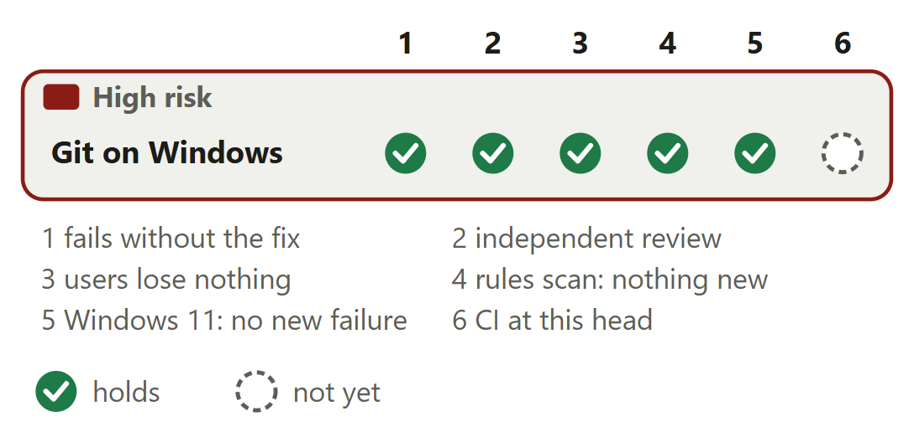

# On Windows: one git.exe per Git call, Git found again after upgrades

For [pull request #801](https://github.com/neralabs/rerail/pull/801), head ba1a8a2a1. [report.html](report.html) is the same report as one page: download it and open it.

## 1. The decision

**Can a Git call whose Git is gone now wait longer, or answer differently, than the same call at `main`?**

**We recommend:** approve it: in the daemon a call waits for its look for another Git and its second start only within its time limit, and a session that starts just after an upgrade is checked again.

| Size | Risk and review | Waits on | Not verified |
|---|---|---|---|
| 2,296 lines in 10 files: 877 ship, 1,419 are tests and text | Careful. A code owner approves: it changes which Git runs. | Nothing. No other pull request needs to merge first. | 4 |

## 2. Intent, and the gap

| Change | Intended | Found | Now |
|---|---|---|---|
| Git behind its launcher | One process per Git call _(code comment)_ | Two `git.exe` on 2.56 _(Windows 11 runs)_ | Closes the gap. |
| The Git kept | One Git kept per process _(code comment)_ | After an upgrade: no checks _(a real daemon)_ | Closes the gap. |

Found in November 2026 on Windows 11 with Git for Windows 2.56.0, in a real daemon with real hooks.

Sources at main, and causes

| Change | Where main states the intent | The cause, and what was measured |
|---|---|---|
| Git behind its launcher | `src/engine/git.ts` at `main`, `gitBehindLauncher`: "The Git program behind Git for Windows' launcher at \`path\`, or \`path\` itself." `GIT_FOR_WINDOWS_BUILDS` lists `mingw64`, `clangarm64` and `mingw32`. | Git for Windows 2.56's x64 build keeps its `git.exe` in `ucrt64\bin` and has no `mingw64`. The look finds no build folder and keeps `cmd\git.exe`, the launcher, which starts the build's `git.exe` as its child. Started bare instead, that `git.exe` with `MSYSTEM` set and no `sh.exe` on `PATH` crashes on any command that runs Git's shell. |
| The Git kept | `src/engine/git.ts` at `main`, line 297, on `gitExecutable`: "The system Git ({@link findGit}), probed once per process". `docs/threat-model.md`, T11: "The daemon finds Git once, from the folder and `PATH` it started with, and keeps it." | `probed` is set at the first ask and never cleared. A start of a path that is gone fails with `ENOENT`, and so does every later one, until the daemon restarts. Through a real daemon on Windows 11, at `main`, each step after the removal steered 0 of 3 rule-breaking writes. |

## 3. Where to look

1. **Read first**, 15 min: `git.ts`: `ProcessGit` (with `livesOn`), `askedInThread`, `startedWithin`, `withinLimits`, `gitStartEnvironment`, `launcherHomes`, `HomeShare`, `prepareDaemonGit`. Can a call whose Git is gone wait past its limit, start a refused Git, or keep a hook alive?
2. 2 min: `daemon.ts`: the call to `prepareDaemonGit` at the daemon's start.

**Then skim**, 10 min: Five test files: `git.test.ts` (ProcessGit with a disk the test holds), `git-disk-thread.test.ts` (the blocking look's handshake), `git-moved.test.ts`, `git-second-look.test.ts` and the Windows-only `git-launcher-environment.test.ts`.

## 4. Risk against verification

Start at the second look in `git.ts`: it decides which program runs while a process lives.

Each limit, and each check that does not hold yet

| Change | Check | Its limit, or why it does not hold yet |
|---|---|---|
| Git on Windows | CI at this head | The pull request is not on GitHub: CI runs when it opens. CI's `Integration tests` job ran on Linux x64 at the head: 22 files passed, 1 skipped, 0 failed. |

## 5. The changes

**Git started without its launcher**, high risk: On Git for Windows 2.56, 2 `git.exe` per Git call at `main`, 1 here.

<b>6. The decisions</b>

**Who looks for another Git, and how long may a call wait?**

**We chose** the daemon alone; the call waits for the look within its time limit. **Would change our mind:** a host where a worker thread cannot start.

| Option | What a user gets | Cost | What it breaks |
|---|---|---|---|
| The daemon alone: a worker thread for blocking calls, the thread pool for others **(chosen)** | The session that starts just after the kept Git is gone is checked: 3 of 3 writes steered on Windows 11. | The daemon's thread sleeps while the worker thread looks: 60 to 330 ms on Windows 11, 20 to 30 ms on Linux, once per blocking call while no Git is found. | With a share that does not answer on `PATH` before the Git found, each blocking call holds the daemon's thread up to its 10 s limit (10,052 and 10,206 ms) and fails, where `main` fails at once. |
| Every process looks the same way | As chosen, in hooks and commands too. | None. | A process cannot end while a question to a silent share is pending: a hook whose Git is removed lives 18 s after its answer, where `main` ends in 9 ms. |
| A blocking call fails as its start did; the look runs for later calls | Later calls run the Git found. | None. | The session's first call finds its repository: it is taken as a folder outside Git, and 0 of 3 writes are steered. |
| A child process for the look in a hook or a command | As chosen. | A process start per look; the look's code is bundled into each entry point, so a child cannot load it alone. | Nothing, but it needs a new entry point in every bundle. |

Before: At main the call starts the kept git.exe, the start finds no program, and that call and every later one fail until the daemon restarts: 0 of 3 writes steered after an upgrade. After: With this change the look runs again by the first look's inputs. Found within the call's time limit, the call runs once more and the Git is kept: 3 of 3 writes steered. Past the limit or once stopped, the call fails as its start did; the look goes on.

**Evidence.** Windows 11, a real daemon and real hooks, Git removed under the daemon, 3 runs each: 0 of 3 writes steered with the previous `git.ts`, 3 of 3 here. With a share that does not answer on `PATH` after the removed Git, each call that does not block ends at its 10 s limit (`main` fails in 2 to 43 ms).

**Does Rerail start Git through the launcher or build the launcher's environment?**

**We chose** the launcher's environment for the build's `git.exe`: one process per call, and a time limit ends the whole Git. **Would change our mind:** a launcher that sets more than `git-wrapper.c` sets today.

| Option | What a user gets | Cost | What it breaks |
|---|---|---|---|
| The build's `git.exe` with the launcher's `MSYSTEM`, `PATH` and `PLINK_PROTOCOL` **(chosen)** | One `git.exe` per call; filters, textconv, aliases, helpers and hooks get the launcher's environment. | An environment built per start and one `stat` off the thread; on a 2.55 layout a call is 1 to 25 ms slower in four runs of 200. | On 2.56 with `MSYSTEM=MINGW64`, 2 of 19 programs Git runs see another commit time than through the launcher. |
| Start through the launcher | The launcher's environment. | Two `git.exe` per call. | A time limit ends the launcher only; on Windows its child runs on in the repository. |
| The build's `git.exe` bare | One process per call. | None. | With `MSYSTEM` set and no `sh.exe` on `PATH` it crashes on any command that runs Git's shell: 6 of 19 calls answer on MinGit 2.55. |

**Evidence.** 19 calls (Git LFS, a filter, a textconv, an alias, a credential helper, hooks, `core.fsmonitor`, `core.sshCommand`, `core.editor`), each against the launcher started by hand, on Windows 11: on 2.56, 17 of 19 answer as through the launcher with `MSYSTEM` unset and with `MINGW64` (`main` 17 and 19; the others differ in a commit's time); on MinGit 2.55, 15 and 16 (`main` 5 and 6).

**Which home's `bin` goes on `PATH`, and which process asks?**

**We chose** the daemon follows the home share's last answer; other processes ask nothing. **Would change our mind:** a hook runner that ends a hook once its answer is written.

| Option | What a user gets | Cost | What it breaks |
|---|---|---|---|
| The daemon follows the last look off its thread; other processes ask nothing **(chosen)** | The launcher's `PATH` in the daemon from its second start. A hook ends when its Git call does, steered: 10,058 to 10,077 ms after its answer with a share that does not answer, `main` 10,051 to 10,263 ms. | One `stat` off the daemon's thread per start when `HOME` is unset. | A hook's or a command's Git has one `bin` more than the launcher's, the profile's, as before this change: a program there is found before the rest of `PATH`. |
| Every process follows the last answer | The launcher's `PATH` from each process's second start. | One `stat` off the thread per start in every process. | A hook that starts Git lives 21.06 to 21.07 s after its answer when the share does not answer: the pending `stat` holds its event loop. |
| Both homes' `bin`, always | Every program the launcher finds. | None. | A program only in the profile's `bin` runs where the person's own Git fails it. |
| A look in Rerail's thread before each start | The launcher's `PATH` at every start. | None on a local disk. | A home share that does not answer freezes the daemon about 21 s per start. |

**Evidence.** On Windows 11, a program only in the profile's `bin`, called through an alias with the share a folder: a hook's Git runs it, the daemon's fails it from its second start, as the launcher does. The case of `prepareDaemonGit` fails with either of its calls taken out. A real daemon whose home share is a folder gives a filter the share's `bin` alone. Real hooks: as in the chosen row.

<b>7. How it fits</b>

Nothing has to merge first: it holds `main` at 9abe89233. No pull request needs it. #674 and #677 share files with it and merge clean in them. #756 has merge conflicts in `git.ts`, resolved in the description.

**Trial merges with our open pull requests.** #674 shares `docs/threat-model.md` and `daemon.ts`, which merge clean; its merge conflicts in two other files come from `main` alone. #677 shares `docs/windows.md`: clean. #756 changes how `git.ts` starts Git: five merge conflicts, each resolved by this change's retry around #756's starts (`runGitWith` calls its `runGitSync`). No order is required.

<b>8. What is not covered</b>: 4 not verified, 2 smaller gaps, 2 limits that stay

1. **macOS** never ran.
2. **A blocking call per removal** behind a silent share holds the daemon's thread up to its 10 s limit each time; `main` fails at once.
3. **A daemon whose home share is silent** steers nothing, at `main` and here alike, for a cause outside this change.
4. **A start that found no program** is taken by the repository lookup as outside Git, at `main` and here.

**Smaller gaps**

- **Two of a daemon's Git starts** are not Rerail's own Git calls and still go through the launcher, once per process each. This change does not touch them.
- **A hook's or a command's Git** with `HOME` unset and a home share other than the profile gets both homes' `bin` on `PATH`, the share's first, as before this change: a program in the profile's `bin` comes before the rest of `PATH`.

**Limits that stay**

- The first look for Git stays synchronous in Rerail's thread, as at `main`: a `PATH` entry on a share that does not answer, before the Git found, holds the first Git call.
- `gitHome` still looks at the home share in Rerail's thread, as at `main`: its own bug report. With Git for Windows its callers reach it only after a Git call that has waited on the same share.

## 9. What we ask of you

1. **May the running daemon look for Git again, as T11 now says?** We recommend yes, by the first look's inputs and checks.

<b>10. Evidence</b>

The description on GitHub is the record. "How you tested it" holds the failing tests, each run and its counts.

| Where | What ran | Result |
|---|---|---|
| Windows 11 | A real daemon and real hooks, a copy of MinGit 2.55 first on `PATH`, upgraded to 2.56's layout under the daemon and then removed, 3 runs, with the previous `git.ts` and this one | Writes steered of 3 once the copy is removed: 0, 0, 0 with the previous `git.ts`; 3, 3, 3 here. Before the removal both give the same counts. |
| Windows 11 and Linux x64 | Real Claude Code hooks that start Git, `HOME` unset and a home share that does not answer, 5 runs a side against `main` on Git for Windows 2.56 and 2.43 | Every hook steered at both. Time from the answer to the end: 2.56, here 10,058 to 10,077 ms, `main` 10,059 to 12,746 ms; 2.43, here 10,058 to 10,074 ms, `main` 10,051 to 10,148 ms and once 27,770 ms. Every process asking the share: 21,061 to 21,073 ms. Usual home 98 to 129 ms here, 104 to 150 ms at `main`. |
| Windows 11 | `HOME` unset and a home share that does not answer; then the kept Git removed with such a share on `PATH` after it; 5 runs a side against `main` | Home share: each first call ends at the 10 s limit at both, later calls answer at both. Git removed: each call that does not block ends at its 10 s limit here (10,005 to 10,378 ms), `main` fails at once. Loop gaps on a quiet machine: 24 to 89 ms at `main`, 21 to 71 ms here. |
| Windows 11 | 19 calls, Git for Windows 2.56 and MinGit 2.55, `MSYSTEM` unset and `MINGW64`, each against the launcher | on 2.56, 17 of 19 answer as through the launcher with `MSYSTEM` unset and with `MINGW64` (`main` 17 and 19; the others differ in a commit's time); on MinGit 2.55, 15 and 16 (`main` 5 and 6) |
| Windows 11 | 200 calls of `main`'s Git module and this one's, alternating, four times | Git for Windows 2.56: 2.00 `git.exe` per call at `main`, 1.00 here; medians 59 to 76 ms against 47 to 61 ms. MinGit 2.55 first: 1.00 at both; 28 to 74 ms against 30 to 99 ms, slower in each run by 1 to 25 ms. |
| Windows 11 and Linux x64 | The new cases over the merge of `main` with the old source, then at the head, then 20 times in a row; and mutations of each new line | Over the merge with the old source: 9 cases fail on Windows 11, 8 on Linux x64. At the head the changed files pass on both; 0 of 20 runs failed. Of 39 one-line changes, 38 fail a case on both. Five more for the home share each fail a case. The case of `prepareDaemonGit` fails 20 of 20 without the follow, and without the look from the checkout. |
| Linux x64 | The rules scan as the automated reviewer runs it, against `main` at f41b8fe6c | No new finding with the published 0.1.5 or with Rerail built from `main`, and none in code this change edits. The highest complexity of a function added or edited is 6, `behindLauncher` (6 at `main`) and `gitForWindowsBuild`; `runRerailDaemon` stays at 4. |

**Sources.** Issue #662. Rerail at `main` (9abe89233) for each quoted intent. Each count names the run it comes from; the trial merges were made on 18 November 2026 with our open pull requests' local heads.

